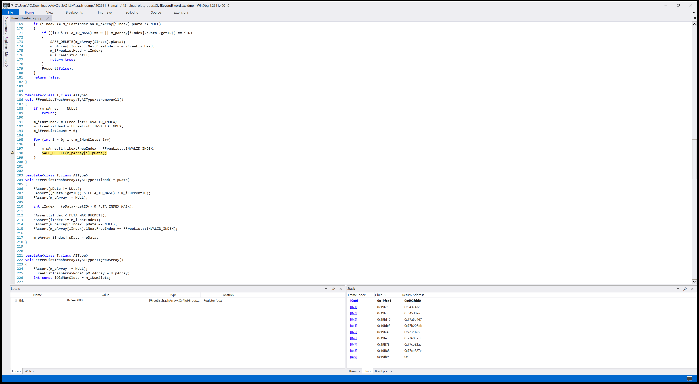
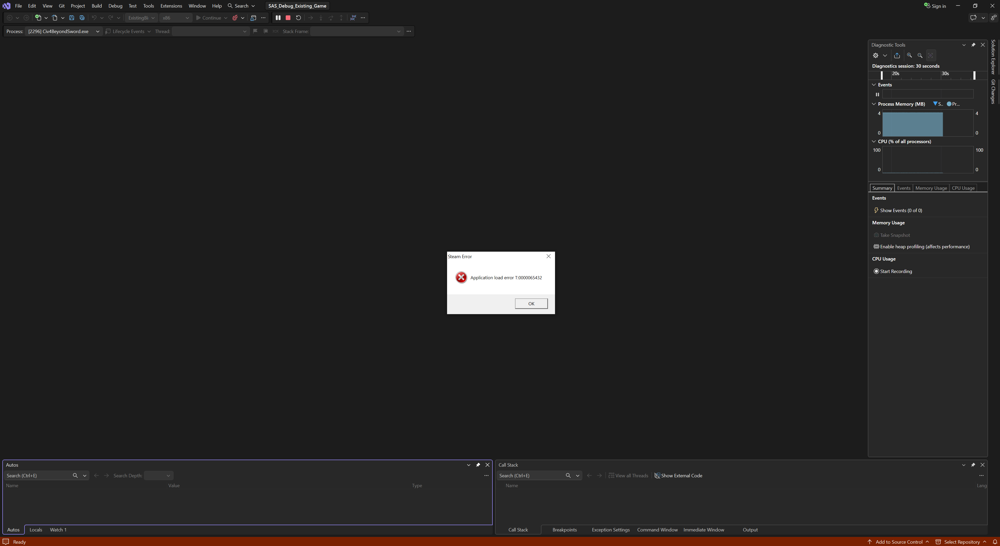
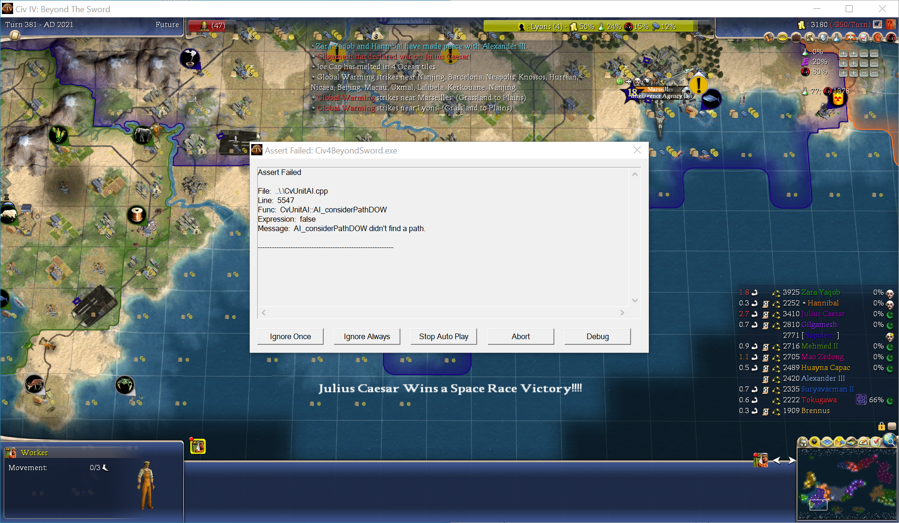

# AdvCiv-SAS DLL Debugging Guide

How to look inside the running game DLL with a debugger: reading crash dumps, attaching to a running Civ4, and what a debugger cannot do on the Steam game. It is written mainly for local agents (Codex, Claude Code), which can run every command here; the Visual Studio steps also suit a person at the screen. External agents such as ChatGPT-5.6-Sol get only the outputs passed on to them.

Building the Debug-opt DLL and its PDB is covered by the [DLL Compilation Guide](/_1_AdvCiv-SAS/Docs/Modding_Resources/README_DLL_Compilation.md); this guide starts once that DLL is installed.

"Debug" means several other things in SAS, none of them covered here: in-game debug mode (Ctrl+Z with the Chipotle cheat), the `Debug-opt` build configuration itself, and the Sevopedia Python dumps in `Docs/Sevopedia/Debug`.

## Menu

- [What works on the Steam game](#what-works-on-the-steam-game)
- [Tools](#tools)
  - [WinDbg and CDB](#windbg-and-cdb)
  - [Visual Studio Community](#visual-studio-community)
- [Retained Debug-opt crash symbols](#retained-debug-opt-crash-symbols)
- [Crash dumps](#crash-dumps)
  - [Inspecting a dump from the command line](#inspecting-a-dump-from-the-command-line)
  - [An example session](#an-example-session)
  - [Taking a full dump](#taking-a-full-dump)
- [Attaching to a running game](#attaching-to-a-running-game)
  - [Start the game first, then attach](#start-the-game-first-then-attach)
  - [A stack snapshot with CDB](#a-stack-snapshot-with-cdb)
  - [Attaching Visual Studio from a script](#attaching-visual-studio-from-a-script)
- [Why breakpoints end the game](#why-breakpoints-end-the-game)
  - [The tests of 2026-11-18](#the-tests-of-2026-11-18)
  - [Checking for hidden threads](#checking-for-hidden-threads)
- [What to use instead](#what-to-use-instead)
- [History of the attempts](#history-of-the-attempts)

## What works on the Steam game

Tested on 2026-11-18 with the Steam `Civ4BeyondSword.exe`, a Debug-opt DLL and its PDB, Visual Studio Community 2026 (18.11.1) and WinDbg's `cdbX86.exe`; see [the tests](#the-tests-of-2026-11-18).

| Task | Works? | Notes |
| --- | --- | --- |
| Read a crash dump with source lines | Yes | The main tool; see [Crash dumps](#crash-dumps). |
| Attach a debugger to a running game | Yes | Visual Studio or CDB, after the game has started. |
| Starting the game from inside Visual Studio | No | Steam stops it with "Application load error T:0000065432". |
| Pause the game and read thread stacks | Yes | A CDB snapshot that detaches with `qd` leaves the game running. |
| Breakpoints on the main thread, which runs the game | No | The game exits when one is hit, without stopping; hardware breakpoints too. |
| Breakpoints on other threads | Yes | Software and hardware; but the DLL's game code runs on the main thread, so they rarely help. |
| Catching a crash in the debugger | No | The crashes tested, on the main thread, gave no debugger stop; run unattached to get Civ4's dump prompt. |

Breakpoints and crash catching fail for one reason: Civ4's main thread, which runs the game loop, `CvGame::update`, turns and Python, is hidden from debuggers. See [Why breakpoints end the game](#why-breakpoints-end-the-game).

## Tools

[`debug_dll.py`](/LLM_Helpers/README.md#debug_dllpy) runs the recipes of this guide in one command each: `list` the Civ4 processes, check a process's `threads` for the hidden flag, take a stack `snapshot` or a full `dump` of a running game, `analyze` a crash dump, or `breaktest` whether a breakpoint stops a game or ends it. The PowerShell blocks below show what it does underneath.

For everything tested so far, only WinDbg is needed: every recipe here, and every command of `debug_dll.py`, runs on its console debugger, CDB. Visual Studio Community is optional, for a person who prefers its window.

- Cases not yet tried, such as stepping through code on an EXE where breakpoints work, like a GOG copy, are expected to work in WinDbg as well, which steps and shows source, but that is not shown.

Agents use CDB: its answers are text, which they read directly, and one command does what Visual Studio needs an automation script or clicks for. Visual Studio was used on 2026-10-20 and in the 2026-11-18 tests, both times driven by script; it suits a person at the screen. WinDbg's window likewise suits a person reading a dump.

Both tools are free. Neither replaces the build toolchain: the DLL is still compiled with VC2003 through VC2010 Express, as in the [DLL Compilation Guide](/_1_AdvCiv-SAS/Docs/Modding_Resources/README_DLL_Compilation.md). The debuggers only read the finished DLL and its PDB.

### WinDbg and CDB

WinDbg is installed from the Microsoft Store (here `Microsoft.WinDbg`, version 1.2611). It is Microsoft's debugger with windows to click through; CDB ("Console Debugger") is the same debugger without the windows, installed alongside it.

- CDB takes its commands as text and prints its answers as text, so an agent can run it from a shell, pass the commands in one go (`-c "~* kb; qd"`) and read the result, where WinDbg would need clicks and screenshots.
- On a running game, end with `qd` (quit and detach): `q`, or closing CDB, also ends Civ4. `q` is for dump files, where nothing is running. Attaching with `-pd` as well detaches rather than ends the game if CDB exits some other way.
- Whatever one does, the other can: the commands in this guide, such as `kb` or `.ecxr`, also work typed into WinDbg's command box.
- WinDbg's window suits a person reading a dump: started as `WinDbgX.exe -z <dump> -y <symbol folder> -c ".ecxr; kb 6"`, it opened the crashing source file at its line, with the locals and stack beside it ([test 18](#the-tests-of-2026-11-18)).



WinDbg on KI#1088's dump, 2026-11-18: `FFreeListTrashArray.cpp` with line 198, `SAFE_DELETE(m_pArray[i].pData)`, marked as the crashing line, the `this` local below and the stack on the right.

- Use its 32-bit build, `cdbX86.exe`, since Civ4 is a 32-bit program:

```powershell
$cdbExe = "$env:LOCALAPPDATA\Microsoft\WindowsApps\cdbX86.exe"
```

WinDbg 1.2610 and later also include an MCP server (Model Context Protocol, the standard way for AI apps to use outside tools), so an AI client can run commands in a WinDbg session; the installed version has it as `DbgX.Mcp.Proxy.exe`. It was not set up here, as of 2026-11-18:

- Microsoft's [announcement](https://devblogs.microsoft.com/performance-diagnostics/introducing-windbg-mcp-debug-with-natural-language-grounded-in-evidence) (2026-10-06) supports VS Code and GitHub Copilot CLI. It names Claude Code as unsupported, working at best with its cross-prompt injection protection turned off, a check meant to stop debugger output from misleading the AI.
- CDB already gives agents the same commands as text, with no setup and no protection to turn off.

Only one debugger can attach to a process at a time, so close WinDbg's own session on the game before CDB attaches, or the reverse.

### Visual Studio Community

Visual Studio Community is free for individual developers; Professional and Enterprise are the paid editions. It was installed on 2026-10-20 from Microsoft's `VisualStudioSetup.exe`, to `C:\Program Files\Microsoft Visual Studio\18\Community`.

- In the installer, tick the **Desktop development with C++** workload and keep its default details. Without it the install is the bare ~1 GB editor with no native C++ debugger; with it, about 12 GB.
  - The user did not know this tick was needed; a ChatGPT-5.6-Sol chat ("Visual Studio Setup Guide", 2026-10-20) pointed it out before the install.
  - Not needed: Visual Studio 2003, an old Windows SDK, "Game development with C++", or extra components such as MFC, ATL, Clang, CMake, ARM or older MSVC toolsets.
  - A missing workload can be added later with **Modify** in the Visual Studio Installer, without reinstalling.
  - No restart is needed unless the installer says "Restart required".
- On its first launch, Visual Studio asks a person to sign in (or skip) and to pick a theme; this is the user's part. The rest, attaching and settings, an agent can do through the automation object below.
  - This follows the ChatGPT-5.6-Sol advice of 2026-10-20; the first launch was not recorded in detail and was not redone on 2026-11-18, when Visual Studio opened with no prompt.
- What is installed can be read without opening the installer; on 2026-11-18 this listed the workloads `Microsoft.VisualStudio.Workload.NativeDesktop` and `Microsoft.VisualStudio.Workload.CoreEditor`, 27 components among them `Microsoft.VisualStudio.Component.VC.Tools.x86.x64`:

```powershell
$vsInstall = & 'C:\Program Files (x86)\Microsoft Visual Studio\Installer\vswhere.exe' -products '*' -include packages -format json -utf8 | ConvertFrom-Json
$vsInstall[0].packages | Where-Object { $_.type -eq 'Workload' } | Select-Object -ExpandProperty id
```

- Do not let Visual Studio convert or build `AdvCiv.sln`; open no project at all, and only attach.
- In **Exception Settings** (Ctrl+Alt+E), Win32 `0xC0000005` (access violation) was already ticked by default. Given the hidden main thread, it did not catch the game's crashes anyway.

## Retained Debug-opt crash symbols

A clean Debug-opt build writes both `CvGameCoreDLL.dll` and its exact matching `CvGameCoreDLL.pdb` under `CvGameCoreDLL/Project/temp_files/Debug-opt`. The linked DLL records that build-time PDB path.

Installing only the DLL in `Assets` while retaining the successful build folder therefore lets automatic WinDbg dump analysis resolve private symbols, source files and line numbers without copying the PDB into `Assets` or manually extending the debugger's symbol path.

- This was confirmed empirically during KI#475.2: after `temp_files/Debug-opt` was removed, a later matching Debug-opt crash report lost the useful source frames despite copying a PDB beside the installed Assets DLL; retaining the freshly rebuilt target restored them.
- Visual Studio finds it the same way: on 2026-11-18, attached with no symbol path set, it bound a breakpoint to `CvGame::update(void)` at its source line straight away.
  - On 2026-10-20 Codex had instead copied a PDB beside the Assets DLL for Visual Studio, because the PDB left in `temp_files` came from another build than the installed DLL; the rule below avoids that mismatch.

Keep the successful `temp_files/Debug-opt` folder while its installed DLL may need crash analysis. The folder is locally Git-ignored because retaining its exact PDB is now the normal Debug-opt workflow.

This is not permission to reuse its `.obj`, `.pch`, dependency or linker files for another accepted Debug-opt build: delete the whole `temp_files/Debug-opt` target before every subsequent Debug-opt compile or retry, then create a fresh DLL/PDB pair. Since 2026-11-11, `build_with_report.ps1` refuses a `BUILD` while `temp_files/<target>` holds any file, so use `REBUILD`, which cleans first.

To preserve symbols beyond the next Debug-opt build, archive the exact DLL/PDB pair outside the repository, with its build report and source commit, and explicitly add that archive directory to the debugger's symbol path when analyzing its matching dump. Its line numbers match the source of that commit, not a branch that has moved on since.

A Release DLL has no such PDB: the Makefile compiles Release without `/Z7` and links it without `/DEBUG`.

A crash in a Release build therefore gives module-relative addresses only, such as `CvGameCoreDLL+0x8ae475` for our DLL and `Civ4BeyondSword+0x5eed5` for the EXE, with no function names; a Debug-opt PDB built later cannot decode it, since it describes a different binary. Reproduce the crash with a Debug-opt build instead.

In CDB, `lmvm CvGameCoreDLL` shows whether the DLL's private symbols loaded and from which PDB path; symbols load on first use, so run it after a `kb`, as before that it shows only `(deferred)` ([test 15](#the-tests-of-2026-11-18)). After fixing the symbol path, `.reload /f CvGameCoreDLL.dll` loads them again.

To check that the installed DLL is the one the PDB belongs to, compare it with the DLL beside the PDB:

```powershell
(Get-FileHash Assets\CvGameCoreDLL.dll).Hash -eq (Get-FileHash CvGameCoreDLL\Project\temp_files\Debug-opt\CvGameCoreDLL.dll).Hash
```

## Crash dumps

With `generatecrashdumps = 1` in `CivilizationIV.ini`, a crash in a game running without a debugger shows Civ4's "Program Execution Problem" prompt, which writes `%LOCALAPPDATA%\Temp\Civ4BeyondSword.exe.dmp`. Since a debugger did not catch the crashes tested, the dump is the reliable way to see where the DLL failed.

Run the game unattached while waiting for a crash: on 2026-10-20, with CDB or Visual Studio attached, the game vanished without the prompt, so no dump was written.

### Inspecting a dump from the command line

The x86 console debugger can inspect Civ4's full-memory dump directly. This PowerShell command was tested from the repository root during the KI#475.2/KI#475.3 investigation; the matching Debug-opt folder resolved the DLL functions and source lines correctly:

```powershell
$cdbExe = "$env:LOCALAPPDATA\Microsoft\WindowsApps\cdbX86.exe"
$dumpFile = "$env:LOCALAPPDATA\Temp\Civ4BeyondSword.exe.dmp"
$symbolDir = (Resolve-Path 'CvGameCoreDLL\Project\temp_files\Debug-opt').Path
& $cdbExe -z $dumpFile -y "$symbolDir;srv*" -c '.ecxr; kb; q'
```

The useful debugger commands are compact:

- `.ecxr` switches to the crashing exception context.
- `kb` prints the symbolic call stack with arguments.
- `.frame N; dv /t` selects a stack frame and shows its typed locals. Debug-opt is optimized, so treat surprising local values as leads rather than authoritative state.
- `dt TypeName address` inspects a typed object, `dd address` displays raw memory and `u FunctionName` disassembles a function when the ordinary stack is insufficient.
- `dds address` lists memory as pointers named by their symbols, and `? expression` evaluates one, such as `? poi(address+14)`; Codex followed a bad pointer this way in KI#475.2's dump on 2026-08-26.
- `dx` reads a variable by name through the symbols, such as `dx CvGameCoreDLL!gGlobals.m_game->m_iElapsedGameTurns` ([test 17](#the-tests-of-2026-11-18)).
- `.reload /f CvGameCoreDLL.dll` forces symbol reloading after correcting the symbol path.
- `!analyze -v` gives WinDbg's own summary of the crash. On 2026-10-20 WinDbg's analysis of a dump also flagged an operation on an already-freed heap block, a lead whose link to that crash was not established.

### An example session

On 2026-11-18 Claude Code Opus 5.5 read KI#1088's saved dump, kept with its own DLL and PDB in `crash_dumps/20261113_small_t148_reload_plotgroups/`. From Windows PowerShell 5.1, with the dump folder as the symbol path:

```powershell
$cdbExe = "$env:LOCALAPPDATA\Microsoft\WindowsApps\cdbX86.exe"
$dumpFolder = 'C:\Users\PC\Downloads\AdvCiv-SAS_LLM\crash_dumps\20261113_small_t148_reload_plotgroups'
& $cdbExe -z "$dumpFolder\Civ4BeyondSword.exe.dmp" -y "$dumpFolder;srv*" -logo dump_analysis.txt -c 'lmvm CvGameCoreDLL; .ecxr; kb 6; !analyze -v; q'
```

It took 3 seconds. `-logo` saved the whole session, 277 lines, kept verbatim as [`cdb_crash_dump_analysis_example.txt`](/_1_AdvCiv-SAS/Docs/examples/debugging/cdb_crash_dump_analysis_example.txt). The part after `.ecxr` reads, verbatim:

```text
CvGameCoreDLL!FFreeListTrashArray<CvPlotGroup,CvPlotGroup>::removeAll+0x45:
0692e475 8b11            mov     edx,dword ptr [ecx]  ds:002b:ffffffff=????????
ChildEBP RetAddr      Args to Child              
0019fce8 0692fdd0     00000000 0d26c408 064374ac CvGameCoreDLL!FFreeListTrashArray<CvPlotGroup,CvPlotGroup>::removeAll+0x45
0019fcf4 064374ac     060a9cc6 0d26c408 00b85a88 CvGameCoreDLL!FFreeListTrashArray<CvPlotGroup,CvPlotGroup>::uninit+0x10
0019fd08 0645d0ea     0000001d 00b85a88 00000000 CvGameCoreDLL!CvPlayer::uninit+0x12c
0019fde0 77a6b467     776a0a48 77604d50 060cfb42 CvGameCoreDLL!CvPlayer::reset+0xa
```

How to read it:

- The first line names the crashing function, and the second the instruction: a read through `ecx`, which held `ffffffff`, so the code followed an invalid pointer.
- The stack below runs from the crash outward: `removeAll`, called by the plot-group list's `uninit`, called by `CvPlayer::uninit` while `CvPlayer::reset` cleared the player, here during a reload.
- `!analyze -v` then adds a summary, from which these lines are verbatim:

```text
EXCEPTION_CODE_STR:  c0000005
FAULTING_SOURCE_LINE_NUMBER:  198
SYMBOL_NAME:  CvGameCoreDLL!FFreeListTrashArray<CvPlotGroup,CvPlotGroup>::removeAll+45
FAILURE_BUCKET_ID:  INVALID_POINTER_READ_c0000005_CvGameCoreDLL.dll!FFreeListTrashArray_CvPlotGroup,CvPlotGroup_::removeAll
```

- `c0000005` is an access violation; line 198 of `FFreeListTrashArray.cpp` is `SAFE_DELETE(m_pArray[i].pData);`, the line WinDbg's window highlights in the screenshot above.
- `lmvm`, run first, printed `CvGameCoreDLL   (deferred)`, as its symbols had not loaded yet; see [Retained Debug-opt crash symbols](#retained-debug-opt-crash-symbols).

### Taking a full dump

At Civ4's "Program Execution Problem" prompt, always choose **Full Dump** (the user's rule, 2026-11-13). A normal dump holds the stack and registers but not the heap, so the objects a crash points at cannot be read.

- Normal is never the better choice for us; it only saves disk space, which is cheap next to a crash that may not come back.
  - On 2026-11-18 two dumps of the same moment of a turn-0 Standard game, taken with CDB, showed the difference ([test 17](#the-tests-of-2026-11-18)): the normal one (`.dump /m`, 0.2 MB) could not even read the DLL's global `gGlobals`, while the full one (`.dump /ma`, 1.27 GB, written in about 3 s) gave the game object and its fields, such as `m_iElapsedGameTurns`.
- On 2026-11-13 an agent chose Normal Dump for a crash in `FFreeListTrashArray<CvPlotGroup>::removeAll` ([KI#1088](/_1_AdvCiv-SAS/Docs/README_Known_Issues.md#ki-1088)): the 22 MB dump gave the stack and the bad pointer, but not the plot-group list or the player it belonged to.
- The prompt's buttons in its 524 x 455 window: Normal Dump at about (90, 416), Full Dump at (258, 416), No Dump at (430, 416). `desktop_windows.py screenshot --pid` captures the prompt itself while it is up, and `click --pid` aims inside it.
- A full dump of a Small game took about a dozen seconds and 1.38 GB, written to `%LOCALAPPDATA%\Temp\Civ4BeyondSword.exe.dmp`; the process stays alive a little after. Check the file size once or twice rather than waiting in a long loop: a loop that started PowerShell on each pass and piped through `tail` showed nothing for minutes on 2026-11-13.
- [`desktop_windows.py dump --pid <pid>`](/LLM_Helpers/README.md#desktop_windowspy) does both steps: it presses Full Dump by its label, with no coordinates or focus, and returns once the file differs from before the press and its writer has let go of it (it opens without shared writing).
  - Added after KI#1088's dump took three tries; it was not tried on a real crash prompt.
  - Every Civ4 writes the same file name, so it checks the process ID the dump records (its MiscInfo stream; read correctly from both KI#1088 dumps) and copies it to `Civ4BeyondSword_<pid>_<time>.dmp` while still holding the original, so another client's crash cannot replace it in between ([KI#1089](/_1_AdvCiv-SAS/Docs/README_Known_Issues.md#ki-1089)).
- Keep each valuable dump with its matching DLL and PDB in `Downloads/AdvCiv-SAS_LLM/crash_dumps/<date>_<what>/`, outside the repository, and write that path in its KI so a grep finds it.

Where dumps go, and what needs cleaning:

- Civ4's prompt always writes `%LOCALAPPDATA%\Temp\Civ4BeyondSword.exe.dmp`, replacing the last one.
- `desktop_windows.py dump` copies it beside the original as `Civ4BeyondSword_<pid>_<time>.dmp`, which stays in `Temp` until deleted or removed by Windows' own cleanup of temporary files.
- `crash_dumps/` under `Downloads/AdvCiv-SAS_LLM/` holds the dumps kept on purpose, each with its DLL and PDB: 3.1 GB on 2026-11-18. Delete a folder there once its KI is closed and its dump no longer needed, through the Recycle Bin.
- A CDB `.dump` writes where it is told: put test dumps in a scratch folder and delete them afterward, as a full dump of a game runs to gigabytes.

`Civ4BeyondSword.exe.dmp` is replaced by a later crash, so preserve a valuable dump before reproducing another one. The dump, installed DLL and PDB must all belong to the same build; source-line information from a different build is not reliable.

## Attaching to a running game

Attaching is useful to see where the game is at a given moment, for example during a hang or while an assertion dialog waits; it cannot stop the game at a chosen line (see [Why breakpoints end the game](#why-breakpoints-end-the-game)).

### Start the game first, then attach

Start Civ4 the usual way (the SAS shortcut, [`start_game.py`](/LLM_Helpers/README.md#start_gamepy) or [`run_autoplay.py`](/LLM_Helpers/README.md#run_autoplaypy)), wait for the main menu or the game, then attach.

Pick the game by its process ID, since several Civ4 clients may run at once, the user's among them; the command line shows each one's mod. The recipes below take `$targetPid`:

```powershell
Get-CimInstance Win32_Process -Filter "Name='Civ4BeyondSword.exe'" | Select-Object ProcessId, CreationDate, CommandLine
$targetPid = 12345  # the one to debug
```

Starting `Civ4BeyondSword.exe mod=\AdvCiv-SAS` from inside Visual Studio does not work: on 2026-10-20 Steam stopped it before SAS loaded.



What not to do, from 2026-10-20: Visual Studio with Civ4 started under its debugger, showing Steam's "Application load error T:0000065432". Its bottom tabs hold the Call Stack, Breakpoints, Exception Settings and Output panes used when attached.

The launch-only project Codex made for that attempt, in `Downloads/SAS_VisualStudio_Debug/`, leads to this error; attach instead. Its launch profile in the mod folder, `.vs/launch.vs.json`, was sent to the Recycle Bin on 2026-11-18 with the rest of that `.vs` folder.

In Visual Studio by hand: **Debug → Attach to Process** (Ctrl+Alt+P), pick `Civ4BeyondSword.exe`, with **Attach to: Native code**.

### A stack snapshot with CDB

This attaches, prints the main thread's stack (thread 0) and detaches with `qd`, so the game keeps running. Tested on 2026-11-18 on a turn-0 game: it took one second and the game stayed responsive.

```powershell
$cdbExe = "$env:LOCALAPPDATA\Microsoft\WindowsApps\cdbX86.exe"
& $cdbExe -pd -p $targetPid -logo "$env:TEMP\civ4_stack_$targetPid.txt" -c "~0 kb 12; qd"
```

- A 2026-11-18 session, 202 lines, is kept verbatim as [`cdb_live_stack_snapshot_example.txt`](/_1_AdvCiv-SAS/Docs/examples/debugging/cdb_live_stack_snapshot_example.txt). Most of it is CDB listing the modules it loads; the stack starts after the `0:033> ~0 kb 12; qd` line, `033` being CDB's own break-in thread.
- How far CDB can walk the main thread depends on where it is caught: five snapshots of one turn-0 game, a second or two apart, gave 2 to 11 frames, ending in "Could not fetch any stack frames" when the walk reached EXE code without unwind information. Take a few rather than trust one.
- `~* kb` prints every thread instead of the main one, and `.ecxr` does not apply here, as nothing has crashed.
- End a CDB session with `qd` (quit and detach): quitting with `q`, or stopping the CDB process, also ends Civ4, which happened on 2026-11-18. `-pd` detaches instead if CDB exits another way: with it, even `q` left the game running ([test 16](#the-tests-of-2026-11-18)).
- For a hang, one snapshot is only a first clue: take two `~* kb` snapshots a few seconds apart and compare them, as a thread stuck in the same frames is the likely culprit. This recipe was not tried on a real hang.
  - `.dump /ma <file>` before `qd` saves a full dump of the running game for later reading (121 MB in a second at the main menu, test 16), but it holds no crash, so start from the thread stacks rather than `.ecxr`.
- The main thread's frames are mostly in the EXE, which has no symbols, so expect `Civ4BeyondSword+0x...` frames; DLL frames show with names and lines when the game is in DLL code at that moment.
- On 2026-10-20 Codex used the same attach to read the text and stack of open SAS assertion dialogs, without the user copying them.

### Attaching Visual Studio from a script

Visual Studio can be driven from PowerShell through its automation object, so an agent can attach it without clicks. Start Visual Studio first (`devenv.exe`, with no solution); `VisualStudio.DTE.18.0` is Visual Studio 2026's name, 17.0 for 2022.

Codex wrote this on 2026-10-20 (kept in `Downloads/SAS_VisualStudio_Debug/attach_running_sas.ps1`, which takes the first Civ4 it finds), and it attached in under a second on 2026-11-18.

Run it in Windows PowerShell 5.1 (`powershell.exe`): `Marshal.GetActiveObject` is missing from PowerShell 7 (`pwsh`), as Codex found in its own default shell on 2026-11-18.

```powershell
$vs = [Runtime.InteropServices.Marshal]::GetActiveObject("VisualStudio.DTE.18.0")
if ([int]$vs.Debugger.CurrentMode -ne 1) { throw "Visual Studio is already debugging" }
$vsTarget = @($vs.Debugger.LocalProcesses | Where-Object { [int]$_.ProcessID -eq $targetPid })
if ($vsTarget.Count -ne 1) { throw "Civ4 process $targetPid not found in Visual Studio's process list" }
$vsTarget[0].Attach()
```

- `CurrentMode` is 1 when not debugging, 2 when paused and 3 when running. `$vs.Debugger.Break($true)` pauses the game, `$vs.Debugger.Go($false)` resumes it, and `$vs.Debugger.CurrentThread.StackFrames` lists the paused thread's frames.
- Add no breakpoints: `$vs.Debugger.Breakpoints.Add("CvGame::update")` binds fine but ends the game when it is hit.
- On 2026-11-18, a pause followed by resuming left the game running; a second pause, in which every thread's stack was read, was followed by the game exiting on resume. One observation each, so the cause is not established; CDB's snapshot is the safer way to read stacks.
- `$vs.Debugger.DetachAll()` detaches when done. Whether the game survives a Visual Studio detach was not established: in the 2026-11-18 test that detached, a breakpoint had already ended the game.

## Why breakpoints end the game

Civ4's main thread is hidden from debuggers (Windows' `ThreadHideFromDebugger` flag). An exception on a hidden thread is never reported to a debugger, so:

- a breakpoint's `int 3` on that thread counts as an unhandled exception and Windows ends the process, without the debugger stopping; a hardware breakpoint there does the same;
- a crash on it is not reported to the debugger either; the attached crashes of 2026-10-20 also showed no dump prompt;
- pausing still works, because a debugger pauses through a new thread of its own;
- breakpoints on Civ4's other threads, which are not hidden, stop normally.

The game loop, `CvGame::update`, `CvGame::doTurn` and the Python callbacks all run on the main thread, so in practice the DLL's game code cannot be stopped at. The other threads run audio, drivers and the EXE's own workers; Codex's samples of them on 2026-11-18 showed no ordinary DLL calls.

The debugger does not always tell when the game has gone: when Codex's main-thread breakpoints ended the game, CDB printed nothing and kept running. Check the game itself, such as `Get-Process -Id <pid>`, rather than the debugger's silence.

The flag is set inside the game process before any debugger attaches. For the game's EXE itself, its builds and what is known of this flag's origin, see the [EXE patches guide](/_1_AdvCiv-SAS/Docs/Modding_Resources/README_EXE_Patches.md#steam-and-gog-exes).

Another build of the game, such as a GOG or CD/DVD copy, may behave differently. This was not tested: only the Steam game was on hand on 2026-11-18.

If one is tried, run the [hidden-thread check](#checking-for-hidden-threads) on it first, then `python LLM_Helpers/dll_builds/debug_dll.py breaktest --pid <its process ID> --function CvGameCoreDLL!CvGame::update` on a throwaway game: on the Steam EXE it reports the game exiting with `0x4000001F`, and a STOPPED there would mean breakpoints work on that EXE.

### The tests of 2026-11-18

Each on a fresh turn-0 Duel game from `start_game.py --world-size WORLDSIZE_DUEL`, with Visual Studio attached through the script above unless noted. The scripts and logs are kept in `Downloads/AdvCiv-SAS_LLM/debugger_trials/claude_20261118/`, whose `README.txt` maps them to the test numbers:

| # | Test | Result |
| --- | --- | --- |
| 1 | Breakpoint on `CvGame::update` by name | No stop within 15 s; the game was gone when Visual Studio detached. |
| 2 | Pause, line breakpoint at `CvGame.cpp` line 3157, resume | Bound to `CvGame::update(void)` line 3158; game exited at once, no stop. |
| 3 | Pause and resume, no breakpoint | Game ran on for 10 s and more. |
| 4 | Breakpoint on `CvGame::update` added while running | Game gone within 1.5 s, no stop. |
| 5 | CDB hardware breakpoint `ba e1 CvGameCoreDLL!CvGame::update`, set from CDB's own break-in thread | No stop within 20 s; the game was alive and responding afterward. Why it did not stop was not established; Codex's test 12, set after switching to the main thread, ended the game. |
| 6 | Breakpoint on `CvGame::doTurn`, which does not run at turn 0 | Game ran on for 15 s. |
| 7 | Query each thread's `ThreadHideFromDebugger` flag | 36 threads; only the main (oldest) one hidden. |
| 8 | CDB snapshot `~0 kb 12; qd` | Main thread's stack printed; game kept running. |
| 9 | Test 7 at the main menu, after a plain launch (`Civ4BeyondSword.exe mod=\AdvCiv-SAS`, no `start_game.py` INI) | Main thread hidden there too, so neither the moment of attaching nor the launch method matters. |

Codex then tested independently with CDB, the same day; its commands, scripts and logs are in `Downloads/AdvCiv-SAS_LLM/debugger_trials/codex_20261118/` (`findings.md`):

| # | Test | Result |
| --- | --- | --- |
| 10 | Software breakpoint on an EXE worker thread: `bp /1 00695dc3`, an address seen in a worker's stack (`Civ4BeyondSword+0x295dc3`, back from a 25 ms `WaitForSingleObject`) | Stopped; `r eip` showed `00695dc3`, and `qd` left the game running. |
| 11 | Hardware breakpoint at the same address, `ba e1 00695dc3` | Stopped and printed the stack. |
| 12 | In that session, `bc *; ~0s; ba e1 CvGameCoreDLL!CvGame::update; g`, set after switching to the main thread | No stop; within 2 s the game had exited with `0x4000001E` (`STATUS_WX86_SINGLE_STEP`), while CDB kept running and printed nothing. |
| 13 | Software breakpoint `bp /1 CvGameCoreDLL!CvGame::update` on a fresh game, its main thread checked hidden first | No stop; game exited within 2 s with `0x4000001F` (`STATUS_WX86_BREAKPOINT`). |
| 14 | A breakpoint in a pure DLL helper, `getSASElapsedMilliseconds`, reached by `.call CvGameCoreDLL!getSASElapsedMilliseconds(100,105)` from an unhidden audio thread (`~7s`) | Stopped, with its arguments read from the PDB, and returned 5. Detaching then reported `SetContext failed 0x800703E6`, and the game needed a forced close afterward. |

- Tests 1, 2, 4 and 6 together show that writing a breakpoint is harmless and hitting it ends the game; test 7 shows why.
- Tests 10 to 13 narrow it to the main thread: breakpoints of both kinds stop on an ordinary thread and end the game on the main one.
- Test 14 only shows that breakpoints and symbols work in the DLL itself, on a thread that is not hidden. The function was called by the debugger, not by the game, and the game was left unstable, so it is not a way to debug gameplay.
- `00695dc3` belongs to this Steam EXE; another EXE build has other addresses.

How one test led to the next (Claude Code Opus 5.5's run):

1. Test 1 was meant to confirm that the October setup worked: attach, break in `CvGame::update`, which runs every frame. Nothing stopped, so the first suspicion was a breakpoint that never bound, as with missing symbols.
2. Test 2 checked that: the breakpoint bound to the right source line, so symbols were fine, yet the game exited. Pausing had worked, so test 3 resumed with no breakpoint at all; the game ran on, so pausing and resuming were not the problem.
3. That left the breakpoint itself. Test 4 confirmed the exit, and the CDB hardware breakpoint of test 5, which writes nothing into the code, was tried in case the game checked its code for changes.
4. Test 6 separated writing from hitting: a breakpoint on code not running at turn 0 was harmless, so the game ends only when one is hit, which pointed to an exception the debugger never receives.
5. A thread hidden from debuggers fits that, so test 7 queried the flag, and the main thread had it. Test 8 then checked what still works, and test 9, on the user's question whether the launch method or the moment of attaching mattered, found the flag at the main menu after a plain launch too.

Dumps and WinDbg's window were checked afterward, on the user's questions of what had really been run and whether a normal dump is ever enough:

| # | Test | Result |
| --- | --- | --- |
| 15 | The KI#1088 dump (`crash_dumps/20261113_small_t148_reload_plotgroups`, its own DLL and PDB): `-c "lmvm CvGameCoreDLL; .ecxr; kb 6; !analyze -v; q"` | 3 s. Stack in `FFreeListTrashArray<CvPlotGroup>::removeAll` with names; `!analyze -v` gave `ffreelisttrasharray.cpp` line 198. `lmvm` run first showed only `(deferred)`, as symbols load on first use; run it after `kb` or `.reload /f`. |
| 16 | `-pd -p <pid> -c ".dump /ma <file>; q"` at the main menu | 1 s, a 121 MB dump that CDB read back; with `-pd`, even `q` detached, and the game kept running. |
| 17 | A turn-0 Standard game: `.dump /m` then `.dump /ma`, then `dx CvGameCoreDLL!gGlobals.m_game->m_iElapsedGameTurns` on each | Normal, 0.2 MB: "Unable to read memory" even for `gGlobals`. Full, 1.27 GB: `m_game` and its fields read. Both written in 3 s, game kept running. `.dump /m` is CDB's own minimal dump; Civ4's Normal Dump keeps more, 22 MB for KI#1088's crash, but still no heap. |
| 18 | WinDbg's window, `WinDbgX.exe -z` on test 15's dump with `-c ".ecxr; kb 6"` | Opened `ffreelisttrasharray.cpp` at line 198, highlighted, with Locals and Stack panes; screenshot above. |

Every Civ4 process whose threads were checked that day had its main thread hidden: two by Claude Code, in game and at the main menu, and one by Codex. Each Civ4 client is a process of its own with its own main thread, so running several clients does not get around it.

Not tried by the agents: attaching through Visual Studio's menu by hand rather than the script, the hang recipe on a real hang, and the GOG EXE.

The exit code Visual Studio recorded on 2026-10-20, `0x4000001F`, is the status of a 32-bit breakpoint under 64-bit Windows (`STATUS_WX86_BREAKPOINT`), which fits a breakpoint the debugger never received.

### Checking for hidden threads

This reports each of a Civ4's threads as hidden, not hidden or unknown; no debugger is needed. On a later EXE, or another release of the game, run it before trusting this guide's conclusion, and conclude that no thread is hidden only when every query succeeded:

```powershell
Add-Type @"
using System;
using System.Runtime.InteropServices;
public static class SasThreadQuery {
    [DllImport("kernel32.dll")] public static extern IntPtr OpenThread(int access, bool inherit, int threadId);
    [DllImport("kernel32.dll")] public static extern bool CloseHandle(IntPtr handle);
    [DllImport("ntdll.dll")] public static extern int NtQueryInformationThread(IntPtr handle, int infoClass, out byte info, int length, out int returned);
}
"@
$civ4 = Get-Process -Id $targetPid -ErrorAction Stop
foreach ($civ4Thread in $civ4.Threads) {
    $threadHandle = [SasThreadQuery]::OpenThread(0x0040, $false, $civ4Thread.Id)
    if ($threadHandle -eq [IntPtr]::Zero) { "thread $($civ4Thread.Id): UNKNOWN (cannot open)"; continue }
    $hiddenFlag = 0; $returned = 0
    $status = [SasThreadQuery]::NtQueryInformationThread($threadHandle, 0x11, [ref]$hiddenFlag, 1, [ref]$returned)
    [void][SasThreadQuery]::CloseHandle($threadHandle)
    if ($status -ne 0) { "thread $($civ4Thread.Id): UNKNOWN (status 0x{0:X8})" -f $status }
    else { "thread $($civ4Thread.Id), started $($civ4Thread.StartTime): " + $(if ($hiddenFlag -ne 0) { "HIDDEN" } else { "not hidden" }) }
}
```

`0x0040` is `THREAD_QUERY_INFORMATION` and `0x11` the `ThreadHideFromDebugger` information class, which Windows answers since Windows 8.1.

## What to use instead

- **Crash dumps** for crashes: a Full Dump with the matching PDB gives the crashing line, the stack and the heap; see [Crash dumps](#crash-dumps).
- **Probes in the DLL** where a breakpoint would go: a temporary pre-gated log line, or a check that writes the values in question, built into a Debug-opt DLL. On 2026-11-16, tracing KI#1082.2 after CDB's breakpoints never fired, a DLL probe gave the answer instead.
- **SAS assertions** in an assertion-enabled build, which name the failed condition, file, function and line; read `SASAssertions_*.log` as in the [Logging Inventory](/_1_AdvCiv-SAS/Docs/Modding_Resources/README_Logging_Inventory.md#sas-assertion-diagnostics).
  - Choose Ignore Once or Ignore Always, not **Debug**: Debug stops through a breakpoint on the main thread, so it can be expected to end the game. This was not tried.



An assertion dialog during an autoplay on 2026-10-20 (`CvUnitAI::AI_considerPathDOW`), with its Ignore Once, Ignore Always, Stop Auto Play, Abort and Debug buttons.

- **Python errors from DLL wrappers**: an access violation inside a `Cy*.cpp` wrapper called from Python showed as `RuntimeError: unidentifiable C++ exception` in `PythonErr.log`, with no crash and no dump ([KI#1091](/_1_AdvCiv-SAS/Docs/README_Known_Issues.md#ki-1091)).
  - The explanation noted on 2026-11-17: VC2003's `catch (...)` also catches such structured exceptions, so Boost.Python's handler turns the access violation into that error.
  - That day an in-game Python probe stood in for a debugger.
- **Stack snapshots** for hangs: [A stack snapshot with CDB](#a-stack-snapshot-with-cdb).
- **An assertion as a stopping point**: while an assertion dialog waits, the main thread is held inside the failing check, so a full live dump taken then (`-pd -p <pid> -c ".dump /ma <file>; qd"`) records the game's whole state at that line, without a breakpoint. A temporary `FAssert` placed where a breakpoint would go, in an assertion-enabled build, makes such a stop on purpose.
  - The dialog waits only with `SAS_ASSERT_SILENT_ACTION=0` and Civ4 restarted, as the setting is read once: the usual local value, `1`, continues past each assertion on its own ([SAS assertion diagnostics](/_1_AdvCiv-SAS/Docs/Modding_Resources/README_Logging_Inventory.md#sas-assertion-diagnostics)).
  - Codex read the stacks of waiting assertion dialogs this way on 2026-10-20; the full dump at an assertion was not tried.
- **The EXE's own frames**: stacks and dumps show the EXE only as `Civ4BeyondSword+0x...`, as it has no symbols. For the EXE itself, see the [EXE patches guide](/_1_AdvCiv-SAS/Docs/Modding_Resources/README_EXE_Patches.md).

## History of the attempts

- **2026-01-25**: asked about debugging, Codex gave the usual advice: build a Debug DLL, attach Visual Studio 2010 Express to `Civ4BeyondSword.exe` and set breakpoints. It was not tried then.
- **2026-08-26, CDB**: during KI#475.2, Codex first read a crash dump with `cdbX86.exe` and the Debug-opt PDB, the start of the dump workflow above.
- **2026-10-20, CDB**: chasing a reload crash, Codex attached CDB to the running game with `sxe av` (stop on access violations). The game crashed with no dump prompt, and CDB recorded the process exiting with `c0000005` instead of stopping, so `.ecxr` had nothing to show. Breakpoints on process termination, added next, did not stop it either.
- **2026-10-20, Visual Studio**: the user installed Visual Studio Community with the C++ workload. Starting Civ4 from Visual Studio hit Steam's load error; starting it from the shortcut and attaching worked, with the DLL's symbols loaded. The game ran to T415, then exited on its own with `0x4000001F` and no stack.
  - Codex's notes from these runs are in `Downloads/SAS_live_debug_55184/`, `Downloads/SAS_VS_failure_59104_20261020/` and `Downloads/SAS_SGR_off_failure_15156_20261021_072145/`; the crash dumps it read that day are the `Downloads/crash_*.txt` and `Downloads/SAS_crash_*_20261020_*/dump_analysis.txt` files.
- **2026-11-16, CDB**: tracing KI#1082.2, `cdbX86.exe` attached to the game, but its breakpoints never fired, and the game closed when the session ended. A DLL probe answered the question instead.
- **2026-11-18**: Claude Code Opus 5.5's [tests](#the-tests-of-2026-11-18) found the hidden main thread, which explains all three.
  - Codex (GPT-6.1-Sol)'s own trials then showed that other threads stop normally, and that a hardware breakpoint on the main thread ends the game too.

Other modders met the same wall; a web search on 2026-11-18 found it on CivFanatics, with no cause found there:

- [Crashing at breakpoint (VS08)](https://forums.civfanatics.com/threads/crashing-at-breakpoint-vs08.360313) (2010, BtS 3.19 on Steam): Civ4 crashed at a breakpoint instead of stopping in the debugger.
- [Debugging the DLL for a Steam installation?](https://forums.civfanatics.com/threads/debugging-the-dll-for-a-steam-installation.514109) (2013, Colonization on Steam): the game ran fine with no breakpoints, crashed with any, and crashed too when debugging an `FAssert`, as this guide expects of an assertion's Debug button.
  - Replies doubted Steam was the cause, since debugging Civ 5 under Steam worked; the poster's disc copy was lost, so a non-Steam copy was not tried.
