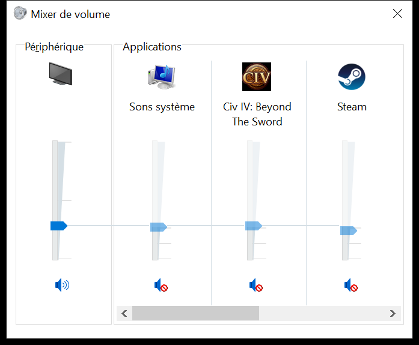

# AdvCiv-SAS Game Runs Guide

How an AI/LLM helper runs Civ4 itself: load a save or start a new game, autoplay a number of turns, look at the window, close the game and read what happened, without the user at the keyboard.

Built and tested by Claude Code Opus 5.5 on 2026-11-10, from a plan drafted with Codex (GPT-6.1-Sol) and ChatGPT-5.6-Sol's earlier research into launching Civ4 externally.

## Menu

[What an agent can do](#what-an-agent-can-do)\
&emsp;[Who can use them](#who-can-use-them)\
[Before a run](#before-a-run)\
&emsp;[Which DLL to test with](#which-dll-to-test-with)\
[Run autoplay from a save](#run-autoplay-from-a-save)\
[Start a new game](#start-a-new-game)\
[How the request reaches the game](#how-the-request-reaches-the-game)\
[How the run ends](#how-the-run-ends)\
[Two clients at once](#two-clients-at-once)\
[Screenshots and clicks](#screenshots-and-clicks)\
&emsp;[The main menu and the Sevopedia](#the-main-menu-and-the-sevopedia)\
&emsp;[The screens outside a game](#the-screens-outside-a-game)\
&emsp;[Inside a game](#inside-a-game)\
&emsp;[Hearing the game](#hearing-the-game)\
[What did not work, and why](#what-did-not-work-and-why)\
[Limits](#limits)

## What an agent can do

- Launch Civ4 into a save made with this mod, or start a new game with a chosen map, size, speed, difficulty, era and leaders.
- Run AI Auto Play for a requested number of turns, optionally in Debug Mode so a watching user sees the whole map.
- Tell how the run ended: completed, ended early, never started, stalled, crashed or timed out.
- Take screenshots of the game window, even while other windows cover it, and click in it.
- Close Civ4 and collect the run's logs and saves.
- Run two or more clients at once, each with its own logs.
- Do all of this in the background: the game never needs the foreground, and runs went on under other applications such as Chrome, VS Code or File Explorer, so the user can keep working meanwhile. Only a click moves the real mouse pointer, and runs need none.

Everything goes through two Python 3 helpers in [`LLM_Helpers/game_runs/`](/LLM_Helpers/README.md#game_runs): [`run_autoplay.py`](/LLM_Helpers/README.md#run_autoplaypy) for whole runs and [`desktop_windows.py`](/LLM_Helpers/README.md#desktop_windowspy) for the window.

Before them, every autoplay needed the user to start Civ4, load the save, press Ctrl+Shift+X and type a turn count, then exit the game afterward.

### Who can use them

- Any local agent that can run commands on the user's Windows PC, such as Claude Code or Codex. Nothing depends on one agent's own tools: the helpers are plain Python 3 scripts calling Windows itself (`user32`/`gdi32` for windows, input and pictures, and WMI through PowerShell to start Civ4).
- They are Windows-only, as Civ4 is. External agents without the game, such as ChatGPT with a light-source ZIP, can read this guide and the logs a run produced, but cannot run one.
- A person can run them too, for example to start a long autoplay and get a summary without watching it.

## Before a run

Everything here was tested in November 2026 on Windows 10 Pro 22H2 (build 19045.6466) with the Steam edition of Beyond the Sword 3.19. Other Windows versions and other editions, such as GOG's, were not tried.

- **Civ4 closed:** the runner refuses to start while another Civ4 runs, unless `--multiple` says that is intended. Check first that the user is not playing.
- **Runtime diagnostics on:** `SAS_RUNTIME_STATUS_ON=1` in [GlobalDefines_advciv_sas.xml](/Assets/XML/GlobalDefines_advciv_sas.xml), the usual development setting. The runner reads the run's Runtime history to know how it ended.
- **Python 3 with Pillow** for screenshots. Nothing else needs installing.
- **A save made with this mod:** a save names its mod in its header (`Mods\AdvCiv-SAS\`), and the runner refuses one made with another mod.
- **No XML or Python edits during a run**, as for any autoplay; see [Runtime safety](/AGENTS.md#runtime-safety-and-diagnostics).
- **Windowed mode:** the runner always sets `FullScreen = 0` for the run, whatever the user's INI says.
  - A window can be captured, clicked and closed by its handle, never takes over the screen or needs Alt+Tab, and lets two clients sit side by side.
  - Civ4 runs fine in it, and the [Quick Install Setup Guide](/_1_AdvCiv-SAS/Docs/README_Quick_Install_Setup_Guide.md) already recommends it for development and autoplays.
- **Dawn of Man:** it did not block these autoplays; the final screenshots showed the map with no popup.
  - A recheck on 2026-11-11 with `SAS_UI_DAWN_OF_MAN_ON=1` agreed: a loaded save and a new game, run side by side with `--multiple`, each completed 5 turns.
  - A game kept open with `--keep-open`, or loaded just to look, still waits on its Continue button, which the first tests dismissed with a click.
  - `SAS_UI_DAWN_OF_MAN_ON=0` skips the screen. It is a player option like SASFastSave, described in the [Main Changes Guide](/_1_AdvCiv-SAS/Docs/README_Main_Changes_Guide.md#system---misc); [`toggle_dev_diagnostics.py`](/LLM_Helpers/README.md#toggle_dev_diagnosticspy) `on` sets it locally.

### Which DLL to test with

Build with the [DLL Compilation Guide](/_1_AdvCiv-SAS/Docs/Modding_Resources/README_DLL_Compilation.md) and copy the DLL into `Assets/` while Civ4 is closed. On 2026-11-10 all three configurations below ran these autoplays:

| Configuration | Build time | Assertions |
| --- | --- | --- |
| `Release` | about 2 minutes | none |
| `Debug-opt` | about 2 minutes | compiled out unless `/DFASSERT_ENABLE` is uncommented in `Makefile.project`; keeps its PDB for crash dumps |
| `Assert-fast` | about 25 seconds, compiled in parallel | on, written to `SASAssertions_*.log` and ignored automatically with the default `SAS_ASSERT_SILENT_ACTION=1`, so they never stop a run |

`build_with_report.ps1 -Configuration Assert-fast` builds the Makefile's `Assert` target. Its `temp_files/Assert` folder can stay afterward: it is git-ignored, and the next `BUILD` refuses to start until it is cleaned, so use `-Request REBUILD` then.

## Run autoplay from a save

```bash
python LLM_Helpers/game_runs/run_autoplay.py "C:/path/to/save.CivBeyondSwordSave" --turns 100
```

- `--turns` counts the loaded turn, so 100 turns from T0 play T0 to T99, as with the Ctrl+Shift+X popup.
- `--debug-mode` turns on Debug Mode before autoplay starts. It seems to change the AI's game ([KI#1080](/_1_AdvCiv-SAS/Docs/README_Known_Issues.md#ki-1080)), so leave it off when comparing runs.
- `--keep-open` leaves Civ4 running afterward, for example to look around or take more screenshots.
- `--verbose` prints the turn as the run advances.

The save is only read. The runner copies the user's `CivilizationIV.ini` so graphics and sound settings match, and deletes that copy when Civ4 closes.

## Start a new game

```bash
python LLM_Helpers/game_runs/run_autoplay.py --new-game --map Pangaea --world-size WORLDSIZE_STANDARD --era ERA_ANCIENT --handicap HANDICAP_NOBLE --fixed-seeds --leaders "LEADER_ALEXANDER,-,LEADER_MANSA_MUSA" --turns 60
```

- `--new-game` sets the INI's `QuickStart = 1`, which starts a game straight from the INI's `[GAME]` settings, without menus.
- `--map` (script name without `.py`), `--world-size`, `--speed`, `--handicap`, `--era`, `--climate` and `--sea-level` override the user's last settings. Other settings, such as the game options string, come from the user's INI.
- `--fixed-seeds` sets `SyncRandSeed` and `MapRandSeed` to `1`. Two such games on Standard Pangaea matched at every RNG and state checkpoint over 60 turns, so a repeatable benchmark needs no save.
- `--leaders` names a leader for each civilization slot in order, with `-` keeping the random one. Each leader brings the first playable civilization that lists it; a requested leader already drawn for another slot is swapped with it.
  - Tested on 2026-11-10: `LEADER_ALEXANDER,-,LEADER_MANSA_MUSA,LEADER_GANDHI` gave Alexander, a random leader, Mansa Musa and Gandhi, and SGR recorded the three as chosen rather than random.
  - A bad name, such as `LEADER_NOPE` or the civilization `CIVILIZATION_GREEK`, leaves that slot random; the run's outcome is `REQUEST_FAILED`, with the mismatch in `pythonErrors`.
  - It needs a DLL built since SGR199, because the leaders are set in `CvInitCore` before the game starts.

## How the request reaches the game

The runner writes a settings file for the run beside `Civ4BeyondSword.exe`, named `SASAutoplay_<run id>.ini`, and launches:

```text
Civ4BeyondSword.exe /FXSLOAD="C:\path\to\save.CivBeyondSwordSave" ini=SASAutoplay_<run id>.ini
```

- `/FXSLOAD=` is the EXE's own argument for loading a save, found among its strings. It must come first and be quoted: after `ini=`, Civ4 opened at the main menu.
  - CivFanatics threads, found by a web search while building the runner, document the switch too. [Command Line Options](https://forums.civfanatics.com/threads/command-line-options.172014/) (2006) quotes a Firaxis list of options that gives `/FXSLOAD=foo`.
  - In [Windows 10, Civ 4 & file associations](https://forums.civfanatics.com/threads/windows-10-civ-4-file-associations.566100/) (2021), loading a save from a command line worked only with the slash, the equals sign and quotation marks around the path.
  - In [Opening savegames with the correct mod](https://forums.civfanatics.com/threads/opening-savegames-with-the-correct-mod.677580/) (2022), double-clicking a save opened it only once the file association's command passed it with `/fxsload="%1"`.
  - None of them mentions its order relative to `ini=`; our runs found that.
- `ini=` makes Civ4 read that file instead of `CivilizationIV.ini`. It loads `Mods\AdvCiv-SAS` in a window and adds an `[SASAutoplay]` section, which Civ4 itself ignores:

| Key | Meaning |
| --- | --- |
| `Turns` | AI Auto Play turns to run; required |
| `DebugMode` | `1` turns on Debug Mode first |
| `RunId` | the run's ID, logged in SGR's settings snapshot so a run can find its own SGR file |
| `Leaders` | leaders by civilization slot, for a new game |

- [SASAutoplayRequest.py](/Assets/Python/SASAutoplayRequest.py) reads the section once, when the first game loads or starts, and starts autoplay on the next game update.
- Only an explicit `ini=` file is read, so ordinary launches never autoplay. `PythonDbg.log` records `SAS_AUTOPLAY_REQUEST` rows when a request is armed and started.
- Civ4 is started through Windows' WMI, not as a child of the agent's shell: when an agent stopped the shell command that had started Civ4, the game and its Runtime observers were killed with it.

## How the run ends

The runner reads the process's own `SASRuntimeHistory_<processStartUtc>_<pid>.jsonl`. `AUTOPLAY_STARTED` and `AUTOPLAY_ENDED` rows give the start, the end turn and `autoplayEndCause`.

| Outcome | Meaning |
| --- | --- |
| `COMPLETED` | autoplay ended as scheduled |
| `REQUEST_FAILED` | autoplay ran, but the request raised an error, such as leaders not applied |
| `ENDED_EARLY` | autoplay ended for another recorded cause, such as victory, defeat or an assertion |
| `NOT_STARTED` | no autoplay within `--start-minutes` (default 5) |
| `STALLED` | no new history row for `--stall-minutes` (default 15) while autoplaying |
| `FAILURE_DIALOG` | the Runtime dialog observer saw a runtime-error or crash dialog |
| `EXITED` | Civ4 exited before autoplay ended |
| `TIMED_OUT` | `--timeout-minutes` (default 240) passed |

Then it takes a final screenshot and closes Civ4 with `WM_CLOSE`, as the title bar's X does. Civ4 exited with code 0 and no confirmation dialog every time it was tested; the runner forces the process only after 90 seconds.

It writes `SASAutoplay_<run id>.json` to `Logs/` under the Civ4 user folder. For example, the test run's `SASAutoplay_20261111T123518Z_6384.json` identifies a run launched at 12:35:18 UTC by runner PID 6384.

- Optional captures share `Downloads/AdvCiv-SAS_LLM/autoplay_screenshots/`, with names such as `SASAutoplay_<capture UTC>_<Civ4 PID>_final.png`; the [Logging Inventory](/_1_AdvCiv-SAS/Docs/Modding_Resources/README_Logging_Inventory.md#autoplay-run-summary) explains why reports and screenshots are kept apart.
- When reporting an issue, the summary and the game logs are in the same directory. You can sort by date or size and collect the relevant files in one view. If an image would help, add the specific PNG linked from the summary.

The screenshot uses [Windows window capture](#screenshots-and-clicks) on the Civ4 client launched for the run. It leaves the window where it is and sends no screenshot hotkey.

- The summary's `screenshot` field gives the saved PNG path when capture succeeds.
- Use `--no-screenshot` to skip the capture, and `--screenshot-root` to choose another image directory.
- If an image has been archived, search for its filename in the screenshot archive.

The runner exits with code 0 only for `COMPLETED`:

```json
{
  "outcome": "COMPLETED",
  "requestedTurns": 30,
  "startTurn": 0,
  "endTurn": 29,
  "autoplayEndCause": "SCHEDULED",
  "wallSeconds": 18.3,
  "civ4": "CLOSED",
  "exitObservation": {"outcome": "ZERO_EXIT_CODE", "exitCode": 0, "failureDialog": null},
  "gameRecord": "...Logs/SASGameRecord_20261110T165714Z_26088_load1.log",
  "pythonErrors": []
}
```

The summary also lists the Runtime history, the new saves (including SASFastSave's stop save) and the last popup that awaited a choice, if any.

Measured on 2026-11-10 on the development PC with a Huge Pangaea T0 save: 10 turns took 14 seconds from launch to exit, 100 turns about 50 seconds, and 300 turns about 400 seconds with Debug Mode on in a smaller window.

## Two clients at once

Why each client needs its own files: in one test two clients started in the same millisecond and opened their SASGameRecord logs in the same second. With names made only of the time, both would have written into one file, mixing two games. With the process ID in every name, each client knows where to write from its start, without checking what the other does.

Pass `--multiple` to each runner, which adds Civ4's `multiple` launch argument:

```bash
python LLM_Helpers/game_runs/run_autoplay.py save.CivBeyondSwordSave --turns 100 --multiple &
python LLM_Helpers/game_runs/run_autoplay.py save.CivBeyondSwordSave --turns 100 --multiple &
```

Each client's files carry its process ID, so they cannot collide:

| File | Name |
| --- | --- |
| Runtime current state | `SASRuntimeStatus_<processStartUtc>_<pid>.json`; `SASRuntimeStatus.json` shows the latest writer |
| Runtime history, exit, screenshot and source records | `SASRuntime*_<processStartUtc>_<pid>.*` |
| SASGameRecord and BBAI | `SASGameRecord_<UTC>_<pid>_load1.log`, `BBAI_<UTC>_<pid>_new1.log` |
| Assertions | `SASAssertions_<UTC with milliseconds>_<pid>_new1.log` |

- In one test both clients started in the same millisecond and their SGR logs in the same second; before the process ID was added, both would have written to the same SGR file.
- The SGR and BBAI session headers also name `processId` and `processStartUtc`.
- Two clients on the same save matched at every RNG and state checkpoint over 100 turns, so parallel runs are as repeatable as single ones.
- Runtime writes its small status snapshot twice per update, once to the process's own file and once to the shared one for existing readers; updates happen at turn and session boundaries, not every frame, so the extra write costs little.
- Still shared, because Civ4's EXE owns them ([KI#1081](/_1_AdvCiv-SAS/Docs/README_Known_Issues.md#ki-1081)): autosaves in `Saves/single/auto`, where same-turn names overwrite each other; `PythonDbg.log` and `PythonErr.log`, so a run's `pythonErrors` can include another client's lines; and the user's BUG settings. A request error names its `RunId`, so a runner counts only its own.

## Screenshots and clicks

```bash
python LLM_Helpers/game_runs/desktop_windows.py list
python LLM_Helpers/game_runs/desktop_windows.py screenshot --pid 15692 --out shot.png
python LLM_Helpers/game_runs/desktop_windows.py click --pid 15692 963 809
python LLM_Helpers/game_runs/desktop_windows.py hover --pid 15692 963 809
python LLM_Helpers/game_runs/desktop_windows.py close --pid 15692
```

Other apps' windows, such as Codex's or Claude's, work the same way; see [README_Desktop_Windows.md](/_1_AdvCiv-SAS/Docs/Modding_Resources/README_Desktop_Windows.md).

A screenshot captures only Civ4's window, wherever it is and at its current size, not the whole screen or a fixed area.

- The default `window` method asks the window to draw itself into a picture (Windows' `PrintWindow`). It shows what the game draws, not what is on the screen, so the game need not be in front: a video, a browser or Notepad over it does not appear, and the user can keep working while an agent takes screenshots.
- `--method screen` brings the game to the front, then copies its area of the screen. It shows exactly what a person would see there, but it takes the focus, and anything that pops up over the game in that moment appears in the picture.

Tested on 2026-11-10 during an autoplay:

| Window state | `window` (default) | `screen` |
| --- | --- | --- |
| in front | captured; two captures 3 seconds apart differed as turns advanced | captured |
| covered by Notepad | captured the game, not Notepad | brings the game to the front first |
| moved and resized to 1300x760 | captured at the new size; Civ4 scales its picture down rather than redrawing it | captured |
| minimized | only the 237x39 title bar | not tried |
| after Civ4 exits | nothing to capture; `run_autoplay.py` takes its final screenshot before closing | same |

- Coordinates are physical pixels from the window's top-left corner, as in the screenshots. The tool makes itself DPI-aware first: without that, at 150% display scaling, Windows reported a 1284x747 window for a 1926x1120 one and the first screenshots were cropped.
- A click moves the real mouse pointer and brings the window to the front, so it does interrupt a user working at the PC.
- One click on the Dawn of Man popup's Continue button reached the game. Its position, `963,809` in a 1926x1120 window, was read off a screenshot, so it holds only for that window size and layout; a different resolution, text scale or UI change moves it. Take a screenshot and read the position again before each click, and prefer a request that needs no click, as autoplay itself does.
- `hover` moves the pointer to a point without clicking or focusing the window, so a tooltip appears without disturbing a user typing elsewhere. It refuses a point outside the window.
- Keystrokes did not: simulated Ctrl+Shift+X and Enter never reached the game, so the tool offers none, and the autoplay request avoids the keyboard. Anyone typing at the PC also cannot disturb a run.
  - Since 2026-11-11 key events carry the scan code a real key press has, and Civ4 accepted them: in the Sevopedia, Down moved to the next entry, Left and Right acted as BACK and NEXT, and `type` filled the search box. Later testing also opened the Ctrl+Shift+X chooser and started and stopped autoplay.
- Civ4's own screenshot key, which the Runtime screenshot observer records, was not tried from the tools.
- Enlarging the window does not add detail either: on 2026-11-11 a 1920x1080 game maximized over a 4K monitor showed the same pixels doubled, so keep the game's own size and crop. See [Look, then act](/_1_AdvCiv-SAS/Docs/Modding_Resources/README_Desktop_Windows.md#look-then-act).

### The main menu and the Sevopedia

Tested on 2026-11-11 with the game windowed at 1920x1080, in a 1926x1120 window on the user's left 4K monitor.

- `desktop_windows.launch_detached('"mod=\\AdvCiv-SAS"')` starts Civ4 with this mod at the main menu, detached from the agent's shell, as Steam's mod shortcut does. A 730x448 splash window comes first; the 1926x1120 game window followed within seconds.
  - On 2026-11-11 PowerShell's `Start-Process -ArgumentList 'mod=\AdvCiv-SAS'` instead got a "Mod Error" box, "Mods\AdvCiv-SAS \ is an invalid mod directory, ignoring",. The process was closed and relaunched with `launch_detached`.
- The main menu's SEVOPEDIA entry, at about (945, 710) in that window, opens the Sevopedia on its Index. Its categories run down the left edge; Units, at about (55, 525), opened the first unit of the list, the Ancient Maceman, and Leaders, at about (60, 702), opened Saladin.
- These points, and the Dawn of Man's Continue button, are kept in [`civ4_points.json`](/LLM_Helpers/game_runs/ui_maps/civ4_points.json), so `desktop_windows.py click --pid PID --point main_menu_sevopedia` needs no numbers. They are relative to the window's corner, so moving the window does not change them; another window size is refused until its points are measured and added.
- The file maps the whole Sevopedia frame at 1920x1080 windowed, read off screenshots on 2026-11-11 rather than kept as new pictures, since the [Sevopedia screenshots](/_1_AdvCiv-SAS/Images/sevopedia/) already show it:
  - all 36 categories of the left list, `pedia_index` to `pedia_techs`, 25 px apart from y 100, at x 60;
  - the search box at the top left, and the Index page's jump bar "0 1 A … Z" along y 102, whose letters are unevenly spaced;
  - Legend, CLEAR, BACK, NEXT and EXIT along the bottom, at y 1094.
  - Clicking Techs, then BACK, then Civics opened a technology, returned to the previous page, and opened a civic.
  - Each category's page is mapped in [`civ4_sevopedia_map.json`](/LLM_Helpers/game_runs/ui_maps/civ4_sevopedia_map.json) by [`map_sevopedia.py`](/LLM_Helpers/README.md#map_sevopediapy): its panels as boxes and its EXPAND buttons as points, which sit at a different place on each page type.
    - The file also names the page kinds (entry, text, media, table, diagram and index pages) and the unit page's panels.
  - An EXPAND above a text panel opens that text over the whole page, with TEXT, BG and STYLE settings and a CLOSE button at the top right. One above a 3D view shows the model over the whole page, with RELOAD and CLOSE. Both CLOSE buttons returned to the page.
  - While Civ4 is in front, the user's typing goes to the Sevopedia's search box and filters the entry list; it happened twice on 2026-11-11. The CLEAR beside the box, `pedia_search_clear`, empties it.
- The Sevopedia also works from the keyboard, through `desktop_windows.py key` and `type`, tested on 2026-11-11:
  - Up and Down move through the entry list, opening each entry; Left and Right act as BACK and NEXT.
  - Typing needs no click on the search box: `type --pid PID war` filtered the list to War Chariot, Gallic Warrior and others, and a CLEAR appeared beside the box.
  - For searches with ASCII digits and punctuation, use `--us-keys`: the box reads key codes as a US keyboard would, so on the user's AZERTY layout plain `type` turned "2" into "@" and "-" into "6", while `type --us-keys 'Ab 9-_=+,.;:/?()!#%'` came through exactly. Civ4's own text boxes, such as the autoplay turn box, need plain `type`.
  - If a query has no matches, the list goes blank while the last entry stays visible on the right. In a repeat check on 2026-11-11, `War 2-_` left the Ancient Maceman page visible. `click --point pedia_search_clear` restored the unit list.
  - The mouse wheel over the entry list scrolls it: `scroll --pid PID 250 600 -5` moved it down about 14 rows.
  - The bottom bar, checked with [`check_points.py`](/LLM_Helpers/README.md#check_pointspy) from a unit page: Legend opens a page explaining the Sevopedia's abbreviations, where the Legend button is gone and BACK and NEXT are dimmed and did nothing; EXIT closes the Sevopedia and returns to the main menu. The bottom CLEAR made no visible change with the search box already empty.
  - Entries show a tooltip when hovered, as an Index entry's did, so hover over an empty spot before a screenshot. Which other panels scroll or show tooltips was not mapped.
  - Only the frame and its controls are mapped, not each page's contents, which the screenshots already show. When a Sevopedia screenshot is outdated, replace that screenshot.
- The Shortcuts category was checked on 2026-11-11 by stepping through its 10 entries with Down. Its shortcut text agreed with [`sevopedia_concepts.txt`](/LLM_Helpers/game_runs/ui_maps/sevopedia_concepts.txt), including `Ctrl + Tab`, which an earlier export had dropped.
  - The list shows the entries alphabetically (Advisors, Camera, Cheats, City Screen, Game, Map Layers, Mods, …), while the text file follows the XML order, with Mods second.
  - Units runs past the bottom of its panel. The wheel did not scroll it until a click on an empty spot in the panel; then `scroll --pid PID 600 800 -15` showed the Work Boats and Workers sections.
  - Ctrl+Z is "Seeing Everything" on the Cheats page and "Toggle Debug mode" on the Game page.
- Movies lists the victory and wonder movies. A click on an entry starts its movie at once; the orange button at about (1860, 160) on the entry's page plays it again.
  - The player's seven buttons sit along y 1073, at x 746, 818, 890, 962, 1034, 1106 and 1178: previous group, previous, replay, a toggle, stop, next and next group, per [`SevoPediaMediaPlayer.py`](/Assets/Python/Contrib/Sevopedia/SevoPediaMediaPlayer.py). Labels above them name the previous and next movie; the elapsed time and title sit at the bottom left. Hovering them showed no tooltip.
  - Every button was clicked by its `media_*` point in [`civ4_points.json`](/LLM_Helpers/game_runs/ui_maps/civ4_points.json) on 2026-11-11:
    - next and previous stepped through the victory movies, Conquest and Cultural;
    - next group went from the victories to the first wonder, Angkor Wat, then to the projects, starting at the Internet; previous group went back to the start of the previous group;
    - replay restarted the current item;
    - the TV-shaped toggle switched to the Music player, which started Agriculture, and its music-note version switched back to Movies, starting at Conquest;
    - stop closed the player and returned to the Sevopedia, on the category of the player that was open, and a movie that ends returns to its page by itself.
  - Use Stop to return to the movie's Sevopedia page. In the main-menu test, pressing Esc or Enter during playback closed the whole Sevopedia.
    - The media player's comment says it consumes both keys during playback. The main-menu test still closed the screen, and the same keys during in-game playback are untested.
- Music lists the tech quotes by era and other sounds, each with its audio ID, such as `Agriculture - AS2D_TECH_AGRICULTURE`; an entry's page shows the quote and the same play button.
  - Its player has the same seven buttons at the same points, with no labels above them; it shows the quote beside them and a list of the tracks on the right.
  - Next and previous stepped between Agriculture and Animal Husbandry; next group went era by era, from Agriculture to Civil Service to Aesthetics, and previous group back. Previous on the first track, and previous group on the first group, did nothing: the timer kept running.
  - Pressing next group from the first track, in a loaded game on 2026-11-11, went through 35 groups, and the player's picture changes with the kind of group:
    - 0 to 6, tech quotes from Ancient to Future: the era's picture, the tech's button and its quote;
    - 7 to 13, the era soundtracks, such as `AS2D_ANCIENT_SOUNDTRACK_1`: one large era picture;
    - 14 to 16, leaders (Intro Peace, Peace, War): the animated leader head, a generic face for the Barbarian leader;
    - 17, civilizations' Select and Order sounds: the civilization's button and leader portrait, with a note that a replay can play another variant;
    - 18 to 29, the 2D scripts (Opening, Songs, Diplo, Tech, Tutorial, Builds, Units, Interface, Ambient, Goody, Events, SFX), and 30 to 34, the 3D scripts (Units, Ambience, Improvements, Civilizations, Other, ending at `SND_ERROR`): a plain music-notes picture, with notes on the Ambience and Improvements groups about late or wrong sounds.
    - The text file names two more groups, Leaders (Intro War) and Scripts (Other, 2D), which did not appear; next group on the last group did nothing.
  - A click on the player's picture or background closes it too, as `SevoPediaMediaPlayer.py` says and a stray click confirmed.
  - Hovering the seven buttons showed no help text, from the main menu. In a loaded game the capture covered only the lower half, so it did not rule out help appearing elsewhere.
- Leader pages, checked on Saladin from the main menu on 2026-11-11, with points in [`civ4_points.json`](/LLM_Helpers/game_runs/ui_maps/civ4_points.json):
  - The page holds the leader head with EXPAND above it, a scrolling traits panel, Favorites, Music, the history text with its own EXPAND, and four columns of AI personality values on the right.
  - Five attitude buttons, red Furious to yellow Friendly, change the head's mood, the chosen one drawn larger; under them "no", "gr", "ag" and "dg" play no animation, a greeting, agreement and disagreement. Leaders with era art also get a row of era buttons, which Saladin has none of.
  - The footer is re-centred to the left of the AI columns: CLEAR at x 236, the previous and next player links "[" and "]" at 368 and 498, BACK at 632, NEXT at 764 and EXIT at 896, so `pedia_back`, `pedia_next` and `pedia_exit` miss there. The player links jump to the leaders of the neighbouring player IDs in a game and show "-1" with no effect from the main menu, as the user confirmed.
  - The expanded head fills about (358, 140) to (1075, 1040), with the attitude and action buttons at the top right and CLOSE at (1850, 119). Left, right and middle drags and the wheel did not move its camera; only the idle animation changed.
- The 3D views of unit, building and bonus pages share one set of controls, tested on the Ancient Maceman, the City Center and Maize, small and expanded, with `desktop_windows.py drag`:
  - a left drag sideways turns the model; up or down did nothing visible;
  - a right drag pans, and can push the model out of view;
  - a middle drag up zooms in, down zooms out, to a limit; sideways did nothing;
  - the wheel and Home did nothing.
  - To get a lost model back, click its entry again in the list, or RELOAD on the expanded view at (1754, 118); both reset the camera. EXPAND sits at (1838, 97) and the expanded view's CLOSE at (1850, 118).
  - The Ancient Maceman's sash changed colour between renders (pink, grey, green).
  - Naval units such as the Galley stand on open water seen from above, and air units such as the Fighter fly over clouds; both take the same controls, but turning an air unit swings its sky and horizon too, while a ground unit's backdrop stays put.
  - The keyboard keeps working in expanded views, as the user noted: with the 3D view or the background text expanded, Down and Up went from the Fighter to the Guided Missile and the Gunship and back, and the page stayed expanded.
- Searching then stepping, 2026-11-11: `type --us-keys ga` on Units left five matches grouped by era (Galley, Pagan Missionary, Gallic Warrior, Frigate, Galleon); Down opened the first, further Downs and Ups stepped through the matches only.
- Hover and click on entry pages, 2026-11-11, with the whole window captured since help text can appear anywhere:
  - promotion, tech and unit icons, such as Combat I, the obsolete tech and the upgrade, show help text beside the pointer, even from the main menu;
  - a text link such as "Advanced Flight" in Special Abilities turns yellow under the pointer, without help text, and the unit's own button showed none;
  - clicking that link or the obsolete-tech icon opened the Advanced Flight tech page, the upgrade icon opened the Jet Fighter, and BACK returned each time.
- The media players' track list is display-only: its rows are plain table rows (`WIDGET_GENERAL` in `SevoPediaMediaPlayer.py`), so clicking them or turning the wheel over them did nothing; it shows the tracks around the one playing, marked ">" and bold.
  - The user recalls the buttons show help text at the centre of the window; from the main menu neither player showed any, over the whole window, and in a game only the lower half was captured, so in-game help text at the centre is still to check.
- The tree and chart pages, 2026-11-11:
  - Unit Tree and Promotion Tree are graphs of buttons with no search box; the wheel scrolls them, the unit tree stopping at its bottom, and clicking a unit node opened its page, here the Spearman;
  - Unit Chart lists unit kinds on the left, such as Air (Fighter) or Melee (Polearm), and clicking one shows their units' stats in the table;
  - Speeds and W. Sizes are large tables, one column per game speed or map size, with a small LOG button beside EXIT;
  - BACK from a tree returned to the chart visited before it.
- More checks the same night, from the main menu:
  - Left and Right work as BACK and NEXT on every page tried, including from the Music page to a tech page and back.
  - Table cells link: on a tech page, a tech cell shows that tech's help and an era cell shows "Open the Eras chart at Ancient"; clicking an era cell opens the Eras chart, the native Era widget recorded in the Known Issues guide on 2026-11-08. Clicking a column heading, such as "Co.", sorts ascending (▲), and again descending (▼).
  - On a Music tech-quote page, the entry's icon shows the tech's help and opens the tech page. Inside the player, as the user pointed out, the tech picture in the middle does the same: its help appears beside it, and a click closes the player and opens the tech page; the era picture beside it shows nothing.
  - The Eras chart's large pictures above each column and the orange play button on its left show no help from the main menu, but clicking the Ancient picture opened the Ancient movie's entry in Movies, and the play button the Ancient soundtrack's entry in Music.
  - Terrain, Feature and Corporation pages have no 3D view. A Terrain page's "Relevant Units" show each unit's modifiers there under its icon, such as +20/+20, and hovering one gives the unit's full help; bonus icons show the bonus's help.
  - An expanded text panel has three settings at the top right, each with − at x 1754 and + at x 1787: TEXT colour at y 57 (1 of 129, such as CLEAR, ALPHA_GREY, WHITE), BG at y 87 (8 backgrounds, such as SCREEN_BG_OPAQUE or a main-menu slideshow picture) and STYLE at y 120 (50 panel styles, such as PANEL_STYLE_MAIN_BLACK25 and BLACK50, which let the background show through). Each click redraws at once.
  - A stray "/[" once appeared in the search box while the user was typing elsewhere; it did not come back with Left and Right alone.
- Base AdvCiv for comparison, started with `launch_detached('"mod=\\AdvCiv"')` on 2026-11-11: its main menu's CIVILOPEDIA sits at about (962, 708), and opens a smaller framed window with the menu around it.
  - It has 25 categories from Technologies to Shortcuts, alphabetical lists without era groups, no search box, and CONTENTS, INDEX, BACK, NEXT and EXIT along the bottom; nothing shows until an entry is picked.
  - A unit page has stats, a small 3D view, Requires, Upgrades To, abilities, promotions and Strategy and History text, without EXPAND, counter tables or AI information. A leader page has a still portrait, the civilization's button, favourite civic and traits, without attitudes, actions, music or AI values.
  - Down did nothing in the base AdvCiv screen tested.
  - A wider tour the same night: its Index lists every entry in three alphabetical columns with an A to Z jump bar, Unit Upgrades is a graph like our Unit Tree, and its Shortcuts include the same "Mods (BUG, K-Mod, AdvCiv)" page SAS inherited.
- The city screen, checked again at turn 201 on 2026-11-11:
  - F10 opened the capital, Uruk; Right and Left then switched to the next and previous city (Eridu, Kish, back to Eridu); Home, End and Page Down did nothing there; Esc closed it.
  - The building list and the production icons show help text when hovered, but neither a left nor a right click on them opens the Sevopedia. A right click is sent with `drag --button right` on one point, since `click` has only the left button.
  - After Esc a right click lands on the map, which orders the selected unit to go there; send it only while the city screen is open.
- Other mods' encyclopedias, opened with `launch_detached('"mod=\\<folder>"')` from the main menu on 2026-11-11, for ideas and comparison. All but BASE opened in the same 1926x1120 window; each loaded within seconds to a minute.
  - Caveman2Cosmos (`Caveman2Cosmos`): "PEDIA" at about (962, 688) opens a full-window space scene with a quote. Twelve groups on the left (Game Concepts to Upgrade Trees) switch a lower list to era filters, such as Ancient with a "# 42" count, and the entries then fill a column beside them.
    - A unit page packs sub-combat-type icons, a small 3D view, a long sectioned effects list, two sideways-scrolling rows of promotions, and Requires, Upgrades To and Obsolete. SAS's Up/Down list navigation is based on C2C's code, as `SevoPediaMain.py` credits. In this check, Down did not move off the Archer.
  - Realism Invictus (`Realism Invictus`): CIVILOPEDIA at about (962, 722); tabs along the top (Technologies, Units, Military, Buildings, Society, World, Help), opening on the whole tech tree with era filters, a civilization dropdown and a sideways scrollbar.
    - Units has Units, Unit Categories and Unit Upgrade Chart, a filter dropdown and a "Type to filter..." box that takes typing without a click, which inspired SAS's search bar, as the user noted.
    - Unit pages have a larger 3D view and Strategy and Background text.
  - History Rewritten (`History Rewritten`): CIVILOPEDIA at about (962, 690) opens a small centred window over the menu art, on Civilizations; 30 categories include Tenets, Organizations, Unit Charts, Promotions Chart, Religious Buildings and Natural Wonders; no search box; BACK, NEXT and EXIT.
    - A civilization page shows its emblem, leaders, free techs, unique buildings and units, and history. Down did nothing.
  - BASE 6.4 (`BASE 6.4`): ran in a 1286x760 window, so `civ4_points.json` refuses it; CIVILOPEDIA at about (620, 528). Close to base AdvCiv's layout with era-grouped lists, a dark tablet backdrop and BASE Concepts and Strategy Guides; its title is cut off at the top at that size.
  - Middle-earth (`Middle-earth`), whose Platypedia SAS also learned from: CIVILOPEDIA at about (962, 708). Its about 30 categories sit on the right, from Update Information (opened first, with the mod's version notes) to Movies and Credits, including Artifacts, Processes and Building Chart; BACK, NEXT, TOP and EXIT along the bottom and a back arrow at the top left.
    - Units is a three-column grid of every unit grouped by Age, with an "Era" grouping dropdown; a unit page has a scrolling stats box, a wide 3D view and Strategy and Background text, and the right-hand list then holds that category's entries.
    - Down did nothing; the user notes the menu's side can be changed, which was not tried.
- In a game, the top right's `game_main.main_menu` opens a menu panel whose 11 items sit at x 1780, 31 px apart from y 207: Exit to Desktop, Exit to Main Menu, Retire, Load Game, Save Game, Options, BUG Menu, Enter WorldBuilder, Game Details, Your Details and Cancel. Cancel, at y 517, closed it; `game_main.sevopedia` beside it opened the Sevopedia on its last category.
- A click on Civ4 while another window was in front was lost once: Units did not open until a second click, most likely because the first only brought Civ4 to the front. Check the result with a small crop after each click, and click again if nothing changed.
  - Later the same day, two clicks in a row on the Shortcuts category's Units entry did nothing, and a third after a `hover` opened it. The user was using the mouse and keyboard during the first two attempts.
    - `desktop_windows.py click` now waits for three seconds of idle time before taking focus. Check what opened before continuing, since the user can resume typing or moving the pointer.
- These points are prone to change. Another resolution or text scale moves them all, and the category rows follow `SAS_CATEGORY_DEFS` in [`SevoPediaMain.py`](/Assets/Python/Contrib/Sevopedia/SevoPediaMain.py), so adding or reordering a category shifts every row below it. After such a change, re-read the points off a screenshot and update the file.
- The pointer leaves a tooltip wherever it rests, which can cover part of the page. Hover over an empty spot before a screenshot.
- The Sevopedia screenshots in [`_1_AdvCiv-SAS/Images/sevopedia`](/_1_AdvCiv-SAS/Images/sevopedia/) still matched the page layout, so they remain a good reference for where things are, although some are dated.

### The screens outside a game

[`civ4_ui_map.json`](/LLM_Helpers/game_runs/ui_maps/civ4_ui_map.json) maps the main menu and every branch below it, explored on 2026-11-11 at 1920x1080 windowed: each screen, how to reach it, and its controls with positions, where they lead and what they do. `desktop_windows.py click --point SCREEN.CONTROL` clicks one by name.

- The main menu's items and every submenu's sit at x 965 from y 575, 45 px apart, with GO BACK at the bottom left. Single Player, Multiplayer and Advanced each open a submenu; Simple Game is a six-step quick setup whose last OK starts the game.
- Some greyed items still work: BTS Content lists other mods' scenarios.
- Controls with real effects were not clicked: anything that starts a game or scenario, Load a Mod's OK, Unload Mod, Exit Game, GameSpy, Check for Updates, and hosting or joining a LAN game.
- For a test game, Custom Game is the most useful screen: one screen holds every setting.
  - Player rows: team, leader (with traits), civilization and difficulty columns.
  - Settings: Map, Size, Climate, Sea Level, Era and Speed, then the map script's own options, which differ by script: Pangaea adds Shoreline, World Wrap and Resources, Planet_Generator_0_68 adds seven continent settings, and Tectonics greys out Climate and Sea Level, which it ignores. The map lists 13 scripts' options.
  - 27 options and 6 victories as checkboxes, and every dropdown's items.
  - [`set_dropdown.py`](/LLM_Helpers/README.md#civ4_ui_mapjson-capture_dropdownspy-and-set_dropdownpy) chooses an item by name. A dropdown opens scrolled to its current item and closes unchanged when its header is clicked again.
- Map-script previews (2026-11-12, findings toward a script, not built yet): Simple Game previews are 336x256 DXT1 `.dds` in `Assets/Art/AdvCiv_SAS/Maps/<Script>/FLAT_<Script>.dds`, wired through a World Picker entry with `GlobeFLAT.nif` and that file as `WaterLevelDecalPath`; Pillow 13 can write DXT1.
  - The source is the minimap of a revealed map: `run_autoplay.py --new-game --map <Script> --debug-mode --keep-open --turns 1` leaves one open, with the minimap in the window's bottom-right corner at 1920x1080.
  - No option or Python call hides the minimap's white camera frame: `setShowInterface(INTERFACE_MINIMAP_ONLY)` hides the rest of the interface, `CONTROL_BARE_MAP` hides units and symbols.
    - Planned instead: capture the minimap three times with the camera in different places (click the minimap) and keep each pixel's median, which drops the frame even over snow; merge as PNG, compress only the final `.dds`.
  - Ctrl+W opens WorldBuilder from a game. Its tool icons sit in two rows of six at the top right, about y 63 and 98, x 1718 to 1893, 35 px apart, beside the Units, Buildings and Technologies panel at the top left.
    - Their tooltips, recorded as the `worldbuilder` screen in `civ4_ui_map.json`: Enter erase mode, Change All Plots, Save, Load, Exit World Builder on the top row after Enter landmark mode, and Edit Unit, Edit City, Player, Map, Reveal Tile and Diplomacy modes below. What each mode opens is recorded there too.
    - Tooltips appeared only with Civ4 in front and a few seconds' dwell: `hover_tooltips.py --front --wait 4` showed all twelve, while hovers from `capture_screens.py`, which does not bring the window forward, showed none (2026-11-12).
    - Change All Plots opens a modal panel: until its Cancel is clicked, other icons, hovers and tooltips do nothing.
    - The mode panel at the top left has a yellow grip at its bottom right: dragging it resizes the panel, and a press just beside it moves the whole panel instead.
      - Sizes reset when WorldBuilder is reopened, so the sizes chosen with the user, the smallest that show every tab without scrolling with one spare row for new buildings, are recorded as `worldbuilder.panel_grip` in the UI map: Player Mode 18 columns wide, Map Mode 11 columns wide with Territory's 49 slots (48 players and the Barbarians) in 5 rows.
    - In Player Mode and Map Mode a click on the map edits the game.
      - On 2026-11-12 a mis-aimed drag moved the panel, so the tab clicks that followed, and a drag across the map, placed eleven Lions, the default brush, in the user's game. A right-click on a plot in Player Mode removes its units, which the user pointed out and which removed them all.
      - Click only on panels, start each drag exactly on the grip, and screenshot after every drag.
    - Every mode was then tried on the map in a test game of the agent's own (2026-11-12), and each result is in the UI map's `worldbuilder` notes and tests.
      - In short: Player Mode and Map Mode paint the selected item onto a plot, and a right-click removes units, resources, improvements, features, routes, ownership and landmark signs, but not a terrain or plot type.
      - Erase Mode clears everything on a plot in one click. Edit Unit and Edit City open a World Builder Edit Control panel whose promotion, building and religion clicks toggle. Diplomacy Mode sets war or peace at once.
    - Change All Plots converts the whole map: Add Hill turned every plot into a hill, the ocean included, with no undo. Try it only in a throwaway game.
    - A second pass on a 48-player SAS48 map added the rest to the `worldbuilder` tests:
      - A Player Mode building clicked on an empty plot founds a city with it, and the first city opens a research choice popup that blocks clicks until answered.
      - Add Script, in Edit Unit and Edit City, asks for a script name that is stored and shown again; an empty name does not clear it.
      - Map Mode's crosshair, Regenerate Map Using Current Map Script, did nothing once a city existed. Diplomacy shows about 6 of 48 players at a time.
      - A client in WorldBuilder ignored the close request, so leave WorldBuilder before closing it.
  - Advanced Start, recorded as the `advanced_start` screen, needs the Custom Game screen: a QuickStart game with the option starts with 0 points, since the setup's Advanced Start Base Points come only from there, and the game reads no points key from the INI. Started from a per-run INI copy, Custom Game remembers its choices in that copy, not the user's INI.
    - Hovering a plot with an item selected shows its price, a click buys it, and a right-click sells it back for the full price, except items whose help says Not removable, such as cities, culture, buildings and visibility. Build Improvements (Automated) spends nearly all points at once, and Begin! ends the phase, turning leftover points into gold.
- Civ4 remembers Custom Game settings for the user's next game. Note them before changing any, and set them back afterwards.
- Other resolutions (2026-11-12, testing the setup-screen EXE patch of [KI#1082](/_1_AdvCiv-SAS/Docs/README_Known_Issues.md#ki-1082)): set `ScreenWidth`, `ScreenHeight` and `FullScreen` in `CivilizationIV.ini` for the run and restore the file afterwards. The named points fit only 1920x1080, so read positions off a screenshot.
  - A 2560x1380 game opened a 2566x1420 window. The main menu's items stay centred about halfway down: Single Player, then Simple Game, both at `1283,724`.
  - A 3840x2160 fullscreen game started and showed the main menu in a full-size screenshot, but a click there was refused, because `desktop_windows.py` found the user's VS Code window over that point, and its window size came back as 2560x1440, the scaled size. Fullscreen also switches the user's monitor, so prefer a window just under the screen's size.
  - A window as large as a 4K monitor technically fits, but its bottom slides under the taskbar: on 2026-11-12 a 3800x2060 game opened a 3806x2100 window whose OK, in the bottom-right corner, was refused as covered by Explorer, and a 3800x1980 one lost focus.
    - Maximize it first instead: start the game at 3840x2060, then `desktop_windows.py move --pid <pid> --monitor 1 full` fits it to the monitor's work area (3844x2102 with its borders), where every control can be clicked. Otherwise lower the INI size well under the screen's.
  - A 1920x1080 fullscreen game could be clicked through, at the screenshot's own coordinates, but ignored `desktop_windows.py close` while still responding, so the agent stopped its own process with `Stop-Process`.
  - Walking Simple Game at 2560x1380 and 3840x2060 (2026-11-12, for the globe patch of [KI#1082](/_1_AdvCiv-SAS/Docs/README_Known_Issues.md#ki-1082)), positions were read off one screenshot per step, with `capture_screens.py --keep-open` and then `--pid`:
    - Map rows are 24 px apart at every size: Arboria at `225,147` in a 2566x1420 window and at `330,144` in a maximized 3844x2102 one, so row N is at that y plus 24 x N. OK sits at `2493,1395` and `3772,2076`; at 4K, Single Player and then Simple Game are both at `1920,1060`.
    - Option steps vary by script: BTG_Cross has six or more (World Wrap, Mirrored Hubs, Spoke Width, Regions, Oil and Aluminium, Elephant), Pangaea one (Shoreline), Great_Plains and Rainforest none. Use Rainforest to reach the civilization step quickly.
    - The OK on the game snapshot step starts the game, so stop one click earlier unless a game is wanted.
  - To judge the world-picker globe's size, use Great_Plains: its flat picture fills the globe's whole area up to its rounded corners. `contact_sheet.py --black-to-white 12` paints near-black pixels white, which shows the area's outline against the black panel; a script that scanned for dark pixels was fooled by the dark globe, and eyes on the screenshot were right.

### Inside a game

The same map holds the in-game screens, explored on 2026-11-11 on a turn-200 Pangaea game started with `run_autoplay.py --keep-open`. Each screen's `tests` list holds what was pressed or clicked and what it did, one per line; this section tells the story around them.

- `game_main`: the top bar, the advisor buttons, the commerce rate buttons, the scoreboard, the unit actions, End Turn and the map toggles, each with its help text, and every shortcut from the Sevopedia's Shortcuts pages.
- `city_screen`: its panels, production choices, processes and named points for all 21 positions in the city radius. The points are relative to the city and the four corners are omitted.
  - For example, `desktop_windows.py click --pid PID --point city_screen.tile_n2_w1` clicks two tiles north and one west of the city. Use `city_screen.tile_center` to restore automatic citizen assignment.
  - At the mapped 1926x1120 window size, the centre is near (963, 540) and neighbouring tiles are about 141 px apart. Confirm the city and grid with a screenshot before clicking, especially after a camera or resolution change.
  - A click on a production choice changes production at once; Shift+click adds it to the end of the queue, Ctrl+click puts it first, and a click on a queued item removes it. The queue shows at the bottom left.
  - The production choices are about 54 px apart across and 53 px down; the 37 and 50 px recorded first were wrong, which a Ctrl+click on the wrong item showed.
  - A specialist's + moves a citizen from a tile to that specialist, and the - that replaces it moves them back: an Engineer raised culture from 99.00 to 100.50, and the - restored it.
- `advisors`: F1 to F9 and Ctrl+E open them, Esc closes them, and each lists its tabs.
- Debug Mode: Ctrl+Z, with `CheatCode = chipotle` in the user's ini, reveals the whole map and gives F1 and F3 a player dropdown; a second Ctrl+Z turns it off.
- Unit cycling, on a stack of about 33 units on the capital's tile, whose icons show in a row above the action bar: period selected the next unit in that row and comma the previous one; W outlined about 8 units at once.
  - In that row a click selected about 8 units, most likely the group the unit was in, Ctrl+click all 11 of its type, Shift+click added more, and Alt+click nearly the whole tile. `desktop_windows.py click --with ctrl` holds the key during the click.
- End Turn, the green circle at (1688, 955), ended turn 200; a research chooser and a production chooser followed, each a click.
- The two arrows left of the minimap select the previous or next city without opening it: the map centres on it and the bottom panel shows its production choices. Esc goes back to the unit.
  - They sit right beside End Turn, about 15 px away on either side, so aim carefully: a few pixels off ends the turn, as the user warned. Shift+Enter is the deliberate way to end a turn.
  - The panel at the bottom left reads "Unit Stack (N)" with the selected units by type, and in the unit row only the selected units have a yellow outline: both show at a glance whether a whole army is selected, as the user pointed out when only 3 of 14 were.
- The eight map buttons, each tried on and off: Unit Display, Resource Display, Grid, Yield Display, Bare Map, map annotations, Scoreboard and Globe View.
  - Units, resources and yields are one set of layers: turning Unit Display on removed the resource bubbles, and turning it off again left neither, so a later screenshot lacked them until Resource Display was clicked. Check a layer's state before relying on it.
  - The user notes that these buttons and the city arrows shift slightly with the map's settings, from the mod's layout tweaks. On a SAS48 Pangaea game they sat up to 10 px further left than on a Standard one, at the same heights, so re-check them on another map before clicking.
  - The scoreboard grows upwards with more players: with 11 leaders on SAS48 it started at about y 670 instead of 715.
- A SAS48 game in Debug Mode, which shows all 48 players, brought controls the smaller game never showed:
  - Under the scoreboard, a row of scroll buttons: up fast, up, center on the active player, down, down fast and autocenter, then the hover lock and a background style that cycles through at least four looks. The list opens centred on the active player, so the top scorers stayed hidden above until scrolled up. The row moved sideways after scrolling, so read it off a fresh screenshot.
  - A click on the minimap centres the view there. To get back after browsing, the city arrows left of the minimap select one of the player's own cities and centre on it, as the user pointed out.
  - A click on another player's city banner selects that city with its production choices; `click --double` on it opens its city screen, and the top bar then shows that player's research and gold.
  - The Military Advisor's Map tab lists any player's units by combat type after a click on their portrait, and its Battles tab gains a player dropdown listing that player's battles, with odds, units and plots.
- Autoplay from inside the game: Ctrl+Shift+X opens "Turn on AI Auto Play?" with a turn box prefilled with 501. Click the box, press Backspace, type the count with `type` and click OK: 2 turns ran in under 3 seconds.
  - Ctrl+Shift+X during a run stops it: a 30-turn run stopped after one or two turns.
  - The popups held back during the run then came one after another: an AI cancelling a deal, a production chooser for a city that could no longer train its unit, and a vote result. Each needs a click; the map lists their buttons.
  - For unattended runs, `run_autoplay.py` remains the way: it needs no clicks and reports the outcome.
- Every advisor's tabs are in the map by name, such as `advisors.f8_timeline`: all sit along y 1091 with EXIT at x 1446, read off each advisor on 2026-11-11. The tech tree (F6) has none. They change rarely, so re-read them when an advisor's tabs change.
- Changing civics: F2, click a civic in its column, then REVOLUTION, which replaces EXIT at the bottom. Labor from Slavery to Tribalism took effect at once ("Autoplay adopts Tribalism!"), with 0 turns of revolution.
- War: Alt+click a leader on the scoreboard asks "Does this mean WAR?!?" and names who will disapprove; Yes declared it, cancelled open borders and turned that player's city banners red.
  - The user's tip on how to play it: move the troops up to the border first, then declare at the start of a turn and attack on that same turn. Declaring first, as the agent did twice on 2026-11-11, gives the enemy free turns to prepare while the troops walk there.
- Moving far: G, then hovering a tile, draws the path with a numbered marker per turn; a click gives the order. A plot click can recentre the view, so re-read positions after each step.
- Esc with nothing open brings up the in-game menu (Exit to Desktop … Cancel); Cancel closes it. Shift+Enter ends the turn, as the End Turn button does.
- An attack on a city was not finished: on the SAS48 map the nearest enemy city was six turns away. The user suggested a Standard or Large game instead, started in each era with `run_autoplay.py --era`, which also brings later units and screens within reach.
- Playing a game by hand, tried on 2026-11-11 with a Custom Game set up through the menus:
  - Custom Game keeps its settings for the next game, so note the user's before changing them and set them back afterwards.
    - They live in `CivilizationIV.ini`'s game section (`Map`, `WorldSize`, `Era`, `Climate`, `SeaLevel`, `GameSpeed`, and the difficulty as `QuickHandicap`), which Civ4 rewrites when a game is launched; on 2026-11-11 they were restored by closing Civ4 first and then editing those lines, after a backup.
    - The difficulty list starts with Rookie, the easiest, then Settler.
  - Founding the capital: click the Settler, press B, keep the name with OK, then choose research and production in the two choosers that follow. Moving the Maceman in and fortifying it (F) let Enter end each turn; Enter does nothing while a unit still waits for orders.
  - The user's tip: for testing, start the in-game autoplay right away on turn 0, before founding anything; the AI founds the capital itself, which saves the founding steps.
  - While the agent typed the autoplay's turn count, the user was typing elsewhere, and their keys landed in Civ4's box as "ntwt", leaving OK greyed out. `desktop_windows.py` now waits for the user to be idle before it takes the focus.
  - In-game autoplay from turn 3 to turn 80 took about a minute and wrote a START and a STOP save, so a reload can return to the moment before a mistake, such as a war declared too early.
  - A war tried by hand at turn 201 of an Ancient-start Rookie game. The user's advice: gather every unit in the city nearest the target first, so the enemy sees no army at the border; check the target's defences; then declare and attack on the same turn. The city arrows next to End Turn help find the troops.
    - Hovering an enemy city, even in Debug Mode, showed its food, production and build but not its units; double-clicking its banner opened its city screen, which showed Walls, so three units would not have been enough.
    - Each new turn can open several popups in a row: a new tech, a newly available civic, a first unit of a kind, and a production chooser for every city that finished something. Hover help and keys such as Ctrl+Z do nothing until all of them are answered.
  - Leaving a game: Esc, Exit to Main Menu, then Yes in "Are you sure?"; it does not offer to save.
  - Starting in the Renaissance era opened on Turn 180 with six units and no city yet, so the user advised against it (Advanced Start, the other way to begin later, is more involved): for armies and cities, start in the Ancient era and autoplay to about turn 200 instead.
- What playing through the interface is for, as concluded with the user on 2026-11-11: knowing the basics and having the coordinates and quirks on record, not mastering the game by clicks.
  - Clicks are slow and break whenever a popup appears or the view moves: getting one army moving toward a war took dozens of steps.
  - They pay off for seeing what a player sees: checking what the logs report, spotting oddities on the map or in a city, and reproducing a bug by hand.
  - For heavy or repeated actions, a direct way for scripts to command the game fits better, as the `[SASAutoplayRequest]` request already does for starting games and autoplay; the same approach could be extended to orders such as declaring war or moving a stack if a test needs them.
- The options, read on 2026-11-11 and changed only to test one: the Options window (Controls, Graphics, Audio, Other) and the BUG menu (12 tabs) are mapped in `civ4_ui_map.json`, and a list of BUG fields derived from the mod's source, with the configured defaults and settings keys, is in `ui_maps/bug_options.txt` from [`export_bug_options.py`](/LLM_Helpers/README.md#hover_tooltipspy-export_pedia_conceptspy-and-export_bug_optionspy).
  - The user asked whether the turn numbers on city bars could come back. They are "Numbers on City Bar", the last Visual Aids box on the Graphics tab, which AdvCiv renamed from Detailed City Info and limited to turns to grow and production turns. Ticking it showed "Uruk (4)" and "Camel Knight (5)" at once; it was then unticked again, since options are the user's for every game.
  - "Wait at End of Turn", on in the user's Controls tab, is why Enter is needed after the last unit has moved.
- A later round on 2026-11-11, from Codex's list, on the turn-200 Gilgamesh save; details are in the map's `city_screen`, `tech_tree` and `advisors` tests:
  - Specialists: hovering the column names the rows (Engineer, Merchant, Scientist, Artist, Priest, Citizen from y 502). A + shows only where the city has a free slot: only Uruk had one for Engineers. Assigned specialists appear as figures to the left of their row.
  - Production: the three scroll buttons jump the list to units, buildings or wonders, but the four building filters changed nothing visible in Lagash's list.
  - Research: in the tech tree (F6), a click on an available tech replaces the whole queue with the path to it, as the user said, and Shift+click appends the path instead. The dropped tech keeps its progress, so clicking it again restores it. The wheel scrolls the tree sideways.
  - Military Advisor, Map tab: the rival selected in this test had an empty unit list with Debug Mode off. With Debug Mode on, the list filled, the world map was revealed, and units of the selected type showed as yellow dots.
- A late-game round on 2026-11-11/12, on the same game autoplayed to turn 350 (Modern era), with the user's suggestions; each step is in the map's tests:
  - During in-game autoplay, focus does not pause it, F3 and other advisors open and close while turns pass, Debug Mode toggles, and Ctrl+Shift+X stops it.
  - An AI won by Domination at turn 369, which walks through the end-of-game screens: victory popup, replay, the Info Screen graph, Your Place in History, the Hall of Fame, then "The End of History" with Just one more turn or Exit to Main Menu.
  - The replay is a useful analysis view for agents: its event list on the right shows major events (captures, wars, wonders, Great People, autoplay starts and ends), next to the map's growth and the score graph. From the main menu's Hall of Fame, the V button opened the selected replay in the main-menu Hall of Fame. The in-game Hall of Fame tested here had no V column.
  - Load Game reaches autosaves by expanding Saves/single in the tree and clicking `auto`; typing a path in the filename box did not work.
  - A city's production can be changed without opening it: select it with the city arrows, click a production choice, and click a queue row to remove it. A click on a city banner while a unit was selected did nothing.
  - The next-unit button left of the city arrows cycled through the units waiting for orders and centred the map on each.
  - Clicking the Great Person bar opens that city's screen; a religion icon on the city screen opens its Sevopedia page, and Esc returns.
  - Research: clicking a known tech in the tech tree clears research (the user's tip), and the top bar then shows the available techs as icons to click.
- Corporations, on 2026-11-12, from the turn-368 autosave with Debug Mode on, following the user's pointers:
  - The Policy Advisor's Corporations tab shows each corporation's founding and headquarters, and with Debug Mode's player dropdown it lists any player's cities with their corporations; that found Cereal Mills in Sitting Bull's Cahokia, Mound City and Acoma.
  - The city's own icons: religions sit at the left of the city bar, corporations at its right end. Each names itself and its effects on hover and opens its Sevopedia page on click, and Esc returns to the city.
  - Reaching a foreign city: the Corporations tab city row did not open Cahokia. A banner click while one of our units was selected did nothing, and Esc then opened the in-game menu; after cancelling it, a click selected the city and a double-click opened its screen. Zoom in a few wheel clicks first: at the farthest zooms banners are tiny and clicks recentre the map.
  - A big late-game city such as Cahokia shows elements a small one leaves empty, such as Spies in the top specialist row and settled Great People. Its building list scrolls by its scrollbar, not the wheel.
- After moving the older replays to an archive subfolder, the main-menu Hall of Fame listed only the replay left in `Replays` and opened faster in that check.
- Loading a save from inside the game: Ctrl+L opens Load File, with folders on the left and the saves on the right, newest first; one wheel click scrolls 3 rows. Clicking a row fills the Filename box, and OK loads it: the turn-199 STOP save loaded in under 5 seconds.
  - A save's `T` number is one less than the turn the game then shows: `HANNIBAL_T0199_…_STOP` opened on Turn 200.
- Keys reach Civ4 through `desktop_windows.py key`, which takes any combination, such as `f10`, `ctrl+left` or `ctrl+shift+x`. When Windows will not bring Civ4 forward, it clicks Civ4's title bar instead.
- Quirks recorded there:
  - zoom works only with the mouse wheel, not Page Up or Page Down;
  - advisors reopen on the tab last used;
  - the player is named "Autoplay" after an autoplay run;
  - a second click on a city tile once closed the city screen;
  - on the user's French AZERTY layout, `type 2` first typed "é", since digits need Shift there; `type` now asks the active layout which keys each character needs. The Sevopedia search box differs and needs `type --us-keys`, as above.

### Hearing the game

An agent cannot listen, but it can record what the speakers play and measure it.

- [`sound_check.py`](/LLM_Helpers/README.md#sound_checkpy) does it in one command: it records the computer's sound output with ffmpeg through the `virtual-audio-capturer` DirectShow device, already installed here, and prints the loudness over time. `--front PID` brings the game to the front first, and `--wave-png` draws a waveform.
- Silence reads about -91 dB. Two causes were met on 2026-11-11, and the user mentions a third:
  - **The game not in front.** In this test the meter read -42 dB with Civ4 in front and silence with the Volume Mixer in front. The user confirmed it goes quiet whenever they click away, for example to chat with an agent. Bringing it forward takes the focus from the user.
  - **The game muted.** The user keeps Civ4 muted in the Windows Volume Mixer.
  - **A Windows glitch,** mentioned by the user but not met that day: an app shown unmuted in the mixer can stay silent until its volume slider is moved down and back up. One click below the slider's thumb lowers it a step and one click above raises it back.
- `sndvol.exe` opens that mixer, the same window as the tray sound icon's right-click "Open Volume Mixer" ("Mélangeur de volume" in French). Civ IV: Beyond the Sword has its own speaker icon there, and one click toggles its mute.
  - Unmuted and in front, the Sevopedia played continuous quiet sound, about -45 dB on average with peaks near -30 dB, most likely its music. Two category clicks made no burst that stood out from it.
  - Leave the mute as the user had it: it was clicked again afterwards, and a recording read -91 dB.
- What a recording can tell: whether the game makes sound, how loud, and when it starts or stops. It cannot tell which track plays; SASGameRecord's soundtrack rows record that during a game.



## What did not work, and why

Kept so the next agent does not repeat these steps:

| Tried | What happened | What works |
| --- | --- | --- |
| `/FXSLOAD=<save>` after `ini=`, or unquoted | Civ4 opened at the main menu | `/FXSLOAD="<save>"` first, then `ini=` |
| Keystrokes (`keybd_event`) for Ctrl+Shift+X and Enter | nothing reached the game, as the key events carried no scan code | the `[SASAutoplay]` request for unattended runs; since 2026-11-11 `desktop_windows.py key` sends scan codes, and Ctrl+Shift+X works in game (see [Inside a game](#inside-a-game)) |
| Starting Civ4 from the agent's shell command | stopping that command killed Civ4 and its Runtime observers | starting it through WMI, detached |
| Window rectangle without DPI awareness | at 150% scaling, 1284x747 reported for a 1926x1120 window, so screenshots were cropped | `desktop_windows.py` makes itself DPI-aware |
| Reading `PythonErr.log` for request errors with two clients | the other client's error marked a normal run `REQUEST_FAILED` | errors name their `RunId` ([KI#1081](/_1_AdvCiv-SAS/Docs/README_Known_Issues.md#ki-1081)) |
| The user's INI map `C2C_Arboria` while loading a save | an assertion-enabled DLL raised "Map script not found" at startup | the run's INI sets `Map = Pangaea` for loads |
| A leader name looked up without its type | `getInfoTypeForString` matches any XML type, so a civilization name would pass | the DLL requires a leader whose own type matches |
| Clicking a position read from an earlier screenshot | in the Codex app, the user had closed a side panel meanwhile, so the chat moved and the click selected a word instead of expanding a section | take a fresh screenshot right before each click; any window can change between two steps, and `desktop_windows.py` works on other apps' windows the same way |
| Reporting the last turn seen in the history | a 300-turn run showed T300, a turn after autoplay ended | `endTurn` comes from the `AUTOPLAY_ENDED` row |

## Limits

- Leaders can be chosen only for a new game, by civilization slot. Civilizations follow from leaders, and other game options come from the user's INI.
- Votes, diplomacy and other prompts that need a decision were not met in these runs. One that blocks autoplay would show as `STALLED`, with the waiting popup in the summary.
- Debug Mode seems to change the game ([KI#1080](/_1_AdvCiv-SAS/Docs/README_Known_Issues.md#ki-1080)).
- The INI's `Autorun` and `AutorunTurnLimit` keys, which ChatGPT's research suggested, were not tried; the `[SASAutoplay]` request worked first.
- Moving units, saving or other in-game actions are possible only through clicks for now.
