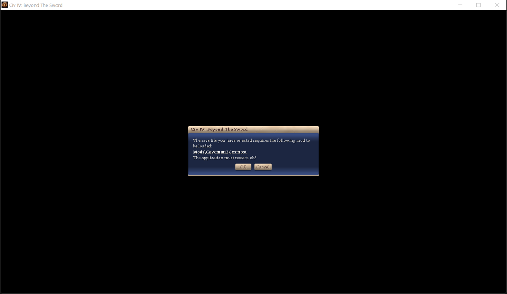

# AdvCiv-SAS Pilot Guide

How an AI/LLM helper reads and drives a running game from the command line, as JSON, instead of through screenshots and clicks: unit and city orders, research, end of turn, saves, autoplay, any XML info, and arbitrary Python run inside the game.

Built and tested by Claude Code Fable 5.2 on 2026-11-13, at the user's request for a way to pilot the active player digitally, as research projects did for StarCraft and Dota 2. The mailbox idea comes from CIVAI, whose repository the user keeps at `C:\Users\PC\Downloads\civai-main`; the goal differs: CIVAI makes LLMs fair opponents behind fog of war, while the pilot gives one agent full information and control of the active player, for AI research and for reproducing bugs and crashes.

The video demos cover two stages of the playtest.

- Part 1 covers the early diplomacy playtest and agent review. Video link to add.
- Part 2 covers the longer live playtest and debugging session. Video link to add.

## Menu

[Quick start](#quick-start)\
[How it works](#how-it-works)\
&emsp;[Switching it on](#switching-it-on)\
&emsp;[Changing commands while Civ4 runs](#changing-commands-while-civ4-runs)\
&emsp;[Why Python, and where the DLL comes in](#why-python-and-where-the-dll-comes-in)\
[Commands](#commands)\
&emsp;[Graph queries](#graph-queries)\
&emsp;[Plot grid and trade network](#plot-grid-and-trade-network)\
&emsp;&emsp;[Scouting trial](#scouting-trial)\
&emsp;&emsp;[Roles](#roles)\
&emsp;[SASPilotConsole](#saspilotconsole)\
&emsp;[Running Python in the game](#running-python-in-the-game)\
&emsp;[Using it from a script](#using-it-from-a-script)\
&emsp;[Replaying commands](#replaying-commands)\
[What was measured](#what-was-measured)\
&emsp;[Speed](#speed)\
&emsp;&emsp;[How it was found](#how-it-was-found)\
&emsp;[Would the DLL be faster?](#would-the-dll-be-faster)\
&emsp;&emsp;[Which other commands to move](#which-other-commands-to-move)\
&emsp;&emsp;[The same question for the Timeline tab, January 2026](#the-same-question-for-the-timeline-tab-january-2026)\
&emsp;[At scale, and the client's own cost](#at-scale-and-the-clients-own-cost)\
&emsp;[How it was measured](#how-it-was-measured)\
&emsp;[Popups](#popups)\
&emsp;[Playing as a person would](#playing-as-a-person-would)\
&emsp;&emsp;[A fog-on playthrough](#a-fog-on-playthrough)\
&emsp;[Loading a save](#loading-a-save)\
[What did not work, and why](#what-did-not-work-and-why)\
[Limits](#limits)\
[Where to take it](#where-to-take-it)\
&emsp;[Modern baseline, 2026-11-14](#modern-baseline-2026-11-14)\
&emsp;[Turn-0 game, 2026-11-14](#turn-0-game-2026-11-14)

## Quick start

Run these from `LLM_Helpers/saspilot/`. `start` launches Civ4 with the pilot on and returns once the first turn waits for orders; every other command talks to that client.

```bash
python SASPilotClient.py start --map Pangaea --world-size WORLDSIZE_SMALL --fixed-seeds
```

```bash
python SASPilotClient.py todo
```

```bash
python SASPilotClient.py mission unit=8192 mission=MISSION_FOUND
```

```bash
python SASPilotClient.py produce city=Carthage item=UNIT_WARRIOR
```

```bash
python SASPilotClient.py research tech=TECH_MINING
```

```bash
python SASPilotClient.py move unit=16385 x=40 y=28
```

```bash
python SASPilotClient.py endturn
```

```bash
python SASPilotClient.py close
```

- `SASPilotClient.py help` lists every command with its arguments, straight from the running game.
- `start` first lists the recommended settings for agent runs with their values, `ok` or `WARN`, warning of any not set, such as the Dawn of Man screen or a tech splash, which make the window wait on a Continue button, SASGameRecord off, or in `CivilizationIV.ini` logging, crash dumps, windowed mode or shown Python errors off; `SASPilotClient.py check` prints the same list alone. The values are the development ones from [`toggle_dev_diagnostics.py`](/LLM_Helpers/diagnostics/toggle_dev_diagnostics.py), read from the working tree, which may differ from the committed values players get (the user's suggestion, 2026-11-14).
- Arguments are `key=value`; a value is read as JSON when it parses (`x=12`, `append=true`, `args=[3]`) and as a string otherwise (`item=UNIT_WARRIOR`).
- `--compact` prints one line of JSON; `--pid` picks a client when several are piloted; `--timeout` changes the 60 s wait for a reply.
- `--timing` prints a request's `roundTripMs` and `gameMs` on stderr, and `bench <command> [key=value...] --count N` sends the same request N times and summarizes both; see [What was measured](#what-was-measured).
- `start --save <file>` loads a save instead of a new game; `start --multiple` runs beside other clients, as in the [Game Runs Guide](/_1_AdvCiv-SAS/Docs/Modding_Resources/README_Game_Runs.md#two-clients-at-once).
- The run above is the sequence tested on 2026-11-13: the Settler founded Carthage, the queue and research were set, the warrior walked to its target over two turns, and 22 turns were ended in a row.

`start` lays out SASPilotConsole beside the game as soon as it is ready, and any later command reopens it if it was closed; every client has one (`SAS_PILOT_WATCH=0` only for automated tests that must not open windows). When the user watches you play, keep the camera on your orders too (see [SASPilotConsole](#saspilotconsole)):

```bash
python SASPilotClient.py start --save <save> --fog
```

```bash
python SASPilotClient.py look follow=1
```

- Give the reason for each order with `note="..."`, which the console shows as `why:`. For two clients, start them with `--watch-slots 2 --watch-slot 1` and `--watch-slot 2`; for a client already running, `SASPilotConsole.py --window --pid <pid>` does the same.
- Close the console window when done; the log stays in `Logs/` for review.

## How it works

- [`SASPilot.py`](/Assets/Python/SASPilot.py), in the game, is a small loader hooked to the `gameUpdate` event beside the autoplay request in `AIAutoPlay.py`, and to screen updates in `CvScreensInterface.update`, which come every frame (see [Speed](#speed)).
- Each client has a mailbox folder, `SASPilot/<process ID>` beside `CivilizationIV.ini` in `Documents/My Games/beyond the sword`, so several clients can be piloted at once; see [KI#1081](/_1_AdvCiv-SAS/Docs/README_Known_Issues.md#ki-1081) for why our files are named by process.
- [`SASPilotClient.py`](/LLM_Helpers/saspilot/SASPilotClient.py) writes a request as `req_<id>.json`, whole and then renamed into place. On its next frame the game claims it by renaming it `run_<id>.json`, runs it and writes `rep_<id>.json` the same way: `{"id", "ok", "result" or "error" and "traceback", "gameTurn", "gameMs", "tick"}`, where `tick` names the event that served it.
  - On a timeout the client deletes its `req_` if it is still there, so the command never runs; a `run_` means the game took it, so the error says to check the game's state before retrying.
- The commands themselves are in [`SASPilotCommands.py`](/LLM_Helpers/saspilot/SASPilotCommands.py), which the loader reads from disk; it is Python 2.4, run inside Civ4.
- Commands see everything, without fog of war, and orders are applied directly to the game objects, as a human's are in single player. Network games are untested.
- Python 2.4 has no `json` module, so the command file carries its own small writer and reader.

### Switching it on

- It is off for players. `SASPilotClient.py start` switches it on for its own process by adding an `[SASPilot]` section with `On = 1` to the per-run INI it passes with `ini=`, as the autoplay runner does with `[SASAutoplay]`.
- `SAS_PILOT_ON` in `GlobalDefines_advciv_sas.xml` switches it on for every launch, for example to pilot a game the user started by hand. Keep it at `0` in commits.
- When off, the cost is one comparison per game update and per frame.
- When on, anyone who can write to the mailbox folder can run Python inside the game, which is the point of the tool; it is a local folder of the user's own account.

### Changing commands while Civ4 runs

- Save an edit to `SASPilotCommands.py` and the running game picks it up within a fraction of a second (it compares the file's size and time every 20 updates, about 30 times a second in game). `ping` then shows `reloadError` if the new file failed to load; the previous version keeps serving.
  - The failure is also written to stderr, which the game shows as a Python error in its window. On 2026-11-13 an edit saved a help string with double quotes inside it, the user watching saw the error, and the corrected file loaded 4 seconds later; so an error that appears while an agent edits this file is usually such a transient save, and `PythonErr.log` names the line.
  - Checking the edit first with Python 2.4 (`C:\Python24\python.exe`, as in [Syntax checks](/AGENTS.md#syntax-checks-and-linting)) before relying on the reload catches such a slip, but the Edit tool saves at once, so the game may load the broken version first.
- This is why the command file lives in `LLM_Helpers/saspilot/` and not in `Assets/Python/`; see [What did not work](#what-did-not-work-and-why).
- `SASPilot.py` itself is in `Assets/Python/`, so changing it needs Civ4 closed first, like any mod Python.
- `ping` reports the loaded `PILOT_REVISION`. Keep one revision for the candidate during a draft PR and record its command changes in [SASPilot revisions](/_1_AdvCiv-SAS/Docs/revisions/SASPilot.md).
- A script writing the command file can fail with `OSError: [Errno 22] Invalid argument` while the game has the file open for its reload check; it happened twice on 2026-11-14, and a retry a moment later succeeded. The Edit tool retries on its own.
  - Later the same day the same error came three times when writing `SASPilotClient.py`, which the game never reads, so the game's reload check is not the only cause; some other process held the file a moment. The cause was not found; a retry loop of a few one-second tries always got through.

### Why Python, and where the DLL comes in

The user asked on 2026-11-13 whether the bridge would be faster or more reliable in the DLL.

- The commands are Python because a command can then be added or fixed in a minute, with no compile and without restarting Civ4, and Python already reaches nearly the whole game API.
- The DLL would not answer sooner: the 250 ms wait was how often the game called the bridge, not Python's speed, and a DLL poll at the same place would have waited as long.
  - Measured later the same day (2026-11-13): a ping spent 0.27 ms in the game against 250 ms round trip. Serving on every frame instead brought it to 2 ms, and a faster JSON writer brought 441 plots from 250 ms to 12 ms, both in Python; see [What was measured](#what-was-measured).
  - Reading the game data itself took 3 ms for 441 plots, so a C++ version of the reads looked likely to save only a few ms.
  - Correction after a C++ prototype the same day: C++ did both reading and writing the JSON in 0.32 ms against Python's 8 ms, but a bridge served from the DLL alone still waited about 200 ms, as the EXE calls the DLL only about four times a second. See [Would the DLL be faster?](#would-the-dll-be-faster).
- The DLL is needed for reach: what Python cannot see or do at all. Popups were the first case, so `CyGame` gained `getSASPilotPopups`, `closeSASPilotPopups` and `answerSASPilotPopup`; deals and a hook at the main menu would be next.
- So the split is: small DLL bindings for what Python lacks, and the commands themselves in Python on top of them.

## Commands

| Command | What it does |
| --- | --- |
| `ping` | bridge revision, PID, whether a game runs, turn, year, active player, whether it is that player's turn, autoplay turns left, map, and the difficulty (`handicap`, `playerHandicap`), as the Victory screen shows it: the user asked whether the pilot played Monarch or Noble (Noble, 2026-11-14) |
| `todo` | what waits for orders: cities with an empty queue, missing research, units ready to move with no mission and not automated, and held popups that ask for a choice; also an open diplomacy screen, and a city screen left open over the map (`cityScreen`), as a spy's Investigate City leaves one, and any advisor or other screen left open (`openScreens`) |
| `closescreens` | close the screens left open in the window, all or one `name=` as `todo`'s `openScreens` names it, as Esc or their Exit button does: the pilot could open an advisor with `control` or `screen` but not close it, and the user saw a Foreign Advisor left open by a test (2026-11-14) |
| `turn` | what a person sees as a turn starts: turn, year, `todo` and the messages since the previous turn |
| `player`, `players` | gold, rates, research, civics, religion, counts, wars; one player or all. Under fog, `players` gives other teams' players only once met, with their ID, name, civilization, team and whether alive, as the scoreboard does: it gave every civilization in full, unmet ones included (Codex's review, round 32) |
| `units`, `unit` | a player's units briefly, or every living player's with `player=all`; one unit in full, with the missions, builds, commands, promotions and upgrades it can take now |
| `cities`, `city` | a player's cities briefly; one city in full, with what it can train, construct, create, maintain or hurry now, and as the city screen shows them its trade routes (each partner and the commerce it brings), defense and bombard damage, and Great People progress. The user asked at turn 141 of the turn-0 game whether the pilot had the city screen's details: London then traded with York for 1 commerce and, after Currency, with Pericles's Sparta for 3, as foreign routes need foreign cities we have seen |
| `plot`, `plots` | terrain, feature, bonus, improvement, route, owner, yields and units of one plot or of a square of plots; with fog on, only what the team knows (see [Playing as a person would](#playing-as-a-person-would)). Center `plots` on `x=` and `y=`, or use `unit=` or `city=` with `radius=` |
| `grid` | an inclusive rectangle or the whole map, with canonical plot coordinates, terrain, fog and optional trade-network edges. See [Plot grid and trade network](#plot-grid-and-trade-network) |
| `fog` | switch between the full view (default) and what the active player's team knows or sees |
| `path` | the route a unit would take to a plot before ordering it: each step's plot, turn and moves left, and the total turns |
| `messages` | the messages the game showed the player at the top of the screen and still lists, such as combat results |
| `citizens`, `work`, `specialist`, `emphasize` | the city screen: worked plots, specialists, governor and emphasis buttons, and the clicks that change them |
| `civics`, `sliders`, `religion` | the civic options with what can be adopted, the commerce percentages, the state religion; each also makes the change |
| `types`, `pedia` | the XML types of one kind, and a type's Sevopedia text: its name and the effects text the DLL composes |
| `info` | any XML info by type, such as `type=UNIT_WARRIOR` or `type=BUILDINGCLASS_PALACE`: every simple getter of its info object, which is the data the Sevopedia shows |
| `mission`, `move` | give a unit's group a mission (`MISSION_FOUND`, `MISSION_FORTIFY`, `MISSION_BUILD data1=BUILD_FARM`...); `move` is `MISSION_MOVE_TO` after a path check; with `append=1` the mission is checked where the queue ends; a unit with no moves left takes a new order too, starting next turn, as in the window (a Worker's replacement queue was refused as "moves left 0", 2026-11-14) |
| `builds` | what a unit could build on a plot, with turns, the improvement or route, and the improvement's yield change; with `refused=1`, also each build the plot refuses and why, in `CvPlayer::canBuild`'s order: the plot's own check first (an improvement the plot cannot have, a feature that unclaimed land cannot have removed (advc.119; in SAS a road drains Marsh, which is why a road at 26,28 of the turn-0 game was refused), or another team's land), then a missing tech, a missing feature tech, and gold with inflation, nothing for a build already begun. The first version asked the tech first and took the XML gold cost (Codex's review, round 32) |
| `sites` | the recommended city sites the window circles for a selected Settler, with found value and path turns |
| `mark` | a sign with text on a plot and, by default, dots over its city radius, so a candidate city site shows on screen; `grid` lists the marks too, so the agent's analysis and the screen show the same sites; `clear=1` removes them. The user's idea in the scouting trial (2026-11-14), when the agent compared sites only in JSON and the user could not see which plots it meant. Cosmetic: nothing in the game changes |
| `odds` | the combat odds the window shows when a unit is pointed at a plot: the defender the game would pick, strengths, and the chance to win in per mille |
| `group` | group a unit with another on its plot, as selecting both does, so they move as one; without `with=`, split it off |
| `diplo`, `reply`, `contact` | the diplomacy screen as the window shows it: the AI's line, the numbered replies and the screen's number; `reply n= screen=` answers one as a click does, refused if the screen has changed since, and `comment=` names the reply instead of its number (`comment=COMPLETE_DEAL`), which is safer: at turn 128 of the turn-0 game the agent sent `n=1` meaning "What would make this deal work?", but with only our Pig on the table the list was FISH_FOR_DEAL, GIFT, and the Pig went to Gilgamesh as a gift; `contact` opens the screen with a leader, and with `give=`/`take=` on its trade table with that deal on it |
| `freetech` | choose a free tech such as the Oracle's, while one is owed |
| `trade` | the diplomacy screen's table with another player: what each side could give, the AI's refusal reason per item (`DENIAL_` type), and its attitude |
| `propose` | propose a deal to an AI, as the Propose button does: `give=[...] take=[...]` with items as `trade` lists them; an accepted deal is made |
| `techs` | the tech market across the players met: each tech we lack that a rival holds, with its cost, whether SAS's XML lets it be traded at all (`bTrade`, off for 32 techs such as Bronze Working, Engineering and Chivalry), and per holder whether it can go in a deal, the AI's refusal and whether it will talk; then what we could give each, with the gold each could pay at once (`maxGoldTrade`, the tab's coin column); and `nobodyHas`, the techs we can research that none of them holds, with `unseenPlayers` counting met players whose techs the fog hides. Under fog, as the Foreign Advisor's tech tab shows it. The user pointed out at turn 139 of the turn-0 game that the agent kept researching techs every neighbour had, which trade buys far cheaper, while a tech nobody has trades to several leaders; at that turn Navigation was the only one |
| `SASPilotClient.py price` | an AI's price, as "What do you want for this?" gives it: `price with=2 take=["TRADE_TECHNOLOGIES:TECH_MACHINERY"]` puts the items on the table, reads the counter-offer and leaves with nothing agreed; `accept=1` takes it (reported as `acceptSent`: read the result back). It stops if another leader's screen or a new conversation takes over. A client-side sequence of `contact`, `diplo` and `reply`. It leaves by Reject or Never mind before Exit and checks a second later that the screen stayed closed: Exit straight from a trade table after a refusal reported it closed, but the table came back and blocked the next call (2026-11-14) |
| `SASPilotClient.py leave` | click through diplomacy screens that only inform (thanks, a cancelled deal, a war declaration) with their exit reply, as a person does, and stop at the first screen with a choice (a deal, peace, a demand), returned for the agent to answer. On turn 289 (2026-11-14) Kublai's declaration, a thanks and two cancelled deals queued up one after another, each needing a `diplo` and a `reply` |
| `look` | turn the window's camera to a plot, a unit or a city; following is on by default since the user, watching the Orleans attack (turn 129 of the turn-0 game, 2026-11-14), asked for it without anyone switching it on (`follow=0` stops it): it makes each `move` and attack look at its destination first, and each order on one of our units or cities (`mission`, `command`, `produce`, `hurry`, `spy`...) look at it, so a person watching sees the action; only our own units and cities, so fog hides nothing more than in the window |
| `command` | a unit command, such as `COMMAND_PROMOTION data1=PROMOTION_COMBAT1`, `COMMAND_AUTOMATE data1=AUTOMATE_EXPLORE` or `COMMAND_DELETE confirm=1`. Deleting needs `confirm=1` or `true`, as the window asks: at turn 90 of the turn-0 game the agent sent `COMMAND_DELETE` to two new Workers meaning to clear their queues, and lost one (a new mission without `append=1` clears a queue) |
| `produce`, `hurry` | set or append a city's production; hurry it, or without `hurry=` list the ways with their gold and population costs (gold needs Universal Suffrage, population Slavery) |
| `research` | the techs available now with turns, and the queue; or research a tech, queueing missing prerequisites first, `append=1` to add. Use `effects=1` to include each available tech's rules and unlocks |
| `tech` | one tech's effects and requirements, with the selected team's cost, progress and missing immediate prerequisites |
| `graph` | the tech tree, promotion prerequisites, unit upgrade paths, current diplomatic relations or completed-turn Info graphs as JSON. See [Graph queries](#graph-queries) |
| `endturn` | end the turn, reporting what was left (`skipped`); the client then waits for the next turn and prints its `turn` digest, unless `--no-wait`; `--turns N` keeps ending turns until something waits |
| `autoplay` | AI Auto Play for a number of turns; follow with `SASPilotClient.py wait` |
| `save` | save; through `SASPilotClient.py` a bare name goes to `Saves/single`; an existing file needs `overwrite=true` |
| `menu` | leave the game: with `path=`, load that save in the same process and wait until it is ready (`--no-wait` returns at once); without, go to the main menu. In a big late game, close and `start --save` instead: leaving a Huge turn-305 game crashed Civ4 ([KI#1084](/_1_AdvCiv-SAS/Docs/README_Known_Issues.md#ki-1084)) |
| `control` | any `ControlTypes` entry, as its hotkey would: `CONTROL_DOMESTIC_SCREEN`, `CONTROL_WORLD_BUILDER`, `CONTROL_QUICK_SAVE`...; a number works too, and the role check resolves it first, as `control=57` (the WorldBuilder) passed the play role when it compared names (Codex's review, round 32) |
| `screen` | call a `CvScreensInterface` function, such as `name=pediaJumpToUnit args=[29]`, to show an advisor or Sevopedia page in the window; under `play` and `assist`, only `show*` and `pedia*` functions, without the WorldBuilder's and the debug screen, as `name=WorldBuilderRevealAllCB` would reveal the map; the Foreign Advisor also takes its tab number (`name=showForeignAdvisorScreen args=[5]` opens Glance), a click a player makes |
| `batch` | several commands in one request |
| `py` | run Python inside the game |
| `profile` | run a command and split its time into reading the game (`gatherMs`) and writing the JSON (`encodeMs`) |
| `popups` | the active player's popups held back from the window, plus any displayed or queued; see [Popups](#popups) |
| `answer` | answer a held popup as if one of its buttons were clicked: `id=` from `popups`, `button=` by number or name (`button=RAZE`), `text=` for an edit box |
| `closepopups` | drop held and queued popups, all or of one `type=` |
| `dequeue` | remove one entry from a city's build queue by position, as clicking it in the city screen does |
| `espionage` | the espionage screen: per team met, our points against it, our spending weight and its counterespionage against us; `team=` with `weight=` sets a weight |
| `spy` | what a spy could do where it stands, as the espionage popups offer it: the plot's owner (`target`), our points against that team, and each affordable mission with its cost and targets; run one with `mission=MISSION_ESPIONAGE data1=<mission> data2=<data>`. An empty list with few `points` means no mission is affordable, as at Madrid with 40 points against Kublai (2026-11-14); `blocked` names why a spy can do nothing this turn: it moved (a spy acts only on a turn it has not moved), attacked, or the target team sees it |
| `relations` | per player met: attitude, will to talk, war, treaties, open borders, defensive pact, closest city distance, cities within 10 plots, score, power (fog off), and `viewsOf`, each leader's attitude toward every other, which is not symmetric. Also `powerRatioPerMille`, their power against ours as the scoreboard shows it beside each leader (1488 is 1.488 times ours), wherever the scoreboard shows it (`canSeeDemographics`), and `attitudeModifiers`, the hover's lines such as "+1: Years of peace" or "-1: You're getting ahead of us": the user pointed to both at turn 90 of the turn-0 game, when every rival was 1.2 to 2.2 times stronger. Under fog, only cities whose city, not just plot, the team has revealed count (Codex's review, round 35). `attitudeValue` and each `viewsOf` cell carry the Foreign Advisor Glance tab's number (the sum of the hover's modifiers, as BUG's AttitudeUtil reads it), with `worstEnemy`, `atWar`, `peaceTreaty` and `wouldJoinWarIfAsked` (advc.152): the user had the agent compare the reply with the Glance tab at turn 127 of the turn-0 game, which showed +11 and -5 where the reply had only Friendly and Annoyed, and the numbers and icons pick a war target and its likely friends |
| `deals` | our running deals, as the Foreign Advisor lists them: the leader, the turn each began, `turnsToCancel` and what each side gives. A resource we export leaves our network, as `CvPlot::updatePlotGroupBonus` subtracts the capital's exports, so `resources` shows it unconnected: at turn 125 of the turn-0 game the mined Iron beside London read unconnected for seven turns, and `deals` showed it had gone to Gilgamesh inside the turn-118 Pig sale |
| `canceldeal` | cancel one of our deals as the Foreign Advisor's cancel does: it raises the window's `BUTTONPOPUP_DEAL_CANCELED`, which `answer` confirms (`CANCEL_DEAL`) or declines; refused before `turnsToCancel` reaches 0 and for deals holding a vassal item, as `CvDeal::isCancelable` is not exposed to Python. The Iron came back at turn 128 this way |
| `trainable` | the units a city can train now, for value per hammer: turns, cost, strength, moves, strength per 100 hammers, and what strength leaves out (first strikes, collateral damage and reach, withdrawal, bombard, city attack and defense, bonuses against unit types). The user's advice at turn 100 of the turn-0 game: weigh strength against cost, as an Axeman for 35 hammers is strong early, and the effects, as a Trebuchet's strength is low. Axeman and Spearman gave 1428 per 100 hammers, the Longbowman and Catapult 1000 |
| `bonustrade` | the Foreign Advisor's Bonuses tab: our resources with how many we have and who would import each, and per leader met whether our networks connect, the most gold per turn they would pay, and what they would import, will export, won't export and we don't need, by the tab's own tests (CvForeignAdvisor.drawResourceDeals). The user advised trading spare copies actively (turn 111 of the turn-0 game, 2026-11-14): asking leaders one by one with `price` had found only that nobody wanted a Pig, while the table showed Louis importing Wine, our second copy, which then sold for 4 gold a turn. The hover's per-resource price ("Will import: Pericles (6), Zara Yaqob (8)" over Rice, from `CvPlayerAI::AI_goldForBonus`) is not exposed to Python; `price` gives the price of one deal |
| `scores` | the SAS Info screen's Score tab: per player met and ourselves, score and its change since last turn, techs known, land share in per mille, power and power per city where the demographics are visible, cities seen, state religion and holy city, vassal status, will to talk, and research where espionage shows it. The user pointed to the tab at turn 150 of the turn-0 game: it showed at once that we knew 27 techs against 29 to 37 for every rival |
| `demographics` | the Info screen's Demographics tab: soldiers, land, population, economy, industry and agriculture, with our value and rank, and the rivals' best, worst and average, under fog by the tab's own rules (rank among met players, best and worst among those whose demographics we see, average above 3 rivals, rounded) |
| `finance`, `domestic`, `military` | the Finance tab's numbers; the Domestic Advisor's per-city overview, with `coastal` per city and a `summary` (cities, coastal, unhealthy or at the health cap, unhappy or at the happy cap, starving), as the user asked at turn 156 of the turn-0 game how many coastal cities we have and which cities need health, and from the advisor's other overview pages each city's defense %, garrison, revolt chance in per mille (Orleans's 9.2% at turn 139 had been learned only from a turn message), food stored against the growth threshold, war weariness and the turn founded; at turn 157 they showed 16 units idle in Orleans and one in London; the Military Advisor's units by domain and place, wounded, upgradeable now with the cheapest cost, Great General progress and walls |
| `targets` | the plots a unit could pick for an interface mode from `unit`'s `targetModes` (recon, air bomb, air strike, rebase, paradrop, airlift, ranged attack, nuke), as the window highlights them, with the mission to send; under fog, revealed plots only. Without `mode=`, the unit's modes. A Jet Fighter's recon flew this way on turn 285 (2026-11-14) |
| `settle` | give every idle group Fortify, else Sleep, else Skip, once per group, as a player does before ending the turn |
| `routes` | a text map of the player's land, one row per map row from the north: `C` city, `#` railroad, `=` road, `.` own land with no route, `~` own water, `x` another's land, `?` unrevealed under fog; plus each city's connection to the capital. Under fog, only our own team: `player=` naming a rival still drew the map's edges from all its plots and listed its cities (Codex's review, 2026-11-14) |
| `map` | a text map of the known world, one character per plot: `C` our city, `c` another's, `~` water, `^` peak, `h` hills, `f` forest or jungle, `x` another's land, `u` one of our units, space unknown; under fog, only revealed plots, with their last-seen owners. Made for an opening's scouting and city sites: at turn 25 of the turn-0 game only 150 of 3168 plots were known |
| `resources` | every resource the team knows of, with its owner, improvement and each build that connects it, with the build's tech and whether we have it: at turn 37 of the turn-0 game it showed that SAS's Agriculture opens the Banana's Plantation and five more resources nearby, so Agriculture went ahead of Masonry (the user's advice: check resources first). `connected` on our own plots says whether the plot supplies its resource: at turn 90 the Banana, the Copper and two Pigs were improved but unconnected, with no road from their plots to a city, which the user saw before the agent did |
| `reminders` | what the game does not announce but a player would want pointed out, as small checks: no research, an empty build queue, a starving or angry city, a wounded unit outside our borders, gold running out within ten turns, techs a met player could be offered, and screens or popups left open in the window, which the user noticed before the pilot did (2026-11-14). Each turn's digest carries them, and `endturn --brief` prints them as `remind:` when they change. Added when the user noted that a missed choice can cost a turn the game never mentions; Seafaring, 2 turns of research no neighbour had, then bought Construction and Metal Casting (2026-11-14). A `losses` check lists our units destroyed or captured since the previous turn: two Workers killed by a barbarian Archer went unnoticed when the agent cut each digest to its last lines. An `unfinished` check lists builds a city has hammers in but is not making, as a city keeps them after switching (the user's advice: a Worker one turn from done is worth finishing). An `unimproved` check lists resources inside our borders that supply nothing though we have the tech for a build that would connect them, such as the Clam at 22,31 of the turn-0 game, outside every city's radius but in our borders, which the user pointed out a cheap Work Boat connects for health (turn 156); it also catches an improvement pillaged by barbarians or rivals, and names a worker of ours already headed there (`unitOnTheWay`, where its group's mission queue ends), as at turn 160 the agent queued a second Work Boat for the Clam while the first was one plot away. A `sleepingWorkers` check lists Workers asleep, as a sleeping unit is not idle and appears nowhere else: three slept near York from turn 155 to 160 while the user saw York under-improved. An `exports` check lists resources we give away in a deal while none is left for ourselves, as the Iron was from turn 118 to 128 of the turn-0 game, with nothing in the game saying so. Added in the scouting trial and the Continents game (2026-11-14), each after a slip the user caught: `idleImprovements` (an improved plot no city works while the city works an unimproved one: the Clam's boats sat unworked six turns with the governor off), `scoutBeforeFounding` (no city yet and units with moves left besides the Settler), `exposed` (a unit within two plots of a visible animal or barbarian: a Scout died beside a Bear), `huts` (every goody hut seen, with our nearest unit), `idleGarrison` (military units waiting in a city, with the nearest foreign unit and how much of the map is revealed; usually they should explore early, not always); `unimproved` also names a unit for it already in a city's queue (`inProduction`) |
| `role` | the session's role, the user's idea (2026-11-14): `play` allows what a player sees and does, keeps fog on and refuses `py`, the WorldBuilder, `fog=0` and orders or reads with another team's `player=`, in `batch` and `profile` too; `assist` adds advice to `play`; `all`, the default, allows everything. `lock=1` holds the role until Civ4 closes, and `start --role` locks it. See [Roles](#roles) below |
| `advise` | advice, a heuristic of ours that may be wrong, naming its rule in each reply: `about=scout` ranks `scout`'s steps; `about=threats` weighs each animal and barbarian within 4 plots of a unit and says which to `avoid`. See [Roles](#roles) below |
| `SASPilotClient.py health` | the pilot's own state in one reply, the user's idea (2026-11-14): the bridge's tick errors, settings not at their recommended values, this session's errors and `py` snippets, operators present, role and fog, and whether SASPilotConsole follows the client; `problems` lists what needs a look and is empty when all is well |
| `scout` | each plot a scout could step to now, with how many unknown plots it would reveal, its defense bonus and the animals and barbarians seen within two plots, in a fixed order; the choice stays the agent's, as automated exploring lost a Warrior that fought on at 15 HP. Its ranking moved to `advise about=scout` with the facts-versus-advice split |
| `greatpeople` | Great People planning: the threshold, per city its points, points per turn, rate modifier, turns left and the mix of types with each one's chance (`chancePctX100`), as the city screen's bar shows; and the techs whose first discoverer gets a free Great Person that nobody has yet |
| `workers` | planning Workers by hand instead of automating them: without `city=`, each Worker with its mission, per city the worked plots left unimproved and the city AI's three most valued builds, and per leader we can trade with whether their capital is on our trade network (a missing road link means no foreign trade routes); with `city=`, each plot's terrain, feature, bonus, river, improvement, route and yields, the city AI's best build and value (`getSASPilotCityBuildsJson`, as Python had no getter), and every improvement a Worker could build with its yield change and turns. The AI's choice is a reference to compare with, as the user wanted the pilot to decide as a player (2026-11-14); as advice no screen shows, it is left out unless the session's role allows advice |

- Types are passed and returned as XML types (`UNIT_WARRIOR`, `TECH_MINING`), never as numbers or translated names.
- Unit and city IDs are per player; `player=` selects another player than the active one, for reading and for orders alike.
- A reply that names another player gives its ID with the leader's name and civilization XML type, such as `contact`'s `{"contacted": {"player": 2, "name": "Kublai Khan", "civ": "CIVILIZATION_MONGOL"}}`; only the ID is unique, as with duplicate leaders or civilizations allowed two players can share both (2026-11-14). Unit and city rows keep a bare `owner` number, as naming it in every row would swell large replies; `players` maps the numbers.
- An order's reply shows the state at the moment the order was given. A mission is carried out on the following game updates: right after `MISSION_FOUND` the reply still showed the Settler, and the city existed a moment later. Read again before relying on the result.
- A `MISSION_MOVE_TO` longer than the unit's moves continues when the turn ends, as it does for a human's unit.
- `start`, `list`, `wait` and `close` are handled by `SASPilotClient.py` itself and are not in `help`.

### Graph queries

Fetch the full rules graph once when planning across several turns, then use a type filter for an individual lookup. The Pilot builds the three rules graphs from the running game's loaded definitions and caches them for the lifetime of the command module. Tech effects and upgrades use the selected player's civilization, so unique units and buildings appear in place of their generic counterparts.

```powershell
python SASPilotClient.py graph kind=tech
python SASPilotClient.py tech type=TECH_AGRICULTURE
python SASPilotClient.py graph kind=promotions type=PROMOTION_COMBAT1
python SASPilotClient.py graph kind=upgrades type=UNIT_WARRIOR
python SASPilotClient.py graph kind=relations fog=1
python SASPilotClient.py graph kind=history metric=power start=100 end=150 fog=1
python SASPilotClient.py plots x=26 y=27 radius=2 fog=1
```

- The tech graph has the F6 grid coordinates, separate required-all and required-any prerequisite groups, and named effects. Agriculture, for example, can enable a worker build and separately satisfy the technology requirement for connecting a resource. The `tech` command adds current research progress and can expose other missing tech prerequisites for a unit or building. Training or construction can still depend on the city, resources, and other conditions.
- Promotions include mandatory and alternative promotions, required technology and state religion, and eligible unit combat classes. Unit upgrades link direct destinations with the appropriate civilization replacements. A single-node lookup also lists incoming links.
- The relations graph is fetched live. Nodes are keyed by player ID, and directed edges preserve cases such as one leader liking another more than the feeling is returned, or a vassal pointing to its master. The graph combines the F3 Relations links with attitude details from Glance and omits uncontacted pairs.
- The Info graphs offer `score`, `economy`, `industry`, `agriculture`, `power`, `culture` and `espionage` by player and completed turn. With fog on, rival series follow the advisor's demographics and partial-score rules.
- Use `plots` for structured spatial data alongside those graphs. Its coordinates and plot fields can be indexed directly while the same fog settings apply.

### Plot grid and trade network

Use `grid` for spatial analysis. It gives the requested bounds, map size, wrapping flags, sparse plot rows keyed by coordinates, and trade links between neighboring plots. Request an inclusive `box=[west,south,east,north]`, center on `x=` and `y=`, `city=` or `unit=` with `radius=`, or omit the area to get the full map. Radius clips at the map boundary. Pass `network=0` when the calculation needs only tile data.

```powershell
python SASPilotClient.py grid 'box=[19,21,30,32]' fog=1 network=0 > grid.json
```

Run this from `LLM_Helpers/saspilot`. An agent can load the JSON into desktop Python, index the tiles by `(x, y)`, compute features for every candidate in the rectangle, and print only the matching plots or aggregate results. For repeated neighborhood scans, use separate numeric arrays for each yield and Boolean masks for land, hills and visibility. Track missing tiles in the mask so an unknown yield stays distinct from a known zero.

- With `fog=1`, unexplored plots have no rows. Explored plots outside current sight retain remembered ownership, route and improvement data. Fields without a last-seen accessor, including current yields and network membership, appear only where the team sees now.
- For network analysis, use `tradeLinks` as edges between coordinate pairs. Each edge comes from the engine's connectivity rules, which can join rivers and water as well as routes. The crop and fog can exclude parts of a path. For capital connectivity, use the engine's `capitalNetwork` result for eligible plots rather than inferring it from a cropped graph.
- On a client whose role permits `fog=0`, the full view includes unrevealed tiles. The selected team's trade-network rules still include its exploration requirement. The text `map` and `routes` commands remain available for compact logs.

#### Scouting trial

On a client started with `--role play`, get a land unit ID from `SASPilotClient.py units`, then compare destinations before issuing any moves.

```powershell
python SASPilotScout.py --pid 33096 --unit 16385 --radius 5 --limit 3
```

Use the PID and unit ID from your own client. The helper keeps the full reveal mask in desktop Python, checks candidate routes in one batch, and prints a few JSON rows. It prefers destinations without a visible foreign unit within two tiles, then uses unexplored tiles per travel turn and discounts coverage already represented by an earlier choice. Foreign contacts can be peaceful, and zero sightings gives no information about units in fog. The radius around each destination is a proxy for line of sight, with a larger square for hills. Compare actual new visibility after a move and refresh the shortlist before committing to a second destination.

The turn-0 Pangaea trial found the same best immediate step as `scout` and also offered candidates along other parts of the frontier. It left the game at turn 0 for a playthrough. Use `tech type=TECH_...` to check what a new discovery would enable once a resource or city site becomes relevant to a research choice.

Claude Code Opus 5.5 then played that start three times on 2026-11-14 with the user coaching, saving `sas_pilot_scout_trial_run1_t028`, `_run2_t012` and `_run3_t040`. Run 3 founded city 2 on turn 40; run 1 had its Settler due around turn 41 and no site chosen.

- Loop around a city with `--around X,Y`, the user's advice for the opening: circle the capital 3 to 5 plots out (`--band`) to find city sites, huts and the nearest rivals before heading far, sites close to the capital first, as those are the ones a Settler can use soon.
  - `--ccw` turns the loop the other way, so two scouts can circle in opposite directions, the user's rule; give the faster unit the largest unknown area, and avoid sending a unit back across ground another has seen.
  - The fertile side first: green land holds the sites, desert and plains can wait.
- Each choice counts what every step of its route reveals, so diagonal steps (five new plots, against three) and hills (two plots of sight) rank higher, as the user advised.
- Each choice has `stopThisTurn`, the best-defended plot the unit reaches this turn: end turns on a hill or forest and let animals attack you there, rather than attack them. Move only to that stop, one plot at a time for a unit with more moves, and look again after each step.
  - SAS defence is not what the feature XML says alone: forest is 0 and jungle -25, but both add `iRivalDefense` 25 outside the attacker's land, so forest gives +25%, jungle 0 and a hill +25 more (`grid` now gives each plot's `defense` from `CvPlot::defenseModifier`).
  - A stop must be in sight and more than two plots from any visible foreign unit, and a wounded unit is refused until it has healed. Each rule came from a loss: the Warrior walked into a Lion on a multi-turn order (run 1); the Scout went back out at 64% health and stopped beside a visible Bear, which killed it at 99% odds though Scouts get +200% against animals (run 3).
  - Killing an animal gains a little experience, while losing the scout loses the only scout: the user's rule is to avoid animals unless something real is at stake.
- Lessons for the opening, all from the user:
  - Move the other units before founding: what they reveal can change the site. Runs 1 and 2 founded before the Warrior moved; run 3 looked from the 19,18 hill first. The `scoutBeforeFounding` reminder now says so.
  - A Scout once Hunting is in: run 1 had none, and information was what the opening lacked most.
  - Strategic resources call for a fresh look at the map: Animal Husbandry revealed a Horse beside the capital (Chariots with The Wheel, Byzantium's Cataphract later with Iron) and a Camel at the Mongol border.
  - A site needs more than resources: scout its coast, as harbours and Work Boats depend on it (Thessalonica at 12,17 was founded without, too early); weigh choke points and the neighbours.
    - The user's review of 12,17: its best food, the Banana at 14,18, already belonged to the capital; the plains south of it cannot grow much; it has no fresh water. The user's own pick, placed with BUG's dot map (Alt+X) and read back by the agent through `grid`'s `dotMap`, was 10,19: the bay's coast, fresh water from the lake at 10,18 and the Rice beside it, with the Banana left to the capital.
      - Why the coast weighs more than its visible resources, in the user's words: the land is greener, the water may hold resources not yet seen, and even without any, coast tiles grow a city further with a Harbor than flat plains can; the Marble at 8,17 would be in range too, for local hammers on wonders or to trade for gold per turn.
      - The agent's site score had counted resources only, so it ranked a plains hill first; a score should also count the plots' own food (grassland against plains) and the coast's room to grow.
      - And the west was not scouted enough before the Settler left, as the user pointed out: the Warrior turned north after one look, and the coast at 8 to 10, 17 to 20 stayed barely seen. The score made it worse by taking points off a site for each unknown plot, so the fully seen 12,17 beat 11,17 and 10,19, whose radius still had fog. Unknown plots around a promising site call for a scout before the Settler commits, not a lower score.
    - The post-game review in debug mode (the user's idea, like reviewing a game of Go; run 3 loaded at turn 41 with Ctrl+Z) showed that the north was a real choke point: the land between the bay and the sea narrows toward Kublai's land. A city there, near 15,22 or 16,22 with the Clam, the Marble, fresh water and the coast, would have held the pass and claimed what lies behind it; both the agent and the user had set the north aside as plains with little food. Weigh where land narrows toward a rival, not only a site's own tiles.
      - Debug also showed what no player could see yet: the north's only other resources were Iron and Sand, revealed by later techs. Iron there would have mattered to Byzantium, whose Cataphract needs Horse and Iron, and the capital has the Horse. The south was poor as well, desert and plains, and the east was blocked by the Inca.
      - So the start was tight, and the review's plan in hindsight: city 2 at 10,19 in the west for food and coast, city 3 at the north choke near 15,22 before Kublai reached it, then fill in behind it.
      - The user then weighed it the other way round: north first, as it was contested and the west was safe behind us. A northern city around the Wheat (16,23) would also have reached the Camel at Kublai's edge, the Marble and hammer hills by a river: a production city holding the pass, with Camel Archers later. Contested land first, safe land after, the same rule the agent had argued for the east.
    - Mark candidate sites with `mark`, which puts them in that same dot map: the user sees each site's city radius at a glance, and suggestions placed with Alt+X reach the agent. A site squeezed between two aggressive AIs' borders for one Gold (20,18) was dropped once Kublai's border showed three plots from the capital.
  - Adopt a civic when you are about to use it, and bundle changes: Slavery came two turns of anarchy before anything needed whipping. A whip takes at most half the city (`hurry` now shows `maxHurryPopulation`), and in SAS Slavery and forest chops both come with Masonry.
  - Chop forests on plots you will improve anyway, such as a grass hill to mine, so the chop and the improvement come in one: a forest gave 20 hammers here, not the XML's 30, as the game scales it (`builds` now shows `featureProduction`).
  - With the city governor off, nothing moves a citizen onto a new improvement: the Clam's fishing boats sat unworked for six turns in run 1. The `idleImprovements` reminder now catches it.
- A Continents game followed the same evening (Mongols, Genghis Khan, Small, Noble, fog on, play role), after the user dropped Boreal on seeing it revealed: no good site anywhere. Debug mode was then left off for both, as the user could not judge the agent's choices with the whole map in view; the review in debug comes after a game (`sas_pilot_continents_mongols_t009`).
  - Founding waited three turns while the Scout, the Archer and the Settler itself (two moves) scouted, the user's rule: the game's recommended inland hill at 55,25 had neither coast nor fresh water, and two turns of moving showed a Clam, two Whales and the coast, so Karakorum stands on the coastal forest hill at 56,27 with the Clam, a Whale, the Silver and the Rice in range.
  - New reminders from it: `huts` lists every goody hut the team has seen with our nearest unit (two huts then gave Pottery and research); `idleGarrison` lists military units waiting in a city with the nearest foreign unit and how much of the map is revealed, as the user pointed out that the Archer should explore while nothing threatened; the call stays the agent's.
  - A found order given to a Settler with no moves left stayed queued without founding at the start of the next turn; issuing it again founded the city.
  - Handoff at turn 19 (`sas_pilot_continents_mongols_t019`, peace with Bismarck and Isabella of Spain, whose Madrid is about 11 plots west-south-west):
    - City 2 planned at 55,23 (Marble, Dye, Pig, Peat, fresh water; it keeps the grass hill at 54,22 as a worked plot), then a city toward the Gold at 52,21 before Madrid takes it. `SASPilotSites.py` ranks 55,23 first; the south and east were still being scouted before the Settler commits, the user's point.
    - Karakorum builds a Worker (the Rice farm, Agriculture in), then the Settler; research Masonry, Mining, Animal Husbandry.
    - Scouting with `SASPilotExplore.py`: the Archer east (`ccw`), the Warrior toward the unseen pocket at 51,26, the Scout back to the closer west, as the user found the south overcommitted. A Panther was near the Scout at 54,16.
  - Codex's review of the day's pilot changes (round 38): fixed the same night, the P1 (`SASPilotExplore.py` read the new turn's events from the immediate `endturn` reply, which holds only the turn ended; it now checks `todo` first, waits for the turn and reads `turn`), hostiles by barbarian identity and war rather than slot number, and `mark` colours limited to `COLOR_` types. Still open:
    - P2: the hut branch of `SASPilotExplore.py` skips the health check and sends a multi-step hut route in one order, so a threat revealed on the way cannot stop it.
    - P3: `SASPilotSites.py` counts fresh water from any river edge of a neighbour, including a diagonal's far edge, and counts a lake as coast; the engine's own fresh-water and coastal answers would be exact where the team can know them.
    - The C++ `area` fix in `appendSASPilotPlotJson` needs a DLL build; the Python blanking in `_plotsJson` can go once it is installed.
- The pilot changes from the trial: `grid` gives `fogEdge` (land or water of unrevealed plots beside revealed ones, which the coastline art shows), feature and resource on fogged plots as the window draws them, and `defense`; `plot` no longer gives the true-map `area` under fog, which told that a bay and a far sea connected through unseen plots; `research tech=` without `append` now restarts the queue at a tech already in it; the `unimproved` reminder says when a unit for it is in a city's queue; new reminders `exposed`, `scoutBeforeFounding` and `idleImprovements`.

#### Roles

- Each command has a role, shown by `role`: play (what a player sees and does), advice, omniscient (seeing past the fog), create (changing the game beyond play, as the WorldBuilder or `py`) or meta (running the session). The user's idea, 2026-11-14.
  - Some depend on their arguments: `fog=0` is omniscient; `control` is resolved to its value first, as `control=57` (the WorldBuilder) passed the play role when names were compared (Codex's review, round 32); `screen` is play only for the advisors and Sevopedia navigation without arguments, as `showReplay` passed a player index to native code unchecked (round 33).
- Facts and advice are kept apart, the user's next idea the same day.
  - `play` commands state what the game shows a player, the same for anyone who can see it, and rarely change.
  - `advice` commands weigh facts into a recommendation by a heuristic of ours, which may be wrong and gets tuned as we learn. Each reply names its rule and shows the facts it weighed.
  - A command of its own, `advise`, so tuning a rule never changes the fact commands that replays compare. `scout` lost its ranking to `advise about=scout`; `workers` leaves out the city AI's builds unless advice is allowed, as no screen shows them; `sites` stays play, as the window circles those sites for any player.
  - `advise about=threats` is the user's own rule: avoid an animal faster than you while you are weaker, as animals are strong in SAS and give little. It gives each unit's moves and strength, whether it could attack ours this turn on open ground, the odds both ways (null for an attack that cannot happen, such as by a Settler or across domains, after Codex's review), and `avoid`.
- The session's role decides what runs:
  - `play` gets facts only, which shows what an agent works out by itself; `assist` adds advice, so the log shows which advice an agent asked for; `all`, the default, allows everything.
  - Under `play` and `assist`, fog stays on, and `player=` naming another team is refused.
  - `SASPilotClient.py start --role play` sets it from the first command, and the game banner records it.
  - `role set=<role> lock=1` holds the role until Civ4 closes. `start --role` writes it into the per-run INI, which the bridge applies, locked, before its first request: set by a request after the game was ready, a second client could act first (Codex's review, round 33), and `role set=all` could lift it (round 32).
  - A refusal names the roles that would allow the command.

### SASPilotConsole

SASPilotConsole shows the command log for a running Civ4 client. This full console capture from the England playthrough shows orders, results, numbered `why` notes, and a refused mission. It predates the SASPilotConsole title bar.


Every request `SASPilotClient.py` sends is appended to `Logs/SASPilot_<processStartUtc>_<pid>.jsonl`, named per client like the other per-process logs ([KI#1081](/_1_AdvCiv-SAS/Docs/README_Known_Issues.md#ki-1081)): its time, turn, command, arguments, `kind` (`read` or `order`), and its result, cut at 1,500 characters, or its error.

```bash
python LLM_Helpers/saspilot/SASPilotConsole.py
```

- `SASPilotConsole.py` follows the newest log, like `tail -f`, and prints each order with its turn and result; `--all` adds the reads, `--from-start` the earlier lines, `--pid` picks a client; results and arguments show whole, `--width 160` cuts them (the log keeps at most 1,500 characters of a result).
- The log is for agents first, one JSON object per line to grep or parse, so it stays compact; a result cut at 1,500 characters keeps its size, and the same command gives it again. The console is the human view: one line per command, or `--pretty` for indented results cut at `--max-lines` (default 40), as a nested reply such as `workers city=Hippo` was hard to read on one line (2026-11-14).
- A `=== <date> (UTC) ===` line marks each new day. Each line starts with the UTC time to the millisecond and `T<turn>-<n>`, the request's number within that turn (`T285-00012`, five digits so a long turn cannot outgrow it; `seq` in the log counts across turns): several commands often land in one second, and the user wanted lines that can be cited exactly (2026-11-14).
- `SASPilotConsole.py --window --pid <civ4 pid>` opens SASPilotConsole in its own window and lays the desktop out: Civ4 at its own size in the top-left corner, the console filling the rest of the screen to its right. `--slots 2 --slot 1` and `--slot 2` split the monitor into one band per client for two clients run with `multiple`.
  - Set up at the user's 3840x2160 monitor with a 1920x1110 Civ4 window; halving the screen with `desktop_windows.py move` had stretched Civ4 to 1920x2100 instead. Other resolutions were not tried. `desktop_windows.py move topleft` and `move beside --beside <pid>` do the same by hand.
- `note=<why>` on any command, or `--note`, writes the agent's reason beside it, shown as `why:`; it is taken out before the request, so the game never sees it.
- Why: the user had nothing to watch while an agent played, as replies are deleted once read, and a game reviewed later lacked the orders and their reasons to set beside SASGameRecord (2026-11-14).
- The log costs the game nothing, as the client writes it, and the client about 0.2 ms a command, against about 7 ms for the request itself (measured 2026-11-14); `SAS_PILOT_LOG=0` in the environment switches it off.
- Pings `wait_for_turn` sends while a turn passes are not logged, or `endturn` would fill the log with them.
- One client often plays many games in a session (each replay and each `menu path=` loads one), so `start` and every load write a row of kind `game` with the save, map and turn; `grep '"kind": "game"'` splits the log by game, and the watcher prints it as a banner. Samples and the reasons are in the [Logging Inventory](/_1_AdvCiv-SAS/Docs/Modding_Resources/README_Logging_Inventory.md#saspilot-command-log).
- Each row names its operator, the agent that sent it, as several agents may pilot one client (the user's idea, 2026-11-14).
  - `operator` comes from `--operator "Claude Code Opus 5.5"` or the `SAS_PILOT_OPERATOR` environment variable.
  - `operatorSession` is the agent's session: `SAS_PILOT_OPERATOR_SESSION`, else Claude Code's `CLAUDE_CODE_SESSION_ID` (also its session log's file name) or Codex's `CODEX_THREAD_ID`.
  - Two sessions of one agent and model are different operators, so an operator is identified by its session when there is one, and by its name otherwise.
  - Without a name, a Claude Code or Codex shell is named by the agent's kind ("Claude Code", "Codex"), as its shell gives the session but not the model; on 2026-11-14 two `py` commands sent without `SAS_PILOT_OPERATOR` were logged without an operator before this.
  - The session ID is a random identifier of a chat on this computer, not a secret; the account ID and email that Claude Code's shell also exposes are not logged.
- Operators join and leave in rows of kind `operator`.
  - An operator's first row in a log is preceded by one, numbered in order of arrival, which the watcher shows as `=== operator 2 joined: <name> ===`.
  - `SASPilotClient.py operator joined` and `SASPilotClient.py operator left` write the opening and closing rows with the same number, and report whether the row was written; an agent that simply stops leaves no closing row.
  - `SASPilotClient.py operator list` gives every operator of the client's log in order of arrival, with its session, join and leave times (`left` null while present), command count and last command, its errors with the time of the last, and how many operators there are and how many are present.
- The watcher's console view:
  - A header: its full UTC start time, its own command line, the log, the client, the filter, the recommended-settings check and the columns.
  - Colors in a console (`--no-color` for plain text): errors red, banners yellow, results sky blue, notes bold orchid, `py` code light green. Banners carry their time.
  - An `op6` column on every line names the operator, as the user asked whether each command should say who sent it.
  - Errors and notes are numbered from the watcher's start, zero-padded and with the operator: `ERROR #00003 (op6)`, `why #00012 (op6)`.
    - A first per-operator form, `why 6.3` for operator 6's third note, restarted at 1 for each operator, so the numbers did not rise down the screen, which the user read as backward.
  - Turns are padded too (`T0068-00012`), so `T0068-` greps turn 68 alone, and lines sort by turn (the user's idea).
  - `py` code shows whole, multi-line code as a block, unless `--short-code`.
  - The game banner shows the recommended-settings check that `start` runs, which until then went only to the terminal that ran `start`.
- A watcher started with `--pid` ends once that Civ4 process has closed, compared by its start time, as Windows reuses process IDs: on 2026-11-14 two watcher consoles were open, one still following a client closed half an hour before, as nothing told it, so each relaunch with `--watch` added a console.
- Test an operator change with `SAS_PILOT_LOG=0` or on a client of its own: the turn-0 game's log numbers its two real agents 4 and 6, as the previous session's tests of the feature registered `test-sec`, `explicit` and `rejoin-t` as operators 2, 3 and 5 (operator 1's row went with a `.seq` reset that a later fix stopped), and the user asked why there was an operator 6 (2026-11-14).
- The console opens with `start` and reopens on any later command if it has closed: later the same day it had ended with the agent's session while Civ4 ran on, and the user could not find it. The console writes its PID, start time and band to `<log>.watch`; `SASPilotClient.py` checks it before each command, one file read and one process check, and opens a new console in the same band if that process is gone. `SAS_PILOT_WATCH=0` turns this off, for automated tests that must not open windows.
  - `start --no-watch` was removed the same day: Codex started a scouting trial with it, and the user, watching, saw one console for two running clients and could not follow the trial. Every client now has its console, as the user asked; a `.watch` file still saying `declined` opens one on the next command.
  - The check and the launch run under a lock on `<log>.watchlock`, one caller at a time: Codex reproduced two simultaneous commands that both found no console and both opened one (round 33), then, with an exclusive claim file instead, two that both took over a stale claim (round 34). With the lock, four commands sent at once opened one console.
- `SASPilotClient.py review` lists, for the operator's session, its errors and its `py` snippets grouped by code, most repeated first; after every `py` order and every error, `SASPilotClient.py` prints a one-line reminder on stderr, so the agent sees it with the reply without the user pointing it out (the user's idea, 2026-11-14). Operator rows and banners also carry how many operators the log has had. The first review of the turn-0 game showed 10 snippets, 9 distinct: the most repeated was the resource list, by then the `resources` command, and three were Pasture checks that `builds refused=1` now answers.

### Running Python in the game

`py` is the general tool: whatever the fixed commands lack, the game's whole Python API is there.

```bash
python SASPilotClient.py py "game.getGameTurn()"
```

```bash
python SASPilotClient.py py "print player.getName(); result = [c.getName() for c in pilot._cities(player)]"
```

- One expression returns its value; otherwise set `result`. What the code prints is shown first.
- The namespace persists between calls and holds `gc`, `game`, `map`, `interface`, `player` (the active one), `describe()`, `pilot` (the command module) and everything from `CvPythonExtensions`.
- `py -` reads the code from standard input and `py @file.py` from a file, for anything longer than a line.
- `describe(obj)` calls every zero-argument `get`/`is`/`can`/`has`/`count` method of an object, which is how `info` works; use it to see what a `CyCity` or `CyPlayer` can tell.
- The [Sevopedia debug dumps](/_1_AdvCiv-SAS/Docs/Sevopedia/Debug/) and the [BUG API text](/_0_Legacy/Docs/Civ4BUG_Python_API/all_classes_web.txt) say which methods exist; with the pilot a doubt is now settled by calling the method in a running game.
- When a `py` snippet proves useful twice, make it a `cmd_<name>` function in the command file.

### Using it from a script

```python
import pilot
pid = pilot.pick_pid(None)
for unit in pilot.call(pid, "units"):
	print(unit["type"], unit["x"], unit["y"])
pilot.call(pid, "endturn")
pilot.wait_for_turn(pid, 600, after_turn=0)
```

- `call` returns the result or raises `PilotError` with the game's traceback; `request` returns the whole reply.
- `load_game(pid, path)` loads a save in a running client and returns once that game waits for orders; see [Loading a save](#loading-a-save).

### Replaying commands

[`SASPilotReplay.py`](/LLM_Helpers/saspilot/SASPilotReplay.py) runs a sequence, a list of commands against a save, and compares each reply with the run last accepted. A changed answer after a DLL rebuild or an edit of the command file then shows as a list of differences, instead of turning up in the middle of a playthrough.

```bash
python SASPilotReplay.py sequences/fogplay_t105_freetech.json
```

- They were called scenarios until 2026-11-13. Civ4 already uses "scenario" for its scenario maps and "replay" for Hall of Fame replays, so the user and Codex chose "command sequence", which says what the files hold; the runner kept its name.
- A sequence is JSON in [`sequences/`](/LLM_Helpers/saspilot/sequences/): `save` (a file in `Saves/single`, or a full path) and `steps`, each with `cmd`, `args`, and optionally `ignore` (result keys left out for that step) and `expectError`.
- The first clean run is written as the baseline, `Logs/SASPilotReplay_<sequence>.json`; later runs list each differing path, such as `steps[3].result.queue[0].turns: 5 -> 4`, and exit 1. `--accept` makes the run the new baseline once a change is meant.
- It starts its own client from the save and closes it after (`--keep` leaves it open), or loads the save in a running one with `--pid`.
- Timings and reply sizes are left out; a failed step is kept by its error line, not its traceback, whose line numbers move with every edit.
- `sleep` waits before a step, for what the game does on later frames; `from` fills arguments from this run's earlier replies, such as the diplomacy screen's number for `reply`; `afterTurn` waits for the turn after an `endturn`.
- `expect` states the value a step must give, the expression's for `py`, so a first run already verifies a fix: `fogplay_t116_queued_build.json` expects fishing boats on the crab and the boat used up.
  - `fogplay_t148_trade_table.json` guards the trade table's empty-columns finding: with Navigation on Pacal's table, "What do you want for this?" must ask 65 gold, a read token from before the counter-offer must be refused, and no gold or tech may change hands.
- A step's error that names a `from`-filled screen number, as in "what read 9 showed", is kept as `read <screen>`, as the number changes every run; only that phrase is rewritten, so an equal number elsewhere, such as `65 gold`, stays compared (Codex's review).
- A result that depends on a local setting is better left out with `ignore` than baked into the baseline: `fogplay_t105_freetech.json`'s last `todo` ignores `infoScreens`, since whether Sailing's splash shows depends on `SAS_UI_TECH_SPLASH_ON`, which ships on while the dev toggle turns it off.
- A held popup's ID is compared only as `held`, as IDs are never reused within a process; unit and city IDs, which the save fixes, are compared.
- The saves are local, so baselines stay in `Logs`, not in the repository; a sequence names the save it was written for.
  - A sequence lives only as long as its save loads. SAS does not keep saves compatible across commits, so a DLL change to what a save stores ends every sequence at once, while an XML rebalance usually loads but may change replies, which `--accept` then records.
  - Discussed with the user on 2026-11-13 and left for when the first save breaks: a sequence that starts a game with a fixed map and seed through `start --fixed-seeds`, then sets up its units and cities by command, would need no save. That needs the WorldBuilder-style commands listed under [Where to take it](#where-to-take-it).
- Why: by 2026-11-13 the command file was 1,800 lines and the Debug-opt DLL had been rebuilt about ten times in one day, each round checked by hand only.

## What was measured

All on 2026-11-13, Small Pangaea, turn 0 to 22, Debug-opt DLL, one client.

- A request took about 250 ms (20 pings averaged 246 ms): the game served the mailbox on game updates, about four a second while it waits for the player.
- Size hardly mattered: 441 plots in full came back in 273 ms.
- With `USE_ON_UPDATE_CALLBACK` set to 1 in `PythonCallbackDefines.xml`, the per-frame `Update` event fired 239 times against 2 game updates by the first ping, so serving on it would cut the wait to about a frame.

### Speed

Measured by Claude Code Opus 5.5 later on 2026-11-13 with `SASPilotClient.py bench`, same map and seeds (`--fixed-seeds`), plots at radius 10 (441 plots, 113 KB of JSON). `roundTripMs` runs from writing the request to reading the reply, so it also holds the client's polling and the file handling; `gameMs` runs from the game reading the request through encoding the reply, and ends before the reply file is written.

| Setup | Ping round trip | Ping in game | 441 plots round trip | 441 plots in game |
| --- | --- | --- | --- | --- |
| Served on game updates (first version) | 251 ms | 0.27 ms | 251 ms | 30 ms |
| Per-frame `Update` callback on, client checks every 20 ms | 21 ms | 0.27 ms | 43 ms | 31 ms |
| Same, client checks every 1 ms | 1.9 ms | 0.24 ms | 35 ms | 31 ms |
| Same, ASCII fast path in the JSON writer | 1.9 ms | 0.24 ms | 11 ms | 7.4 ms |
| Served on screen updates, callback back at 0 (current) | 2.0 ms | 0.16 ms | 12 ms | 8.7 ms |

- Medians of 30 pings or 10 plot reads. Nearly all of the first 250 ms was waiting for the game to look, not serving.
- Of the 30 ms for 441 plots, reading the game took 3 ms and writing the JSON 28 ms: the writer escaped every character in Python. Plain ASCII strings, nearly all XML types and names, are now copied whole, which cut it to about 4 ms with byte-identical output.
- The client checked for the reply every 20 ms, which became most of a 21 ms ping once the game answered every frame; it now checks every 1 ms.
- `CvScreensInterface.update`, which the EXE calls for the open Python screens, fired about 650 times a second in game, once a frame, with `USE_ON_UPDATE_CALLBACK` at 0. The pilot now serves from it, so players keep the callback off; for them it costs one Python check a frame on top of a call the EXE already makes.
- One mailbox listing took 19 microseconds, so checking every frame costs about 1% of one core while piloted.
- Turning `USE_ON_UPDATE_CALLBACK` on from Python with `gc.setDefineINT` did nothing: the EXE reads it at launch only.
- So ask for much in one request, with `plots`, `batch` or `py`, when the data is large; small requests are now cheap too.

#### How it was found

Each step came from what the previous measurement showed, not from a plan made up front.

1. The question was whether the DLL would be faster. Rather than argue it, `--timing` and `bench` were added to time each request on both sides: the client's round trip and the game's own work (`gameMs`).
2. The first numbers settled where the time went: a ping spent 0.27 ms in the game out of 251 ms. Neither Python nor C++ could fix that; only being served more often could.
3. Switching on `USE_ON_UPDATE_CALLBACK` cut a ping to 21 ms, which matched the client's own 20 ms sleep between checks; at 1 ms it fell to 1.9 ms.
4. The plot read stayed at 31 ms in the game. Timing its two halves (now the `profile` command) showed 3 ms reading and 28 ms writing JSON, which led to the ASCII fast path.
5. The callback is a setting for every player, and `gc.setDefineINT` could not switch it on for the pilot alone, so the open screens' `update` call was tried instead: it fires every frame with no setting.

### Would the DLL be faster?

A C++ prototype (Claude Code Opus 5.5, 2026-11-13) answered this with numbers. It had two parts, switched on by a `native` pilot command:

- `getSASPilotPlotsJson` wrote the same plots as the Python `plots` command, in C++. Its output was byte-identical to Python's for the 441 plots.
- A mailbox served entirely in C++ (`nreq_<id>.txt` requests, `bench --native`), from the five update functions the EXE calls on the DLL, each counted.

| Path | Ping round trip | 441 plots round trip | 441 plots in game |
| --- | --- | --- | --- |
| Python, served every frame | 1.9 ms | 11.6 ms | 8.4 ms |
| C++ mailbox in the DLL | 200 ms (median) | 200 ms (median) | 0.46 ms |
| C++ plots called from Python's every-frame check (current) | 1.9 ms | 3.2 ms | 0.51 ms |

- C++ was about 25 times faster at the work itself: 0.32 ms against 8.1 ms (3.3 ms reading, 4.9 ms writing), timed around the call alone. In the pilot's own `gameMs`, which also counts reading the request and its JSON, it was 0.51 ms.
- The last row was first estimated at about 2.5 ms; measured after the change, it was 3.2 ms (median of 10).
- But in 10 seconds of that run, at turn 0 waiting for orders, only `CvGame::update` and `updateTestEndTurn` ran, 40 times each; `updateColoredPlots`, `updateBlockadedPlots` and `updateSelectionList` did not run at all with nothing selected. The DLL has no call every frame, so a bridge in the DLL alone waits for those, about 200 ms.
- So the fastest shape is Python's every-frame check calling C++ for large reads. At 441 plots the gain is about 8 ms per request; it grows with size, by about 18 microseconds per plot in Python against 0.7 in C++, so a full Huge map read would be where it pays.
- Codex (GPT-6.1-Sol) reviewed the prototype and suggested keeping it on a side branch, as it would mean two writers to keep identical. The user preferred the long-term speed ("a house of iron rather than of wood"), so the plot reads moved to C++ for good, with the Python writer removed so there is one writer only:
  - `plot` and `plots` now return the C++ JSON as it is, through `RawJson` in `SASPilotCommands.py`; a new plot field goes in `appendSASPilotPlotJson` in [CvGameInterface.cpp](/CvGameCoreDLL/CvGameInterface.cpp) and needs a DLL build.
  - The C++ mailbox, its hook counters and the `native` command were dropped, since the mailbox was the slow part. They are kept as a diff in `Downloads/AdvCiv-SAS_diff_backups/pilot_native_mailbox_prototype_*`, outside the repository.
  - Codex's review also found that a pilot error in the screen update would skip the screen's own update, that the C++ radius needed bounds, and that the JSON key cache mixed up equal keys such as `1` and `True`; all three were fixed. It confirmed the ASCII fast path against all 256 byte values under Python 2.4.

#### Which other commands to move

Later the same day, the user asked why every command was not moved to C++, as the plots had been. The answer is measured per command, not assumed, as the plots' was. `SASPilotClient.py --count 10 bench <command>` on a Small map at turn 176 with fog on (medians):

| Command | Round trip | Game time (`gameMs`) | Above a bare request |
| --- | --- | --- | --- |
| `ping` | 5.4 ms | 0.23 ms | |
| `todo` | 5.4 ms | 0.19 ms | 0 |
| `units player=all` | 5.4 ms | 0.26 ms | 0.03 ms |
| `cities` | 5.4 ms | 0.26 ms | 0.03 ms |
| `techs` | 7.0 ms | 0.77 ms | 0.54 ms |
| `trade with=2` | 9.0 ms | 3.49 ms | 3.3 ms |

- `trade` checks every tradeable item in both directions, so its loop moved to C++ (`getSASPilotTradeItemsJson` in [CvGameInterface.cpp](/CvGameCoreDLL/CvGameInterface.cpp)), and `techs` reads that table instead of checking each tech itself. One writer, as for the plots.
  - Measured after, same save: `trade` 3.49 → 2.15 ms of game time, less than the plots' 25 times, as most of what remains is the game's own `getTradeDenial` AI work, which C++ calls just the same. [`checks/trade_items_parity.py`](/LLM_Helpers/saspilot/checks/trade_items_parity.py) found the same entries as the Python loop for all 20 pairs of players; only the order changed, to the game's enum order, which the turn-115 baseline accepted after a sorted comparison.
  - `techs` first got slower, 0.77 → 3.3 ms, as it read the whole table eight times for its tech rows, which Codex predicted from the code; a kind filter on the C++ table brought it to 0.57 ms. A port is checked by timing it afterwards, not only before.
- The others add nothing measurable to a bare request, whose time is the wait for the game's next frame, so they stay in Python, which reloads while Civ4 runs and reports its errors instead of crashing the game. AGENTS.md's rule applies: prefer the faster version for a measured gain, the simpler one when there is none.
- Some cannot move: the diplomacy screen's text and replies exist only in `CvDiplomacy.py`, which the EXE calls; `look` uses the EXE's camera, not the DLL's; `SASPilotClient.py price` waits across frames for a screen, which no single game-side call can.
- `units` and `cities` grow with the map, so a Huge late game is worth timing again before deciding they stay.

#### The same question for the Timeline tab, January 2026

The Info Screen's Timeline tab, then called the History tab, went through the same Python-or-DLL question ten months earlier, without measurements.

- On 2026-01-24, in a Codex (GPT-5.2-Codex) session, the user asked whether the DLL could build the tab's replay messages faster, as mid-to-late games showed a delay. Codex moved the filtering and formatting into C++ (`CvGame::getReplayMessagesFiltered`), then added a C++ cache.
- By eye, the C++ cache felt slower than the version before it and the C++ filtering only slightly faster, "hard to tell". These were the user's visual impressions in game, with no timing taken: the slowdown seemed clear enough to notice, but was not confirmed and could be mistaken.
  - The user's reasons, as recalled on 2026-11-13: Python keeps the tab easy for modmods to carry over and change, and the C++ version seemed slower, not faster. A clearly faster C++ version could have been judged differently. The user kept the pure Python version for simplicity and saved the C++ one on the side branch `history-tab-dll-implementation`, commit `a256d0638` ("loading times are not fast enough to justify not going full python rather for simplicity").
- That branch was deleted from GitHub on 2026-10-13 with other old branches. On 2026-11-13 GitHub's activity log gave its last commit, `git fetch origin <sha>` brought it back, and it was restored as a local branch.
- In May 2026 the tab's real cost turned out to be elsewhere: caching the data and even the prepared rows "did not significantly help", while keeping the table widget the EXE had built made reopening almost instant (practical commit 5859; the comment is in [CvMilitaryAdvisor.py](/Assets/Python/Screens/CvMilitaryAdvisor.py) for the Battles tab, which shared the fix).
- The pilot's test showed C++ faster only at the part it replaces, with most of the time elsewhere, in waiting for the game to look. The Timeline may have been the same, with its time in the EXE building table rows, but that is a reading of two separate findings: the January impressions and the May table fix. Neither measured what the January C++ changed.
- The difference is that the pilot's time was measured, part by part, before choosing; the Timeline's was judged by eye, which could suggest that C++ did not help much but not show why.

### At scale, and the client's own cost

A Huge Pangaea autoplayed to turn 300 (876 units, 82 cities, 6,016 plots) showed where the time goes once the game is large, measured by Claude Code Opus 5.5 on 2026-11-13.

- Every read command but two stayed near 1 ms in the game: one player's 150 units 1.3 ms, all cities 1.4 ms, all players 1.1 ms. These were left in Python.
- All 876 units, as one `batch` of `units` per player, took 8 ms: 2 ms reading the game and 6 ms writing JSON. So `units` moved to C++ like the plots, and `units player=all` gives every living player's units in one request.
  - In C++ (`getSASPilotUnitsJson`, sharing the unit writer of the plots), all 876 units took 0.58 ms in the game and 4.5 ms round trip (median of 10), and the output was identical to Python's, in the same order.
- The whole map's plots took 6.8 ms in the game but 21.6 ms round trip. The game wrote the 1.6 MB reply in 0.5 ms; the rest was the client: `json.loads` took 9 ms, and printing it indented with `json.dumps` took 58 ms.
  - With `orjson` (installed 2026-11-13, `python -m pip install orjson`) the same parse took 7 ms and the indented print 2.2 ms, with identical data. Importing `orjson` costs about 27 ms, so `SASPilotClient.py` uses it only for replies of at least `ORJSON_MIN_BYTES` (200 KB); it indents by 2 rather than 1. Without `orjson`, such replies use the `json` module, as Codex's review asked.
  - Codex also found that skipping the process check with one mailbox made a crashed Civ4 wait out the whole timeout; the client now checks once a reply is a second late, which costs nothing when it is quick.
- Each `SASPilotClient.py` command is a new Python, and that start cost more than the request: a whole `SASPilotClient.py ping` took 56 ms for a 2 ms request. Python itself starts in 15 ms; importing `SASPilotClient.py` took 38 ms, 18 ms of it `desktop_windows` and `run_autoplay`, which only `start`, `close` and a few checks need. They are now imported where they are used, and with one mailbox the client no longer checks its process before sending.

| Whole `SASPilotClient.py` command | Before | After |
| --- | --- | --- |
| `ping` | 56 ms | 43 ms |
| whole Huge map's plots, indented | 139 ms | 74 ms |
| whole Huge map's plots, `--compact` | 83 ms | 72 ms |

- What remains of a ping is mostly Python's start (15 ms) and `argparse` (11 ms). A script that imports `pilot` and calls `pilot.call` pays them once, so for many requests in a row it is the faster way.

### How it was measured

The timers are Windows' high-resolution performance counter in all three places, not a Civ4 clock:

- The client, `SASPilotClient.py`, uses Python 3's `time.perf_counter()` for `roundTripMs`, from writing the request to reading the reply.
- The game's Python uses `time.clock()`, which in Python 2.4 on Windows reads the same counter, for `gameMs` and the `profile` command. The values came out in fractions of a millisecond and agreed with the round trips, unlike `time.time()`, whose coarse steps the loader's comments warn about.
- The C++ prototype called `QueryPerformanceCounter` directly.

To repeat or extend a measurement:

1. `SASPilotClient.py start --map Pangaea --world-size WORLDSIZE_SMALL --fixed-seeds`, so every run has the same map and units.
2. `SASPilotClient.py bench ping --count 30` and `SASPilotClient.py bench plots x=27 y=19 radius=10 --count 10` give medians for the round trip and the game's share, and `servedOn` tells which event served them.
3. If the game's share is large, `SASPilotClient.py profile cmd=<command> 'args={...}'` splits it into reading the game and writing JSON.
4. To compare a C++ version of a command, call it from `py` with `time.clock()` around it, as the plot writer was compared; the C++ mailbox comparison needs the backed-up prototype diff.
5. To see how often an event fires, compare the `ticks` in two `ping` replies taken a known time apart.

### Popups

While the pilot drives, the DLL does not launch the game's popups into the window: it keeps each one in a held list that `popups` shows and `answer` or `closepopups` settles. The Esc menu and its confirmations still open, so a person at the window can leave the game, and so do requests to open a screen (`BUTTONPOPUP_PYTHON_SCREEN`). Fable designed this on 2026-11-13; Claude Code Opus 5.5 tested and completed it the same day.

- Why not close them in the window: a popup on display could not be closed from the DLL. `killAll`, `clearQueuedPopups` and a cancel checked in the popup's focus callback each removed only queued popups. Only one popup shows at a time, so an unanswered one also held back the rest.
- The city-name popup is a Python popup the DLL cannot hold, so `CvEventManager.py` skips it while the pilot drives; the city keeps its default name.
- Founding a city at turn 0 held `BUTTONPOPUP_CHOOSETECH` and `BUTTONPOPUP_CHOOSEPRODUCTION`, with the city ID as `data1`. Turns ended normally with popups held.
- Each held popup has an `id`, never reused in the process; `answer` takes it, and refuses an id that is gone, including one already answered.
- `answer` calls the popup's OK handler, `CvDLLButtonPopup::OnOkClicked`, which does not make every choice: production and tech are chosen through the popup's buttons as widgets, and their OK handler only opens the city or the Technology Advisor. `answer index=2 button=0` on the production popup dropped it with the queue still empty. So use `produce` and `research` for those; `answer` fits popups whose OK handler acts, such as `BUTTONPOPUP_RAZECITY` and `BUTTONPOPUP_CHANGECIVIC`.
- Two faults found in testing, both fixed in the DLL:
  - A settled popup stayed listed: after `research` chose Mining, the choose-tech popup was still held three turns later. The game drops such popups just before showing them, in `CvDLLButtonPopup::OnFocus`, which a held popup never reaches. `pruneSASPilotHeldPopups` now applies the same rules each time `popups` lists them.
  - The held list outlived the game: a save loaded in the same process still listed the previous game's popups. `CvGame::reset` now clears it on a load or a new game.
- Codex (GPT-6.1-Sol) reviewed this and found three more, all fixed:
  - `answer` first took a list position, which could name another popup once the list shifted after a prune or a reload; it takes the `id` now, and the DLL prunes and looks it up again before answering.
  - The hold also caught `BUTTONPOPUP_PYTHON_SCREEN`, a request to open a screen such as Dawn of Man rather than a choice, which first showed up as a held entry. It is launched as usual now. With the local `SAS_UI_DAWN_OF_MAN_ON` at 0, Dawn of Man did not show at all; with it at 1 it would open in the window, which was not tried.
  - Listing changed the game: for a city in disorder or on automated production, the pruning marked the city to ask again, as `OnFocus` does. Such a popup now stays held, so listing has no side effect. The election and vote checks and Python focus callbacks of `OnFocus` are not mirrored.
- Tested at turn 300 to 306 of a Huge game (2026-11-13), which also showed popups the hold never saw:
  - Granting `TECH_NATIONALISM` by `py` raised no popup at first: the revolution timer was at 4, so the game kept Nationhood as a reminder and asked again when it reached 0, at turn 304.
  - That popup then sat in the player's queue (`QUEUED`), out of reach of `answer`. AdvCiv's Minimize Pop-Ups option keeps popups queued until every unit has moved, and with 150 units that did not happen. `CvPlayer::takeSASPilotQueuedPopups` now moves the popups the pilot holds out of the queue into the held list before `popups` lists them and before `answer`; which popups are held is decided in one place, `isSASPilotPopupHoldable`.
  - `answer` on the `BUTTONPOPUP_CHANGECIVIC` with button 0 (`SAS_POPUP_CIVIC_ADOPT_CIVIC`; 1 declines, 2 opens the advisor) changed Bureaucracy to Nationhood.
  - `player.acquireCity(city, True, False)` by `py` raised `BUTTONPOPUP_RAZECITY`, with the city's new ID as `data1` and the captured gold as `data3`. Button 1 razed Lakamha; on a second city, button 0 kept Mayapan.
  - Two choose-production popups for one city, differing only in `data2` (0 and -1), were both held; `produce` for that city cleared both.
- Codex (GPT-6.1-Sol) reviewed this round too and found four more, all fixed:
  - Held popups were lost on a save: the save writes the queue and the displayed popups, not the held list, and taking from the queue made it worse. `CvPlayer::write` now writes the held popups with the queue; a fresh Civ4 loading such a save on 2026-11-13 held the same three choices again.
  - `answer` passed any button to the game's handler; for an election, a negative button would have indexed its vote options out of range. `answer` now takes only the popup types listed in `_ANSWER_MAX_BUTTON` in `SASPilotCommands.py`, each with its highest button, and refuses others with the list of those it takes.
  - A held or taken popup skipped `reportButtonPopupLaunched`, which keeps count of relaunched popups to keep their sound quiet, so a later popup could have lost its sound; both paths now report it.
  - The client: see [At scale, and the client's own cost](#at-scale-and-the-clients-own-cost).
- Codex's suggested check, saving and reloading in the same Civ4 to see the held popups come back, crashed Civ4 every time. Narrowing it down showed the crash came from leaving that Huge game, not from the pilot or the day's DLL; see [KI#1084](/_1_AdvCiv-SAS/Docs/README_Known_Issues.md#ki-1084).

- Codex's fourth review (GPT-6.1-Sol) found three more, fixed by Claude Code Fable 5.2 and tested at turn 83 of a Small game on 2026-11-13:
  - A button inside the type's range could still be one the game would not offer, such as raze when `canRaze` is false. `getSASPilotPopupButtons` in `CvDLLButtonPopup.cpp` now lists what each launch function would offer, as `0=KEEP,1=RAZE,2=LIBERATE`; `popups` shows them and `answer` takes a number or a name. `_ANSWER_MAX_BUTTON` is gone.
    - The DLL checks the button itself before taking the popup: `answerSASPilotPopup(4, 3, u'')` from `py`, past the CLI's check, returned `false` and left the raze popup held. `answer id=4 button=RAZE` then razed Beshbalik.
    - Buttons that only open a screen or the city (raze 3, civics 2) are not listed, as they make no choice.
    - Adopting a civic was first listed whenever the revolution was possible. Codex's fifth review asked for the launcher's exact rule, so it is listed only when the window would show it: AdvCiv hides it when other new civics could be adopted too. In that case decline and use `civics set=`, which adopts several at once.
    - An event's buttons are the `EventTypes` it can choose, listed by type. Before holding an event popup, the DLL makes the launcher's checks and cleanup (`isSASPilotEventPopupLaunchable`), also from the fifth review. Neither was tried on a real event.
  - Switching holding off cleared the held choices. `popups held=0` now hands them back: two held popups (`CHOOSETECH`, `CHOOSEPRODUCTION`) were listed `QUEUED` at once and the first `DISPLAYED` two seconds later, and setting research removed the displayed one.
    - They go back through the game's usual `addPopup`, which for a civics, religion or choose-tech popup first drops a queued one of the same type, as it does whenever the game asks again. A held choice handed back beside a queued one of the same type was not tried.
  - Taking a popup from the queue lowered `killAll`'s relaunch count for every popup; it now does so only for one inside the counted front run. This was not tested, as it only affects a popup's sound.
- Conquering a size-1 city by `py` raised no raze popup: the game destroys such a city on capture, and its owner was eliminated. Use a city of size 2 or more to raise one.

### Playing as a person would

The pilot began as a debugging tool with full information. On 2026-11-13 the user asked for play as a person would: control units, choose a path, manage the fog, enter the city screen and change specialists. Fable added these the same day, tested on a Small Pangaea map.

- `fog on=1` limits `plots`, `plot`, `units`, `unit`, `cities` and `city` to what the active player's team knows; `fog on=0` (the default) returns everything, and `fog=0` or `fog=1` on one request overrides the switch.
  - The switch lives in the game's process, so every new client starts with fog off; `SASPilotClient.py start --fog` switches it on at launch. A relaunch of the fog-on playthrough at turn 156 forgot it, and three turns went by with full sight before a reply showed `"fog": false` (2026-11-13).
  - A plot the team has not revealed is left out of `plots`, so the reply holds only the known map. A revealed plot out of sight gives the owner, improvement and route the team last saw and no units; a plot in sight leaves out invisible units; a bonus shows once its tech reveals it. Yields and the feature are the current ones even out of sight.
  - At turn 0, a radius-6 read gave 37 plots with fog against 169 without, and `units player=all` gave 2 units against 14. At turn 83 the whole map was 257 plots of 2,052, read in 0.6 ms in the game against 3.6 ms without fog.
  - It is written in C++ with the plots (`appendSASPilotPlotJson`), so it costs nothing in Python. `players`, `py` and `info` are not limited, so fog is a way to play fair, not a guarantee.
  - Codex's fifth review (GPT-6.1-Sol) found what still leaked, fixed the same day:
    - `unit` by ID gave an invisible unit that `units` left out, and a rival unit in sight came back with its orders and mission queue. A rival's unit now needs to be in sight and not invisible, and gives its type, plot, damage, strength and promotions.
    - `city` gave a rival's city in full once its plot was in sight, queue and food included. It now gives what the map shows: name, plot and owner for a city the team has revealed, and its population while in sight.
    - `path` took any player's unit and any movement flags; with fog on it takes the team's own units and no flags.
  - Known gaps, as Civ4 keeps no memory of them: out of sight, a plot's yields, feature and bonus are the current ones, and a city razed out of sight disappears from the reply at once. Whether the window shows the same was not checked.
  - Retested at turn 70 of a Small game with the rebuilt DLL: a rival Worker in sight gave the short form, a rival unit out of sight was refused and given in full with `fog=0`, Beshbalik (revealed, out of sight) gave name, plot and owner, and `path` for the rival Worker was refused.
- `path unit=... x=... y=...` gives the route before the order, as the window draws it: a Warrior's 5-plot path came back with one step per turn. It uses a pathfinder of its own (`getSASPilotPathJson`), leaving the shared one alone; Python's `generatePath` gives only the turn count. It was not compared with the route the window draws for the same unit.
- `messages` returns what the game showed at the top of the screen, cleaned of font and color tags: "You have captured Beshbalik!!!", "Judaism has been founded in a faraway land!". The game drops a message once its display time passes, so read them each turn; SASGameRecord keeps the lasting record.
- The city screen: `citizens city=Carthage` lists each plot in the radius with its yields and whether it is worked, the specialists with their limits, the governor and the emphasis buttons.
  - `work x= y=` clicks a plot as the screen does: a free plot was worked, and the same plot clicked again was freed and its citizen became a specialist. As in the window, a click switches the governor off, and a click on the city's own plot switches it on again.
    - The first version sent a different task for the city's own plot and refused plots the city could not work. Codex's fifth review pointed out that the screen sends the same task for every plot, which also claims a plot from another of the player's cities; `work` now does the same.
  - `specialist type=SPECIALIST_CITIZEN change=-1` and `emphasize type=EMPHASIZE_PRODUCTION` worked the same way. All go through `CvCity::doTask`, as the screen's buttons do.
  - These commands, and `civics`, `religion`, `sliders`, `research` and `hurry`, check that a type belongs to the kind they take: `specialist type=UNIT_WARRIOR` would otherwise have passed a unit's number to the DLL as a specialist (the fifth review). Each now answers "UNIT_WARRIOR is not a SPECIALIST_ type" and the like.
  - After the fix, a click on Carthage's own plot switched the governor back on and reassigned its citizen.
- `civics`, `sliders` and `religion` list the choices and make them. `civics set=CIVIC_SLAVERY` at turn 0 first adopted Slavery without its tech: `CyPlayer.canAdopt` only checks that a revolution is possible, so the command now checks `canDoCivics` for each civic as well.
  - Both apply the change directly (`CyPlayer.revolution`, `convert`) rather than with the net message the screens send, which is handled after the reply is written, so the reply showed the old civics.
- `pedia type=BUILDING_GRANARY` returns the effects text as the Sevopedia shows it: "Stores 40% of [YIELD_FOOD] after Growth or Starvation". Icons are GameFont characters in the game's text, so they are named, and the bullet is written as a dash.
  - Static values are in the XML files, which an agent can read directly; `pedia` is for the text the DLL composes from them and from its own rules. `types kind=UNIT_` lists a kind's types.
- Found on the way: [KI#1090](/_1_AdvCiv-SAS/Docs/README_Known_Issues.md#ki-1090) covers the inherited binding that mapped Python's `TaskTypes.TASK_CONSCRIPT` to `TASK_HURRY`, so drafting from Python would have hurried production. It is corrected in `CyEnumsInterface.cpp`: the two now read 10 and 9 in game, where both were 9.
- The user's games run with random events off (`GAMEOPTION_NO_EVENTS` in the user's INI, which `ping` lists under `gameOptions`), so the event popup's buttons will stay untried unless a test game turns events on.

#### A fog-on playthrough

On 2026-11-13 Claude Code Opus 5.5 played a Small Pangaea game from turn 0 to 115 with `fog on=1`, using only pilot commands, to list what a person can do in the window that the pilot could not. Each gap was fixed as it came up and retested in the same game; the code comments at each fix say what failed first.

| Turn | What was missing | Now |
| --- | --- | --- |
| 0 | `research` listed tech names only, while the tech chooser shows each tech's turns | each tech with `turns`, `cost` and `progress`, plus the research `queue` |
| 0 | `city` listed what can be built, not the turns the city screen shows beside each | `options` maps each unit, building and project to its turns |
| 0 | an empty queue gave `productionNeeded` 2147483647, the game's MAX_INT | `null` |
| 0 | the scout's Explore button had no equivalent: `COMMAND_AUTOMATE data1=AUTOMATE_EXPLORE` was refused as an unknown XML type, and `unit` did not list automations | `AUTOMATE_` names are taken, and `unit` lists `automations` |
| 0 | `unit` gave `activity` and `automate` as numbers (6, 3) | `ACTIVITY_MISSION`, `AUTOMATE_EXPLORE` |
| 1-8 | the exploring scout was listed as idle every turn, while the window does not ask for an automated unit's orders | `todo` leaves automated groups out |
| 1-8 | each turn took `endturn`, `todo` and `messages` | `turn` gives all three, and `SASPilotClient.py endturn` prints it for the new turn; `--turns N` ends turns until something waits |
| 5-8 | three turns ended with no research set, and nothing said so | `endturn` reports what `todo` listed as `skipped` |
| 5-8 | `messages` returned AdvCiv's "----- Older messages:" line each turn (`MESSAGE_TYPE_EOT`, advc.106b) and types as numbers | left out; types by name |
| 15 | `research tech=TECH_BRONZE_WORKING` was refused, as Metal Casting was missing; a shift-click in the tech tree queues the prerequisites | any tech the player can ever research is taken, prerequisites first; `append=1` adds to the queue |
| 25 | a Worker's builds were listed for its own plot only | `builds unit= x= y=` gives each build on any plot, with its turns and yield change |
| 25 | `mission ... append=1` after a `move` was checked on the unit's plot, not where its queue ends | checked at `lastMissionPlot`, as a shift-click is |
| 25 | a build mission's target came back as 17 | `BUILD_COTTAGE` |
| any | `plot` gave `plotType` as a number (2) | `PLOT_LAND` and the like (DLL) |
| 40 | the Settler had no equivalent of the circles BtS draws for recommended city sites | `sites unit=` gives the same list in C++ (DLL), with found values and path turns |
| 40 | no combat odds before attacking, which a person sees on hovering an enemy | `odds unit= x= y=`: the Warrior against a Wolf gave 783 per mille, the Wolf at 2.25 |
| 41 | "Pacal II will trade Agriculture, Mysticism" came as a message, but the pilot could not see or use the diplomacy screen | `trade with=1` lists both columns: Pacal would give Mysticism and Open Borders and refused Masonry with `DENIAL_TECH_MONOPOLY`; `propose` makes an offer (DLL) |
| 41-42 | the same message showed in two turn digests, as messages made when a turn starts carry that turn | the digest leaves out messages it already showed |
| 46 | `propose` tried in game | asking Mysticism for nothing and Masonry were refused; Open Borders for Open Borders and Metal Casting for Mysticism were accepted and made; SASGameRecord wrote a `DIPLO_OFFER_EVALUATED` row for each |
| 58 | reading 30 turns of JSON digests took a throwaway parser | `endturn --brief` prints one line per message and one for what waits |
| 60 | a "feat" popup ("you have trained your first Archery unit") was held and listed as waiting, though it asks nothing and `answer` cannot take Python popups | the digest gives its text under `notices` and drops it, as clicking OK does; only feat popups, whose buttons open an advisor at most |
| 70 | the civics popup gave `data1` 2 and `data2` 12 with no text, where the window asks "Adopt Caste System?" | `popups` and `todo` add `about`, such as `{"civicOption": "CIVICOPTION_LABOR", "civic": "CIVIC_CASTE_SYSTEM"}` |
| 71 | `produce item=UNIT_SETTLER` was refused with no reason | the refusal quotes the window's hover text, here "National Unit: 0 Left", as the Settler walking to its site still counted |
| 76-81 | a Barbarian Archer pillaged near Carthage | `odds` gave 111 per mille on its hill, then 500 on flat land; the attack's own combat log said "Combat Odds: 50.0%", and the Archer won |
| 81 | `path` found a 7-turn route home for a Warrior just after Open Borders with Ethiopia were signed, while `move` said it had no path | `move` checks with the same pathfinder as `path` |
| 81 | a mission appended right after a `move` was refused while the group was still busy moving | a mission queued behind others is not checked by the pilot, as a shift-click is not; the game checks it when it starts |
| 91 | a Settler had to cross land where Barbarian Archers had pillaged, and the pilot could not escort it: Python has no `joinGroup` | `group unit= with=` (DLL, `joinSASPilotGroup`, using the game's `canJoinGroup`); the Settler and an Archer moved as one group and founded Hippo at turn 97, the first site `sites` ranked |
| 94 | `produce item=BUILDING_MONUMENT` in a city that had one was refused with no reason | "Utica already has BUILDING_MONUMENT" |
| 97-115 | AI contacts, war and peace | see the diplomacy notes below the table |
| 105 | putting a Galley ahead of a half-built Library meant replacing the queue | `produce ... first=1` inserts at the front and keeps the rest |
| 113 | enemy spies imposed Despotism; restoring Hereditary Rule was refused with no reason | the refusal gives the revolution timer (4) and anarchy turns |
| 114 | after `COMMAND_LOAD` the Galley showed cargo 1 but not which unit, and the Archer not its ship | `unit` gives `transport`, `cargoSpace` and `cargoUnits` |
| 114-115 | transport tried end to end | the Archer loaded in Carthage, rode the Galley two turns to (40,31) and landed in Hippo by `move`; at sea there is no unload command, as moving onto land is how a person lands, and the Galley's cargo was 0 after |

- AI contacts were the largest gap: SASGameRecord's `GAME_RECORD_AI_DIPLO_CONTACT` rows with `targetHuman=1` showed seven in the first 97 turns (tech offers, Open Borders, Zara Yaqob pressing for Paganism), and the pilot had seen none. They open the diplomacy screen in the window, from 25 places in the DLL that call the EXE's `beginDiplomacy`; Moctezuma's first-contact screen of turn 60 was still open at turn 97.
  - The screen is driven by `CvDiplomacy.py`, which the EXE calls to set the AI's line and add each reply. `CyDiplomacy` has getters for the deal on the table but none for the line or the replies, so `CvDiplomacy.py` now records them in `SASPilotScreen`: bookkeeping only, nothing on the screen changes.
  - `diplo` lists who, the AI's line and the numbered replies; `reply n=` calls `CvDiplomacy.handleUserResponse` with that reply's comment and data, the handler a click calls, so war, peace, deals and closing follow the screen's own rules. The window showed each step as it happened.
  - `contact with=` opens the screen as clicking a leader does, so declaring war and asking for peace use the screen's replies instead of commands of their own. Declaring war on the Aztecs raised AdvCiv's confirmation, `BUTTONPOPUP_DECLAREWARMOVE`, which the pilot held and `answer button=DECLARE_WAR` confirmed; the Open Borders deal with them was cancelled, as in the window.
  - Answered at turn 97 through `reply`, in the order the window queued them: Moctezuma's first contact (peace), his Open Borders offer (accepted, and `isOpenBorders` then held), Zara Yaqob's religion demand (refused), and Pacal's offer of Polytheism for Monarchy (refused; `propose` then got Polytheism and Seafaring for Monarchy).
  - A screen closed by declaring war left `SASPilotScreen` marked open, and the next `diplo` raised "unidentifiable C++ exception" from `CyDiplomacy.atWar` on the closed screen. `getWhoTradingWith` gives -1 once the screen is closed, so it decides.
  - "Care to negotiate?" opens the trade table, which the pilot cannot fill; decline and use `propose` instead.
- Info screens: the tech splash, era and wonder movie screens only inform. The hold lets screens through, and Minimize Pop-Ups kept them queued while units had not moved, so twelve had piled up by turn 97, and a splash on display kept the diplomacy screen from opening. Queued ones become `notices` in the digest and are dropped; one on display is closed as its Continue or OK button does (`hideScreen` under the name it was shown with). A religion founding uses the wonder movie screen with `data3` 1; the first version named it "BUILDING_CITY_CENTER".
- The Oracle's free tech (turn 105) waited in a held `BUTTONPOPUP_CHOOSETECH` with `data1` 1, which `todo` hid, as it left out all choose-tech popups while research was set. `todo` now lists one with `data1` above 0, and `freetech tech=` grants it through the game's `CvNetResearch` with iDiscover (DLL, `chooseSASPilotFreeTech`), which `CyMessageControl.sendResearch` cannot send.
  - After a reload the chooser was already on display (`DISPLAYED`), opened by the load before the pilot held popups again, so `freetech` takes a displayed one too.
  - The first version only sent the message. The window's button first lowers the player's choosing-free-tech count (`CvDLLWidgetData::doResearch`, the Unofficial Patch's "Free Tech Popup Fix"), which is what refuses a second grant; without it, Philosophy was granted while the chooser on display still offered every tech, Philosophy included, and a click would have granted another. The binding now lowers the count as the button does, and the game was reloaded from before the choice.
- A Great Scientist listed no "Join City": missions that take a type were tested with -1 only. `unit` now lists them as `MISSION_JOIN:SPECIALIST_GREAT_SCIENTIST` and the like, and `city` gives `freeSpecialists`, where a settled Great Person counts; without it the join looked to have failed.
- Not confirmed: an Archer that had attacked and won, with no moves left, was given a move and an appended heal in the same turn; the next turn its queue was empty and it stood where it fought. Ordered again, it moved at once. Codex pointed out that `CvUnit::updateCombat` clears the attacker's whole mission queue once combat resolves, so orders given while the combat was still playing out would be wiped; that fits, but the original run was not reproduced.
- Codex (GPT-6.1-Sol) reviewed this round on 2026-11-13; all fixed the same day:
  - `propose` passed any parsed item to `canTradeItem`, which assumes valid data, and checked each item alone, so two gold items could each pass and together overspend. `proposeSASPilotDeal` now checks each item's data for its kind (an index in range, a living team, a city of the giver, a positive amount), refuses an item given twice, and refuses network games, where a direct deal would bypass the net messages.
  - A mission queued behind others skipped every check, so a `MISSION_MOVE_TO` off the map would have reached `CvSelectionGroup::startMission`, which dereferences the target plot. A queued move or route now needs a plot on the map and a build a `BUILD_` type; plain missions take no data, and other missions cannot be queued by the pilot. Tested: 500,500, build 99, a `UNIT_WARRIOR` as build and a queued `MISSION_BOMBARD` were refused, a queued sentry was taken.
  - `odds` could name an invisible defender under fog: `CyPlot.getBestDefender` calls its last argument `bTestCanMove`, but it is `CvPlot::getBestDefender`'s `bTestVisible`, which `odds` now sets when fog is on.
  - Dropping a feat notice by type and `data1` could also drop a queued or displayed popup of the same type and `data1`; it is dropped only when every popup of that type and `data1`, in any state, is a held notice.
  - `endturn --turns` ended the first turn before checking it and printed the last digest indented; it now ends nothing while something waits (tested at turn 84 with a civics popup held) and prints every digest alike.
  - `research` ignored `pushResearch`'s result; a failed push now says so with the queue as it is.
  - Not changed: `propose` reports that the AI accepted, not that the deal took effect; Codex noted that `CvDeal` can still reject an accepted bundle. The diplomacy screen also prepares trade data and sends ask-help and demand events of its own, so only the propose path is matched.
- A mistake of the agent's own, kept as a caution: `endturn --no-wait` sent to try the `--brief` output ended turn 70 for real with a Settler, an empty city and a civics popup waiting. The reply's `skipped` listed them.

- An effect of the missing research, worth knowing when an agent ends turns carelessly: with no research set, K-Mod's `CvPlayer::doResearch` lets the AI choose for a human (`AI_chooseResearch`). It chose Animal Husbandry, which in SAS makes the Warrior obsolete. The Warrior queued at turn 0, 14 of 18 hammers done, was then dropped from the queue by `checkCanContinueProduction` (advc.064d) without a message, and its hammers stayed parked for a unit the city can no longer build. Its upgrade, the Axeman, needed Bronze Working, so `upgradeProduction` could not carry the hammers over.

- Codex (GPT-6.1-Sol) reviewed the diplomacy, free-tech and notice work on 2026-11-13 (its seventh review); the next Claude session fixed and tested it the same day:
  - `reply` could answer a newer screen than the one `diplo` showed: `CvDiplomacyInterface.refresh` calls `determineResponses` without `setAIComment`, where the replies had been cleared. They are now cleared where `determineResponses` clears the buttons, which also counts screens; `diplo` gives the count as `screen`, and `reply` requires it. Tested: without `screen=` and with a stale one, `reply` was refused.
  - `reply` called `CvDiplomacy` directly, skipping BUG's diplomacy events; it goes through `CvDiplomacyInterface.handleUserResponse`, which BUG extends, as a click does. No Python errors followed.
  - `setAIComment` looked up the comment's type for every player; it now keeps the raw ID, and the pilot resolves it.
  - `freetech` closed choosers by type and count, which could discard a second award; the DLL now takes the exact chooser, by its held ID or the one on display, and reads the count from it.
  - Notices were dropped through `closeSASPilotPopups`, whose `killAll` relaunches the popups on display; `dropSASPilotPopup` now drops each one exactly.
  - `todo` missed a free-tech chooser on display. It lists it as `freeTechOwed`, but only while the game still counts a free tech as owed (`isSASPilotChoosingFreeTech`): after `freetech` took a displayed chooser, the chooser stayed in the window, as the DLL cannot close a popup on display, and `todo` would have waited for good. Calling `killAll` for it after the grant was tried and left it on screen.
  - Why it was on display at all: holding popups began with the first request, after a launch's load had already shown the save's chooser. `SASPilot.onLoad` now switches holding on at the load; on a fresh launch from the turn-105 save the chooser was then held, Sailing was taken, and The Wheel was refused as "no free tech is owed now".
- The turn digest skipped messages it had already shown, and that memory outlived loading a save, so a reloaded game's digest hid them; it now starts over with each load.
- Codex's eighth review (2026-11-13), of that round:
  - `freetech` no longer takes a chooser on display. It read the count from it and left it on screen, and a later award, or the rest of a two-tech award, makes the player choosing again and that old chooser usable once more. Since holding starts at the load, a displayed chooser is rare, and the window answers it.
  - Dropping a queued notice now counts it as launched when it was among the popups `killAll` relaunched, as taking held popups does, so the next popup keeps its sound.
  - `SASPilot.onLoad` started the mailbox itself, outside the error guard of the other hooks. It now only reads the switch and turns holding on, and keeps an error as `tickError`; the mailbox still starts on the first game update.
  - `reply` also checks that the screen is still with the partner `diplo` showed.
  - `SASPilotReplay.py` failed to notice a step marked `expectError` that succeeded, and counted `true` equal to `1`; both are differences now.
- Turns 116 to 118, continuing the game: a Work Boat sent from Hippo to a crab with `move`, with fishing boats queued behind it, woke at the crab with an empty queue and nothing built.
  - A turn-by-turn trace showed the build at the head of the queue at turn 117, then gone two seconds into the turn, with no foreign unit within five plots, so not K-Mod's danger check.
  - The cause was the pilot's own orders. `mission` passed the unit's plot as the mission AI plot, which `pushMission` records while the group can move, while the window's orders pass none (`CvNetPushMission`). The `move` from (39,32) set it; the build, appended after the boat had arrived with no moves left, did not. At turn 117 the KI#176 guard in `continueMission`, meant for stale AI Worker targets, saw the boat away from (39,32) and cancelled the build.
  - `mission` now passes no plot or unit, as the window does; `CySelectionGroup.pushMission` dereferenced Python's `None`, an inherited binding fixed in [KI#176.2](/_1_AdvCiv-SAS/Docs/README_Known_Issues.md#ki-176.2), like the `CyUnit` combat wrappers in [KI#1091](/_1_AdvCiv-SAS/Docs/README_Known_Issues.md#ki-1091), so the DLL now takes it. The new sequence `fogplay_t116_queued_build.json` checks that the fishing boats are built.
  - Opus's Land Worker with a queued cottage (turn 40) still had moves when the build was appended, so its mission AI plot followed and it was built; the Archer whose heal vanished at turn 81 had no build queued, so this guard does not explain it.
  - Building the fishing boats directly used the boat up at once, and `mission` then read the deleted unit and raised an unidentifiable C++ exception; it now looks the unit up again by ID and reports `unitGone`.
- `info` gives the type for getters that return another info's index, such as `getPrereqAndTechType: TECH_MATHEMATICS` beside `getPrereqAndTech: 32`; finding the Catapult's tech had taken a `py` call.
- `py` names the likely cause of a syntax error on a line with `if` and `else`: Python 2.4 has no conditional expression, and three sessions on 2026-11-13 wrote one into `py` code, this one twice.
- Turns 118 to 137, preparing a siege of Gondar, Zara Yaqob's size-9 city three tiles from Hadrumetum, which founded Christianity at turn 118:
  - Pacal sold Mathematics, the Catapult's tech, for 63 gold through `propose`, five turns before research would have had it. Five Catapults and three Longbowmen were then trained, and a Settler founded Kerkouane on the Iron that Iron Working revealed, which connected Iron at once; Copper followed when its borders grew.
  - Homer, a Great Artist born in Hadrumetum, made a Great Work there: its culture went from 323 to 1,423 and the two plots next to Gondar became ours, so the siege can stage on our land.
  - A rival city in sight now gives its `defenseModifier`, as the window's city bar shows it: Gondar's was 40, with two Longbowmen in it.
  - `sites` listed (34,29) first with a found value of 0: the list is the AI's cached recommendation, which the window circles as it is, so a site can stay listed after its value has dropped. `CyPlayer.AI_foundValue` from Python gave 0 for every plot tried, so the value comes only from `sites`.
  - `produce` refused Kerkouane's Archer with no reason: the Longbowman had made it obsolete, and the window does not list it, so there was no hover text to quote. The refusal now says the window does not offer it. Utica's Swordsman was refused with the hover text "Requires Iron": Kerkouane's Iron reached Carthage, not yet Utica.
  - The Theocracy popup offered only "decline" while a revolution was possible: AdvCiv's advc.004o hides "adopt" when other civics have become available too, to send the player to the civics screen; `civics set=` is that screen. It also restored Hereditary Rule, lost to enemy spies at turn 113, with no anarchy.
  - `civics adopt=CIVIC_THEOCRACY` returned the civics list as if it had worked: the command takes `set=`, and the unknown key was ignored. Every command now refuses a key its help does not list, read from the help's `args:` part, with `player` and `fog` allowed everywhere as shared helpers read them; a scan of each command's code found no key it reads that its help leaves out.
  - The Apostolic Palace's first vote (turn 137) was held with no buttons, as the pilot's button list did not know `BUTTONPOPUP_DIPLOVOTE`. Its buttons now follow `launchDiploVotePopup`: the eligible teams as `TEAM_<id>` for an election, else `YES` and `NO`, `NEVER` when the resolution can be defied, and `ABSTAIN` under the launcher's condition; the resolution's text is in the popup and in `about`, and a vote already decided is dropped.
    - Tested at turns 137 and 147: an election between Kublai Khan (`TEAM_2`) and Moctezuma (`TEAM_4`), with `ABSTAIN`; then Kublai's resolution to force every full member to declare war on us, with `YES`, `NO` and `ABSTAIN`. Voting `NO`, with Pacal and Moctezuma, defeated it, 124 votes to the 151 needed.
  - The result of each vote came as a held `BUTTONPOPUP_TEXT` with no button, so 'todo' waited on it. Its only button is OK and `OnOkClicked` does nothing for it, so a held text popup is now a notice, like the feats.
- Turns 138 to 148, the siege of Gondar:
  - Pacal offered 6 gold a turn for Ivory, and the agent accepted in the same command as checking Ivory's effect, which turned out to be +1 happiness in SAS. Nothing was lost, as two Ivory were owned, but it is kept as a caution: read a check before acting on it. The agent then answered the next screen blindly with reply 0, which opened "Make an offer"; `diplo` first, then `reply`.
  - Civil Service made the Swordsman obsolete, as its hover text had said; Carthage's queued second Swordsman became a Maceman with its hammers, through the game's own upgrade of queued production.
  - Ten units moved next to Gondar. `mission=MISSION_BOMBARD` given to one Catapult of the stack bombarded with all six, as a group order does in the window, and used their moves, so none could attack that turn; defence fell from 50 to 26 in steps of 4. The next turn the Catapults left the stack and three bombarded one by one, to 14.
  - `odds` then found no unit in Gondar: its Crossbowman had left, and the Swordsman walked in. Gondar, Christianity's holy city with its shrine, the Church of the Nativity, was kept through the held raze popup.
  - `city` gave neither the city's religions nor its holy-city status nor its turns of unrest, which the city screen shows; it now gives `religions`, `holyCityOf`, `corporations` and `occupationTurns`.
  - A sentry order was refused for a stack with Catapults, as K-Mod lets only units that can defend stand sentry, and a sleep order for the Swordsman in Gondar: both game rules, shown by the actions `unit` lists.
  - An Ethiopian Camel Archer then killed the Swordsman in Gondar at 78.7%, chosen by the game as the city's defender over three unhurt Longbowmen; Moctezuma made peace with Zara Yaqob the same turn and named us his worst enemy.
- The first Swordsman's congratulation showed the key `TXT_KEY_FEAT_UNITCOMBAT_MELEE_SHOCK` instead of a text: SAS split BtS's melee combat type into polearm and shock, and the two new feats had no text, so a player saw the key too. Both are now in `AdvCiv-SAS_main.xml`, adapted from BtS's melee feat. A wider check of every literal `TXT_KEY_` in `Assets/Python` against SAS's text and the inherited key list found about a dozen more without text, such as `TXT_KEY_PEDIA_NEVER_OBSOLETE` and `TXT_KEY_STATUS_DUMP_TURN`, besides prefixes built at run time; they are left for a review of their code paths.
- Codex's ninth review (2026-11-13), of that round:
  - `info` named indices by the getter's ending, which would read a quantity, such as `getHealthBonus`, as an index and could ask a table for an entry out of range. Only listed getters are named now (`getPrereqAndTech`, `getObsoleteTech`, `getTechReveal`, `getTechCityTrade`, `getTechObsolete`, `getPrereqAndBonus`, `getPrereqReligion`, `getStateReligion`), within range; finding the info itself only tries tables whose count covers the index.
  - The data checks of queued missions now run for immediate ones too, so a move off the map given at once is refused before native code sees it.
  - `batch` and `profile` called commands directly and skipped the argument check, and commands whose help names no arguments took any; one check now serves all three entry points, and such commands take only `player` and `fog`.
  - The queued-build sequence's last step could return false and still pass; sequences can now state `expect`.

### Loading a save

`start --save` and `menu path=` load a save, but first `SASPilotClient.py` checks which mod the save was made with and refuses a save from another mod.

- `menu path=` waits until the loaded game waits for orders. The first runs of `SASPilotReplay.py` (2026-11-13) loaded the turn-105 save with `menu` and then `wait`, and found no free tech owed and no popups: the game being left still answered `ping` as in game with its turn active, so the wait returned before the load had begun and the first steps read the old game. `SASPilot.py` now counts finished loads on the `OnLoad` event, `ping` reports `loads`, and `load_game` waits for the count to rise; tested from turn 105 to the turn-97 save, back in 1.4 s.

- Every mod names its saves `PC BC-<year>` by default, and they all share `Saves/single`. On 2026-11-13 the largest recent save there, `PC BC-149491`, looked like an AdvCiv-SAS one but had been made with Caveman2Cosmos.
- Civ4 then stopped on its own dialog asking to restart into that mod. The pilot cannot answer it, and the game no longer replied to requests, so the client had to be closed.
- A save's header holds the mod it needs: 4 bytes, then a 4-byte length and the folder, such as `Mods\AdvCiv-SAS\` (16 bytes) or `Mods\Caveman2Cosmos\` (20). `run_autoplay.save_mod_folder` reads it for both tools, as Codex's review suggested, and reports a missing, short or cut file plainly; what the first 4 bytes hold is not known.



## What did not work, and why

- The command file in `Assets/Python/`: saving an edit while Civ4 ran made the EXE reinitialize its Python, `PythonErr.log` filled with `Can't find module CvScreensInterface`, and the game stopped answering. The user confirmed that the mod has no working Python reload, unlike Realism Invictus; the notes on RI's approach are in `C:\Users\PC\Downloads\AdvCiv-SAS_LLM\ri_python_reload`.
  - Moving the file to `Assets/SASPilot/` broke the same way, so the EXE watches all of `Assets`.
  - In `LLM_Helpers/game_runs/`, outside `Assets`, edits reload cleanly. The loader compiles the file's text itself: `imp.load_source` worked too but left a `.pyc` beside the source.
- Plain integers for enum arguments: Boost.Python raised `ArgumentError` for `plot.getYield(0)` and `unit.canDoCommand(3, ...)`. Convert with the enum class, `YieldTypes(i)` or `CommandTypes(i)`; methods declared with `int`, such as `canStartMission`, take numbers.
- Enum values in replies: a Boost enum is an `int` whose `str()` is its name, so `info` first wrote `"getCommandType":COMMAND_UPGRADE`, which is not JSON. Enums now go out as quoted names.
  - The client first treated a reply it could not parse as still being written and retried until its timeout, which looked like a hung game. Replies are renamed into place whole, so it now fails at once and keeps the file.
- `CyInterface().exitingToMainMenu(path)`: its help string shows one argument, but the EXE's binding takes `(path, bool)`. With `False` it loaded the save in the same process, and the pilot answered again once the game was up. What the bool changes was not tested.
- A ping straight after `endturn` still showed the old turn as active, because the turn ends after the reply is written. The client's `endturn` therefore waits for a later game turn.
- The main menu: no `gameUpdate` fires there, and with `USE_ON_UPDATE_CALLBACK` at 1 no `Update` either, so Python cannot serve the mailbox outside a game.
  - Screen updates do not fire there either: after `menu` from a client started with a save, a ping got no reply in 10 s (2026-11-13).
  - `menu` without a path, in a client started with a new game, did not stay at the menu: the per-run INI still said `QuickStart = 1`, so a new game started at once, which makes it a way to restart.
  - In a client started from a save it stays at the main menu, silent. From there use the UI tools of the [Game Runs Guide](/_1_AdvCiv-SAS/Docs/Modding_Resources/README_Game_Runs.md#the-main-menu-and-the-sevopedia), or `close` and `start` again, which takes about a minute.

## Limits

- Popups are held rather than shown (see [Popups](#popups)); `answer` was tried on the production, civics and raze popups, not on war declarations, random events or other Python popups.
- Diplomacy goes through the screen (`contact`, `diplo`, `reply`) and `propose`; the trade table behind "Care to negotiate?" cannot be filled by the pilot.
- `messages` holds only what the game still lists; the full history of the other players' turns is in SASGameRecord (see the [Logging Inventory](/_1_AdvCiv-SAS/Docs/Modding_Resources/README_Logging_Inventory.md)).
- Fog covers the map reads only; see [Playing as a person would](#playing-as-a-person-would).
- A save made while popups were held writes them into the player's popup queue. Loading it with the pilot on held them again; loading it with the pilot off, where they should show in the window, was not tried.
- A request made during a long AI turn or a load waits until the game updates again; raise `--timeout` rather than repeat it.
- `info` and `describe` skip getters that need arguments, such as yields per type; read those with `py`.

## Where to take it

Before a commit: CI, and a Release DLL smoke-tested, as the pilot added Python bindings. The user wants both left until the work has settled.

State on 2026-11-13, after Claude Code Opus 5.5's fifth session, for the next agent:

If Claude resumes automatically after its usage limit resets, continue the Pilot playtest from the running game or the latest save below. The user may be away. Ask Codex for peer review or help and keep iterating through testing and fixes. Continue through intermediate review rounds without handing control back to the user. Hand back if the work is ready for final review or a step genuinely needs the user's input.

- Done in the fourth session (Codex rounds 11 to 15): the text-key check's round-10 follow-up (KI#1085), the Sevopedia Index fix (KI#1086), BUG Unit Naming's melee options (KI#1087), the trade table through `contact give= take=`, read tokens on `diplo`/`todo`, `menu` refusing under an open screen (KI#1088), `save overwrite=true`, `build_dll.py`, the Makefile's `find.exe` (KI#38.7) and five `SAS_UI_*_ON` screen switches.
- Done in the fifth session, each tested in game, with Codex reviewing rounds 16 and 17:
  - Codex's round 15: `save overwrite=true` writes to an unused sibling name and keeps the old save aside until the new one is in place, and says where each file is if a rename fails; conversations are counted in `CvDiplomacy.py` as each begins, not when the pilot sees a screen open; read tokens also compare `CyDiplomacy.getData()`, the join-war and embargo target, and refuse an offer longer than 64 items.
  - `fogplay_t148_trade_table.json` guards the trade table's 65-gold counter-offer; all four sequences replay clean.
  - `control_characters.py` allowed form feed, so it had passed the fourth session's four lost-backslash slips; it now rejects it (KI#38.7 update).
  - From play: `endturn` refuses while a diplomacy screen waits (a war declaration stayed open over three turns) or a pilot contact is still queued; `hurry` without a type lists the choices with costs; `odds` suggests the combat limit when siege units cannot attack enemies already damaged to it, counting only units the player can see and none aboard ships (Codex's round 17).
- The game: turns 148 to 156 of the fog-on playthrough.
  - Peace with Zara Yaqob kept Gondar; a Maceman, a Catapult that withdrew and Longbowmen destroyed an Aztec landing party next to Gondar (a Longbowman and two Trebuchets, for one Catapult); Feudalism was swapped with Kublai Khan for Sacred Architecture.
  - Naval combat is not possible yet: Gondar lies on an 87-tile inland sea, where the Aztec Galleys are, while the Triremes from Carthage and Hippo sail the 1,419-tile ocean. A Trireme queued first in Gondar takes 23 turns, and gold cannot rush it: BtS needs Universal Suffrage for that, Slavery for population.
  - Then Kublai Khan and his new vassal Pacal declared war, and a Mongol stack of four Longbowmen, two Trebuchets, a Catapult, a Chariot and an Archer stands next to Utica (35,25), held by two Archers and a Longbowman. Kublai refuses to talk. Saved as `sas_pilot_fogplay_t156_mongol_war`.
  - Later in the session, turns 156 to 165: Utica (size 11) fell at turn 157, its Trebuchets' collateral damage wearing the defenders down. An Apostolic Palace vote then forced its members to war on us, 218 votes to 15, and Zara Yaqob broke the peace.
  - Gondar's own Trireme came out at turn 161, but the Aztec fleet's Trireme defended at 32%, so it stayed in port. Five Catapults fired for collateral at a nine-unit Aztec stack next to Gondar: the odds rose from 4.9% to 46.9% as it weakened, and our Maceman then won at 96.4%. Gondar still fell at turn 163, with the Trireme in port.
  - Zara made peace again at turn 165; Kublai, Pacal and Moctezuma are still at war with us. Saved as `sas_pilot_fogplay_t165`: Carthage, Hippo, Hadrumetum and Kerkouane remain.
- Learned in this stretch:
  - Fog is the game-side session's switch and starts off in every new client, so the relaunch at turn 156 gave full sight for three turns until a reply showed `"fog": false`. `SASPilotClient.py start --fog` now switches it on at launch; use it for the playthrough.
  - `SASPilotClient.py --turns N --brief endturn` already ends turns until something waits, printing one line per message; this session first rebuilt it with shell loops before reading `--help`.
  - `MISSION_FORTIFY` shows as `ACTIVITY_SLEEP`: stock BtS starts it that way, the fortify bonus grows each turn the unit stays, and K-Mod then refuses a second Fortify on a sleeping unit. Not a pilot bug.
  - Codex's round 18: under fog, `odds` now refuses a `player=` naming another team's unit, as the game picks the defender with the attacker's own sight. Both round-17 fixes checked out. His idea for the CLI's mid-turn wait, a `diplomacyOpen` flag on `ping`, waits until a stall reproduces.
- From the user's notes, turns 165 to 176: `look` for the camera (the user, watching, could not follow the action), `techs` for the tech market and `SASPilotClient.py price` for an AI's counter-offer, with `accept=1` to take it. Codex's round 19 made `techs` and `look` follow the Foreign Advisor's fog rules.
  - Trading by the market: Water Wheel for 130 gold and Machinery for 180, about 8 and 11 turns of research; Machinery became tradeable the turn after we had its prerequisite. Chivalry, which SAS's XML forbids trading, is researched instead: research what cannot be bought, buy what can.
  - An Apostolic Palace vote to stop the war against Kublai brought peace with him and Pacal at turn 168; Moctezuma made peace at turn 176 after taking Hadrumetum, so all four are at peace. Kublai's "willing to cede Utica" refused 211 gold, and 211 gold with Spices and Ivory.
  - The civics screen showed `anarchyTurns: 0`, so switching to Slavery was free, and 2 population rushed a Longbowman into the empty Hadrumetum; it lost to a War Elephant (9.6 against 7.4).
  - Saved as `sas_pilot_fogplay_t176_peace`: Carthage, Hippo and Kerkouane, research on Chivalry.
  - Then: Broader Education for 145 gold from Kublai (Zara refused with `DENIAL_TECH_MONOPOLY`), Professional Army researched as untradeable, Open Borders with Kublai. His 10-turn peace treaty ran out at turn 178, we became his worst enemy at 179, and at 180 he declared war and took Carthage in the same AI turn; a `--turns` batch does not stop for a "worst enemy" message, which only the player's judgment would. The Great Scientist born in Hippo discovered Printing Press. Saved as `sas_pilot_fogplay_t180_carthage_lost`: Hippo and Kerkouane are left, at war with Kublai and Pacal.
  - Codex's round 20 on `price`: it is now bound to the leader asked and the conversation it opened (`diplo` returns `conversation`), refuses any reply on another screen, accepts only `accept` true/1 or false/0, and reports `acceptSent` and `screenClosed` rather than "accepted", as GLAD follows the reply whether or not the deal was carried out.
- Then, without playing:
  - `answer` takes the advisor's build tip (`BUTTONPOPUP_PYTHON` with `cityWarningOnClickedCallback`): the DLL's `getSASPilotPopupButtons` lists ACCEPT_RECOMMENDATION only while the city can still build the item, and REFUSE_RECOMMENDATION, and its answer path calls the Python handler, as Codex suggested over a direct call from the pilot.
  - `desktop_windows.py dump --pid` presses Full Dump by its label and waits for the file; not yet met a real crash prompt.
  - The user asked why not move every command to C++. Timing them (see [Which other commands to move](#which-other-commands-to-move)) moved `trade`'s loop to C++ and had `techs` read it; [`checks/trade_items_parity.py`](/LLM_Helpers/saspilot/checks/trade_items_parity.py) compares the two for every pair of players.
- Second fog-on run, saved as `sas_pilot_fresh_t134` with an AI offer open. The run verified selling tech for gold through `price`, founding Hippo through the Pilot and spreading Islam in Carthage. `unit` now lists religion and corporation spread missions with their required type. Religion spread was exercised live. A two-sided tech swap also exercised the new Complete Deal reply.
- ChatGPT (web) reviewed the unfinished commit `f92958390` on 2026-11-14 from a light-source ZIP; its four concrete Pilot findings were fixed the same day and tested live:
  - `tickError` was kept only while empty and never cleared, so a recovered failure showed in `ping` for good and a different later one was never logged. A tick that runs through now clears it; `tickErrorCount` and `lastTickError` keep the history, and each distinct error is logged once (five forced failures gave one row).
  - A timeout could not tell a command never started from one already running, as the game deleted the request before running it. The game now claims it by renaming `req_` to `run_`, and the client's timeout says whether it was withdrawn (safe to retry) or claimed, with its outcome unknown and the request ID named (check the game first), after one last look for a reply. A request that outlives its timeout still writes its reply, which nothing reads.
  - The command file's `(size, mtime)` stamp missed a same-size edit within the same second; every tenth check now compares the content's MD5 as well.
  - `start` waited only for `hello.json` to exist, which a recycled PID's stale folder could satisfy, and Codex's review then found the new game would also run any `req_` left there. `start` now writes a random session ID into the per-run INI's `[SASPilot]` section; the game echoes it in `hello.json` and, when it starts the mailbox, clears the hello, requests and replies a dead process left. `start` waits for a hello carrying its own session, and every request carries it: the game refuses one from another session without running it, which covers a stale request it could not delete (Codex's round 26; tested with a planted request).
  - Kept as they are, with the reasons: the argument check reads each command's accepted keys from its help text, which caught a real `civics adopt=` mistake. ChatGPT suggested declaring them once as data and generating the help from that, a refactor for when the command set settles. Moving the C++ side out of `CvGameInterface.cpp` into its own file waits for the same reason. `--fog` is cooperative fair play, not a security boundary, since `py` reaches everything; a restricted player-only command set would be a separate mode if ever wanted.
- Open:
  - Seen, not changed: the reply accepting a peace deal still shows `atWar: true`, and the next `diplo` shows `false`, as the deal lands a frame later.
  - A `py` snippet of several lines returns only what it assigns to `result`; a last bare expression gives nothing.
- Suggested order for the next session:
  1. Codex's rounds 25 and 26 are addressed (session ID on every request, claimed-outcome wording, a bounded read of a locked reply, the XML switch read before the INI). Earlier: Codex's round 21 is addressed: `price` acts only on the trade table its own request opened, not the same leader's unsolicited greeting, and a stop while leaving is reported as `cleanupStopped` with `acceptSent` kept, rather than raised. `conversation` is volatile in replays, as it counts from the client's start. Codex verified the greeting and cleanup cases with mocks. The four replay sequences passed after the conversation number was excluded from comparison.
  2. The fog-on game is nearly lost (two cities at turn 180). Either play it out from `sas_pilot_fogplay_t180_carthage_lost` for what it still shows, or start a new fog-on game with `start --fog` to reach the later eras and naval combat; `look follow=1` if someone watches.
  3. Try `desktop_windows.py dump --pid` on a real crash prompt. The advisor's city tip already supports `answer` and was tested with a stale Colosseum recommendation and a valid Theatre recommendation.
  4. When the user says the scope is settled: perhaps split the candidate (player-facing fixes, CI and tools, the pilot), then toggle diagnostics off, run `ci_report.py` and markdownlint once, and build the Release DLL.
  - The Makefile now calls `find.exe` by its System32 path (KI#38.7): a terminal build passed; one build from Visual C++ 2010 Express would confirm the IDE path.
  - KI#1088's cause is not shown; its full dump is in `Downloads/AdvCiv-SAS_LLM/crash_dumps/20261113_small_t148_reload_with_diplomacy_open`.
- Before a change, run the four sequences of [Replaying commands](#replaying-commands); after it, run them again and read the differences.

### Modern baseline, 2026-11-14

A Large Pangaea autoplayed to turn 265, then played through the pilot with fog on from turn 269 to 281, at war with Isabella beside Kublai. Saves: `sas_pilot_large_t265_modern`, `sas_pilot_large_t269_war`, `sas_pilot_large_t274_spy`.

- `autoplay turns=0` stops a running autoplay, as a person would interrupt it: a 300-turn run stopped at turn 265.
- A human's multi-turn `MISSION_MOVE_TO` moves when the turn ends (`CvGame` runs `autoMission` once the player sets auto moves), not when it starts, and K-Mod clears it when danger is next to the unit: the spy sent to Madrid woke at (33,27) with enemies in sight and needed a new `move`.
- Ordering units one by one, Fortify, then Sleep, then Skip: a unit whose group-mate had already fortified the group refused its own Fortify, and its Skip then overrode the group's Fortify. `settle` orders each group once.
- Upgraded units come out awake, as in the window: 20 Musketmen upgraded to Riflemen were idle the next turn.
- After Flight, the 9 remaining Musketmen refused the Rifleman upgrade and offered only Paratrooper, while `military` still listed Rifleman, and Carthage could no longer train Riflemen (`canTrain` false). The cause was not found; worth checking whether a SAS unit rule or the upgrade list explains it.
  - Found on turn 284 (2026-11-14): inherited BtS behavior, not SAS's. `CvCity::allUpgradesAvailable` (advc.001u) hides a unit once anything further along its upgrade chain can be built, even across a step that cannot: Rifleman upgrades to Infantry, which needs Fascism (not known), but Infantry upgrades to Paratrooper, which needs only Advanced Flight. So Riflemen left the build list and Musketmen upgrade straight to Paratrooper (22 strength, 155 hammers, against the Rifleman's 15 and 120). `military` lists Paratrooper by then; its Rifleman listing came from before that tech.
- The SAS Airship is a land unit (`airRange` 0) and offers no air missions; air missions start from an interface mode, which `canStartMission` with no target never lists, hence `targetModes` and `targets`. A Fighter (Carthage) and a Bomber (Utica) are queued to test them.
- The Military Advisor's Summary missed chained upgrades; fixed as KI#1092, the screen then showed 28 upgradeable for 3206 gold, as the pilot counted.
- The pilot has no view of the road network: the user noticed a marsh at (11,42) with no route between a railroad at (10,42) and roads at (12,41) and (12,43). All 15 cities were already connected to the capital through (10,41), so the gain was a straight rail link for moving units, not trade. Following the user's suggestion, `routes` now draws the network as text, one character per plot: row 42 read `C=#..=.=#C`, Hittite, a road, the railroad at (10,42), then the unrouted (11,42) and (12,42) while the Workers built.
- About 30 Workers were asleep in cities, unautomated, after the autoplay handed the game back; 24 were automated with `COMMAND_AUTOMATE data1=AUTOMATE_BUILD`. `todo` does not list sleeping units, so idle Workers stay unnoticed; a check for sleeping Workers would help.
- Tried on turns 283 to 285 (2026-11-14), save `sas_pilot_large_t283_watch`:
  - `spy` at Oporto first gave no missions although 910 points were held against Roosevelt: the spy had moved that turn, and `CvUnit::canEspionage` refuses a spy that has; the reply now names it (`blocked`). The next turn listed seven missions; Investigate City (61 points) ran through `mission`, opened Oporto's city screen, and the spy was caught afterwards, as the game's message said.
  - A Jet Fighter (the queued Fighter, upgraded in the queue) flew a recon through `targets` and `mission`; `targets` without `mode=` raised a bare KeyError and now lists the modes. Air strike listed no plots, as no enemy was in range. The Bomber was not built.
  - The user saw a city screen and a diplomacy screen left open, and the camera on a far fog-covered city: `todo` now reports `cityScreen`, and `look follow=1` also looks at our unit or city before each order on it.
  - Isabella offered peace on turn 285; refused, as Kublai, the closest neighbour and ally, is furious with her and she is weak and 5 tiles away. The Apostolic Palace vote to give Roosevelt's Faro to Joao II, Zara's vassal, got our No.

- Turns 286 to 292 (2026-11-14), saves `sas_pilot_large_t286_workers`, `sas_pilot_large_t289_kublai_war`, `sas_pilot_large_t291_peace_attempt`:
  - `workers` showed every worked land plot improved and every railroad bonus (+1 production on mines, lumbermills and quarries) taken after 287 turns of automated Workers, so the idle Workers were automated again. Manual Worker planning is to be learned from turn 0, where the choices matter, together with settling cities (the user's plan).
  - A strike force sailed to Baria for Toledo (Isabella's island city), but the stack's siege units found no path past Isabella's units, and on turn 289 Kublai Khan, the closest and strongest neighbour, declared war. His modern stack (Gunships, Self-Propelled Artillery, Mechanized Infantry, a Tank, Stealth Bombers, a Destroyer) took Teotihuacan, Tarsus and Leptis in two turns against Riflemen and Field Guns; upgrades (Riflemen to Paratroopers, cavalry to Dragoons) and Bazookas by rail followed, and a fortified Bazooka killed a Gunship.
  - Romanticism came as a gift from Pacal, who had asked 360 gold ten minutes before; Theory of Evolution, untradeable, was researched.
  - Asking Kublai for peace exposed KI#1093 (the pilot's contact timer, fixed) and KI#1094 (open: the AI offers peace, the screen says accepted, and the victory-denial guard keeps the war). Still at war with Kublai and Isabella at turn 292.
  - KI#1094 was then fixed (the user agreed the screen should match the decision) and tested on `sas_pilot_large_t292_peace_test`: Kublai refuses peace on the screen, and peace with Isabella ended that war. Still at war with Kublai; saved as `sas_pilot_large_t292_isabella_peace`.
  - Handoff for the next session (2026-11-14, Claude Code Opus 5.5 near its 5-hour limit):
    - Read Codex's round-30 reply (KI#1094 code, named replies, `--pretty`) if not yet addressed; it was requested at the end of this session.
    - First, the user's operator idea (2026-11-14): an `operator` field on every log row from `--operator "Claude Code Opus 5.5"` or `SAS_PILOT_OPERATOR`, and a greppable row when a new operator first writes to a log ("Operator 1 joined: ..."), kept in the locked `.seq` file, so Codex and other agents sharing a client are told apart; a "left" row needs an explicit command.
      - Done the same day by the next session: the `operator` field, the numbered `joined` rows and `SASPilotClient.py operator left`, tested with two operators on one client; see [SASPilotConsole](#saspilotconsole).
    - Start a new game from turn 0 with `SASPilotClient.py start --fog --watch` to learn Workers (`workers`) and settling by hand, as the user asked.
    - Final pass only when the user approves: `toggle_dev_diagnostics.py off`, `ci_report.py`, markdownlint, a Release DLL (the native changes since the last commit add DLL getters and the KI#1094 fix), then a follow-up commit.

### Turn-0 game, 2026-11-14

A new game played from turn 0 to learn Workers and settling by hand: England, Pangaea, Standard size, fog on, with the user watching through `SASPilotConsole.py` and advising. Saves: `sas_pilot_turn0_t52_york`, `sas_pilot_turn0_t68_third_settler`; at the end of the session the game was at turn 68 in client 17864, on the `play` role.

- What the play taught, in the user's words where they gave them:
  - Scout early instead of guarding the capital: animals cannot enter owned plots (`CvUnit.cpp:2687`), and scouting finds huts, contacts and city sites and fog-busts barbarian spawns. Automated exploring lost a Warrior that fought on at 15 HP, so scout by hand with `scout` and heal first; avoid animals unless the odds are great.
  - Check resources first: `resources` showed that SAS's Agriculture gives the Plantation for Banana, Dye, Wine, Spices and Sugar, so it went ahead of Masonry.
  - In SAS, chopping forest needs Masonry, and a road on Marsh drains it, which counts as removing a feature and is not allowed on unclaimed land (advc.119); `builds refused=1` gives such reasons.
  - A cheap tech no neighbour has is trade bait: Seafaring (2 turns) bought Construction and Metal Casting.
  - Settle toward the contested neighbour first (York, then the third city at 29,22 toward Sumer), with an escort: the Warrior from scouting, then the Archer.
- Handoff for the next session (Claude Code Opus 5.5 at its 5-hour limit):
  - First, the user's idea to separate facts from advice (2026-11-14): commands that state what the game shows (`turn`, `plot`, `units`, `map`, `resources`, `path`, `odds`) apart from those that weigh facts into a judgment (`scout`'s ranking, `reminders`, `sites`, the AI's pick in `workers`, and a planned `advise threats`, such as an animal faster and stronger than our unit). A judgment shows its inputs and may be wrong; an advice role beside `play` would let a session play on facts alone, and the log would show which advice an agent used. Tag each command fact or advice in the role table, and split `scout` into its facts and its ranking.
  - Console details done at the end of the session: the watcher header prints the settings check and says `filter:` instead of `shows:`, the day line reads `=== date <day> (UTC) ===` like the other banners, and operator banners carry how many operators the log has and how many are present. The verbatim sample in the Logging Inventory predates these and shows the older header and day line.
  - Codex's round 32, P2 items still open:
    - The play role checks `control` by its raw string, so the numeric value of `CONTROL_WORLD_BUILDER` passes, and `screen` can call `showWorldBuilderScreen` or `WorldBuilderRevealAllCB`: resolve the control before checking, and allowlist `screen` calls under play.
    - `players` without `player=` returns every civilization's summary, unmet ones included, under play: give play a met-player summary or classify the full query as omniscient.
    - `role set=all` can lift a `start --role play` from the same mailbox: if the launch setting should hold, lock the transition.
    - P3: `builds refused` reasons are in a slightly different order from `CvPlayer::canBuild` (tech before the plot), and the gold reason ignores a resumed build's zero cost: label them as likely reasons or expose the native checks.
  - Round 32's P1 (`player=-2` read out of bounds in `_checkRole`) and the empty-error crash in `review` are fixed.
  - Play on: the Settler and Archer are on their way to 29,22; York's Pig at 27,29 waits for York's borders; the Seafaring offer to Gilgamesh and Louis drew no counter-offer.
  - The final pass waits for the user's go-ahead, as before.
- Continued the same day by the next session (Claude Code Opus 5.5, session 8aab2bf1), after reading this handoff:
  - Done: the facts-versus-advice split (see [Roles](#roles)), Codex's round 32 to 35 findings, `closescreens` and the open-screen reminder, the console opening with `start` and reopening itself, `op` columns and padded numbers, `demographics`, the scoreboard's power ratios and the hover's attitude modifiers in `relations`, `connected` in `resources`, the `losses` reminder, the delete guard and the difficulty in `ping`.
  - Played turns 68 to 100 on the locked `play` role: Nottingham (29,22) and Hastings (19,25) founded, Mathematics bought from Gilgamesh for Calendar (asked for his price, he proposed the very swap he had refused when offered), Copper connected and the first Axeman out. Saves: `sas_pilot_turn0_t96_copper`.
  - What the play taught, mostly from the user's advice as it went:
    - Military power keeps rivals off, and it is the pilot's first measure: at turn 90 every rival was 1.2 to 2.2 times our power (the scoreboard's ratios), so we were the weak target the AI plans against. Four cities with few troops was expanding too thin, "like Civ3"; Hastings, by a strong neighbour with little in its radius, was a city for someone else to capture, and settling by a neighbour costs attitude (the hover's modifiers show it).
    - A resource counts only with a route from its plot to a city: the Banana, the Copper and two Pigs were improved for many turns but unconnected.
    - About two Workers per city; a city stuck at its happiness cap (London) turns its food into Workers and Settlers rather than idling; chop forest and jungle near cities for hammers, jungle first where a city is unhealthy; move Workers away from raiders rather than into a city; road the shared plot first (the one south of London touched London, the Copper and the Pig).
    - Barbarian Archers killed two chopping Workers and a Scout outside our borders; fortified Archers in cities beat three attacks.
    - Check the city's worked plots: London's governor was off and it worked a lake over the Banana; emphasis buttons steer only the governor.
  - Next (as written at turn 100): build the Axeman and Catapult stack in London and pick a target or a deterrent posture by the power ratios; the Wine Plantation at 19,24; Monarchy after Iron Working for London's happiness.
  - Turns 100 to 120, what was done and why, with the user advising throughout:
    - Power: the rivals' ratios fell from 1.2-2.2 to 0.7-1.2 times ours as Axemen came out of London and York, the two production cities. `endturn` now prints them as a `power:` line every turn, as the user advised watching power each turn.
    - Troops went from London, the interior, to the border cities: York faces Gilgamesh, Hastings faces Hannibal and Louis. Border cities are the ones attacked, and troops there react at once.
    - Religion: we adopted Hinduism when it reached York, as Gilgamesh and Zara Yaqob are Hindu: +1 and +2 attitude ("brothers and sisters of the faith"), shown by `relations`' modifiers.
    - Trade: two spare copies sold for gold per turn, Wine to Louis for 4 and a Pig to Gilgamesh for 8, found with `bonustrade` and priced by stepping `price` down from the importer's maximum; income went from +1 to +12 a turn. Copies we hold only once (Copper, Banana, Rice) stayed, though leaders asked for them. Sitting Bull's demand to stop trading with Louis was refused: he is far away and off our network.
    - Workers: high-value plots first, such as a +2-hammer Mine on a plot already worked; jungle and forest removal queued alone, so the next build can be chosen once the hammers are in; the hill jungle at 26,27 by York before a road at 29,27 that the river made unneeded.
    - A mistake the user caught: York built a Hindu Temple, about 2.5 Axemen of hammers, though no city was unhappy, and Nottingham was about to build another. Buildings that solve no current problem wait while a war is being prepared.
    - The target: Louis is the weakest (0.68), Annoyed, and his city Orleans (17,22) is 3 plots from Hastings. It sits on a hill with 3 Longbowmen and 2 Catapults, so Axemen alone would lose; at turn 120 five Axemen and two Catapults left York for Hastings (5 turns) and London builds two more Catapults, to bombard the defense and wound the stack before the Axemen attack.
  - Turns 121 to 122: the `unfinished` reminder caught London's Hindu Temple at 79 of 80 hammers, finished first; Monarchy came, and Hereditary Rule cost 2 turns of anarchy, not the 1 expected, taken before the war rather than during it. Save: `sas_pilot_turn0_t122_orleans_prep`.
    - The user corrected a Worker choice: the Mine at 28,20 is on plains hills, 0 food and 4 hammers, so the citizen working it costs the city 2 food a turn, while a grass hill (31,21) keeps a food. `workers` ranks options by the improvement's change alone, not the plot's total food, so it rated that Mine too well; a possible extension would weigh the plot's food after the build.
  - The user's review at the end: the Temple's hammers were about 2.5 more Axemen, which could already have taken Orleans and its resources. Louis's land was never scouted, so his other cities and resources are unknown; scouting a target belongs before the war, and since he cancelled Open Borders, a unit can now enter his land only at war. A first move when the war starts: see which of his cities hold which resources (`map`, `resources`) and pick targets by them.
  - Open question at turn 122: the Iron at 24,28 has its Mine and a road beside London, and the game announced Iron at turn 112, but `resources` shows it unconnected and `bonustrade` no longer lists it. The 2-turn anarchy began the same turn, but the Iron was still unconnected after it ended (turn 124), so that was not the cause. The Iron touches London only diagonally, with no road on either corner plot; a road at 24,27 was ordered at turn 124 to test whether a straight link restores it. Codex's round 36 findings (the last `price` probe, aircraft in `trainable`, `bonustrade` importers) were fixed at the end of the session.
  - At turn 125 (save `sas_pilot_turn0_t125_stack_at_hastings`) five Axemen and two Catapults wait at Hastings, with a third Catapult, a fourth from London and two new Axemen on their way; Louis cancelled the Wine deal that turn, after Open Borders at 117.
  - Next: the Orleans stack (five Axemen, three Catapults, Nottingham's Axeman) reaches Hastings around turn 125; check the odds with `odds` once at war, bombard, then attack; two more Catapults come from London. Currency is being researched.
  - Pilot changes from these turns: `trainable`, `bonustrade`, the `unfinished` reminder (hammers a city keeps in a build it switched away from), the `power:` digest line, `mission` accepting orders for a unit with no moves left (the window does), `price` leaving by Never mind before Exit, and `leave` closing AI_DIPLOCOMMENT_STOP_DENIED.
  - Follow-ups: the `play` role refuses `player=` naming another team even for reads under fog, such as `cities player=2`, which shows only what the map shows, so rival cities had to be found through `map`; a fog-safe allowlist of reads would serve play. The user also suggested power per city, the Battles tab's hammer totals, and rivals' wonders (a builder is likely weaker) as further signs of strength.
- Continued by session 748de630 (Claude Code Opus 5.5) after a context compaction, turns 125 to 139 (saves `sas_pilot_turn0_t129_war_on_louis`, `sas_pilot_turn0_t132_orleans_taken`, `sas_pilot_turn0_t139_orleans_held`):
  - The Iron question answered: the Pig sale signed at turn 118 also gave Gilgamesh our only Iron, so the capital's network subtracted it (`CvPlot::updatePlotGroupBonus`). The turn-118 log shows the reply after "What would make this deal work?" with only the Pig on our side, yet the signed deal held both; three tries to reproduce it found no AI willing to counter-offer, so how the Iron joined is unknown. `deals`, `canceldeal` and the `exports` reminder now show and undo such a loss; the deal was cancelled at turn 128 and the Iron reconnected.
  - Orleans taken at turn 132, as the user advised: Louis's Catapults came out and were killed on open ground (84% and 96%); four Catapults bombarded the defense from 50% to 2% over three turns; then all five Catapults attacked first as expendables, each dying but damaging five defenders with collateral, and five Axemen then won at 65% to 99%. 140 gold of plunder; Orleans kept (Granary, Forge, Colosseum).
  - What the play taught, in the user's words where given:
    - Expendables first: "send your expendables to die in war first (cannon fodder)", such as an old unit not worth upgrading, then the stronger ones finish.
    - Trading: ask "What would make this deal work?" first, never propose straight away, as a fair deal is accepted anyway ("yes this deal looks fine to us"); put one side only, what we want or what we give, as with both sides filled there may be no middle the AI can reach. Name replies with `comment=`: their numbers change with the table.
    - Maps: trade for world maps at this stage. The AI values a map by the plots it would newly see (`CvTeamAI::AI_mapTradeVal`: 5 per land plot, 1 per water plot, divided by 10), so after little exploring our map was worth less than Zara's or Gilgamesh's and neither swap had a middle; exploring early raises our map's value as well as finding sites.
    - Attitude: `attitudeModifiers` break the Glance numbers down, and some are actionable (shared religion +3/+4, Open Borders +2, favourite civic, voting for a leader +1). Befriend strong neighbours and keep one weak target. Each declaration adds a "declared war on us" memory (-3, decaying about 1 in 150 a turn) and a "declared war on our friends" memory with each disapproving observer (`CvTeamAI.cpp`, advc.130j/130y), so one long war costs less than several.
    - Taking sides: when Gilgamesh, the strong neighbour, demanded we stop trading with Mansa Musa, agreeing gave +1 with Gilgamesh and cost -2 with Mansa ("You stopped trading with us", "You have traded with our worst enemies"). Fighting a shared enemy earns "our mutual military struggle" (`AI_getShareWarAttitude`), and a neighbour losing a long war can resent those who stay out.
    - War economy: raise the gold slider when unit upkeep runs the treasury down (-10 a turn at turn 128); keep producing during the war, as units die and other rivals "watch like sharks".
    - Movement: with slow units, one turn in enemy land before the attack is fine; with 2-move units, a blitz from outside the border. Do not attack across a river without better odds; approach from a peak or the river's own side. No lone scouts in enemy land: Axeman 180236 died to a Camel Archer at 82% for the attacker; move the whole stack, leaving one defender.
    - Captured cities: Orleans showed a 9.2% revolt chance to Pericles's culture once the stack left; a garrison lowers it.
    - Workers: check that a city can grow before improving more; Nottingham had three improved Mines unworked while York, under-improved, still had jungle and marsh to clear for hammers and health.
  - Mistakes: the Work Boat for Hastings's Fish was queued after the Fish already had its boats (it explores the coast now); a `reply n=1` gave a Pig away as a gift (Gilgamesh, turn 128, cancellable from turn 138).
  - At turn 139: at war with Louis (0.55 of our power); Orleans held by four Axemen and a Catapult, three Axemen and a Catapult on the hill at 17,21; Louis's known land lies north of Orleans (16-18,19-20 and 20,15), his cities unseen. Gilgamesh is at war with Mansa Musa. Research at 20%, -7 gold a turn with about 200 in the treasury.
  - Tech, the user's advice at turns 139-140 (the agent had researched techs every neighbour held, with nothing to trade):
    - Research what nobody has (`techs` `nobodyHas`; Navigation at turn 139) and trade it on to several leaders; buy or ask for the rest. Zara sold Philosophy (425 beakers) for 70 gold, Literature for 35 and Drama for 45, and gave Paper for nothing when asked as a favour (ASK) while Friendly, then refused the next request ("you press us too hard").
    - Gold is worth more than a tech the other side already holds, which costs it nothing to share: pay with a monopoly tech, a spare resource or a favour first. The Foreign Advisor's Techs tab shows each leader's tradeable gold (Zara 590), a buyer for a monopoly tech.
    - Broker: give each leader what it lacks to get something to give the next. A traded tech arrives the next turn (Philosophy, Literature and Drama bought at turn 139 were "discovered" at 140), and only then can it be traded on; the `trades` reminder lists such sales (Drama to Mansa Musa at turn 140, who would no longer talk to us after we cancelled our Open Borders for Gilgamesh).
  - Middle-game plan at turn 140: the army alone will not carry it, as every rival but Louis is our size or larger; catch up in tech by research and trade, build the economy (Currency, Code of Laws, Cottages, Libraries, a Hindu shrine from London's coming Great Prophet), keep the strong Hindu neighbours Gilgamesh and Zara friendly, keep power near theirs, and take peace from Louis when it buys his techs or gold.
  - Turns 140 to 153 (save `sas_pilot_turn0_t152_coventry`):
    - Trades: Drama (bought for 45) went to Mansa Musa for Meditation, and Paper (free) for 35 gold, once a traded tech could be traded on a turn later. Zara got Navigation at turn 145, so `nobodyHas` emptied; research then went to Mounted Combat, which SAS's XML forbids trading (`xmlTradeable` false), so research is the only way to it, and it opens Camel Archers.
    - Maps: every leader answered "no deal" to a map for our map, for gold (30 and 60) or for nothing asked; Mansa refuses it by attitude. Why the AI will not sell a map even for gold is not yet traced (`CvPlayerAI::AI_considerOffer`, `AI_mapTradeVal`).
    - Louis at war: the screen opens only by a plain contact, and only once a turn; a contact with a deal on the table, or after exiting his greeting, opens nothing (`CvPlayer::canContact` checks both sides' willingness; `relations` `willTalk` checks his side only). "Suggest peace" gave peace for peace; `propose` of peace with his map, Monotheism or 100 gold was refused. The user: no peace too soon, take it when it buys something, and pressure him with a big stack and more cities for a better deal.
    - The Camel at 19,30 (the user's idea for a medieval mount: with our Iron it gives Camel Archers, Camel Knights at Chivalry and Camel Cuirassiers at Firearms; there is no Horse nearby, and Elephants stop at Mounted Combat) is on an island; a Galley carried a Settler and an Axeman, and Coventry was founded at 18,29 at turn 152.
    - Mistake: Coventry was founded in a hurry because of barbarians on the island, though only a weak Archer and a Longbowman were there, 4 plots from Hastings so their radii overlap, before the island was explored. The user: do not settle so close to another city's radius, and explore first; it also left the Clam at 22,31 outside the city's radius, which a city at 20,30 would have had with the Camel. Before founding, list the resources within each candidate's radius (`resources`, `sites`).
    - Gilgamesh demanded we stop trading with Mansa (agreed, +1 with him); Mansa later demanded we stop trading with Gilgamesh (refused, the user: Gilgamesh is the friend and neighbour). Gilgamesh and Mansa made peace at turn 150, which frees Gilgamesh's army; the user: a pilot should notice when rivals' wars end, as they then look elsewhere. Kumbi Saleh (Mansa) is at 34,20 and Lagash (Gilgamesh) at 30,18, both near Nottingham.
    - The user's reading: the start was weak (27 techs against 29 to 37, economy 7th of 8 in the Demographics), so catching up is harder; enough military for now, Libraries and Markets next. Pericles leads the Victory screen (score 1033, 16% of the population, Sparta 1611 culture).
    - Pilot changes: `scores` (the SAS Info screen's Score tab: score and its change, techs known, land share, power and power per city, religion, research), `city` with trade routes, defense and Great People, `techs` with `nobodyHas` and `maxGoldTrade`. Possible next: a `victory` command for the Victory screen, a reminder when a rival's war ends, and `willTalk` checking both sides as `canContact` does.
  - Turn 157 (save `sas_pilot_turn0_t157`): peace with Louis, peace for peace, as the user judged his cities too far to attack and the war's cost better spent on the economy; Orleans stays ours. Mounted Combat came; research went to Civil Service (untradeable in SAS). London's Great Prophet joined it as a Great Priest. Research at 40% (-4 gold a turn, 246 in the treasury); unit upkeep is the largest cost (30 a turn). The Work Boat sails for the Clam at 22,31, in our borders though outside every radius, whose Fishing Boats connect it for health (the user). The user: stronger tech gives stronger units, the middle-game plan.
  - Turns 158-159, from the user's advice:
    - Production and citizens follow the need, not a fixed order: Hastings put a Work Boat for the Clam ahead of its Library, and took Orleans's grass-hill Mine at 19,23 (1/3/0) for it with `work`, freeing its weakest plot (1/1/0); the Work Boat came to 5 turns. The first `work` on 19,23 did not take: the freed citizen sat a turn as a plain specialist until a check of the worked plots showed it, so read the plots back after each `work`. Then the user asked where the Work Boat came from: the explorer sent to the Clam at turn 155 was one plot from it, so the second was dropped from Hastings's queue and the governor switched back on.
    - Food-built units (Worker, Work Boat, Settler) stop a city's growth: build them in strong cities, which produce them fast, and let a new city like Coventry grow (it builds a Monument); a Worker was shipped to Coventry by Galley instead of built there.
    - Pericles offered 200 gold for Orleans (turn 158); declined, as it has 5 citizens, a Forge, a Colosseum, two Dyes and a Copper, its revolt chance is 0 with its garrison, and selling would feed the runaway leader.
  - Turns 161-163: the user asked whether we were on the best civics, as starting civics are weak; we had kept Tribalism, Barbarism and Prehistoric Religion since the start. Slavery and Organized Religion were adopted at turn 163; the agent read `civics`'s `anarchyTurns: 0` as the switch's cost, but it is the anarchy under way, and the revolution cost 3 turns of anarchy. Follow-up: `civics` should give a proposed switch's anarchy length (`CyPlayer.getCivicAnarchyLength`) before it is made.
    - Five barbarian Catapults landed by three Galleys beside Coventry (turn 163); its two Axemen stayed fortified rather than attack at 50% (the user agreed), the Worker at the Camel stepped inside and the Galley sheltered in the city.
    - Civics, read from the civics screen and `CIV4CivicInfos.xml` at the user's request (turn 164): each changed civic adds its `iAnarchyLength` (1 each here), so three changes cost 3 turns; bundle changes into one revolution. Vassalage (medium upkeep) gives 5 free units plus 10% of the population and cuts the number-of-cities maintenance by 25% and colony maintenance by 100% (Coventry is on an island), against unit costs of about 30 gold a turn: the next revolution should take it, which the agent had rejected on upkeep alone. Caste System (high upkeep) opens unlimited Artists, Scientists and Merchants, for cities at their happy cap; Slavery (low upkeep) suits growing cities and early production, as the user said. Organized Religion is high upkeep with +1 health in all cities. Hereditary Rule (+1 happy per 2 military units in a city, +25% happiness from resources, -25% war weariness) suits our garrisons and Gilgamesh's favourite civics.
    - At the user's request the game was reloaded from `sas_pilot_turn0_t161` (`menu path=`) and Slavery, Organized Religion and Vassalage were adopted in one revolution at turn 161, costing 4 turns of anarchy against 3 for the first two alone, so the anarchy length is not a plain sum of `iAnarchyLength`; save `sas_pilot_turn0_t161_vassalage`. Turns 161 to 164 of the first branch (York's Courthouse, the Clam's Fishing Boats, the barbarian landing at Coventry) must be replayed from here; the reminders list most of them.
    - The user's review of the game so far (2026-11-14): the position looked desperate and is recovering, but the score stays low from early mistakes: no early tech planning, over-expansion, poorly chosen worked tiles, and too little exploration. Scout from the very first turns instead of guarding the capital (automated explore, or better by hand for the most value), and trade for world maps.
    - The user's next focus for the pilot: the city screen and plot allocation, the Domestic Advisor's overview tabs, and the other SAS advisors and Info screen tabs (such as Battles and Timeline), which carry more than base AdvCiv's, so the pilot reads what they show.
    - Next, the user's question (turn 161): was each civic worth it in gold? Anarchy charges no expenses, so `finance` reads 0 until it ends. Compare the first `finance` after anarchy with the baseline before the switch (turn 157: unit cost 30, city maintenance 18, civic upkeep 19, total 67, -4 a turn at 40% research), and if worthwhile reload `sas_pilot_turn0_t161` to try each civic alone against all three.
    - The user noted the Lumbermill (keeps the forest and adds hammers) as an alternative to chopping every forest.
  - Pilot follow-up the user asked for: attackability, a fact command giving per rival the path turns from our army or nearest city to each of its seen cities, with terrain, rivers and the defenders seen, so a war target's reach is known before declaring (Louis's cities turned out unseen and too far only after the war began).
  - End of this game (2026-11-14): the user judged it had taught what it could, beyond the basics, so it stopped at turn 161, saved as `sas_pilot_turn0_t161_final`, and its client was closed. The next test is a fresh fog-on opening, Codex's `sas_pilot_scout_trial_t000` (Byzantium, Pangaea, Noble), played with `tech` before research choices and `SASPilotScout.py` before scouting moves, to compare turns 50 and 100 with this game.
  - Next (superseded at turn 157 by the peace): march the stack north when Louis's cities are found; heal first; keep York, London and Nottingham producing Axemen and Catapults; no peace with Louis while he is this weak, though his techs (Currency, Drama, Literature, Philosophy) could buy peace later.

Possible extensions, in the order they seemed useful on 2026-11-13:

- A full game played through the pilot with fog on, which would show what is still missing for play as a person would. The first 115 turns were played on 2026-11-13 (see [A fog-on playthrough](#a-fog-on-playthrough)); a war was declared and ended through the diplomacy screen and a Galley carried an Archer; a city siege, naval combat and the later eras are still to come.

- Popups: try `answer` on a real event and a war declaration.
- Filling the diplomacy screen's trade table, so "Care to negotiate?" and "What would you want?" work as in the window; war, peace and answering the AI go through the screen already.
- Choosing which unit of a stack attacks; loading, sailing and landing were tried with a Galley (see the table), and grouping is covered by `group`.
- A turn digest: one command giving what changed since the last call, beyond `messages`.
- Advisor data as commands, where a screen computes something the XML and the other commands do not give.
- WorldBuilder changes as commands, such as placing a unit or changing a plot, for setting up test cases.
- Serving the main menu needs a hook that runs there, which Python does not have; a DLL-side poll would be the place to look.
- Game journals apart from this technical guide, the user's idea on 2026-11-14: one journal per game (setup, turn ranges with decisions and reasons, the user's advice, mistakes, saves, power over time) and one lessons file distilled from them, which an agent reads before playing; this guide would keep commands, limits and fixes. Deferred until the pilot is nearly final, as prose costs tokens and the harness still changes; the play notes stay in the handoff sections until then.
- Agents playing each other, an idea the user raised on 2026-11-14: one agent per seat, such as Claude Code on one civ and Codex instances on others, each driving its own client through its per-process mailbox, with fog on per client.
  - `multiple` already runs several clients on one computer with logs named by process (KI#1081), and SASGameRecord would record the game, which makes it an AI benchmark too.
  - The first problem is network sync: in a network game every order must travel as a network message, as the window's clicks do, while commands such as `mission` (`pushMission`), `dequeue` (`popOrder`) and the espionage weight change the game directly from Python, which would put the clients out of sync. They would need to go through `CyMessageControl` and its siblings.
  - Hotseat, with the agents taking turns on one process, avoids sync and needs only a pilot that follows whose turn it is; network games add turn timers that a slow agent would run into.
  - The agents could set the game up themselves too: `start_game.py` and `SASPilotClient.py start` already start single-player games through a per-run INI, and the LAN host and join screens are in the UI map from the two-client walkthrough, so `desktop_windows.py` could click through them on each client before each pilot takes over. The pilot cannot serve those screens, as Python has no hook at the main menu.
  - Roleplay between the seats, a further idea of the user's (2026-11-14): agents commenting on or needling each other, through the game's chat if the pilot can send it (not checked), or through the `note=` reasons of each client's command log; and real diplomacy, as in a network game players trade with each other through the same diplomacy screen the pilot drives against the AI.
