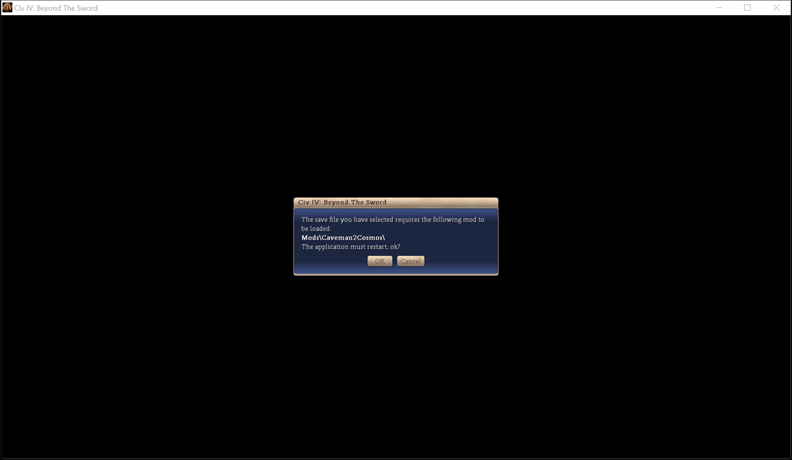

# AdvCiv-SAS Pilot Guide

How an AI/LLM helper reads and drives a running game from the command line, as JSON, instead of through screenshots and clicks: unit and city orders, research, end of turn, saves, autoplay, any XML info, and arbitrary Python run inside the game.

Built and tested by Claude Code Fable 5.2 on 2026-11-13, at the user's request for a way to pilot the active player digitally, as research projects did for StarCraft and Dota 2. The mailbox idea comes from CIVAI, whose repository the user keeps at `C:\Users\PC\Downloads\civai-main`; the goal differs: CIVAI makes LLMs fair opponents behind fog of war, while the pilot gives one agent full information and control of the active player, for AI research and for reproducing bugs and crashes.

The video demos cover two stages of the playtest.

- Part 1 covers the early diplomacy playtest and agent review. Video link to add.
- Part 2 covers the longer live playtest and debugging session. Video link to add.

## Menu

[Quick start](#quick-start)\
[How it works](#how-it-works)\
&emsp;[Switching it on](#switching-it-on)\
&emsp;[Changing commands while Civ4 runs](#changing-commands-while-civ4-runs)\
&emsp;[Why Python, and where the DLL comes in](#why-python-and-where-the-dll-comes-in)\
[Commands](#commands)\
&emsp;[Running Python in the game](#running-python-in-the-game)\
&emsp;[Using it from a script](#using-it-from-a-script)\
&emsp;[Replaying commands](#replaying-commands)\
[What was measured](#what-was-measured)\
&emsp;[Speed](#speed)\
&emsp;&emsp;[How it was found](#how-it-was-found)\
&emsp;[Would the DLL be faster?](#would-the-dll-be-faster)\
&emsp;&emsp;[Which other commands to move](#which-other-commands-to-move)\
&emsp;&emsp;[The same question for the Timeline tab, January 2026](#the-same-question-for-the-timeline-tab-january-2026)\
&emsp;[At scale, and the client's own cost](#at-scale-and-the-clients-own-cost)\
&emsp;[How it was measured](#how-it-was-measured)\
&emsp;[Popups](#popups)\
&emsp;[Playing as a person would](#playing-as-a-person-would)\
&emsp;&emsp;[A fog-on playthrough](#a-fog-on-playthrough)\
&emsp;[Loading a save](#loading-a-save)\
[What did not work, and why](#what-did-not-work-and-why)\
[Limits](#limits)\
[Where to take it](#where-to-take-it)

## Quick start

Run these from `LLM_Helpers/game_runs/`. `start` launches Civ4 with the pilot on and returns once the first turn waits for orders; every other command talks to that client.

```bash
python pilot.py start --map Pangaea --world-size WORLDSIZE_SMALL --fixed-seeds
```

```bash
python pilot.py todo
```

```bash
python pilot.py mission unit=8192 mission=MISSION_FOUND
```

```bash
python pilot.py produce city=Carthage item=UNIT_WARRIOR
```

```bash
python pilot.py research tech=TECH_MINING
```

```bash
python pilot.py move unit=16385 x=40 y=28
```

```bash
python pilot.py endturn
```

```bash
python pilot.py close
```

- `pilot.py help` lists every command with its arguments, straight from the running game.
- Arguments are `key=value`; a value is read as JSON when it parses (`x=12`, `append=true`, `args=[3]`) and as a string otherwise (`item=UNIT_WARRIOR`).
- `--compact` prints one line of JSON; `--pid` picks a client when several are piloted; `--timeout` changes the 60 s wait for a reply.
- `--timing` prints a request's `roundTripMs` and `gameMs` on stderr, and `bench <command> [key=value...] --count N` sends the same request N times and summarizes both; see [What was measured](#what-was-measured).
- `start --save <file>` loads a save instead of a new game; `start --multiple` runs beside other clients, as in the [Game Runs Guide](/_1_AdvCiv-SAS/Docs/Modding_Resources/README_Game_Runs.md#two-clients-at-once).
- The run above is the sequence tested on 2026-11-13: the Settler founded Carthage, the queue and research were set, the warrior walked to its target over two turns, and 22 turns were ended in a row.

## How it works

- [`SASPilot.py`](/Assets/Python/SASPilot.py), in the game, is a small loader hooked to the `gameUpdate` event beside the autoplay request in `AIAutoPlay.py`, and to screen updates in `CvScreensInterface.update`, which come every frame (see [Speed](#speed)).
- Each client has a mailbox folder, `SASPilot/<process ID>` beside `CivilizationIV.ini` in `Documents/My Games/beyond the sword`, so several clients can be piloted at once; see [KI#1081](/_1_AdvCiv-SAS/Docs/README_Known_Issues.md#ki-1081) for why our files are named by process.
- [`pilot.py`](/LLM_Helpers/game_runs/pilot.py) writes a request as `req_<id>.json`, whole and then renamed into place. On its next frame the game runs it and writes `rep_<id>.json` the same way: `{"id", "ok", "result" or "error" and "traceback", "gameTurn", "gameMs", "tick"}`, where `tick` names the event that served it.
- The commands themselves are in [`SASPilotCommands.py`](/LLM_Helpers/game_runs/SASPilotCommands.py), which the loader reads from disk; it is Python 2.4, run inside Civ4.
- Commands see everything, without fog of war, and orders are applied directly to the game objects, as a human's are in single player. Network games are untested.
- Python 2.4 has no `json` module, so the command file carries its own small writer and reader.

### Switching it on

- It is off for players. `pilot.py start` switches it on for its own process by adding an `[SASPilot]` section with `On = 1` to the per-run INI it passes with `ini=`, as the autoplay runner does with `[SASAutoplay]`.
- `SAS_PILOT_ON` in `GlobalDefines_advciv_sas.xml` switches it on for every launch, for example to pilot a game the user started by hand. Keep it at `0` in commits.
- When off, the cost is one comparison per game update and per frame.
- When on, anyone who can write to the mailbox folder can run Python inside the game, which is the point of the tool; it is a local folder of the user's own account.

### Changing commands while Civ4 runs

- Save an edit to `SASPilotCommands.py` and the running game picks it up within a fraction of a second (it compares the file's size and time every 20 updates, about 30 times a second in game). `ping` then shows `reloadError` if the new file failed to load; the previous version keeps serving.
  - The failure is also written to stderr, which the game shows as a Python error in its window. On 2026-11-13 an edit saved a help string with double quotes inside it, the user watching saw the error, and the corrected file loaded 4 seconds later; so an error that appears while an agent edits this file is usually such a transient save, and `PythonErr.log` names the line.
  - Checking the edit first with Python 2.4 (`C:\Python24\python.exe`, as in [Syntax checks](/AGENTS.md#syntax-checks-and-linting)) before relying on the reload catches such a slip, but the Edit tool saves at once, so the game may load the broken version first.
- This is why the command file lives in `LLM_Helpers/game_runs/` and not in `Assets/Python/`; see [What did not work](#what-did-not-work-and-why).
- `SASPilot.py` itself is in `Assets/Python/`, so changing it needs Civ4 closed first, like any mod Python.
- Bump `PILOT_REVISION` in the command file when a command's name, arguments or reply changes; `ping` reports it.

### Why Python, and where the DLL comes in

The user asked on 2026-11-13 whether the bridge would be faster or more reliable in the DLL.

- The commands are Python because a command can then be added or fixed in a minute, with no compile and without restarting Civ4, and Python already reaches nearly the whole game API.
- The DLL would not answer sooner: the 250 ms wait was how often the game called the bridge, not Python's speed, and a DLL poll at the same place would have waited as long.
  - Measured later the same day (2026-11-13): a ping spent 0.27 ms in the game against 250 ms round trip. Serving on every frame instead brought it to 2 ms, and a faster JSON writer brought 441 plots from 250 ms to 12 ms, both in Python; see [What was measured](#what-was-measured).
  - Reading the game data itself took 3 ms for 441 plots, so a C++ version of the reads looked likely to save only a few ms.
  - Correction after a C++ prototype the same day: C++ did both reading and writing the JSON in 0.32 ms against Python's 8 ms, but a bridge served from the DLL alone still waited about 200 ms, as the EXE calls the DLL only about four times a second. See [Would the DLL be faster?](#would-the-dll-be-faster).
- The DLL is needed for reach: what Python cannot see or do at all. Popups were the first case, so `CyGame` gained `getSASPilotPopups`, `closeSASPilotPopups` and `answerSASPilotPopup`; deals and a hook at the main menu would be next.
- So the split is: small DLL bindings for what Python lacks, and the commands themselves in Python on top of them.

## Commands

| Command | What it does |
| --- | --- |
| `ping` | bridge revision, PID, whether a game runs, turn, year, active player, whether it is that player's turn, autoplay turns left, map |
| `todo` | what waits for orders: cities with an empty queue, missing research, units ready to move with no mission and not automated, and held popups that ask for a choice |
| `turn` | what a person sees as a turn starts: turn, year, `todo` and the messages since the previous turn |
| `player`, `players` | gold, rates, research, civics, religion, counts, wars; one player or all |
| `units`, `unit` | a player's units briefly, or every living player's with `player=all`; one unit in full, with the missions, builds, commands, promotions and upgrades it can take now |
| `cities`, `city` | a player's cities briefly; one city in full, with what it can train, construct, create, maintain or hurry now |
| `plot`, `plots` | terrain, feature, bonus, improvement, route, owner, yields and units of one plot or of a square of plots; with fog on, only what the team knows (see [Playing as a person would](#playing-as-a-person-would)) |
| `fog` | switch between the full view (default) and what the active player's team knows or sees |
| `path` | the route a unit would take to a plot before ordering it: each step's plot, turn and moves left, and the total turns |
| `messages` | the messages the game showed the player at the top of the screen and still lists, such as combat results |
| `citizens`, `work`, `specialist`, `emphasize` | the city screen: worked plots, specialists, governor and emphasis buttons, and the clicks that change them |
| `civics`, `sliders`, `religion` | the civic options with what can be adopted, the commerce percentages, the state religion; each also makes the change |
| `types`, `pedia` | the XML types of one kind, and a type's Sevopedia text: its name and the effects text the DLL composes |
| `info` | any XML info by type, such as `type=UNIT_WARRIOR` or `type=BUILDINGCLASS_PALACE`: every simple getter of its info object, which is the data the Sevopedia shows |
| `mission`, `move` | give a unit's group a mission (`MISSION_FOUND`, `MISSION_FORTIFY`, `MISSION_BUILD data1=BUILD_FARM`...); `move` is `MISSION_MOVE_TO` after a path check; with `append=1` the mission is checked where the queue ends |
| `builds` | what a unit could build on a plot, with turns, the improvement or route, and the improvement's yield change |
| `sites` | the recommended city sites the window circles for a selected Settler, with found value and path turns |
| `odds` | the combat odds the window shows when a unit is pointed at a plot: the defender the game would pick, strengths, and the chance to win in per mille |
| `group` | group a unit with another on its plot, as selecting both does, so they move as one; without `with=`, split it off |
| `diplo`, `reply`, `contact` | the diplomacy screen as the window shows it: the AI's line, the numbered replies and the screen's number; `reply n= screen=` answers one as a click does, refused if the screen has changed since; `contact` opens the screen with a leader, and with `give=`/`take=` on its trade table with that deal on it |
| `freetech` | choose a free tech such as the Oracle's, while one is owed |
| `trade` | the diplomacy screen's table with another player: what each side could give, the AI's refusal reason per item (`DENIAL_` type), and its attitude |
| `propose` | propose a deal to an AI, as the Propose button does: `give=[...] take=[...]` with items as `trade` lists them; an accepted deal is made |
| `techs` | the tech market across the players met: each tech we lack that a rival holds, with its cost, whether SAS's XML lets it be traded at all (`bTrade`, off for 32 techs such as Bronze Working, Engineering and Chivalry), and per holder whether it can go in a deal, the AI's refusal and whether it will talk; then what we could give each. Under fog, as the Foreign Advisor's tech tab shows it |
| `pilot.py price` | an AI's price, as "What do you want for this?" gives it: `price with=2 take=["TRADE_TECHNOLOGIES:TECH_MACHINERY"]` puts the items on the table, reads the counter-offer and leaves with nothing agreed; `accept=1` takes it (reported as `acceptSent`: read the result back). It stops if another leader's screen or a new conversation takes over. A client-side sequence of `contact`, `diplo` and `reply` |
| `look` | turn the window's camera to a plot, a unit or a city; `follow=1` makes each `move` and attack look at its destination first, so a person watching sees the action |
| `command` | a unit command, such as `COMMAND_PROMOTION data1=PROMOTION_COMBAT1`, `COMMAND_AUTOMATE data1=AUTOMATE_EXPLORE` or `COMMAND_DELETE` |
| `produce`, `hurry` | set or append a city's production; hurry it, or without `hurry=` list the ways with their gold and population costs (gold needs Universal Suffrage, population Slavery) |
| `research` | the techs available now with turns, and the queue; or research a tech, queueing missing prerequisites first, `append=1` to add |
| `endturn` | end the turn, reporting what was left (`skipped`); the client then waits for the next turn and prints its `turn` digest, unless `--no-wait`; `--turns N` keeps ending turns until something waits |
| `autoplay` | AI Auto Play for a number of turns; follow with `pilot.py wait` |
| `save` | save; through `pilot.py` a bare name goes to `Saves/single`; an existing file needs `overwrite=true` |
| `menu` | leave the game: with `path=`, load that save in the same process and wait until it is ready (`--no-wait` returns at once); without, go to the main menu. In a big late game, close and `start --save` instead: leaving a Huge turn-305 game crashed Civ4 ([KI#1084](/_1_AdvCiv-SAS/Docs/README_Known_Issues.md#ki-1084)) |
| `control` | any `ControlTypes` entry, as its hotkey would: `CONTROL_DOMESTIC_SCREEN`, `CONTROL_WORLD_BUILDER`, `CONTROL_QUICK_SAVE`... |
| `screen` | call a `CvScreensInterface` function, such as `name=pediaJumpToUnit args=[29]`, to show an advisor or Sevopedia page in the window |
| `batch` | several commands in one request |
| `py` | run Python inside the game |
| `profile` | run a command and split its time into reading the game (`gatherMs`) and writing the JSON (`encodeMs`) |
| `popups` | the active player's popups held back from the window, plus any displayed or queued; see [Popups](#popups) |
| `answer` | answer a held popup as if one of its buttons were clicked: `id=` from `popups`, `button=` by number or name (`button=RAZE`), `text=` for an edit box |
| `closepopups` | drop held and queued popups, all or of one `type=` |

- Types are passed and returned as XML types (`UNIT_WARRIOR`, `TECH_MINING`), never as numbers or translated names.
- Unit and city IDs are per player; `player=` selects another player than the active one, for reading and for orders alike.
- An order's reply shows the state at the moment the order was given. A mission is carried out on the following game updates: right after `MISSION_FOUND` the reply still showed the Settler, and the city existed a moment later. Read again before relying on the result.
- A `MISSION_MOVE_TO` longer than the unit's moves continues when the turn ends, as it does for a human's unit.
- `start`, `list`, `wait` and `close` are handled by `pilot.py` itself and are not in `help`.

### Running Python in the game

`py` is the general tool: whatever the fixed commands lack, the game's whole Python API is there.

```bash
python pilot.py py "game.getGameTurn()"
```

```bash
python pilot.py py "print player.getName(); result = [c.getName() for c in pilot._cities(player)]"
```

- One expression returns its value; otherwise set `result`. What the code prints is shown first.
- The namespace persists between calls and holds `gc`, `game`, `map`, `interface`, `player` (the active one), `describe()`, `pilot` (the command module) and everything from `CvPythonExtensions`.
- `py -` reads the code from standard input and `py @file.py` from a file, for anything longer than a line.
- `describe(obj)` calls every zero-argument `get`/`is`/`can`/`has`/`count` method of an object, which is how `info` works; use it to see what a `CyCity` or `CyPlayer` can tell.
- The [Sevopedia debug dumps](/_1_AdvCiv-SAS/Docs/Sevopedia/Debug/) and the [BUG API text](/_0_Legacy/Docs/Civ4BUG_Python_API/all_classes_web.txt) say which methods exist; with the pilot a doubt is now settled by calling the method in a running game.
- When a `py` snippet proves useful twice, make it a `cmd_<name>` function in the command file.

### Using it from a script

```python
import pilot
pid = pilot.pick_pid(None)
for unit in pilot.call(pid, "units"):
	print(unit["type"], unit["x"], unit["y"])
pilot.call(pid, "endturn")
pilot.wait_for_turn(pid, 600, after_turn=0)
```

- `call` returns the result or raises `PilotError` with the game's traceback; `request` returns the whole reply.
- `load_game(pid, path)` loads a save in a running client and returns once that game waits for orders; see [Loading a save](#loading-a-save).

### Replaying commands

[`pilot_replay.py`](/LLM_Helpers/game_runs/pilot_replay.py) runs a sequence, a list of commands against a save, and compares each reply with the run last accepted. A changed answer after a DLL rebuild or an edit of the command file then shows as a list of differences, instead of turning up in the middle of a playthrough.

```bash
python pilot_replay.py pilot_sequences/fogplay_t105_freetech.json
```

- They were called scenarios until 2026-11-13. Civ4 already uses "scenario" for its scenario maps and "replay" for Hall of Fame replays, so the user and Codex chose "command sequence", which says what the files hold; the runner kept its name.
- A sequence is JSON in [`pilot_sequences/`](/LLM_Helpers/game_runs/pilot_sequences/): `save` (a file in `Saves/single`, or a full path) and `steps`, each with `cmd`, `args`, and optionally `ignore` (result keys left out for that step) and `expectError`.
- The first clean run is written as the baseline, `Logs/SASPilotReplay_<sequence>.json`; later runs list each differing path, such as `steps[3].result.queue[0].turns: 5 -> 4`, and exit 1. `--accept` makes the run the new baseline once a change is meant.
- It starts its own client from the save and closes it after (`--keep` leaves it open), or loads the save in a running one with `--pid`.
- Timings and reply sizes are left out; a failed step is kept by its error line, not its traceback, whose line numbers move with every edit.
- `sleep` waits before a step, for what the game does on later frames; `from` fills arguments from this run's earlier replies, such as the diplomacy screen's number for `reply`; `afterTurn` waits for the turn after an `endturn`.
- `expect` states the value a step must give, the expression's for `py`, so a first run already verifies a fix: `fogplay_t116_queued_build.json` expects fishing boats on the crab and the boat used up.
  - `fogplay_t148_trade_table.json` guards the trade table's empty-columns finding: with Navigation on Pacal's table, "What do you want for this?" must ask 65 gold, a read token from before the counter-offer must be refused, and no gold or tech may change hands.
- A step's error that names a `from`-filled screen number, as in "what read 9 showed", is kept as `read <screen>`, as the number changes every run; only that phrase is rewritten, so an equal number elsewhere, such as `65 gold`, stays compared (Codex's review).
- A result that depends on a local setting is better left out with `ignore` than baked into the baseline: `fogplay_t105_freetech.json`'s last `todo` ignores `infoScreens`, since whether Sailing's splash shows depends on `SAS_UI_TECH_SPLASH_ON`, which ships on while the dev toggle turns it off.
- A held popup's ID is compared only as `held`, as IDs are never reused within a process; unit and city IDs, which the save fixes, are compared.
- The saves are local, so baselines stay in `Logs`, not in the repository; a sequence names the save it was written for.
  - A sequence lives only as long as its save loads. SAS does not keep saves compatible across commits, so a DLL change to what a save stores ends every sequence at once, while an XML rebalance usually loads but may change replies, which `--accept` then records.
  - Discussed with the user on 2026-11-13 and left for when the first save breaks: a sequence that starts a game with a fixed map and seed through `start --fixed-seeds`, then sets up its units and cities by command, would need no save. That needs the WorldBuilder-style commands listed under [Where to take it](#where-to-take-it).
- Why: by 2026-11-13 the command file was 1,800 lines and the Debug-opt DLL had been rebuilt about ten times in one day, each round checked by hand only.

## What was measured

All on 2026-11-13, Small Pangaea, turn 0 to 22, Debug-opt DLL, one client.

- A request took about 250 ms (20 pings averaged 246 ms): the game served the mailbox on game updates, about four a second while it waits for the player.
- Size hardly mattered: 441 plots in full came back in 273 ms.
- With `USE_ON_UPDATE_CALLBACK` set to 1 in `PythonCallbackDefines.xml`, the per-frame `Update` event fired 239 times against 2 game updates by the first ping, so serving on it would cut the wait to about a frame.

### Speed

Measured by Claude Code Opus 5.5 later on 2026-11-13 with `pilot.py bench`, same map and seeds (`--fixed-seeds`), plots at radius 10 (441 plots, 113 KB of JSON). `roundTripMs` runs from writing the request to reading the reply, so it also holds the client's polling and the file handling; `gameMs` runs from the game reading the request through encoding the reply, and ends before the reply file is written.

| Setup | Ping round trip | Ping in game | 441 plots round trip | 441 plots in game |
| --- | --- | --- | --- | --- |
| Served on game updates (first version) | 251 ms | 0.27 ms | 251 ms | 30 ms |
| Per-frame `Update` callback on, client checks every 20 ms | 21 ms | 0.27 ms | 43 ms | 31 ms |
| Same, client checks every 1 ms | 1.9 ms | 0.24 ms | 35 ms | 31 ms |
| Same, ASCII fast path in the JSON writer | 1.9 ms | 0.24 ms | 11 ms | 7.4 ms |
| Served on screen updates, callback back at 0 (current) | 2.0 ms | 0.16 ms | 12 ms | 8.7 ms |

- Medians of 30 pings or 10 plot reads. Nearly all of the first 250 ms was waiting for the game to look, not serving.
- Of the 30 ms for 441 plots, reading the game took 3 ms and writing the JSON 28 ms: the writer escaped every character in Python. Plain ASCII strings, nearly all XML types and names, are now copied whole, which cut it to about 4 ms with byte-identical output.
- The client checked for the reply every 20 ms, which became most of a 21 ms ping once the game answered every frame; it now checks every 1 ms.
- `CvScreensInterface.update`, which the EXE calls for the open Python screens, fired about 650 times a second in game, once a frame, with `USE_ON_UPDATE_CALLBACK` at 0. The pilot now serves from it, so players keep the callback off; for them it costs one Python check a frame on top of a call the EXE already makes.
- One mailbox listing took 19 microseconds, so checking every frame costs about 1% of one core while piloted.
- Turning `USE_ON_UPDATE_CALLBACK` on from Python with `gc.setDefineINT` did nothing: the EXE reads it at launch only.
- So ask for much in one request, with `plots`, `batch` or `py`, when the data is large; small requests are now cheap too.

#### How it was found

Each step came from what the previous measurement showed, not from a plan made up front.

1. The question was whether the DLL would be faster. Rather than argue it, `--timing` and `bench` were added to time each request on both sides: the client's round trip and the game's own work (`gameMs`).
2. The first numbers settled where the time went: a ping spent 0.27 ms in the game out of 251 ms. Neither Python nor C++ could fix that; only being served more often could.
3. Switching on `USE_ON_UPDATE_CALLBACK` cut a ping to 21 ms, which matched the client's own 20 ms sleep between checks; at 1 ms it fell to 1.9 ms.
4. The plot read stayed at 31 ms in the game. Timing its two halves (now the `profile` command) showed 3 ms reading and 28 ms writing JSON, which led to the ASCII fast path.
5. The callback is a setting for every player, and `gc.setDefineINT` could not switch it on for the pilot alone, so the open screens' `update` call was tried instead: it fires every frame with no setting.

### Would the DLL be faster?

A C++ prototype (Claude Code Opus 5.5, 2026-11-13) answered this with numbers. It had two parts, switched on by a `native` pilot command:

- `getSASPilotPlotsJson` wrote the same plots as the Python `plots` command, in C++. Its output was byte-identical to Python's for the 441 plots.
- A mailbox served entirely in C++ (`nreq_<id>.txt` requests, `bench --native`), from the five update functions the EXE calls on the DLL, each counted.

| Path | Ping round trip | 441 plots round trip | 441 plots in game |
| --- | --- | --- | --- |
| Python, served every frame | 1.9 ms | 11.6 ms | 8.4 ms |
| C++ mailbox in the DLL | 200 ms (median) | 200 ms (median) | 0.46 ms |
| C++ plots called from Python's every-frame check (current) | 1.9 ms | 3.2 ms | 0.51 ms |

- C++ was about 25 times faster at the work itself: 0.32 ms against 8.1 ms (3.3 ms reading, 4.9 ms writing), timed around the call alone. In the pilot's own `gameMs`, which also counts reading the request and its JSON, it was 0.51 ms.
- The last row was first estimated at about 2.5 ms; measured after the change, it was 3.2 ms (median of 10).
- But in 10 seconds of that run, at turn 0 waiting for orders, only `CvGame::update` and `updateTestEndTurn` ran, 40 times each; `updateColoredPlots`, `updateBlockadedPlots` and `updateSelectionList` did not run at all with nothing selected. The DLL has no call every frame, so a bridge in the DLL alone waits for those, about 200 ms.
- So the fastest shape is Python's every-frame check calling C++ for large reads. At 441 plots the gain is about 8 ms per request; it grows with size, by about 18 microseconds per plot in Python against 0.7 in C++, so a full Huge map read would be where it pays.
- Codex (GPT-6.1-Sol) reviewed the prototype and suggested keeping it on a side branch, as it would mean two writers to keep identical. The user preferred the long-term speed ("a house of iron rather than of wood"), so the plot reads moved to C++ for good, with the Python writer removed so there is one writer only:
  - `plot` and `plots` now return the C++ JSON as it is, through `RawJson` in `SASPilotCommands.py`; a new plot field goes in `appendSASPilotPlotJson` in [CvGameInterface.cpp](/CvGameCoreDLL/CvGameInterface.cpp) and needs a DLL build.
  - The C++ mailbox, its hook counters and the `native` command were dropped, since the mailbox was the slow part. They are kept as a diff in `Downloads/AdvCiv-SAS_diff_backups/pilot_native_mailbox_prototype_*`, outside the repository.
  - Codex's review also found that a pilot error in the screen update would skip the screen's own update, that the C++ radius needed bounds, and that the JSON key cache mixed up equal keys such as `1` and `True`; all three were fixed. It confirmed the ASCII fast path against all 256 byte values under Python 2.4.

#### Which other commands to move

Later the same day, the user asked why every command was not moved to C++, as the plots had been. The answer is measured per command, not assumed, as the plots' was. `pilot.py --count 10 bench <command>` on a Small map at turn 176 with fog on (medians):

| Command | Round trip | Game time (`gameMs`) | Above a bare request |
| --- | --- | --- | --- |
| `ping` | 5.4 ms | 0.23 ms | |
| `todo` | 5.4 ms | 0.19 ms | 0 |
| `units player=all` | 5.4 ms | 0.26 ms | 0.03 ms |
| `cities` | 5.4 ms | 0.26 ms | 0.03 ms |
| `techs` | 7.0 ms | 0.77 ms | 0.54 ms |
| `trade with=2` | 9.0 ms | 3.49 ms | 3.3 ms |

- `trade` checks every tradeable item in both directions, so its loop moved to C++ (`getSASPilotTradeItemsJson` in [CvGameInterface.cpp](/CvGameCoreDLL/CvGameInterface.cpp)), and `techs` reads that table instead of checking each tech itself. One writer, as for the plots.
  - Measured after, same save: `trade` 3.49 → 2.15 ms of game time, less than the plots' 25 times, as most of what remains is the game's own `getTradeDenial` AI work, which C++ calls just the same. [`pilot_checks/trade_items_parity.py`](/LLM_Helpers/game_runs/pilot_checks/trade_items_parity.py) found the same entries as the Python loop for all 20 pairs of players; only the order changed, to the game's enum order, which the turn-115 baseline accepted after a sorted comparison.
  - `techs` first got slower, 0.77 → 3.3 ms, as it read the whole table eight times for its tech rows, which Codex predicted from the code; a kind filter on the C++ table brought it to 0.57 ms. A port is checked by timing it afterwards, not only before.
- The others add nothing measurable to a bare request, whose time is the wait for the game's next frame, so they stay in Python, which reloads while Civ4 runs and reports its errors instead of crashing the game. AGENTS.md's rule applies: prefer the faster version for a measured gain, the simpler one when there is none.
- Some cannot move: the diplomacy screen's text and replies exist only in `CvDiplomacy.py`, which the EXE calls; `look` uses the EXE's camera, not the DLL's; `pilot.py price` waits across frames for a screen, which no single game-side call can.
- `units` and `cities` grow with the map, so a Huge late game is worth timing again before deciding they stay.

#### The same question for the Timeline tab, January 2026

The Info Screen's Timeline tab, then called the History tab, went through the same Python-or-DLL question ten months earlier, without measurements.

- On 2026-01-24, in a Codex (GPT-5.2-Codex) session, the user asked whether the DLL could build the tab's replay messages faster, as mid-to-late games showed a delay. Codex moved the filtering and formatting into C++ (`CvGame::getReplayMessagesFiltered`), then added a C++ cache.
- By eye, the C++ cache felt slower than the version before it and the C++ filtering only slightly faster, "hard to tell". These were the user's visual impressions in game, with no timing taken: the slowdown seemed clear enough to notice, but was not confirmed and could be mistaken.
  - The user's reasons, as recalled on 2026-11-13: Python keeps the tab easy for modmods to carry over and change, and the C++ version seemed slower, not faster. A clearly faster C++ version could have been judged differently. The user kept the pure Python version for simplicity and saved the C++ one on the side branch `history-tab-dll-implementation`, commit `a256d0638` ("loading times are not fast enough to justify not going full python rather for simplicity").
- That branch was deleted from GitHub on 2026-10-13 with other old branches. On 2026-11-13 GitHub's activity log gave its last commit, `git fetch origin <sha>` brought it back, and it was restored as a local branch.
- In May 2026 the tab's real cost turned out to be elsewhere: caching the data and even the prepared rows "did not significantly help", while keeping the table widget the EXE had built made reopening almost instant (practical commit 5859; the comment is in [CvMilitaryAdvisor.py](/Assets/Python/Screens/CvMilitaryAdvisor.py) for the Battles tab, which shared the fix).
- The pilot's test showed C++ faster only at the part it replaces, with most of the time elsewhere, in waiting for the game to look. The Timeline may have been the same, with its time in the EXE building table rows, but that is a reading of two separate findings: the January impressions and the May table fix. Neither measured what the January C++ changed.
- The difference is that the pilot's time was measured, part by part, before choosing; the Timeline's was judged by eye, which could suggest that C++ did not help much but not show why.

### At scale, and the client's own cost

A Huge Pangaea autoplayed to turn 300 (876 units, 82 cities, 6,016 plots) showed where the time goes once the game is large, measured by Claude Code Opus 5.5 on 2026-11-13.

- Every read command but two stayed near 1 ms in the game: one player's 150 units 1.3 ms, all cities 1.4 ms, all players 1.1 ms. These were left in Python.
- All 876 units, as one `batch` of `units` per player, took 8 ms: 2 ms reading the game and 6 ms writing JSON. So `units` moved to C++ like the plots, and `units player=all` gives every living player's units in one request.
  - In C++ (`getSASPilotUnitsJson`, sharing the unit writer of the plots), all 876 units took 0.58 ms in the game and 4.5 ms round trip (median of 10), and the output was identical to Python's, in the same order.
- The whole map's plots took 6.8 ms in the game but 21.6 ms round trip. The game wrote the 1.6 MB reply in 0.5 ms; the rest was the client: `json.loads` took 9 ms, and printing it indented with `json.dumps` took 58 ms.
  - With `orjson` (installed 2026-11-13, `python -m pip install orjson`) the same parse took 7 ms and the indented print 2.2 ms, with identical data. Importing `orjson` costs about 27 ms, so `pilot.py` uses it only for replies of at least `ORJSON_MIN_BYTES` (200 KB); it indents by 2 rather than 1. Without `orjson`, such replies use the `json` module, as Codex's review asked.
  - Codex also found that skipping the process check with one mailbox made a crashed Civ4 wait out the whole timeout; the client now checks once a reply is a second late, which costs nothing when it is quick.
- Each `pilot.py` command is a new Python, and that start cost more than the request: a whole `pilot.py ping` took 56 ms for a 2 ms request. Python itself starts in 15 ms; importing `pilot.py` took 38 ms, 18 ms of it `desktop_windows` and `run_autoplay`, which only `start`, `close` and a few checks need. They are now imported where they are used, and with one mailbox the client no longer checks its process before sending.

| Whole `pilot.py` command | Before | After |
| --- | --- | --- |
| `ping` | 56 ms | 43 ms |
| whole Huge map's plots, indented | 139 ms | 74 ms |
| whole Huge map's plots, `--compact` | 83 ms | 72 ms |

- What remains of a ping is mostly Python's start (15 ms) and `argparse` (11 ms). A script that imports `pilot` and calls `pilot.call` pays them once, so for many requests in a row it is the faster way.

### How it was measured

The timers are Windows' high-resolution performance counter in all three places, not a Civ4 clock:

- The client, `pilot.py`, uses Python 3's `time.perf_counter()` for `roundTripMs`, from writing the request to reading the reply.
- The game's Python uses `time.clock()`, which in Python 2.4 on Windows reads the same counter, for `gameMs` and the `profile` command. The values came out in fractions of a millisecond and agreed with the round trips, unlike `time.time()`, whose coarse steps the loader's comments warn about.
- The C++ prototype called `QueryPerformanceCounter` directly.

To repeat or extend a measurement:

1. `pilot.py start --map Pangaea --world-size WORLDSIZE_SMALL --fixed-seeds`, so every run has the same map and units.
2. `pilot.py bench ping --count 30` and `pilot.py bench plots x=27 y=19 radius=10 --count 10` give medians for the round trip and the game's share, and `servedOn` tells which event served them.
3. If the game's share is large, `pilot.py profile cmd=<command> 'args={...}'` splits it into reading the game and writing JSON.
4. To compare a C++ version of a command, call it from `py` with `time.clock()` around it, as the plot writer was compared; the C++ mailbox comparison needs the backed-up prototype diff.
5. To see how often an event fires, compare the `ticks` in two `ping` replies taken a known time apart.

### Popups

While the pilot drives, the DLL does not launch the game's popups into the window: it keeps each one in a held list that `popups` shows and `answer` or `closepopups` settles. The Esc menu and its confirmations still open, so a person at the window can leave the game, and so do requests to open a screen (`BUTTONPOPUP_PYTHON_SCREEN`). Fable designed this on 2026-11-13; Claude Code Opus 5.5 tested and completed it the same day.

- Why not close them in the window: a popup on display could not be closed from the DLL. `killAll`, `clearQueuedPopups` and a cancel checked in the popup's focus callback each removed only queued popups. Only one popup shows at a time, so an unanswered one also held back the rest.
- The city-name popup is a Python popup the DLL cannot hold, so `CvEventManager.py` skips it while the pilot drives; the city keeps its default name.
- Founding a city at turn 0 held `BUTTONPOPUP_CHOOSETECH` and `BUTTONPOPUP_CHOOSEPRODUCTION`, with the city ID as `data1`. Turns ended normally with popups held.
- Each held popup has an `id`, never reused in the process; `answer` takes it, and refuses an id that is gone, including one already answered.
- `answer` calls the popup's OK handler, `CvDLLButtonPopup::OnOkClicked`, which does not make every choice: production and tech are chosen through the popup's buttons as widgets, and their OK handler only opens the city or the Technology Advisor. `answer index=2 button=0` on the production popup dropped it with the queue still empty. So use `produce` and `research` for those; `answer` fits popups whose OK handler acts, such as `BUTTONPOPUP_RAZECITY` and `BUTTONPOPUP_CHANGECIVIC`.
- Two faults found in testing, both fixed in the DLL:
  - A settled popup stayed listed: after `research` chose Mining, the choose-tech popup was still held three turns later. The game drops such popups just before showing them, in `CvDLLButtonPopup::OnFocus`, which a held popup never reaches. `pruneSASPilotHeldPopups` now applies the same rules each time `popups` lists them.
  - The held list outlived the game: a save loaded in the same process still listed the previous game's popups. `CvGame::reset` now clears it on a load or a new game.
- Codex (GPT-6.1-Sol) reviewed this and found three more, all fixed:
  - `answer` first took a list position, which could name another popup once the list shifted after a prune or a reload; it takes the `id` now, and the DLL prunes and looks it up again before answering.
  - The hold also caught `BUTTONPOPUP_PYTHON_SCREEN`, a request to open a screen such as Dawn of Man rather than a choice, which first showed up as a held entry. It is launched as usual now. With the local `SAS_UI_DAWN_OF_MAN_ON` at 0, Dawn of Man did not show at all; with it at 1 it would open in the window, which was not tried.
  - Listing changed the game: for a city in disorder or on automated production, the pruning marked the city to ask again, as `OnFocus` does. Such a popup now stays held, so listing has no side effect. The election and vote checks and Python focus callbacks of `OnFocus` are not mirrored.
- Tested at turn 300 to 306 of a Huge game (2026-11-13), which also showed popups the hold never saw:
  - Granting `TECH_NATIONALISM` by `py` raised no popup at first: the revolution timer was at 4, so the game kept Nationhood as a reminder and asked again when it reached 0, at turn 304.
  - That popup then sat in the player's queue (`QUEUED`), out of reach of `answer`. AdvCiv's Minimize Pop-Ups option keeps popups queued until every unit has moved, and with 150 units that did not happen. `CvPlayer::takeSASPilotQueuedPopups` now moves the popups the pilot holds out of the queue into the held list before `popups` lists them and before `answer`; which popups are held is decided in one place, `isSASPilotPopupHoldable`.
  - `answer` on the `BUTTONPOPUP_CHANGECIVIC` with button 0 (`SAS_POPUP_CIVIC_ADOPT_CIVIC`; 1 declines, 2 opens the advisor) changed Bureaucracy to Nationhood.
  - `player.acquireCity(city, True, False)` by `py` raised `BUTTONPOPUP_RAZECITY`, with the city's new ID as `data1` and the captured gold as `data3`. Button 1 razed Lakamha; on a second city, button 0 kept Mayapan.
  - Two choose-production popups for one city, differing only in `data2` (0 and -1), were both held; `produce` for that city cleared both.
- Codex (GPT-6.1-Sol) reviewed this round too and found four more, all fixed:
  - Held popups were lost on a save: the save writes the queue and the displayed popups, not the held list, and taking from the queue made it worse. `CvPlayer::write` now writes the held popups with the queue; a fresh Civ4 loading such a save on 2026-11-13 held the same three choices again.
  - `answer` passed any button to the game's handler; for an election, a negative button would have indexed its vote options out of range. `answer` now takes only the popup types listed in `_ANSWER_MAX_BUTTON` in `SASPilotCommands.py`, each with its highest button, and refuses others with the list of those it takes.
  - A held or taken popup skipped `reportButtonPopupLaunched`, which keeps count of relaunched popups to keep their sound quiet, so a later popup could have lost its sound; both paths now report it.
  - The client: see [At scale, and the client's own cost](#at-scale-and-the-clients-own-cost).
- Codex's suggested check, saving and reloading in the same Civ4 to see the held popups come back, crashed Civ4 every time. Narrowing it down showed the crash came from leaving that Huge game, not from the pilot or the day's DLL; see [KI#1084](/_1_AdvCiv-SAS/Docs/README_Known_Issues.md#ki-1084).

- Codex's fourth review (GPT-6.1-Sol) found three more, fixed by Claude Code Fable 5.2 and tested at turn 83 of a Small game on 2026-11-13:
  - A button inside the type's range could still be one the game would not offer, such as raze when `canRaze` is false. `getSASPilotPopupButtons` in `CvDLLButtonPopup.cpp` now lists what each launch function would offer, as `0=KEEP,1=RAZE,2=LIBERATE`; `popups` shows them and `answer` takes a number or a name. `_ANSWER_MAX_BUTTON` is gone.
    - The DLL checks the button itself before taking the popup: `answerSASPilotPopup(4, 3, u'')` from `py`, past the CLI's check, returned `false` and left the raze popup held. `answer id=4 button=RAZE` then razed Beshbalik.
    - Buttons that only open a screen or the city (raze 3, civics 2) are not listed, as they make no choice.
    - Adopting a civic was first listed whenever the revolution was possible. Codex's fifth review asked for the launcher's exact rule, so it is listed only when the window would show it: AdvCiv hides it when other new civics could be adopted too. In that case decline and use `civics set=`, which adopts several at once.
    - An event's buttons are the `EventTypes` it can choose, listed by type. Before holding an event popup, the DLL makes the launcher's checks and cleanup (`isSASPilotEventPopupLaunchable`), also from the fifth review. Neither was tried on a real event.
  - Switching holding off cleared the held choices. `popups held=0` now hands them back: two held popups (`CHOOSETECH`, `CHOOSEPRODUCTION`) were listed `QUEUED` at once and the first `DISPLAYED` two seconds later, and setting research removed the displayed one.
    - They go back through the game's usual `addPopup`, which for a civics, religion or choose-tech popup first drops a queued one of the same type, as it does whenever the game asks again. A held choice handed back beside a queued one of the same type was not tried.
  - Taking a popup from the queue lowered `killAll`'s relaunch count for every popup; it now does so only for one inside the counted front run. This was not tested, as it only affects a popup's sound.
- Conquering a size-1 city by `py` raised no raze popup: the game destroys such a city on capture, and its owner was eliminated. Use a city of size 2 or more to raise one.

### Playing as a person would

The pilot began as a debugging tool with full information. On 2026-11-13 the user asked for play as a person would: control units, choose a path, manage the fog, enter the city screen and change specialists. Fable added these the same day, tested on a Small Pangaea map.

- `fog on=1` limits `plots`, `plot`, `units`, `unit`, `cities` and `city` to what the active player's team knows; `fog on=0` (the default) returns everything, and `fog=0` or `fog=1` on one request overrides the switch.
  - The switch lives in the game's process, so every new client starts with fog off; `pilot.py start --fog` switches it on at launch. A relaunch of the fog-on playthrough at turn 156 forgot it, and three turns went by with full sight before a reply showed `"fog": false` (2026-11-13).
  - A plot the team has not revealed is left out of `plots`, so the reply holds only the known map. A revealed plot out of sight gives the owner, improvement and route the team last saw and no units; a plot in sight leaves out invisible units; a bonus shows once its tech reveals it. Yields and the feature are the current ones even out of sight.
  - At turn 0, a radius-6 read gave 37 plots with fog against 169 without, and `units player=all` gave 2 units against 14. At turn 83 the whole map was 257 plots of 2,052, read in 0.6 ms in the game against 3.6 ms without fog.
  - It is written in C++ with the plots (`appendSASPilotPlotJson`), so it costs nothing in Python. `players`, `py` and `info` are not limited, so fog is a way to play fair, not a guarantee.
  - Codex's fifth review (GPT-6.1-Sol) found what still leaked, fixed the same day:
    - `unit` by ID gave an invisible unit that `units` left out, and a rival unit in sight came back with its orders and mission queue. A rival's unit now needs to be in sight and not invisible, and gives its type, plot, damage, strength and promotions.
    - `city` gave a rival's city in full once its plot was in sight, queue and food included. It now gives what the map shows: name, plot and owner for a city the team has revealed, and its population while in sight.
    - `path` took any player's unit and any movement flags; with fog on it takes the team's own units and no flags.
  - Known gaps, as Civ4 keeps no memory of them: out of sight, a plot's yields, feature and bonus are the current ones, and a city razed out of sight disappears from the reply at once. Whether the window shows the same was not checked.
  - Retested at turn 70 of a Small game with the rebuilt DLL: a rival Worker in sight gave the short form, a rival unit out of sight was refused and given in full with `fog=0`, Beshbalik (revealed, out of sight) gave name, plot and owner, and `path` for the rival Worker was refused.
- `path unit=... x=... y=...` gives the route before the order, as the window draws it: a Warrior's 5-plot path came back with one step per turn. It uses a pathfinder of its own (`getSASPilotPathJson`), leaving the shared one alone; Python's `generatePath` gives only the turn count. It was not compared with the route the window draws for the same unit.
- `messages` returns what the game showed at the top of the screen, cleaned of font and color tags: "You have captured Beshbalik!!!", "Judaism has been founded in a faraway land!". The game drops a message once its display time passes, so read them each turn; SASGameRecord keeps the lasting record.
- The city screen: `citizens city=Carthage` lists each plot in the radius with its yields and whether it is worked, the specialists with their limits, the governor and the emphasis buttons.
  - `work x= y=` clicks a plot as the screen does: a free plot was worked, and the same plot clicked again was freed and its citizen became a specialist. As in the window, a click switches the governor off, and a click on the city's own plot switches it on again.
    - The first version sent a different task for the city's own plot and refused plots the city could not work. Codex's fifth review pointed out that the screen sends the same task for every plot, which also claims a plot from another of the player's cities; `work` now does the same.
  - `specialist type=SPECIALIST_CITIZEN change=-1` and `emphasize type=EMPHASIZE_PRODUCTION` worked the same way. All go through `CvCity::doTask`, as the screen's buttons do.
  - These commands, and `civics`, `religion`, `sliders`, `research` and `hurry`, check that a type belongs to the kind they take: `specialist type=UNIT_WARRIOR` would otherwise have passed a unit's number to the DLL as a specialist (the fifth review). Each now answers "UNIT_WARRIOR is not a SPECIALIST_ type" and the like.
  - After the fix, a click on Carthage's own plot switched the governor back on and reassigned its citizen.
- `civics`, `sliders` and `religion` list the choices and make them. `civics set=CIVIC_SLAVERY` at turn 0 first adopted Slavery without its tech: `CyPlayer.canAdopt` only checks that a revolution is possible, so the command now checks `canDoCivics` for each civic as well.
  - Both apply the change directly (`CyPlayer.revolution`, `convert`) rather than with the net message the screens send, which is handled after the reply is written, so the reply showed the old civics.
- `pedia type=BUILDING_GRANARY` returns the effects text as the Sevopedia shows it: "Stores 40% of [YIELD_FOOD] after Growth or Starvation". Icons are GameFont characters in the game's text, so they are named, and the bullet is written as a dash.
  - Static values are in the XML files, which an agent can read directly; `pedia` is for the text the DLL composes from them and from its own rules. `types kind=UNIT_` lists a kind's types.
- Found on the way: [KI#1090](/_1_AdvCiv-SAS/Docs/README_Known_Issues.md#ki-1090) covers the inherited binding that mapped Python's `TaskTypes.TASK_CONSCRIPT` to `TASK_HURRY`, so drafting from Python would have hurried production. It is corrected in `CyEnumsInterface.cpp`: the two now read 10 and 9 in game, where both were 9.
- The user's games run with random events off (`GAMEOPTION_NO_EVENTS` in the user's INI, which `ping` lists under `gameOptions`), so the event popup's buttons will stay untried unless a test game turns events on.

#### A fog-on playthrough

On 2026-11-13 Claude Code Opus 5.5 played a Small Pangaea game from turn 0 to 115 with `fog on=1`, using only pilot commands, to list what a person can do in the window that the pilot could not. Each gap was fixed as it came up and retested in the same game; the code comments at each fix say what failed first.

| Turn | What was missing | Now |
| --- | --- | --- |
| 0 | `research` listed tech names only, while the tech chooser shows each tech's turns | each tech with `turns`, `cost` and `progress`, plus the research `queue` |
| 0 | `city` listed what can be built, not the turns the city screen shows beside each | `options` maps each unit, building and project to its turns |
| 0 | an empty queue gave `productionNeeded` 2147483647, the game's MAX_INT | `null` |
| 0 | the scout's Explore button had no equivalent: `COMMAND_AUTOMATE data1=AUTOMATE_EXPLORE` was refused as an unknown XML type, and `unit` did not list automations | `AUTOMATE_` names are taken, and `unit` lists `automations` |
| 0 | `unit` gave `activity` and `automate` as numbers (6, 3) | `ACTIVITY_MISSION`, `AUTOMATE_EXPLORE` |
| 1-8 | the exploring scout was listed as idle every turn, while the window does not ask for an automated unit's orders | `todo` leaves automated groups out |
| 1-8 | each turn took `endturn`, `todo` and `messages` | `turn` gives all three, and `pilot.py endturn` prints it for the new turn; `--turns N` ends turns until something waits |
| 5-8 | three turns ended with no research set, and nothing said so | `endturn` reports what `todo` listed as `skipped` |
| 5-8 | `messages` returned AdvCiv's "----- Older messages:" line each turn (`MESSAGE_TYPE_EOT`, advc.106b) and types as numbers | left out; types by name |
| 15 | `research tech=TECH_BRONZE_WORKING` was refused, as Metal Casting was missing; a shift-click in the tech tree queues the prerequisites | any tech the player can ever research is taken, prerequisites first; `append=1` adds to the queue |
| 25 | a Worker's builds were listed for its own plot only | `builds unit= x= y=` gives each build on any plot, with its turns and yield change |
| 25 | `mission ... append=1` after a `move` was checked on the unit's plot, not where its queue ends | checked at `lastMissionPlot`, as a shift-click is |
| 25 | a build mission's target came back as 17 | `BUILD_COTTAGE` |
| any | `plot` gave `plotType` as a number (2) | `PLOT_LAND` and the like (DLL) |
| 40 | the Settler had no equivalent of the circles BtS draws for recommended city sites | `sites unit=` gives the same list in C++ (DLL), with found values and path turns |
| 40 | no combat odds before attacking, which a person sees on hovering an enemy | `odds unit= x= y=`: the Warrior against a Wolf gave 783 per mille, the Wolf at 2.25 |
| 41 | "Pacal II will trade Agriculture, Mysticism" came as a message, but the pilot could not see or use the diplomacy screen | `trade with=1` lists both columns: Pacal would give Mysticism and Open Borders and refused Masonry with `DENIAL_TECH_MONOPOLY`; `propose` makes an offer (DLL) |
| 41-42 | the same message showed in two turn digests, as messages made when a turn starts carry that turn | the digest leaves out messages it already showed |
| 46 | `propose` tried in game | asking Mysticism for nothing and Masonry were refused; Open Borders for Open Borders and Metal Casting for Mysticism were accepted and made; SASGameRecord wrote a `DIPLO_OFFER_EVALUATED` row for each |
| 58 | reading 30 turns of JSON digests took a throwaway parser | `endturn --brief` prints one line per message and one for what waits |
| 60 | a "feat" popup ("you have trained your first Archery unit") was held and listed as waiting, though it asks nothing and `answer` cannot take Python popups | the digest gives its text under `notices` and drops it, as clicking OK does; only feat popups, whose buttons open an advisor at most |
| 70 | the civics popup gave `data1` 2 and `data2` 12 with no text, where the window asks "Adopt Caste System?" | `popups` and `todo` add `about`, such as `{"civicOption": "CIVICOPTION_LABOR", "civic": "CIVIC_CASTE_SYSTEM"}` |
| 71 | `produce item=UNIT_SETTLER` was refused with no reason | the refusal quotes the window's hover text, here "National Unit: 0 Left", as the Settler walking to its site still counted |
| 76-81 | a Barbarian Archer pillaged near Carthage | `odds` gave 111 per mille on its hill, then 500 on flat land; the attack's own combat log said "Combat Odds: 50.0%", and the Archer won |
| 81 | `path` found a 7-turn route home for a Warrior just after Open Borders with Ethiopia were signed, while `move` said it had no path | `move` checks with the same pathfinder as `path` |
| 81 | a mission appended right after a `move` was refused while the group was still busy moving | a mission queued behind others is not checked by the pilot, as a shift-click is not; the game checks it when it starts |
| 91 | a Settler had to cross land where Barbarian Archers had pillaged, and the pilot could not escort it: Python has no `joinGroup` | `group unit= with=` (DLL, `joinSASPilotGroup`, using the game's `canJoinGroup`); the Settler and an Archer moved as one group and founded Hippo at turn 97, the first site `sites` ranked |
| 94 | `produce item=BUILDING_MONUMENT` in a city that had one was refused with no reason | "Utica already has BUILDING_MONUMENT" |
| 97-115 | AI contacts, war and peace | see the diplomacy notes below the table |
| 105 | putting a Galley ahead of a half-built Library meant replacing the queue | `produce ... first=1` inserts at the front and keeps the rest |
| 113 | enemy spies imposed Despotism; restoring Hereditary Rule was refused with no reason | the refusal gives the revolution timer (4) and anarchy turns |
| 114 | after `COMMAND_LOAD` the Galley showed cargo 1 but not which unit, and the Archer not its ship | `unit` gives `transport`, `cargoSpace` and `cargoUnits` |
| 114-115 | transport tried end to end | the Archer loaded in Carthage, rode the Galley two turns to (40,31) and landed in Hippo by `move`; at sea there is no unload command, as moving onto land is how a person lands, and the Galley's cargo was 0 after |

- AI contacts were the largest gap: SASGameRecord's `GAME_RECORD_AI_DIPLO_CONTACT` rows with `targetHuman=1` showed seven in the first 97 turns (tech offers, Open Borders, Zara Yaqob pressing for Paganism), and the pilot had seen none. They open the diplomacy screen in the window, from 25 places in the DLL that call the EXE's `beginDiplomacy`; Moctezuma's first-contact screen of turn 60 was still open at turn 97.
  - The screen is driven by `CvDiplomacy.py`, which the EXE calls to set the AI's line and add each reply. `CyDiplomacy` has getters for the deal on the table but none for the line or the replies, so `CvDiplomacy.py` now records them in `SASPilotScreen`: bookkeeping only, nothing on the screen changes.
  - `diplo` lists who, the AI's line and the numbered replies; `reply n=` calls `CvDiplomacy.handleUserResponse` with that reply's comment and data, the handler a click calls, so war, peace, deals and closing follow the screen's own rules. The window showed each step as it happened.
  - `contact with=` opens the screen as clicking a leader does, so declaring war and asking for peace use the screen's replies instead of commands of their own. Declaring war on the Aztecs raised AdvCiv's confirmation, `BUTTONPOPUP_DECLAREWARMOVE`, which the pilot held and `answer button=DECLARE_WAR` confirmed; the Open Borders deal with them was cancelled, as in the window.
  - Answered at turn 97 through `reply`, in the order the window queued them: Moctezuma's first contact (peace), his Open Borders offer (accepted, and `isOpenBorders` then held), Zara Yaqob's religion demand (refused), and Pacal's offer of Polytheism for Monarchy (refused; `propose` then got Polytheism and Seafaring for Monarchy).
  - A screen closed by declaring war left `SASPilotScreen` marked open, and the next `diplo` raised "unidentifiable C++ exception" from `CyDiplomacy.atWar` on the closed screen. `getWhoTradingWith` gives -1 once the screen is closed, so it decides.
  - "Care to negotiate?" opens the trade table, which the pilot cannot fill; decline and use `propose` instead.
- Info screens: the tech splash, era and wonder movie screens only inform. The hold lets screens through, and Minimize Pop-Ups kept them queued while units had not moved, so twelve had piled up by turn 97, and a splash on display kept the diplomacy screen from opening. Queued ones become `notices` in the digest and are dropped; one on display is closed as its Continue or OK button does (`hideScreen` under the name it was shown with). A religion founding uses the wonder movie screen with `data3` 1; the first version named it "BUILDING_CITY_CENTER".
- The Oracle's free tech (turn 105) waited in a held `BUTTONPOPUP_CHOOSETECH` with `data1` 1, which `todo` hid, as it left out all choose-tech popups while research was set. `todo` now lists one with `data1` above 0, and `freetech tech=` grants it through the game's `CvNetResearch` with iDiscover (DLL, `chooseSASPilotFreeTech`), which `CyMessageControl.sendResearch` cannot send.
  - After a reload the chooser was already on display (`DISPLAYED`), opened by the load before the pilot held popups again, so `freetech` takes a displayed one too.
  - The first version only sent the message. The window's button first lowers the player's choosing-free-tech count (`CvDLLWidgetData::doResearch`, the Unofficial Patch's "Free Tech Popup Fix"), which is what refuses a second grant; without it, Philosophy was granted while the chooser on display still offered every tech, Philosophy included, and a click would have granted another. The binding now lowers the count as the button does, and the game was reloaded from before the choice.
- A Great Scientist listed no "Join City": missions that take a type were tested with -1 only. `unit` now lists them as `MISSION_JOIN:SPECIALIST_GREAT_SCIENTIST` and the like, and `city` gives `freeSpecialists`, where a settled Great Person counts; without it the join looked to have failed.
- Not confirmed: an Archer that had attacked and won, with no moves left, was given a move and an appended heal in the same turn; the next turn its queue was empty and it stood where it fought. Ordered again, it moved at once. Codex pointed out that `CvUnit::updateCombat` clears the attacker's whole mission queue once combat resolves, so orders given while the combat was still playing out would be wiped; that fits, but the original run was not reproduced.
- Codex (GPT-6.1-Sol) reviewed this round on 2026-11-13; all fixed the same day:
  - `propose` passed any parsed item to `canTradeItem`, which assumes valid data, and checked each item alone, so two gold items could each pass and together overspend. `proposeSASPilotDeal` now checks each item's data for its kind (an index in range, a living team, a city of the giver, a positive amount), refuses an item given twice, and refuses network games, where a direct deal would bypass the net messages.
  - A mission queued behind others skipped every check, so a `MISSION_MOVE_TO` off the map would have reached `CvSelectionGroup::startMission`, which dereferences the target plot. A queued move or route now needs a plot on the map and a build a `BUILD_` type; plain missions take no data, and other missions cannot be queued by the pilot. Tested: 500,500, build 99, a `UNIT_WARRIOR` as build and a queued `MISSION_BOMBARD` were refused, a queued sentry was taken.
  - `odds` could name an invisible defender under fog: `CyPlot.getBestDefender` calls its last argument `bTestCanMove`, but it is `CvPlot::getBestDefender`'s `bTestVisible`, which `odds` now sets when fog is on.
  - Dropping a feat notice by type and `data1` could also drop a queued or displayed popup of the same type and `data1`; it is dropped only when every popup of that type and `data1`, in any state, is a held notice.
  - `endturn --turns` ended the first turn before checking it and printed the last digest indented; it now ends nothing while something waits (tested at turn 84 with a civics popup held) and prints every digest alike.
  - `research` ignored `pushResearch`'s result; a failed push now says so with the queue as it is.
  - Not changed: `propose` reports that the AI accepted, not that the deal took effect; Codex noted that `CvDeal` can still reject an accepted bundle. The diplomacy screen also prepares trade data and sends ask-help and demand events of its own, so only the propose path is matched.
- A mistake of the agent's own, kept as a caution: `endturn --no-wait` sent to try the `--brief` output ended turn 70 for real with a Settler, an empty city and a civics popup waiting. The reply's `skipped` listed them.

- An effect of the missing research, worth knowing when an agent ends turns carelessly: with no research set, K-Mod's `CvPlayer::doResearch` lets the AI choose for a human (`AI_chooseResearch`). It chose Animal Husbandry, which in SAS makes the Warrior obsolete. The Warrior queued at turn 0, 14 of 18 hammers done, was then dropped from the queue by `checkCanContinueProduction` (advc.064d) without a message, and its hammers stayed parked for a unit the city can no longer build. Its upgrade, the Axeman, needed Bronze Working, so `upgradeProduction` could not carry the hammers over.

- Codex (GPT-6.1-Sol) reviewed the diplomacy, free-tech and notice work on 2026-11-13 (its seventh review); the next Claude session fixed and tested it the same day:
  - `reply` could answer a newer screen than the one `diplo` showed: `CvDiplomacyInterface.refresh` calls `determineResponses` without `setAIComment`, where the replies had been cleared. They are now cleared where `determineResponses` clears the buttons, which also counts screens; `diplo` gives the count as `screen`, and `reply` requires it. Tested: without `screen=` and with a stale one, `reply` was refused.
  - `reply` called `CvDiplomacy` directly, skipping BUG's diplomacy events; it goes through `CvDiplomacyInterface.handleUserResponse`, which BUG extends, as a click does. No Python errors followed.
  - `setAIComment` looked up the comment's type for every player; it now keeps the raw ID, and the pilot resolves it.
  - `freetech` closed choosers by type and count, which could discard a second award; the DLL now takes the exact chooser, by its held ID or the one on display, and reads the count from it.
  - Notices were dropped through `closeSASPilotPopups`, whose `killAll` relaunches the popups on display; `dropSASPilotPopup` now drops each one exactly.
  - `todo` missed a free-tech chooser on display. It lists it as `freeTechOwed`, but only while the game still counts a free tech as owed (`isSASPilotChoosingFreeTech`): after `freetech` took a displayed chooser, the chooser stayed in the window, as the DLL cannot close a popup on display, and `todo` would have waited for good. Calling `killAll` for it after the grant was tried and left it on screen.
  - Why it was on display at all: holding popups began with the first request, after a launch's load had already shown the save's chooser. `SASPilot.onLoad` now switches holding on at the load; on a fresh launch from the turn-105 save the chooser was then held, Sailing was taken, and The Wheel was refused as "no free tech is owed now".
- The turn digest skipped messages it had already shown, and that memory outlived loading a save, so a reloaded game's digest hid them; it now starts over with each load.
- Codex's eighth review (2026-11-13), of that round:
  - `freetech` no longer takes a chooser on display. It read the count from it and left it on screen, and a later award, or the rest of a two-tech award, makes the player choosing again and that old chooser usable once more. Since holding starts at the load, a displayed chooser is rare, and the window answers it.
  - Dropping a queued notice now counts it as launched when it was among the popups `killAll` relaunched, as taking held popups does, so the next popup keeps its sound.
  - `SASPilot.onLoad` started the mailbox itself, outside the error guard of the other hooks. It now only reads the switch and turns holding on, and keeps an error as `tickError`; the mailbox still starts on the first game update.
  - `reply` also checks that the screen is still with the partner `diplo` showed.
  - `pilot_replay.py` failed to notice a step marked `expectError` that succeeded, and counted `true` equal to `1`; both are differences now.
- Turns 116 to 118, continuing the game: a Work Boat sent from Hippo to a crab with `move`, with fishing boats queued behind it, woke at the crab with an empty queue and nothing built.
  - A turn-by-turn trace showed the build at the head of the queue at turn 117, then gone two seconds into the turn, with no foreign unit within five plots, so not K-Mod's danger check.
  - The cause was the pilot's own orders. `mission` passed the unit's plot as the mission AI plot, which `pushMission` records while the group can move, while the window's orders pass none (`CvNetPushMission`). The `move` from (39,32) set it; the build, appended after the boat had arrived with no moves left, did not. At turn 117 the KI#176 guard in `continueMission`, meant for stale AI Worker targets, saw the boat away from (39,32) and cancelled the build.
  - `mission` now passes no plot or unit, as the window does; `CySelectionGroup.pushMission` dereferenced Python's `None`, an inherited binding fixed in [KI#176.2](/_1_AdvCiv-SAS/Docs/README_Known_Issues.md#ki-176.2), like the `CyUnit` combat wrappers in [KI#1091](/_1_AdvCiv-SAS/Docs/README_Known_Issues.md#ki-1091), so the DLL now takes it. The new sequence `fogplay_t116_queued_build.json` checks that the fishing boats are built.
  - Opus's Land Worker with a queued cottage (turn 40) still had moves when the build was appended, so its mission AI plot followed and it was built; the Archer whose heal vanished at turn 81 had no build queued, so this guard does not explain it.
  - Building the fishing boats directly used the boat up at once, and `mission` then read the deleted unit and raised an unidentifiable C++ exception; it now looks the unit up again by ID and reports `unitGone`.
- `info` gives the type for getters that return another info's index, such as `getPrereqAndTechType: TECH_MATHEMATICS` beside `getPrereqAndTech: 32`; finding the Catapult's tech had taken a `py` call.
- `py` names the likely cause of a syntax error on a line with `if` and `else`: Python 2.4 has no conditional expression, and three sessions on 2026-11-13 wrote one into `py` code, this one twice.
- Turns 118 to 137, preparing a siege of Gondar, Zara Yaqob's size-9 city three tiles from Hadrumetum, which founded Christianity at turn 118:
  - Pacal sold Mathematics, the Catapult's tech, for 63 gold through `propose`, five turns before research would have had it. Five Catapults and three Longbowmen were then trained, and a Settler founded Kerkouane on the Iron that Iron Working revealed, which connected Iron at once; Copper followed when its borders grew.
  - Homer, a Great Artist born in Hadrumetum, made a Great Work there: its culture went from 323 to 1,423 and the two plots next to Gondar became ours, so the siege can stage on our land.
  - A rival city in sight now gives its `defenseModifier`, as the window's city bar shows it: Gondar's was 40, with two Longbowmen in it.
  - `sites` listed (34,29) first with a found value of 0: the list is the AI's cached recommendation, which the window circles as it is, so a site can stay listed after its value has dropped. `CyPlayer.AI_foundValue` from Python gave 0 for every plot tried, so the value comes only from `sites`.
  - `produce` refused Kerkouane's Archer with no reason: the Longbowman had made it obsolete, and the window does not list it, so there was no hover text to quote. The refusal now says the window does not offer it. Utica's Swordsman was refused with the hover text "Requires Iron": Kerkouane's Iron reached Carthage, not yet Utica.
  - The Theocracy popup offered only "decline" while a revolution was possible: AdvCiv's advc.004o hides "adopt" when other civics have become available too, to send the player to the civics screen; `civics set=` is that screen. It also restored Hereditary Rule, lost to enemy spies at turn 113, with no anarchy.
  - `civics adopt=CIVIC_THEOCRACY` returned the civics list as if it had worked: the command takes `set=`, and the unknown key was ignored. Every command now refuses a key its help does not list, read from the help's `args:` part, with `player` and `fog` allowed everywhere as shared helpers read them; a scan of each command's code found no key it reads that its help leaves out.
  - The Apostolic Palace's first vote (turn 137) was held with no buttons, as the pilot's button list did not know `BUTTONPOPUP_DIPLOVOTE`. Its buttons now follow `launchDiploVotePopup`: the eligible teams as `TEAM_<id>` for an election, else `YES` and `NO`, `NEVER` when the resolution can be defied, and `ABSTAIN` under the launcher's condition; the resolution's text is in the popup and in `about`, and a vote already decided is dropped.
    - Tested at turns 137 and 147: an election between Kublai Khan (`TEAM_2`) and Moctezuma (`TEAM_4`), with `ABSTAIN`; then Kublai's resolution to force every full member to declare war on us, with `YES`, `NO` and `ABSTAIN`. Voting `NO`, with Pacal and Moctezuma, defeated it, 124 votes to the 151 needed.
  - The result of each vote came as a held `BUTTONPOPUP_TEXT` with no button, so 'todo' waited on it. Its only button is OK and `OnOkClicked` does nothing for it, so a held text popup is now a notice, like the feats.
- Turns 138 to 148, the siege of Gondar:
  - Pacal offered 6 gold a turn for Ivory, and the agent accepted in the same command as checking Ivory's effect, which turned out to be +1 happiness in SAS. Nothing was lost, as two Ivory were owned, but it is kept as a caution: read a check before acting on it. The agent then answered the next screen blindly with reply 0, which opened "Make an offer"; `diplo` first, then `reply`.
  - Civil Service made the Swordsman obsolete, as its hover text had said; Carthage's queued second Swordsman became a Maceman with its hammers, through the game's own upgrade of queued production.
  - Ten units moved next to Gondar. `mission=MISSION_BOMBARD` given to one Catapult of the stack bombarded with all six, as a group order does in the window, and used their moves, so none could attack that turn; defence fell from 50 to 26 in steps of 4. The next turn the Catapults left the stack and three bombarded one by one, to 14.
  - `odds` then found no unit in Gondar: its Crossbowman had left, and the Swordsman walked in. Gondar, Christianity's holy city with its shrine, the Church of the Nativity, was kept through the held raze popup.
  - `city` gave neither the city's religions nor its holy-city status nor its turns of unrest, which the city screen shows; it now gives `religions`, `holyCityOf`, `corporations` and `occupationTurns`.
  - A sentry order was refused for a stack with Catapults, as K-Mod lets only units that can defend stand sentry, and a sleep order for the Swordsman in Gondar: both game rules, shown by the actions `unit` lists.
  - An Ethiopian Camel Archer then killed the Swordsman in Gondar at 78.7%, chosen by the game as the city's defender over three unhurt Longbowmen; Moctezuma made peace with Zara Yaqob the same turn and named us his worst enemy.
- The first Swordsman's congratulation showed the key `TXT_KEY_FEAT_UNITCOMBAT_MELEE_SHOCK` instead of a text: SAS split BtS's melee combat type into polearm and shock, and the two new feats had no text, so a player saw the key too. Both are now in `AdvCiv-SAS_main.xml`, adapted from BtS's melee feat. A wider check of every literal `TXT_KEY_` in `Assets/Python` against SAS's text and the inherited key list found about a dozen more without text, such as `TXT_KEY_PEDIA_NEVER_OBSOLETE` and `TXT_KEY_STATUS_DUMP_TURN`, besides prefixes built at run time; they are left for a review of their code paths.
- Codex's ninth review (2026-11-13), of that round:
  - `info` named indices by the getter's ending, which would read a quantity, such as `getHealthBonus`, as an index and could ask a table for an entry out of range. Only listed getters are named now (`getPrereqAndTech`, `getObsoleteTech`, `getTechReveal`, `getTechCityTrade`, `getTechObsolete`, `getPrereqAndBonus`, `getPrereqReligion`, `getStateReligion`), within range; finding the info itself only tries tables whose count covers the index.
  - The data checks of queued missions now run for immediate ones too, so a move off the map given at once is refused before native code sees it.
  - `batch` and `profile` called commands directly and skipped the argument check, and commands whose help names no arguments took any; one check now serves all three entry points, and such commands take only `player` and `fog`.
  - The queued-build sequence's last step could return false and still pass; sequences can now state `expect`.

### Loading a save

`start --save` and `menu path=` load a save, but first `pilot.py` checks which mod the save was made with and refuses a save from another mod.

- `menu path=` waits until the loaded game waits for orders. The first runs of `pilot_replay.py` (2026-11-13) loaded the turn-105 save with `menu` and then `wait`, and found no free tech owed and no popups: the game being left still answered `ping` as in game with its turn active, so the wait returned before the load had begun and the first steps read the old game. `SASPilot.py` now counts finished loads on the `OnLoad` event, `ping` reports `loads`, and `load_game` waits for the count to rise; tested from turn 105 to the turn-97 save, back in 1.4 s.

- Every mod names its saves `PC BC-<year>` by default, and they all share `Saves/single`. On 2026-11-13 the largest recent save there, `PC BC-149491`, looked like an AdvCiv-SAS one but had been made with Caveman2Cosmos.
- Civ4 then stopped on its own dialog asking to restart into that mod. The pilot cannot answer it, and the game no longer replied to requests, so the client had to be closed.
- A save's header holds the mod it needs: 4 bytes, then a 4-byte length and the folder, such as `Mods\AdvCiv-SAS\` (16 bytes) or `Mods\Caveman2Cosmos\` (20). `run_autoplay.save_mod_folder` reads it for both tools, as Codex's review suggested, and reports a missing, short or cut file plainly; what the first 4 bytes hold is not known.



## What did not work, and why

- The command file in `Assets/Python/`: saving an edit while Civ4 ran made the EXE reinitialize its Python, `PythonErr.log` filled with `Can't find module CvScreensInterface`, and the game stopped answering. The user confirmed that the mod has no working Python reload, unlike Realism Invictus; the notes on RI's approach are in `C:\Users\PC\Downloads\AdvCiv-SAS_LLM\ri_python_reload`.
  - Moving the file to `Assets/SASPilot/` broke the same way, so the EXE watches all of `Assets`.
  - In `LLM_Helpers/game_runs/`, outside `Assets`, edits reload cleanly. The loader compiles the file's text itself: `imp.load_source` worked too but left a `.pyc` beside the source.
- Plain integers for enum arguments: Boost.Python raised `ArgumentError` for `plot.getYield(0)` and `unit.canDoCommand(3, ...)`. Convert with the enum class, `YieldTypes(i)` or `CommandTypes(i)`; methods declared with `int`, such as `canStartMission`, take numbers.
- Enum values in replies: a Boost enum is an `int` whose `str()` is its name, so `info` first wrote `"getCommandType":COMMAND_UPGRADE`, which is not JSON. Enums now go out as quoted names.
  - The client first treated a reply it could not parse as still being written and retried until its timeout, which looked like a hung game. Replies are renamed into place whole, so it now fails at once and keeps the file.
- `CyInterface().exitingToMainMenu(path)`: its help string shows one argument, but the EXE's binding takes `(path, bool)`. With `False` it loaded the save in the same process, and the pilot answered again once the game was up. What the bool changes was not tested.
- A ping straight after `endturn` still showed the old turn as active, because the turn ends after the reply is written. The client's `endturn` therefore waits for a later game turn.
- The main menu: no `gameUpdate` fires there, and with `USE_ON_UPDATE_CALLBACK` at 1 no `Update` either, so Python cannot serve the mailbox outside a game.
  - Screen updates do not fire there either: after `menu` from a client started with a save, a ping got no reply in 10 s (2026-11-13).
  - `menu` without a path, in a client started with a new game, did not stay at the menu: the per-run INI still said `QuickStart = 1`, so a new game started at once, which makes it a way to restart.
  - In a client started from a save it stays at the main menu, silent. From there use the UI tools of the [Game Runs Guide](/_1_AdvCiv-SAS/Docs/Modding_Resources/README_Game_Runs.md#the-main-menu-and-the-sevopedia), or `close` and `start` again, which takes about a minute.

## Limits

- Popups are held rather than shown (see [Popups](#popups)); `answer` was tried on the production, civics and raze popups, not on war declarations, random events or other Python popups.
- Diplomacy goes through the screen (`contact`, `diplo`, `reply`) and `propose`; the trade table behind "Care to negotiate?" cannot be filled by the pilot.
- `messages` holds only what the game still lists; the full history of the other players' turns is in SASGameRecord (see the [Logging Inventory](/_1_AdvCiv-SAS/Docs/Modding_Resources/README_Logging_Inventory.md)).
- Fog covers the map reads only; see [Playing as a person would](#playing-as-a-person-would).
- A save made while popups were held writes them into the player's popup queue. Loading it with the pilot on held them again; loading it with the pilot off, where they should show in the window, was not tried.
- A request made during a long AI turn or a load waits until the game updates again; raise `--timeout` rather than repeat it.
- `info` and `describe` skip getters that need arguments, such as yields per type; read those with `py`.

## Where to take it

Before a commit: CI, and a Release DLL smoke-tested, as the pilot added Python bindings. The user wants both left until the work has settled.

State on 2026-11-13, after Claude Code Opus 5.5's fifth session, for the next agent:

If Claude resumes automatically after its usage limit resets, continue the Pilot playtest from the running game or the latest save below. The user may be away. Ask Codex for peer review or help and keep iterating through testing and fixes. Continue through intermediate review rounds without handing control back to the user. Hand back if the work is ready for final review or a step genuinely needs the user's input.

- Done in the fourth session (Codex rounds 11 to 15): the text-key check's round-10 follow-up (KI#1085), the Sevopedia Index fix (KI#1086), BUG Unit Naming's melee options (KI#1087), the trade table through `contact give= take=`, read tokens on `diplo`/`todo`, `menu` refusing under an open screen (KI#1088), `save overwrite=true`, `build_dll.py`, the Makefile's `find.exe` (KI#38.7) and five `SAS_UI_*_ON` screen switches.
- Done in the fifth session, each tested in game, with Codex reviewing rounds 16 and 17:
  - Codex's round 15: `save overwrite=true` writes to an unused sibling name and keeps the old save aside until the new one is in place, and says where each file is if a rename fails; conversations are counted in `CvDiplomacy.py` as each begins, not when the pilot sees a screen open; read tokens also compare `CyDiplomacy.getData()`, the join-war and embargo target, and refuse an offer longer than 64 items.
  - `fogplay_t148_trade_table.json` guards the trade table's 65-gold counter-offer; all four sequences replay clean.
  - `control_characters.py` allowed form feed, so it had passed the fourth session's four lost-backslash slips; it now rejects it (KI#38.7 update).
  - From play: `endturn` refuses while a diplomacy screen waits (a war declaration stayed open over three turns) or a pilot contact is still queued; `hurry` without a type lists the choices with costs; `odds` suggests the combat limit when siege units cannot attack enemies already damaged to it, counting only units the player can see and none aboard ships (Codex's round 17).
- The game: turns 148 to 156 of the fog-on playthrough.
  - Peace with Zara Yaqob kept Gondar; a Maceman, a Catapult that withdrew and Longbowmen destroyed an Aztec landing party next to Gondar (a Longbowman and two Trebuchets, for one Catapult); Feudalism was swapped with Kublai Khan for Sacred Architecture.
  - Naval combat is not possible yet: Gondar lies on an 87-tile inland sea, where the Aztec Galleys are, while the Triremes from Carthage and Hippo sail the 1,419-tile ocean. A Trireme queued first in Gondar takes 23 turns, and gold cannot rush it: BtS needs Universal Suffrage for that, Slavery for population.
  - Then Kublai Khan and his new vassal Pacal declared war, and a Mongol stack of four Longbowmen, two Trebuchets, a Catapult, a Chariot and an Archer stands next to Utica (35,25), held by two Archers and a Longbowman. Kublai refuses to talk. Saved as `sas_pilot_fogplay_t156_mongol_war`.
  - Later in the session, turns 156 to 165: Utica (size 11) fell at turn 157, its Trebuchets' collateral damage wearing the defenders down. An Apostolic Palace vote then forced its members to war on us, 218 votes to 15, and Zara Yaqob broke the peace.
  - Gondar's own Trireme came out at turn 161, but the Aztec fleet's Trireme defended at 32%, so it stayed in port. Five Catapults fired for collateral at a nine-unit Aztec stack next to Gondar: the odds rose from 4.9% to 46.9% as it weakened, and our Maceman then won at 96.4%. Gondar still fell at turn 163, with the Trireme in port.
  - Zara made peace again at turn 165; Kublai, Pacal and Moctezuma are still at war with us. Saved as `sas_pilot_fogplay_t165`: Carthage, Hippo, Hadrumetum and Kerkouane remain.
- Learned in this stretch:
  - Fog is the game-side session's switch and starts off in every new client, so the relaunch at turn 156 gave full sight for three turns until a reply showed `"fog": false`. `pilot.py start --fog` now switches it on at launch; use it for the playthrough.
  - `pilot.py --turns N --brief endturn` already ends turns until something waits, printing one line per message; this session first rebuilt it with shell loops before reading `--help`.
  - `MISSION_FORTIFY` shows as `ACTIVITY_SLEEP`: stock BtS starts it that way, the fortify bonus grows each turn the unit stays, and K-Mod then refuses a second Fortify on a sleeping unit. Not a pilot bug.
  - Codex's round 18: under fog, `odds` now refuses a `player=` naming another team's unit, as the game picks the defender with the attacker's own sight. Both round-17 fixes checked out. His idea for the CLI's mid-turn wait, a `diplomacyOpen` flag on `ping`, waits until a stall reproduces.
- From the user's notes, turns 165 to 176: `look` for the camera (the user, watching, could not follow the action), `techs` for the tech market and `pilot.py price` for an AI's counter-offer, with `accept=1` to take it. Codex's round 19 made `techs` and `look` follow the Foreign Advisor's fog rules.
  - Trading by the market: Water Wheel for 130 gold and Machinery for 180, about 8 and 11 turns of research; Machinery became tradeable the turn after we had its prerequisite. Chivalry, which SAS's XML forbids trading, is researched instead: research what cannot be bought, buy what can.
  - An Apostolic Palace vote to stop the war against Kublai brought peace with him and Pacal at turn 168; Moctezuma made peace at turn 176 after taking Hadrumetum, so all four are at peace. Kublai's "willing to cede Utica" refused 211 gold, and 211 gold with Spices and Ivory.
  - The civics screen showed `anarchyTurns: 0`, so switching to Slavery was free, and 2 population rushed a Longbowman into the empty Hadrumetum; it lost to a War Elephant (9.6 against 7.4).
  - Saved as `sas_pilot_fogplay_t176_peace`: Carthage, Hippo and Kerkouane, research on Chivalry.
  - Then: Broader Education for 145 gold from Kublai (Zara refused with `DENIAL_TECH_MONOPOLY`), Professional Army researched as untradeable, Open Borders with Kublai. His 10-turn peace treaty ran out at turn 178, we became his worst enemy at 179, and at 180 he declared war and took Carthage in the same AI turn; a `--turns` batch does not stop for a "worst enemy" message, which only the player's judgment would. The Great Scientist born in Hippo discovered Printing Press. Saved as `sas_pilot_fogplay_t180_carthage_lost`: Hippo and Kerkouane are left, at war with Kublai and Pacal.
  - Codex's round 20 on `price`: it is now bound to the leader asked and the conversation it opened (`diplo` returns `conversation`), refuses any reply on another screen, accepts only `accept` true/1 or false/0, and reports `acceptSent` and `screenClosed` rather than "accepted", as GLAD follows the reply whether or not the deal was carried out.
- Then, without playing:
  - `answer` takes the advisor's build tip (`BUTTONPOPUP_PYTHON` with `cityWarningOnClickedCallback`): the DLL's `getSASPilotPopupButtons` lists ACCEPT_RECOMMENDATION only while the city can still build the item, and REFUSE_RECOMMENDATION, and its answer path calls the Python handler, as Codex suggested over a direct call from the pilot.
  - `desktop_windows.py dump --pid` presses Full Dump by its label and waits for the file; not yet met a real crash prompt.
  - The user asked why not move every command to C++. Timing them (see [Which other commands to move](#which-other-commands-to-move)) moved `trade`'s loop to C++ and had `techs` read it; [`pilot_checks/trade_items_parity.py`](/LLM_Helpers/game_runs/pilot_checks/trade_items_parity.py) compares the two for every pair of players.
- Second fog-on run, saved as `sas_pilot_fresh_t134` with an AI offer open. The run verified selling tech for gold through `price`, founding Hippo through the Pilot and spreading Islam in Carthage. `unit` now lists religion and corporation spread missions with their required type. Religion spread was exercised live. A two-sided tech swap also exercised the new Complete Deal reply.
- Open:
  - Seen, not changed: the reply accepting a peace deal still shows `atWar: true`, and the next `diplo` shows `false`, as the deal lands a frame later.
  - A `py` snippet of several lines returns only what it assigns to `result`; a last bare expression gives nothing.
- Suggested order for the next session:
  1. Codex's round 21 is addressed: `price` acts only on the trade table its own request opened, not the same leader's unsolicited greeting, and a stop while leaving is reported as `cleanupStopped` with `acceptSent` kept, rather than raised. `conversation` is volatile in replays, as it counts from the client's start. Codex verified the greeting and cleanup cases with mocks. The four replay sequences passed after the conversation number was excluded from comparison.
  2. The fog-on game is nearly lost (two cities at turn 180). Either play it out from `sas_pilot_fogplay_t180_carthage_lost` for what it still shows, or start a new fog-on game with `start --fog` to reach the later eras and naval combat; `look follow=1` if someone watches.
  3. Try `desktop_windows.py dump --pid` on a real crash prompt. The advisor's city tip already supports `answer` and was tested with a stale Colosseum recommendation and a valid Theatre recommendation.
  4. When the user says the scope is settled: perhaps split the candidate (player-facing fixes, CI and tools, the pilot), then toggle diagnostics off, run `ci_report.py` and markdownlint once, and build the Release DLL.
  - The Makefile now calls `find.exe` by its System32 path (KI#38.7): a terminal build passed; one build from Visual C++ 2010 Express would confirm the IDE path.
  - KI#1088's cause is not shown; its full dump is in `Downloads/AdvCiv-SAS_LLM/crash_dumps/20261113_small_t148_reload_with_diplomacy_open`.
- Before a change, run the four sequences of [Replaying commands](#replaying-commands); after it, run them again and read the differences.

Possible extensions, in the order they seemed useful on 2026-11-13:

- A full game played through the pilot with fog on, which would show what is still missing for play as a person would. The first 115 turns were played on 2026-11-13 (see [A fog-on playthrough](#a-fog-on-playthrough)); a war was declared and ended through the diplomacy screen and a Galley carried an Archer; a city siege, naval combat and the later eras are still to come.

- Popups: try `answer` on a real event and a war declaration.
- Filling the diplomacy screen's trade table, so "Care to negotiate?" and "What would you want?" work as in the window; war, peace and answering the AI go through the screen already.
- Choosing which unit of a stack attacks; loading, sailing and landing were tried with a Galley (see the table), and grouping is covered by `group`.
- A turn digest: one command giving what changed since the last call, beyond `messages`.
- Advisor data as commands, where a screen computes something the XML and the other commands do not give.
- WorldBuilder changes as commands, such as placing a unit or changing a plot, for setting up test cases.
- Serving the main menu needs a hook that runs there, which Python does not have; a DLL-side poll would be the place to look.
