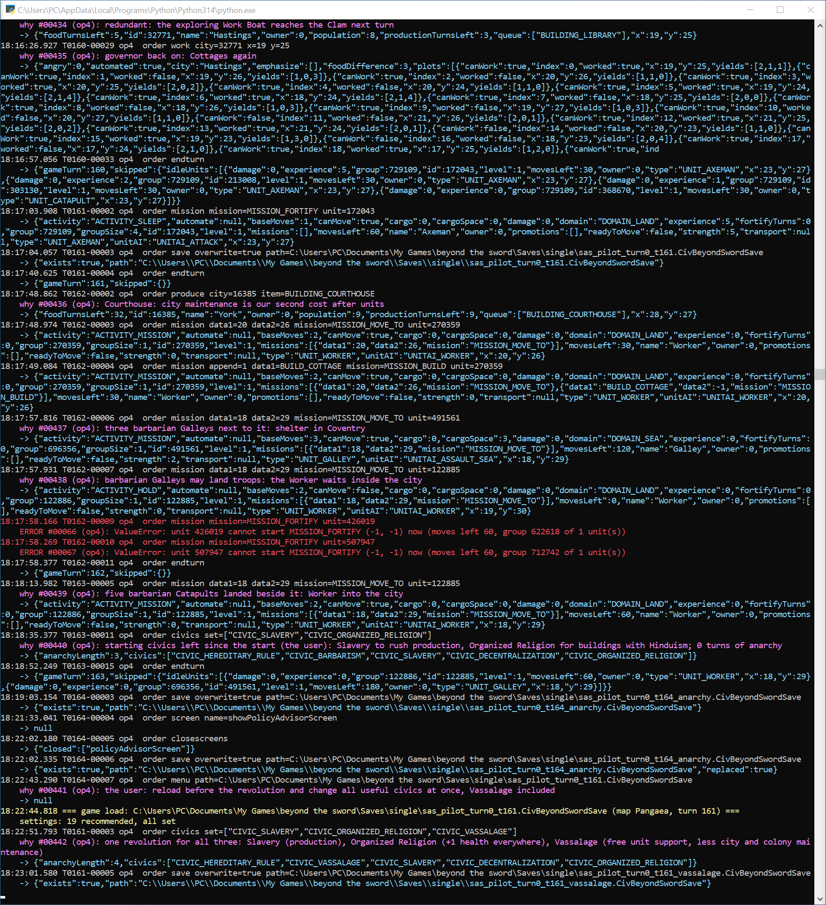
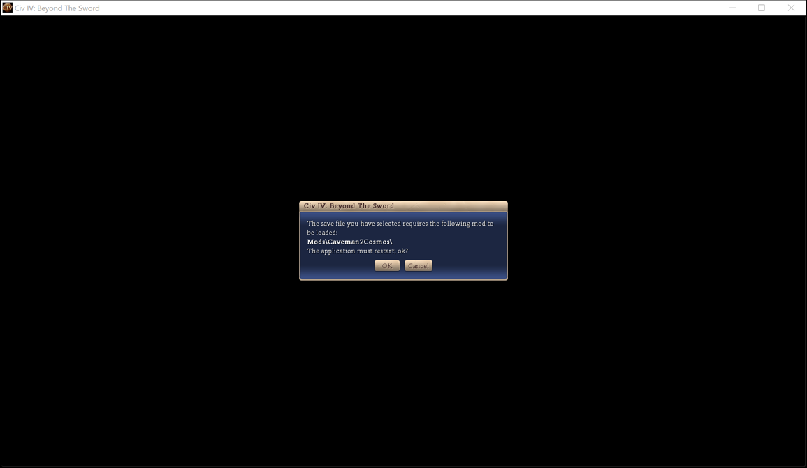

# AdvCiv-SAS SASPilot Guide

How an AI/LLM helper reads and drives a running game from the command line, as JSON, instead of through screenshots and clicks: unit and city orders, research, end of turn, saves, autoplay, any XML info, and arbitrary Python run inside the game.

Built and tested by Claude Code Fable 5.2 on 2026-11-13, at the user's request for a way to pilot the active player digitally, as research projects did for StarCraft and Dota 2.

The mailbox idea comes from CIVAI, whose repository the user keeps at `C:\Users\PC\Downloads\civai-main`; the goal differs: CIVAI makes LLMs fair opponents behind fog of war, while SASPilot gives one agent full information and control of the active player, for AI research and for reproducing bugs and crashes.

The video demos cover two stages of the playtest.

- Part 1 covers the early diplomacy playtest and agent review. Video link to add.
- Part 2 covers the longer live playtest and debugging session. Video link to add.

## Menu

[Quick start](#quick-start)\
[How it works](#how-it-works)\
&emsp;[Switching it on](#switching-it-on)\
&emsp;[Changing commands while Civ4 runs](#changing-commands-while-civ4-runs)\
&emsp;[Why Python, and where the DLL comes in](#why-python-and-where-the-dll-comes-in)\
[Commands](#commands)\
&emsp;[Trade fields](#trade-fields)\
&emsp;[City sites](#city-sites)\
&emsp;[Tech cases](#tech-cases)\
&emsp;[Reminders](#reminders)\
&emsp;[Greatest Civilizations](#greatest-civilizations)\
&emsp;[Dot-map colours](#dot-map-colours)\
&emsp;[Graph queries](#graph-queries)\
&emsp;[Plot grid and trade network](#plot-grid-and-trade-network)\
&emsp;&emsp;[Roles](#roles)\
&emsp;[SASPilotConsole](#saspilotconsole)\
&emsp;[Watching a person play](#watching-a-person-play)\
&emsp;[Running Python in the game](#running-python-in-the-game)\
&emsp;[Using it from a script](#using-it-from-a-script)\
&emsp;[Replaying commands](#replaying-commands)\
[Popups](#popups)\
[Screens and buttons by name (SASPilotUI)](#screens-and-buttons-by-name-saspilotui)\
&emsp;[The widget recorder](#the-widget-recorder)\
&emsp;[What a press sends](#what-a-press-sends)\
&emsp;[What the recorder costs](#what-the-recorder-costs)\
&emsp;[The main interface and the city screen](#the-main-interface-and-the-city-screen)\
&emsp;[Main interface controls, tested on a late game](#main-interface-controls-tested-on-a-late-game)\
&emsp;[Reading and naming, tested on a late game](#reading-and-naming-tested-on-a-late-game)\
&emsp;[Diplomacy and names, tested on a SAS48 game](#diplomacy-and-names-tested-on-a-sas48-game)\
&emsp;[Map plots for unit actions, tested on a late game](#map-plots-for-unit-actions-tested-on-a-late-game)\
&emsp;[Typing and drop-downs, tested on a late game](#typing-and-drop-downs-tested-on-a-late-game)\
&emsp;[A turn by name, tested on a SAS48 game](#a-turn-by-name-tested-on-a-sas48-game)\
&emsp;[Sweeping the screens, tested on a late game](#sweeping-the-screens-tested-on-a-late-game)\
&emsp;&emsp;[Python errors and their dialogs](#python-errors-and-their-dialogs)\
&emsp;[BUG's options screen, tested on a late game](#bugs-options-screen-tested-on-a-late-game)\
&emsp;[Transitions, tested on a late game](#transitions-tested-on-a-late-game)\
&emsp;[What stays the EXE's, and what covers it](#what-stays-the-exes-and-what-covers-it)\
&emsp;[SASPilotUI limits](#saspilotui-limits)\
[Loading a save](#loading-a-save)\
[What was measured](#what-was-measured)\
[What did not work, and why](#what-did-not-work-and-why)\
[Limits](#limits)\
[Where to take it](#where-to-take-it)

## Quick start

Run these from `SASPilot/`. `start` launches Civ4 with SASPilot on and returns once the first turn waits for orders; every other command talks to that client.

```bash
python SASPilotClient.py start --map Pangaea --world-size WORLDSIZE_SMALL --fixed-seeds
```

```bash
python SASPilotClient.py todo
```

```bash
python SASPilotClient.py mission unit=8192 mission=MISSION_FOUND
```

```bash
python SASPilotClient.py produce city=Carthage item=UNIT_WARRIOR
```

```bash
python SASPilotClient.py research tech=TECH_MINING
```

```bash
python SASPilotClient.py move unit=16385 x=40 y=28
```

```bash
python SASPilotClient.py endturn
```

```bash
python SASPilotClient.py close
```

- `SASPilotClient.py help` lists every command with its arguments, straight from the running game.
- `start` first lists the recommended settings for agent runs with their values, `ok` or `WARN`, warning of any not set, such as the Dawn of Man screen or a tech splash, which make the window wait on a Continue button, SASGameRecord off, or in `CivilizationIV.ini` logging, crash dumps, windowed mode or shown Python errors off; `SASPilotClient.py check` prints the same list alone.
  - The values are the development ones from [`toggle_dev_diagnostics.py`](/LLM_Helpers/diagnostics/toggle_dev_diagnostics.py), read from the working tree, which may differ from the committed values players get (the user's suggestion, 2026-11-14).
- Arguments are `key=value`; a value is read as JSON when it parses (`x=12`, `append=true`, `args=[3]`) and as a string otherwise (`item=UNIT_WARRIOR`).
- `--compact` prints one line of JSON; `--pid` picks a client when several are piloted; `--timeout` changes the 60 s wait for a reply.
- `--timing` prints a request's `roundTripMs` and `gameMs` on stderr, and `bench <command> [key=value...] --count N` sends the same request N times and summarizes both; see [What was measured](#what-was-measured).
- `start --save <file>` loads a save instead of a new game: a full path, a bare name from `Saves/single`, or a path under `Saves` such as `single/auto/<name>`, the extension optional; `start --multiple` runs beside other clients, as in the [Game Runs Guide](/_1_AdvCiv-SAS/Docs/Modding_Resources/README_Game_Runs.md#two-clients-at-once).
- The run above is the sequence tested on 2026-11-13: the Settler founded Carthage, the queue and research were set, the warrior walked to its target over two turns, and 22 turns were ended in a row.

`start` lays out SASPilotConsole beside the game as soon as it is ready, and any later command reopens it if it was closed; every client has one (`SAS_PILOT_WATCH=0` only for automated tests that must not open windows). When the user watches you play, keep the camera on your orders too (see [SASPilotConsole](#saspilotconsole)):

```bash
python SASPilotClient.py start --save <save> --fog
```

```bash
python SASPilotClient.py look follow=1
```

- Give the reason for each order with `note="..."`, which the console shows as `why:`. For two clients, start them with `--watch-slots 2 --watch-slot 1` and `--watch-slot 2`; for a client already running, `SASPilotConsole.py --window --pid <pid>` does the same.
- Close the console window when done; the log stays in `Logs/` for review.

## How it works

- [`SASPilot.py`](/Assets/Python/SASPilot.py), in the game, is a small loader hooked to the `gameUpdate` event beside the autoplay request in `AIAutoPlay.py`, and to screen updates in `CvScreensInterface.update`, which come every frame (see [Speed](/_1_AdvCiv-SAS/Docs/Modding_Resources/README_SASPilot_Performance.md#speed)).
- Each client has a mailbox folder, `SASPilot/<process ID>` beside `CivilizationIV.ini` in `Documents/My Games/beyond the sword`, so several clients can be piloted at once; see [KI#1081](/_1_AdvCiv-SAS/Docs/README_Known_Issues.md#ki-1081) for why our files are named by process.
- [`SASPilotClient.py`](/SASPilot/SASPilotClient.py) writes a request as `req_<id>.json`, whole and then renamed into place. On its next frame the game claims it by renaming it `run_<id>.json`, runs it and writes `rep_<id>.json` the same way: `{"id", "ok", "result" or "error" and "traceback", "gameTurn", "gameMs", "tick"}`, where `tick` names the event that served it.
  - On a timeout the client deletes its `req_` if it is still there, so the command never runs; a `run_` means the game took it, so the error says to check the game's state before retrying.
- The commands themselves are in [`SASPilotCommands.py`](/SASPilot/game/SASPilotCommands.py), which the loader reads from disk; it is Python 2.4, run inside Civ4.
- Commands see everything, without fog of war, and orders are applied directly to the game objects, as a human's are in single player. Network games are untested.
- Python 2.4 has no `json` module, so the command file carries its own small writer and reader.

### Switching it on

- It is off for players. `SASPilotClient.py start` switches it on for its own process by adding an `[SASPilot]` section with `On = 1` to the per-run INI it passes with `ini=`, as the autoplay runner does with `[SASAutoplay]`.
- `SAS_PILOT_ON` in `GlobalDefines_advciv_sas.xml` switches it on for every launch, for example to pilot a game the user started by hand. Keep it at `0` in commits.
- When off, the cost is one comparison per game update and per frame.
- When on, anyone who can write to the mailbox folder can run Python inside the game, which is the point of the tool; it is a local folder of the user's own account.

### Changing commands while Civ4 runs

- Save an edit to `SASPilotCommands.py` and the running game picks it up within a fraction of a second (it compares the file's size and time every 20 updates, about 30 times a second in game). `ping` then shows `reloadError` if the new file failed to load; the previous version keeps serving.
  - The failure is also written to stderr, which the game shows as a Python error in its window. On 2026-11-13 an edit saved a help string with double quotes inside it, the user watching saw the error, and the corrected file loaded 4 seconds later; so an error that appears while an agent edits this file is usually such a transient save, and `PythonErr.log` names the line.
  - Checking the edit first with Python 2.4 (`C:\Python24\python.exe`, as in [Syntax checks](/AGENTS.md#syntax-checks-and-linting)) before relying on the reload catches such a slip, but the Edit tool saves at once, so the game may load the broken version first.
- This is why the command file lives in `SASPilot/game/` and not in `Assets/Python/`; see [What did not work](#what-did-not-work-and-why).
  - Writing the file is enough, even unchanged. On 2026-11-20 a credit sweep's `sed -i` rewrote `Assets/Python/SASPilot.py` while a test game ran, and the game showed "Failed to load python module CvScreensInterface". Rewriting that file again with identical bytes (the same MD5, no Git diff) reproduced it at once in a fresh game.
  - So a sweep across files, such as `sed -i` or a script writing every match, must leave `Assets/` alone while Civ4 runs, even where it changes nothing.
- `SASPilot.py` itself is in `Assets/Python/`, so changing it needs Civ4 closed first, like any mod Python.
- `ping` reports the loaded `PILOT_REVISION`. Keep one revision for the candidate during a draft PR and record its command changes in [SASPilot revisions](/_1_AdvCiv-SAS/Docs/revisions/SASPilot.md).
- A script writing the command file can fail with `OSError: [Errno 22] Invalid argument` while the game has the file open for its reload check; it happened twice on 2026-11-14, and a retry a moment later succeeded. The Edit tool retries on its own.
  - Later the same day the same error came three times when writing `SASPilotClient.py`, which the game never reads, so the game's reload check is not the only cause; some other process held the file a moment. The cause was not found; a retry loop of a few one-second tries always got through.
- The other way round, the game's reload can meet a save in progress: on 2026-11-19 a script rewriting the command file made the game's read fail with `IOError: [Errno 13] Permission denied`, and the traceback reached `PythonErr.log`, which the user saw.
  - The loader had also marked the file as loaded before reading it, so the edit waited for the next content check.
  - Since then a failed read leaves the file unloaded and writes only a `COMMANDS_READ_RETRY` record to `PythonDbg.log`, and the next check, a fraction of a second later, loads the finished file.

### Why Python, and where the DLL comes in

The user asked on 2026-11-13 whether the bridge would be faster or more reliable in the DLL.

- The commands are Python because a command can then be added or fixed in a minute, with no compile and without restarting Civ4, and Python already reaches nearly the whole game API.
- The DLL would not answer sooner: the 250 ms wait was how often the game called the bridge, not Python's speed, and a DLL poll at the same place would have waited as long.
  - Measured later the same day (2026-11-13): a ping spent 0.27 ms in the game against 250 ms round trip. Serving on every frame instead brought it to 2 ms, and a faster JSON writer brought 441 plots from 250 ms to 12 ms, both in Python; see [What was measured](#what-was-measured).
  - Reading the game data itself took 3 ms for 441 plots, so a C++ version of the reads looked likely to save only a few ms.
  - Correction after a C++ prototype the same day: C++ did both reading and writing the JSON in 0.32 ms against Python's 8 ms, but a bridge served from the DLL alone still waited about 200 ms, as the EXE calls the DLL only about four times a second. See [Would the DLL be faster?](/_1_AdvCiv-SAS/Docs/Modding_Resources/README_SASPilot_Performance.md#would-the-dll-be-faster).
- The DLL is needed for reach: what Python cannot see or do at all. Popups were the first case, so `CyGame` gained `getSASPilotPopups`, `closeSASPilotPopups` and `answerSASPilotPopup`; deals and a hook at the main menu would be next.
- So the split is: small DLL bindings for what Python lacks, and the commands themselves in Python on top of them.

## Commands

| Command | What it does |
| --- | --- |
| `ping` | bridge revision, PID, whether a game runs, turn, year, active player, whether it is that player's turn, autoplay turns left, map, and the difficulty (`handicap`, `playerHandicap`), as the Victory screen shows it: the user asked whether SASPilot played Monarch or Noble (Noble, 2026-11-14) |
| `todo` | what waits for orders: cities with an empty queue, missing research, units ready to move with no mission and not automated, and held popups that ask for a choice; also an open diplomacy screen, and a city screen left open over the map (`cityScreen`), as a spy's Investigate City leaves one, and any advisor or other screen left open (`openScreens`) |
| `closescreens` | close the screens left open in the window, all or one `name=` as `todo`'s `openScreens` names it, as Esc or their Exit button does: SASPilot could open an advisor with `control` or `screen` but not close it, and the user saw a Foreign Advisor left open by a test (2026-11-14) |
| `turn` | what a person sees as a turn starts: turn, year, `todo` and the messages since the previous turn |
| `player`, `players` | gold, rates, research, civics, religion, counts, wars; one player or all. Under fog, `players` gives other teams' players only once met, with their ID, name, civilization, team and whether alive, as the scoreboard does: it gave every civilization in full, unmet ones included (Codex's review, round 32) |
| `units`, `unit` | a player's units briefly, each with its state (activity, automation, head mission and its target plot, fortify turns, promotion ready; ours only under fog), or every living player's with `player=all`; one unit in full, with the missions, builds, commands, promotions and upgrades it can take now |
| `hover` | the hover text a player reads for units, as plain text: each of ours in one line as the plot hover lists them, or one unit's full hover with `unit=`; another player's unit only while in sight under fog |
| `cities`, `city` | a player's cities briefly; one city in full, with what it can train, construct, create, maintain or hurry now, and as the city screen shows them its trade routes (each partner and the commerce it brings), defense and bombard damage, and Great People progress. The user asked at turn 141 of the turn-0 game whether SASPilot had the city screen's details: London then traded with York for 1 commerce and, after Currency, with Pericles's Sparta for 3, as foreign routes need foreign cities we have seen |
| `plot`, `plots` | terrain, feature, bonus, improvement, route, owner, yields and units of one plot or of a square of plots; with fog on, only what the team knows (see [Playing as a person would](/_1_AdvCiv-SAS/Docs/Modding_Resources/README_SASPilot_Playtests.md#playing-as-a-person-would)). Center `plots` on `x=` and `y=`, or use `unit=` or `city=` with `radius=` |
| `grid` | an inclusive rectangle or the whole map, with canonical plot coordinates, terrain, fog and optional trade-network edges. See [Plot grid and trade network](#plot-grid-and-trade-network) |
| `fog` | switch between the full view (default) and what the active player's team knows or sees |
| `path` | the route a unit would take to a plot before ordering it: each step's plot, turn and moves left, and the total turns |
| `messages` | the messages the game showed the player at the top of the screen and still lists, such as combat results |
| `citizens`, `work`, `specialist`, `emphasize` | the city screen: worked plots, specialists, citizens left unassigned, governor and emphasis buttons, and the clicks that change them; a plot claimed from another city brings that city's screen too (`claimedFrom`), as its freed citizen waits unassigned until its governor runs |
| `civics`, `sliders`, `religion` | the civic options with what can be adopted, the commerce percentages, the state religion; each also makes the change. `religion` gives each candidate faith with our cities that have it (where its happiness applies), our holy city of it, and the met civs whose state religion it is (`sharedWith`) or who follow another (`otherFaithOf`, a diplomatic cost of about -3 to -4 the user recalled), as a state religion trades happiness against diplomacy. Added when the validation run chose Paganism over Hinduism, founded in Cork, for Cyrus, the strongest neighbour, who went to Pleased (+4) |
| `types`, `pedia` | the XML types of one kind, and a type's Sevopedia text: its name and the effects text the DLL composes |
| `info` | any XML info by type, such as `type=UNIT_WARRIOR` or `type=BUILDINGCLASS_PALACE`: every simple getter of its info object, which is the data the Sevopedia shows |
| `mission`, `move` | give a unit's group a mission (`MISSION_FOUND`, `MISSION_FORTIFY`, `MISSION_BUILD data1=BUILD_FARM`...); `move` is `MISSION_MOVE_TO` after a path check; with `append=1` the mission is checked where the queue ends; a unit with no moves left takes a new order too, starting next turn, as in the window (a Worker's replacement queue was refused as "moves left 0", 2026-11-14) |
| `builds` | what a unit could build on a plot, with turns, the improvement or route, and the improvement's yield change; with `refused=1`, also each build the plot refuses and why, in `CvPlayer::canBuild`'s order: the plot's own check first (an improvement the plot cannot have, a feature that unclaimed land cannot have removed (advc.119; in SAS a road drains Marsh, which is why a road at 26,28 of the turn-0 game was refused), or another team's land), then a missing tech, a missing feature tech, and gold with inflation, nothing for a build already begun. The first version asked the tech first and took the XML gold cost (Codex's review, round 32) |
| `buildsteps` | a Worker's plan over several plots in one order, as shift-clicks queue it: `steps=BUILD_ROAD@99,26;BUILD_FARM@100,27` moves to each plot and builds there in order, each through `mission`'s checks; replaces the queue unless `append=1` |
| `sites` | the recommended city sites the window circles for a selected Settler, with found value and path turns |
| `limits` | happiness and health, the two limits on growth, and where more could come from: per city the happy and health margins and turns to grow, which binds first, what our traits give, the resources giving either with our status and the tech that lets a city use one, the buildings giving either that a city can build now or after one tech, and state religion (the religions in our cities, the happiness our civics give). The user named happiness this game's focus at turn 54 of the 2026-11-19 validation run; it showed +1 from a state religion (Paganism, in Cork only) and the Gold at 20,14 inside the next site's radius |
| `plansites` | city sites planned ahead without a Settler: each revealed legal site of our landmasses with the AI's found value and what the empire's shape needs, each field and priority as in [City sites](#city-sites); `spread=N` keeps sites N apart, `legal=1` adds the sites the AI rates 0 near our cities. The AI's value is a reference, not the answer |
| `potential` | what each revealed plot of a square could yield once improved: today's yields, and every improvement the player could build there with its yields and whether it can start now (false: a tech away); counts today's techs, so later tech bonuses are left out, and under fog skips builds only a hidden bonus allows |
| `mark` | a sign with text on a plot and, by default, dots over its city radius, so a candidate city site shows on screen; `grid` lists the marks too, so the agent's analysis and the screen show the same sites; `clear=1` removes them. The user's idea in the scouting trial (2026-11-14), when the agent compared sites only in JSON and the user could not see which plots it meant. `color=contrast`, the default on one of our cities, picks the colour farthest from our civ's colours (see [Dot-map colours](#dot-map-colours)). Cosmetic: nothing in the game changes |
| `signs` | the map signs the player sees (theirs and those for everyone), with plot, caption and owner, including the user's own |
| `odds` | the combat odds the window shows when a unit is pointed at a plot: the defender the game would pick, strengths, and the chance to win in per mille |
| `group` | group a unit with another on its plot, as selecting both does, so they move as one; without `with=`, split it off |
| `diplo`, `reply`, `contact` | the diplomacy screen as the window shows it: the AI's line, the numbered replies and the screen's number; `reply n= screen=` answers one as a click does, refused if the screen has changed since, and `comment=` names the reply instead of its number (`comment=COMPLETE_DEAL`), which is safer: at turn 128 of the turn-0 game the agent sent `n=1` meaning "What would make this deal work?", but with only our Pig on the table the list was FISH_FOR_DEAL, GIFT, and the Pig went to Gilgamesh as a gift; `contact` opens the screen with a leader, and with `give=`/`take=` on its trade table with that deal on it |
| `freetech` | choose a free tech such as the Oracle's, while one is owed |
| `trade` | the diplomacy screen's table with another player: what each side could give, the AI's refusal reason per item (`DENIAL_` type), and its attitude, with the fields in [Trade fields](#trade-fields) |
| `propose` | propose a deal to an AI, as the Propose button does: `give=[...] take=[...]` with items as `trade` lists them; an accepted deal is made |
| `techs` | the tech market across the players met: each tech we lack that a rival holds, with its cost, whether SAS's XML lets it be traded at all (`bTrade`, off for 32 techs such as Bronze Working, Engineering and Chivalry), and per holder whether it can go in a deal, the AI's refusal and whether it will talk; then what we could give each, with the gold each could pay at once (`maxGoldTrade`, the tab's coin column); and `nobodyHas`, the techs we can research that none of them holds, with `unseenPlayers` counting met players whose techs the fog hides. Under fog, as the Foreign Advisor's tech tab shows it. The user pointed out at turn 139 of the turn-0 game that the agent kept researching techs every neighbour had, which trade buys far cheaper, while a tech nobody has trades to several leaders; at that turn Navigation was the only one |
| `rivaltechs` | met rivals' tech trees beside ours, as the tech screen shows who knows each tech: with one rival, what they know, could research next, have that we lack and lack that we have (each with its XML trade flag), and races with our research; `layout` lays the tree out by tech-screen column with who knows each tech, overlapping several rivals with `with=8,3` or `with=all` |
| `SASPilotClient.py price` | an AI's price, as "What do you want for this?" gives it: `price with=2 take=["TRADE_TECHNOLOGIES:TECH_MACHINERY"]` puts the items on the table, reads the counter-offer and leaves with nothing agreed; `accept=1` takes it (reported as `acceptSent`: read the result back). It stops if another leader's screen or a new conversation takes over. A client-side sequence of `contact`, `diplo` and `reply`. It leaves by Reject or Never mind before Exit and checks a second later that the screen stayed closed: Exit straight from a trade table after a refusal reported it closed, but the table came back and blocked the next call (2026-11-14) |
| `SASPilotClient.py leave` | click through diplomacy screens that only inform (thanks, a cancelled deal, a war declaration) with their exit reply, as a person does, and stop at the first screen with a choice (a deal, peace, a demand), returned for the agent to answer. On turn 289 (2026-11-14) Kublai's declaration, a thanks and two cancelled deals queued up one after another, each needing a `diplo` and a `reply` |
| `look` | turn the window's camera to a plot, a unit or a city; following is on by default since the user, watching the Orleans attack (turn 129 of the turn-0 game, 2026-11-14), asked for it without anyone switching it on (`follow=0` stops it): it makes each `move` and attack look at its destination first, and each order on one of our units or cities (`mission`, `command`, `produce`, `hurry`, `spy`...) look at it, so a person watching sees the action; only our own units and cities, so fog hides nothing more than in the window |
| `command` | a unit command, such as `COMMAND_PROMOTION data1=PROMOTION_COMBAT1`, `COMMAND_AUTOMATE data1=AUTOMATE_EXPLORE` or `COMMAND_DELETE confirm=1`. Deleting needs `confirm=1` or `true`, as the window asks: at turn 90 of the turn-0 game the agent sent `COMMAND_DELETE` to two new Workers meaning to clear their queues, and lost one (a new mission without `append=1` clears a queue) |
| `produce`, `hurry` | set or append a city's production; hurry it, or without `hurry=` list the ways with their gold and population costs (gold needs Universal Suffrage, population Slavery) |
| `research` | the techs available now with turns, and the queue; or research a tech, queueing missing prerequisites first, `append=1` to add. `effects=1` adds each tech's rules and unlocks; `ahead=N` lists every tech at most N techs away, with the techs on the way, OR alternatives, unlocks and the met players seen to hold it; `rivals` gives each met player's current research when espionage shows it. Without args each available tech comes with its case, as in [Tech cases](#tech-cases) |
| `tech` | one tech's effects and requirements, with the selected team's cost, progress and missing immediate prerequisites, and its `path`: every tech still to research, prerequisites first, in the order `research` queues them, with beakers and turns each and in total. Effects say `leadsTo` for later techs and `prerequisite` for what it unlocks |
| `graph` | the tech tree, promotion prerequisites, unit upgrade paths, current diplomatic relations or completed-turn Info graphs as JSON. See [Graph queries](#graph-queries) |
| `endturn` | end the turn, reporting what was left (`skipped`); the client then waits for the next turn and prints its `turn` digest, unless `--no-wait`; `--turns N` keeps ending turns until something waits |
| `autoplay` | AI Auto Play for a number of turns; follow with `SASPilotClient.py wait` |
| `save` | save; through `SASPilotClient.py` a bare name goes to `Saves/single`; an existing file needs `overwrite=true` |
| `menu` | leave the game: with `path=`, load that save in the same process and wait until it is ready (`--no-wait` returns at once); without, go to the main menu. In a big late game, close and `start --save` instead: leaving a Huge turn-305 game crashed Civ4 ([KI#1084](/_1_AdvCiv-SAS/Docs/README_Known_Issues.md#ki-1084)) |
| `control` | any `ControlTypes` entry, as its hotkey would: `CONTROL_DOMESTIC_SCREEN`, `CONTROL_WORLD_BUILDER`, `CONTROL_QUICK_SAVE`...; a number works too, and the role check resolves it first, as `control=57` (the WorldBuilder) passed the play role when it compared names (Codex's review, round 32) |
| `screen` | call a `CvScreensInterface` function, such as `name=pediaJumpToUnit args=[29]`, to show an advisor or Sevopedia page in the window; under `play` and `assist`, only `show*` and `pedia*` functions, without the WorldBuilder's and the debug screen, as `name=WorldBuilderRevealAllCB` would reveal the map; the Foreign Advisor also takes its tab number (`name=showForeignAdvisorScreen args=[5]` opens Glance), a click a player makes |
| `batch` | several commands in one request |
| `py` | run Python inside the game |
| `profile` | run a command and split its time into reading the game (`gatherMs`) and writing the JSON (`encodeMs`) |
| `popups` | the active player's popups held back from the window, plus any displayed or queued; see [Popups](#popups) |
| `answer` | answer a held popup as if one of its buttons were clicked: `id=` from `popups`, `button=` by number or name (`button=RAZE`), `text=` for an edit box |
| `closepopups` | drop held and queued popups, all or of one `type=` |
| `dequeue` | remove one entry from a city's build queue by position, as clicking it in the city screen does |
| `espionage` | the espionage screen: per team met, our points against it, our spending weight and its counterespionage against us; `team=` with `weight=` sets a weight |
| `spy` | what a spy could do where it stands, as the espionage popups offer it: the plot's owner (`target`), our points against that team, and each affordable mission with its cost and targets; run one with `mission=MISSION_ESPIONAGE data1=<mission> data2=<data>`. An empty list with few `points` means no mission is affordable, as at Madrid with 40 points against Kublai (2026-11-14); `blocked` names why a spy can do nothing this turn: it moved (a spy acts only on a turn it has not moved), attacked, or the target team sees it |
| `relations` | per player met: attitude, will to talk, war, treaties, open borders, defensive pact, closest city distance, cities within 10 plots, score, power (fog off), and `viewsOf`, each leader's attitude toward every other, which is not symmetric. Also `powerRatioPerMille`, their power against ours as the scoreboard shows it beside each leader (1488 is 1.488 times ours), wherever the scoreboard shows it (`canSeeDemographics`), and `attitudeModifiers`, the hover's lines such as "+1: Years of peace" or "-1: You're getting ahead of us": the user pointed to both at turn 90 of the turn-0 game, when every rival was 1.2 to 2.2 times stronger. Under fog, only cities whose city, not just plot, the team has revealed count (Codex's review, round 35). `attitudeValue` and each `viewsOf` cell carry the Foreign Advisor Glance tab's number (the sum of the hover's modifiers, as BUG's AttitudeUtil reads it), with `worstEnemy`, `atWar`, `peaceTreaty` and `wouldJoinWarIfAsked` (advc.152): the user had the agent compare the reply with the Glance tab at turn 127 of the turn-0 game, which showed +11 and -5 where the reply had only Friendly and Annoyed, and the numbers and icons pick a war target and its likely friends |
| `deals` | our running deals, as the Foreign Advisor lists them: the leader, the turn each began, `turnsToCancel` and what each side gives. A resource we export leaves our network, as `CvPlot::updatePlotGroupBonus` subtracts the capital's exports, so `resources` shows it unconnected: at turn 125 of the turn-0 game the mined Iron beside London read unconnected for seven turns, and `deals` showed it had gone to Gilgamesh inside the turn-118 Pig sale |
| `canceldeal` | cancel one of our deals as the Foreign Advisor's cancel does: it raises the window's `BUTTONPOPUP_DEAL_CANCELED`, which `answer` confirms (`CANCEL_DEAL`) or declines; refused before `turnsToCancel` reaches 0 and for deals holding a vassal item, as `CvDeal::isCancelable` is not exposed to Python. The Iron came back at turn 128 this way |
| `trainable` | the units a city can train now, for value per hammer: turns, cost, strength, moves, strength per 100 hammers, and what strength leaves out (first strikes, collateral damage and reach, withdrawal, bombard, city attack and defense, bonuses against unit types). The user's advice at turn 100 of the turn-0 game: weigh strength against cost, as an Axeman for 35 hammers is strong early, and the effects, as a Trebuchet's strength is low. Axeman and Spearman gave 1428 per 100 hammers, the Longbowman and Catapult 1000 |
| `buildable` | the buildings a city can build now, with cost, hammers already in each, turns, and the happiness, health and culture each gives there, fastest first; `trainable` is the same for units |
| `bonustrade` | the Foreign Advisor's Bonuses tab: our resources with how many we have and who would import each, and per leader met whether our networks connect, the most gold per turn they would pay, and what they would import, will export, won't export and we don't need, by the tab's own tests (CvForeignAdvisor.drawResourceDeals). The user advised trading spare copies actively (turn 111 of the turn-0 game, 2026-11-14): asking leaders one by one with `price` had found only that nobody wanted a Pig, while the table showed Louis importing Wine, our second copy, which then sold for 4 gold a turn. The hover's per-resource price ("Will import: Pericles (6), Zara Yaqob (8)" over Rice, from `CvPlayerAI::AI_goldForBonus`) is not exposed to Python; `price` gives the price of one deal |
| `borders` | land borders in numbers, to pick a front: per player whose land we have seen, their land plots, our frontier with them and theirs with us, whom else their land touches and by how much, and their seen cities nearest ours with distance and coast. Sorted by our frontier |
| `scores` | the SAS Info screen's Score tab: per player met and ourselves, score and its change since last turn, techs known, land share in per mille, power and power per city where the demographics are visible, cities seen, state religion and holy city, vassal status, will to talk, and research where espionage shows it. The user pointed to the tab at turn 150 of the turn-0 game: it showed at once that we knew 27 techs against 29 to 37 for every rival. Also every other column of the tab: traits, land to the hundredth of a percent, masters and vassals, and per rival the power ratio, attitude and its value, worst enemy, war, peace treaty, trade network, open borders, defensive pact, golden age or anarchy and our espionage weight; checked column by column against the tab at turn 200 of a Large autoplay (2026-11-15). `sort=<field>` or `sort=-<field>` sorts as a column header does |
| `wartargets` | war targets and threats side by side: per player met, power, frontier, nearest city, war, their attitude toward us, and the diplomatic cost of a war on them (who would be angered or pleased, who would join if asked, pacts and masters). `threat` flags a rival at least as strong as us that dislikes us, however far |
| `rivalcities` | seen rival cities near ours: population against ours, capital, coast, defense bonus, defenders when the plot is in view, bonuses we lack, and a food and production estimate from the tiles seen |
| `world` | what every player can know, met or not: world wonders with their year, projects, national wonders seen, the Top 5 Cities, rivals alive and met, religions with date and influence, corporations, and vote sources with builder, religion and total votes; owners named only where the game's screens name them. See [What a player knows about rivals not met](/_1_AdvCiv-SAS/Docs/Modding_Resources/README_SASPilot_Playtests.md#what-a-player-knows-about-rivals-not-met) |
| `settings` | the Victory screen's Settings tab: the game being played (difficulty, map script, size and real grid, climate, sea level, map options, speed, era, options, disabled victories), our leader and civilization with traits and unique units and buildings, and the rivals the tab lists: those met, those not met whose pick at setup was not random (leader, civilization or both, with the possible leaders or civilizations for the random half), and how many were fully random; every leader named with its AI personality as the Sevopedia ranks it. See [What a player knows about rivals not met](/_1_AdvCiv-SAS/Docs/Modding_Resources/README_SASPilot_Playtests.md#what-a-player-knows-about-rivals-not-met) |
| `shore` | a plot's relation to water for choosing a city site: coastal (can build ships), fresh water, river, lake, adjacent water and ocean plots, and for a Farm whether the plot is irrigated or can take irrigation now; revealed plots only |
| `seareach` | where a ship can still explore: per direction (north, south, east, west of it), the unknown coast its pathfinder reaches and in how many turns, marked when it lies in a met rival's waters, and the nearest reachable unknown coast as `recommend` (crossing a rival's waters toward the unknown is fine, touring its known shore is not); a failed path means no route through revealed plots, not ocean, as unrevealed water may connect |
| `topcivs` | the Greatest Civilizations screens our team saw: `history` from the replay messages the save keeps (turn and the row the Timeline shows), the latest one, our rank in it and whether the screen is still up; see [Greatest Civilizations](#greatest-civilizations) |
| `step` | one plot along the path toward a target, with what that step showed (position, moves left, steps still to go, plots newly revealed, foreign units within two plots), so the next step can react; `move` takes one plot only unless `whole=1`, as moves over several plots go a plot at a time |
| `victory` | the Victory screen's Victories tab per valid victory: score and turns left, rivals left and met, domination shares needed against ours and the best met team's, Legendary cities needed with our best cities' culture and turns to it, space parts; and the world totals its percentages imply (population and land plots, unmet players included) |
| `geography` | the map as our team has seen it, with takeaways: land, water and ocean seen, each landmass with its owners, cities, unowned land and whether fully explored, landmass count with mean and median size of explored ones, the bonus mix on seen plots, met rivals sharing our landmass and open borders; the map settings and the AI's land- or naval-heavy reading; the script's World Picker preview. See [Map composition and contact](/_1_AdvCiv-SAS/Docs/Modding_Resources/README_SASPilot_Playtests.md#map-composition-and-contact); `settings` quotes the map script's own description and every one of its options with this game's value (`mapOptionsAll`), defaults included, such as SAS_Large_Facing_Islands' east-west coast lanes |
| `timeline` | the Info screen's Timeline tab as entries, newest first, through the tab's own filter: met players' era changes, first discoveries, Great People and cities founded where seen, plus public announcements (religions, corporations, world wonders) in faraway form; each with turn, date, text, kind, its player once met and `public`. `since=`, `find=`, `public=1`, `limit=` |
| `demographics` | the Info screen's Demographics tab: soldiers, land, population, economy, industry and agriculture, with our value and rank, and the rivals' best, worst and average, under fog by the tab's own rules (rank among met players, best and worst among those whose demographics we see, average above 3 rivals, rounded) |
| `finance`, `domestic`, `military` | the Finance tab's numbers; the Domestic Advisor's per-city overview, with `coastal` per city and a `summary` (cities, coastal, unhealthy or at the health cap, unhappy or at the happy cap, starving), as the user asked at turn 156 of the turn-0 game how many coastal cities we have and which cities need health, and from the advisor's other overview pages each city's defense %, garrison, revolt chance in per mille (Orleans's 9.2% at turn 139 had been learned only from a turn message), food stored against the growth threshold, war weariness and the turn founded; at turn 157 they showed 16 units idle in Orleans and one in London; the Military Advisor's units by domain and place, wounded, upgradeable now with the cheapest cost, Great General progress and walls |
| `targets` | the plots a unit could pick for an interface mode from `unit`'s `targetModes` (recon, air bomb, air strike, rebase, paradrop, airlift, ranged attack, nuke), as the window highlights them, with the mission to send; under fog, revealed plots only. Without `mode=`, the unit's modes. A Jet Fighter's recon flew this way on turn 285 (2026-11-14) |
| `settle` | give every idle group Fortify, else Sleep, else Skip, once per group, as a player does before ending the turn |
| `routes` | a text map of the player's land, one row per map row from the north: `C` city, `#` railroad, `=` road, `.` own land with no route, `~` own water, `x` another's land, `?` unrevealed under fog; plus each city's connection to the capital. Under fog, only our own team: `player=` naming a rival still drew the map's edges from all its plots and listed its cities (Codex's review, 2026-11-14) |
| `map` | a text map of the known world, one character per plot: `C` our city, `c` another's, `~` water, `^` peak, `h` hills, `f` forest or jungle, `x` another's land, `u` one of our units, space unknown; under fog, only revealed plots, with their last-seen owners. Made for an opening's scouting and city sites: at turn 25 of the turn-0 game only 150 of 3168 plots were known; `owners=1` draws each land plot as its owner's ID to read border shapes |
| `resources` | every resource the team knows of, with its owner, improvement and each build that connects it, with the build's tech and whether we have it: at turn 37 of the turn-0 game it showed that SAS's Agriculture opens the Banana's Plantation and five more resources nearby, so Agriculture went ahead of Masonry (the user's advice: check resources first). `connected` on our own plots says whether the plot supplies its resource: at turn 90 the Banana, the Copper and two Pigs were improved but unconnected, with no road from their plots to a city, which the user saw before the agent did; each with its happiness and health and how many we already have available (`weHaveAvailable`), as a second source adds only its plot's yields |
| `reminders` | what the game does not announce but a player would want pointed out, as small checks, each in [Reminders](#reminders); each turn's digest carries them, and `endturn --brief` prints them as `remind:` when they change. `mute=CHECK` or `mute=CHECK@x,y` silences a check or one entry for the session, `unmute=` lifts it (`all` for every one) |
| `role` | the session's role, the user's idea (2026-11-14): `play` allows what a player sees and does, keeps fog on and refuses `py`, the WorldBuilder, `fog=0` and orders or reads with another team's `player=`, in `batch` and `profile` too; `assist` adds advice to `play`; `all`, the default, allows everything. `lock=1` holds the role until Civ4 closes, and `start --role` locks it. See [Roles](#roles) below |
| `directions` | what is known in each of 8 compass sectors around a city: good and poor land, fresh water, resources, rival plots and the unknown edge, with a rough value, so scouting and new cities go where the land promises more. The user's idea after the Warrior walked into tundra the map already showed (validation run, 2026-11-19) |
| `advise` | advice, a heuristic of ours that may be wrong, naming its rule in each reply: `about=scout` ranks `scout`'s steps; `about=threats` weighs each animal and barbarian within 4 plots of a unit and says which to `avoid`. See [Roles](#roles) below |
| `SASPilotClient.py health` | SASPilot's own state in one reply, the user's idea (2026-11-14): the bridge's tick errors, settings not at their recommended values, this session's errors and `py` snippets, operators present, role and fog, and whether SASPilotConsole follows the client; `problems` lists what needs a look and is empty when all is well |
| `scout` | each plot a scout could step to now, with how many unknown plots it would reveal, its defense bonus and the animals and barbarians seen within two plots, in a fixed order; the choice stays the agent's, as automated exploring lost a Warrior that fought on at 15 HP. Its ranking moved to `advise about=scout` with the facts-versus-advice split. `frontiers` gives the nearest known land of our landmass bordering the unknown, by distance from the unit, as far targets: at turn 60 of the 2026-11-19 validation run every step around the Scout revealed little and it drifted back toward home, while a pocket inside Sitting Bull's land 2 plots away still hid his city Cahokia, found 2 turns later |
| `greatpeople` | Great People planning: the threshold, per city its points, points per turn, rate modifier, turns left and the mix of types with each one's chance (`chancePctX100`), as the city screen's bar shows; and the techs whose first discoverer gets a free Great Person that nobody has yet |
| `workers` | planning Workers by hand instead of automating them: without `city=`, each Worker with its mission, per city the worked plots left unimproved and the city AI's three most valued builds, and per leader we can trade with whether their capital is on our trade network (a missing road link means no foreign trade routes); with `city=`, each plot's terrain, feature, bonus, river, improvement, route and yields, the city AI's best build and value (`getSASPilotCityBuildsJson`, as Python had no getter), and every improvement a Worker could build with its yield change and turns. The AI's choice is a reference to compare with, as the user wanted SASPilot to decide as a player (2026-11-14); as advice no screen shows, it is left out unless the session's role allows advice |

- Types are passed and returned as XML types (`UNIT_WARRIOR`, `TECH_MINING`), never as numbers or translated names.
- Unit and city IDs are per player; `player=` selects another player than the active one, for reading and for orders alike.
- A reply that names another player gives its ID with the leader's name and civilization XML type, such as `contact`'s `{"contacted": {"player": 2, "name": "Kublai Khan", "civ": "CIVILIZATION_MONGOL"}}`; only the ID is unique, as with duplicate leaders or civilizations allowed two players can share both (2026-11-14).
  - Unit and city rows keep a bare `owner` number, as naming it in every row would swell large replies; `players` maps the numbers.
- An order's reply shows the state at the moment the order was given. A mission is carried out on the following game updates: right after `MISSION_FOUND` the reply still showed the Settler, and the city existed a moment later. Read again before relying on the result.
- A `MISSION_MOVE_TO` longer than the unit's moves continues when the turn ends, as it does for a human's unit.
- `start`, `list`, `wait` and `close` are handled by `SASPilotClient.py` itself and are not in `help`.

### Trade fields

`trade` gives these fields beside the two columns of the diplomacy screen.

| Field | What it gives |
| --- | --- |
| `tradeRules` | which kinds of trade (tech, gold, maps, open borders, pacts, alliance, vassal) each side's techs allow, and the techs that allow each, read from the XML so other rules are followed (in SAS: Writing for techs and open borders, Currency for gold) |
| `techsNotOffered` | each tech they hold and we lack that is off the table, with why: bTrade off in the XML, as for The Wheel in SAS, or a prerequisite we lack |
| `tradeRoutes` | whether a trade route with them can exist: allowed at all (open borders or other free trade), their cities we have seen (AdvCiv's advc.124 skips unrevealed cities, so exploring finds partners, as the user recalled) and those our network reaches |

Resource trades follow a stricter rule (`CvPlayer::canTradeNetworkWith`: their city must also reach their own capital), which `bonustrade` gives: at turn 54 Pasargadae was on our network for a route, while `bonustrade` said Persia was not connected.

### City sites

`plansites` gives each site these fields, added when the 2026-11-19 validation run leaned toward a Crab site 14 plots from the Palace and a Corn site past Persia.

| Field | What it gives |
| --- | --- |
| `value` | the AI's found value (`CvPlayerAI::AI_foundValue`), a reference: on the isolated island of the [islands replay](/_1_AdvCiv-SAS/Docs/Modding_Resources/README_SASPilot_Playtests.md#islands-replay-from-turn-0) it rated one site, while corner sites that claim the coast fitted the plan better, and at turn 79 it rated 30,15 at 0 for being near Cork |
| `coastal`, `openCoast` | whether the site is on the sea, and the open coast in its radius |
| `foodBonuses`, `happyBonuses` | the food and happiness resources revealed in its radius |
| `foodAtSize6` | the centre's and best tiles' natural food, revealed bonuses included, less what 6 citizens eat |
| `sharedPlots`, `sharedStrong` | the plots it shares with our cities, with their yields; strong ones have a bonus or 4+ total yield |
| `unknownPlots` | its radius plots still in fog |
| `toGovCenter`, `toOurNearestCity` | its distance to our nearest government center and to our nearest city |
| `nearestRivalCity`, `nearerRivalThanUs` | the nearest seen rival city, and whether it is nearer than ours |
| `contested`, `withinReach` | a rival city at most 2 plots farther than ours; within 6 plots of our nearest city |
| `upkeepReference` | per reply: the distance upkeep our cities pay now at their distances |

Each site's `priority` is the first that applies:

| Priority | When | Case that prompted it |
| --- | --- | --- |
| `scout first` | 4 or more radius plots unknown | the user: exploring near the capital comes first; the food check had skipped 14,10 and 26,8 with 8 plots unknown |
| `skip` | food at size 6 is 0 or less | the plains around 28,21: no food, no bonus, no link to our land short of taking Pasargadae |
| `first` | contested and within reach | 20,12, 6 plots from Pasargadae, became Emain Macha |
| `dart only` | contested beyond reach: it needs defenders and a reason, such as a chokepoint or the map edge | 24,22, 9 plots from Cork and nearer Pasargadae, would be built for Persia to take |
| `later` | uncontested and more than 8 plots from our government center | radial growth fills the ring around the capital first (the user, turn 80) |
| `can wait` | uncontested and near | the low-value east at turn 54 |
| `(poor food)` mark | food at size 6 is 2 or less | the west's plains and tundra (the user, turn 80) |

### Tech cases

`research` without args gives each available tech these fields, added when the validation run researched Calendar with no case for it.

| Field | What it gives |
| --- | --- |
| `buyFrom` | met civs that would sell it to us now: buy it rather than research it |
| `sellTo` | met civs lacking it, when the XML lets it be traded: trade stock |
| `leadsTo`, `unlocks` | the techs it leads to, and the units, buildings and other things it unlocks |
| `forOurResources` | the resources in sight whose improvement it would unlock |
| `meetsNeeds` | a happiness or health building where a city has 1 or less to spare, the limit with the smaller margin marked as binding first; or a land unit stronger than any we train, with the resources it needs and our status for each (have, ours, elsewhere, hidden until a tech, or this tech reveals it), as a Chariot or Axeman is no army without Horse, Copper or Iron. Temples count for our state religion or one in our cities; the Palace and other maxed-out classes are skipped; the first 3 are listed, then a count |

`limits` gives each city's happy and health margins, and which limit binds first.

### Reminders

| Check | What it points out | Case that prompted it |
| --- | --- | --- |
| research, cities, gold, wounded, trades, screens | no research, an empty build queue, a starving or angry city, a city growing within 5 turns past its happy or healthy limit, research a met rival would sell us, a wounded unit outside our borders, gold running out within ten turns, techs a met player could be offered, screens or popups left open | a missed choice can cost a turn the game never mentions; Seafaring, 2 turns no neighbour had, bought Construction and Metal Casting (2026-11-14) |
| `losses` | our units destroyed or captured since the previous turn | two Workers killed by a barbarian Archer went unnoticed when the agent cut each digest to its last lines |
| `unfinished` | builds a city has hammers in but is not making, as a city keeps them after switching | the user's advice: a Worker one turn from done is worth finishing |
| `unimproved` | resources in our borders that supply nothing though we have the tech, with a unit on its way (`unitOnTheWay`) or in a queue (`inProduction`); an improved one not on a city's trade network gets a road only when it answers a need (happiness or health within 1 of a cap, or a unit or building that requires it) | the Clam at 22,31 of the turn-0 game, connected by a cheap Work Boat for health; at turn 66 of the validation run, roading every resource was inefficient, as a worked tile yields without one |
| `sleepingWorkers` | Workers asleep, as a sleeping unit is not idle and appears nowhere else | three slept near York from turn 155 to 160 |
| `exports` | resources we give away while none is left for ourselves | the Iron from turn 118 to 128 of the turn-0 game |
| `idleImprovements` | an improved plot no city works while the city works an unimproved one, with each plot's yields; a deliberate hammer swap is left out | the Clam's boats unworked six turns with the governor off; Dublin's 3-hammer hill forest over its Crab at turn 61 |
| `scoutBeforeFounding` | no city yet and units with moves left besides the Settler | scouting trial, 2026-11-14 |
| `exposed` | a unit within two plots of a visible animal or barbarian | a Scout died beside a Bear |
| `huts` | every goody hut seen, with our nearest unit | scouting trial, 2026-11-14 |
| `idleGarrison` | military units waiting in a city, with the nearest foreign unit; a city's only defender with a rival city within 8 plots stays | usually they should explore early; at turn 59 it sent Cork's only Archer out with Pasargadae 7 plots away |
| `sharedBonuses` | a food bonus two cities share, with the `work` click that moves it to the hungrier one | Continents game, 2026-11-14 |
| `staleMarks` | a site mark one of our cities stands on or near, with the `mark ... clear=1` that removes it; a mark on our own city is kept, and a site mark left on a new city is flagged for a city mark | the user marks our cities to see a site's overlap |
| `rivalMoods` | a met rival whose attitude, tradeable techs and resources, or the resources we could offer changed since the last call | the user: check trades every turn |
| `expansionSupport` | a Settler queued or out while Workers number fewer than 2 per city less 1, or a city has no defender | at turn 52, 2 cities had 1 Worker and no defender |
| `homeUnknown` | land still unknown within 6 plots of a city, by direction | a unit sat fortified in the capital while east and west were unknown |
| `happyHealth` | a city with 1 or less to spare in either limit: which binds first, trait effects, resources of the other kind to trade away, met civs exporting what we lack, linked trade networks | happiness is usually scarce early while our health was plentiful |
| `lowProduction` | a city under 3 hammers a turn: its best unworked hammer tiles and the improvements that would add hammers, river plots first | Dublin made 2 at turn 54, so an Archer took 13 turns |
| `borderPressure` | a city's strong plots that a rival owns or whose rival culture reaches 70% of ours, with its culture rate and culture buildings | Emain Macha, 6 plots from Pasargadae, a holy city |
| `sitesChanged` | a change in the verdict of a city site worth settling since the last call | Cork's grown borders made 29,14 take 2 of Cork's strong plots at turn 79 |
| `whip` | a 1-citizen whip that pays: the city is capped and growing wastes food, or the citizen regrows within 6 turns; not while whip anger runs at 1 happy face or less; it names a food-keeping building such as the Granary | the user: whip hammer items, and a Granary goes well with it |
| `research` (no case) | our research improving no resource, finding no buyer and meeting no need | Calendar at turn 54 |

### Greatest Civilizations

The Greatest Civilizations screen ranks the civilizations by one category, now and then: every 40 turns at Normal speed from turn 75, while we have met half the other teams or fewer (AdvCiv's advc.038), so a few times a game.

- At turn 82 of the 2026-11-19 validation run it ranked us 2nd in culture, and SASPilot saw none of it: CvEventManager shows it through a throwaway `CvTopCivs` instance, which kept the ranking until the screen closed, while `todo` and `closescreens` asked `CvScreensInterface.topCivs`, another instance.
- `CvTopCivs.py` now records each screen as a replay message visible only to the viewer's team (`CyGame.addSASTeamReplayMessage`, KI#337's visibility mask), which the save, replays and Hall of Fame keep and the Timeline lists: a title row, "The Greatest Civilizations, Wealthiest, by Herodotus", then one row per rank, such as "1) Cyrus of Persia, player 4, team 4" or "3) An Unknown Civilization".
  - Leader, civilization, player ID and team, as a leader can repeat or pair oddly with a civilization; plain white, as the player's colour was hard to read.
  - The ranks are written from the last to the first and the title last, so the Timeline, newest first, reads them top down in rank order; `topcivs` regroups each title with its rank rows.
  - A single row first ran past the Timeline's width, then lost the unknown civilizations' places when they were counted at its end.
  - `topcivs` reads the rows through `CyReplayInfo.createInfo`, as the Timeline does, so each row's stored audience decides what a player sees. A first `CvTopCivs.g_lastShown` global outlived loading an earlier save and a hot-seat change of viewer, so it went (Codex's review, 2026-11-19).
  - Title rows are matched in the current language, so rows saved in another language are missed, here and by the Timeline's switch; a known limit kept for simplicity, as SAS adds English text only.
- The ranking is recorded whether or not the screen shows; `SAS_UI_TOP_CIVS_ON` decides only whether it shows (1 for players, 0 in the development values, as for the other hands-free screens), and during AI Auto Play `SAS_AIAUTOPLAY_DISMISS_INFO_POPUPS_ON` skips it too.
- `SAS_INFO_UI_TIMELINE_TOP_CIVS_ON=0` hides the rows from the Timeline only, and SASGameRecord level 1 adds rows with the values behind every rank for all players (`GAME_RECORD_TOP_CIVS` and `GAME_RECORD_TOP_CIVS_RANK`; see the [SASGameRecord revision history](/_1_AdvCiv-SAS/Docs/revisions/SASGameRecord.md)).
- `todo` and `closescreens` ask the screen by its ID.
- `screen name=showTopCivs` needs the `all` role: a player has no button for this screen, so calling it under play gave a fresh ranking of unmet civs at will, and each call uses a draw of the synchronized random number. Tests show it once, then reload the save to undo that draw.

### Dot-map colours

The agent marks the dot map (BUG's Alt+X) with one colour per kind of mark, so a person watching can follow its plan.

- It marks our own cities too, so a planned site's overlap with them shows.
- In the 2026-11-19 validation run, white marks on Ireland's white cities were hard to read, so a mark on one of our cities now takes `color=contrast` by default.
  - This picks the colour farthest from our civ's two colours, so it works for any civ; Ireland's white and green gave magenta.

| Mark | Colour | Example (Ireland, turn 54) |
| --- | --- | --- |
| One of our cities | `contrast`, the default on our city | Dublin and Cork in magenta |
| Planned site, next in line | `COLOR_GREEN`, the default elsewhere | 20,12, the next Settler's site |
| Filler or later site | `COLOR_YELLOW` | 14,10 and 26,8, coastal fillers; 29,14, 14 plots from the Palace |
| Contested site, nearer a rival city than ours | `COLOR_RED` | 24,22, nearer Pasargadae |

A sign (`text=`) gives the reason, such as "2 Corn, contested with Persia and Mehmed".

### Graph queries

Fetch the full rules graph once when planning across several turns, then use a type filter for an individual lookup. SASPilot builds the three rules graphs from the running game's loaded definitions and caches them for the lifetime of the command module. Tech effects and upgrades use the selected player's civilization, so unique units and buildings appear in place of their generic counterparts.

```powershell
python SASPilotClient.py graph kind=tech
python SASPilotClient.py tech type=TECH_AGRICULTURE
python SASPilotClient.py graph kind=promotions type=PROMOTION_COMBAT1
python SASPilotClient.py graph kind=upgrades type=UNIT_WARRIOR
python SASPilotClient.py graph kind=relations fog=1
python SASPilotClient.py graph kind=history metric=power start=100 end=150 fog=1
python SASPilotClient.py plots x=26 y=27 radius=2 fog=1
```

- The tech graph has the F6 grid coordinates, separate required-all and required-any prerequisite groups, and named effects.
  - Agriculture, for example, can enable a worker build and separately satisfy the technology requirement for connecting a resource. The `tech` command adds current research progress and can expose other missing tech prerequisites for a unit or building.
  - Training or construction can still depend on the city, resources, and other conditions.
- Promotions include mandatory and alternative promotions, required technology and state religion, and eligible unit combat classes. Unit upgrades link direct destinations with the appropriate civilization replacements. A single-node lookup also lists incoming links.
- The relations graph is fetched live. Nodes are keyed by player ID, and directed edges preserve cases such as one leader liking another more than the feeling is returned, or a vassal pointing to its master. The graph combines the F3 Relations links with attitude details from Glance and omits uncontacted pairs.
- The Info graphs offer `score`, `economy`, `industry`, `agriculture`, `power`, `culture` and `espionage` by player and completed turn. With fog on, rival series follow the advisor's demographics and partial-score rules.
- Use `plots` for structured spatial data alongside those graphs. Its coordinates and plot fields can be indexed directly while the same fog settings apply.

### Plot grid and trade network

For numbers over an area, such as each plot's food over a city radius around a unit, a city, a bonus or where the camera looks, [`SASPilotPlots.py`](/SASPilot/README.md#piloting-a-running-game) computes them from `plots` with numpy and scipy. Both `grid` and `plots` take `camera=1` to center on the plot the main view looks at.

Use `grid` for spatial analysis. It gives the requested bounds, map size, wrapping flags, sparse plot rows keyed by coordinates, and trade links between neighboring plots. Request an inclusive `box=[west,south,east,north]`, center on `x=` and `y=`, `city=` or `unit=` with `radius=`, or omit the area to get the full map.

Radius clips at the map boundary. Pass `network=0` when the calculation needs only tile data.

```powershell
python SASPilotClient.py grid 'box=[19,21,30,32]' fog=1 network=0 > grid.json
```

Run this from `SASPilot`. An agent can load the JSON into desktop Python, index the tiles by `(x, y)`, compute features for every candidate in the rectangle, and print only the matching plots or aggregate results.

For repeated neighborhood scans, use separate numeric arrays for each yield and Boolean masks for land, hills and visibility. Track missing tiles in the mask so an unknown yield stays distinct from a known zero.

- With `fog=1`, unexplored plots have no rows. Explored plots outside current sight retain remembered ownership, route and improvement data. Fields without a last-seen accessor, including current yields and network membership, appear only where the team sees now.
- For network analysis, use `tradeLinks` as edges between coordinate pairs. Each edge comes from the engine's connectivity rules, which can join rivers and water as well as routes. The crop and fog can exclude parts of a path. For capital connectivity, use the engine's `capitalNetwork` result for eligible plots rather than inferring it from a cropped graph.
- On a client whose role permits `fog=0`, the full view includes unrevealed tiles. The selected team's trade-network rules still include its exploration requirement. The text `map` and `routes` commands remain available for compact logs.

The scouting helpers built on `grid` came from the [scouting trial](/_1_AdvCiv-SAS/Docs/Modding_Resources/README_SASPilot_Playtests.md#scouting-trial), recorded with its lessons in SASPilot Playtests.

#### Roles

- Each command has a role, shown by `role`: play (what a player sees and does), advice, omniscient (seeing past the fog), create (changing the game beyond play, as the WorldBuilder or `py`) or meta (running the session). The user's idea, 2026-11-14.
  - Some depend on their arguments: `fog=0` is omniscient; `control` is resolved to its value first, as `control=57` (the WorldBuilder) passed the play role when names were compared (Codex's review, round 32); `screen` is play only for the advisors and Sevopedia navigation without arguments, as `showReplay` passed a player index to native code unchecked (round 33).
- Facts and advice are kept apart, the user's next idea the same day.
  - `play` commands state what the game shows a player, the same for anyone who can see it, and rarely change.
  - `advice` commands weigh facts into a recommendation by a heuristic of ours, which may be wrong and gets tuned as we learn. Each reply names its rule and shows the facts it weighed.
  - A command of its own, `advise`, so tuning a rule never changes the fact commands that replays compare. `scout` lost its ranking to `advise about=scout`; `workers` leaves out the city AI's builds unless advice is allowed, as no screen shows them; `sites` stays play, as the window circles those sites for any player.
  - `advise about=threats` is the user's own rule: avoid an animal faster than you while you are weaker, as animals are strong in SAS and give little. It gives each unit's moves and strength, whether it could attack ours this turn on open ground, the odds both ways (null for an attack that cannot happen, such as by a Settler or across domains, after Codex's review), and `avoid`.
- The session's role decides what runs:
  - `play` gets facts only, which shows what an agent works out by itself; `assist` adds advice, so the log shows which advice an agent asked for; `all`, the default, allows everything.
  - Under `play` and `assist`, fog stays on, and `player=` naming another team is refused.
  - `SASPilotClient.py start --role play` sets it from the first command, and the game banner records it.
  - `role set=<role> lock=1` holds the role until Civ4 closes. `start --role` writes it into the per-run INI, which the bridge applies, locked, before its first request: set by a request after the game was ready, a second client could act first (Codex's review, round 33), and `role set=all` could lift it (round 32).
  - A refusal names the roles that would allow the command.

### SASPilotConsole

SASPilotConsole shows the command log for a running Civ4 client. This full console capture from the England playthrough shows orders, results, numbered `why` notes, and a refused mission. It predates the SASPilotConsole title bar.



Every request `SASPilotClient.py` sends is appended to `Logs/SASPilot_<processStartUtc>_<pid>.jsonl`, named per client like the other per-process logs ([KI#1081](/_1_AdvCiv-SAS/Docs/README_Known_Issues.md#ki-1081)): its time, turn, command, arguments, `kind` (`read` or `order`), and its result, cut at 1,500 characters, or its error.

```bash
python SASPilot/SASPilotConsole.py
```

- `SASPilotConsole.py` follows the newest log, like `tail -f`, and prints each order with its turn and result; `--all` adds the reads, `--from-start` the earlier lines, `--pid` picks a client; results and arguments show whole, `--width 160` cuts them (the log keeps at most 1,500 characters of a result).
- The log is for agents first, one JSON object per line to grep or parse, so it stays compact; a result cut at 1,500 characters keeps its size, and the same command gives it again. The console is the human view: one line per command, or `--pretty` for indented results cut at `--max-lines` (default 40), as a nested reply such as `workers city=Hippo` was hard to read on one line (2026-11-14).
- A `=== <date> (UTC) ===` line marks each new day. Each line starts with the UTC time to the millisecond and `T<turn>-<n>`, the request's number within that turn (`T285-00012`, five digits so a long turn cannot outgrow it; `seq` in the log counts across turns): several commands often land in one second, and the user wanted lines that can be cited exactly (2026-11-14).
- `SASPilotConsole.py --window --pid <civ4 pid>` opens SASPilotConsole in its own window and lays the desktop out: Civ4 at its own size in the top-left corner, the console filling the rest of the screen to its right. `--slots 2 --slot 1` and `--slot 2` split the monitor into one band per client for two clients run with `multiple`.
  - Set up at the user's 3840x2160 monitor with a 1920x1110 Civ4 window; halving the screen with `desktop_windows.py move` had stretched Civ4 to 1920x2100 instead. Other resolutions were not tried. `desktop_windows.py move topleft` and `move beside --beside <pid>` do the same by hand.
- `note=<why>` on any command, or `--note`, writes the agent's reason beside it, shown as `why:`; it is taken out before the request, so the game never sees it.
- Why: the user had nothing to watch while an agent played, as replies are deleted once read, and a game reviewed later lacked the orders and their reasons to set beside SASGameRecord (2026-11-14).
- The log costs the game nothing, as the client writes it, and the client about 0.2 ms a command, against about 7 ms for the request itself (measured 2026-11-14); `SAS_PILOT_LOG=0` in the environment switches it off.
- Pings `wait_for_turn` sends while a turn passes are not logged, or `endturn` would fill the log with them.
- One client often plays many games in a session (each replay and each `menu path=` loads one), so `start` and every load write a row of kind `game` with the save, map and turn; `grep '"kind": "game"'` splits the log by game, and the watcher prints it as a banner.
  - Samples and the reasons are in the [Logging Inventory](/_1_AdvCiv-SAS/Docs/Modding_Resources/README_Logging_Inventory.md#saspilot-command-log).
- Each row names its operator, the agent that sent it, as several agents may pilot one client (the user's idea, 2026-11-14).
  - `operator` comes from `--operator "Claude Code Opus 5.5"` or the `SAS_PILOT_OPERATOR` environment variable.
  - `operatorSession` is the agent's session: `SAS_PILOT_OPERATOR_SESSION`, else Claude Code's `CLAUDE_CODE_SESSION_ID` (also its session log's file name) or Codex's `CODEX_THREAD_ID`.
  - Two sessions of one agent and model are different operators, so an operator is identified by its session when there is one, and by its name otherwise.
  - Without a name, a Claude Code or Codex shell is named by the agent's kind ("Claude Code", "Codex"), as its shell gives the session but not the model; on 2026-11-14 two `py` commands sent without `SAS_PILOT_OPERATOR` were logged without an operator before this.
  - The session ID is a random identifier of a chat on this computer, not a secret; the account ID and email that Claude Code's shell also exposes are not logged.
- Operators join and leave in rows of kind `operator`.
  - An operator's first row in a log is preceded by one, numbered in order of arrival, which the watcher shows as `=== operator 2 joined: <name> ===`.
  - `SASPilotClient.py operator joined` and `SASPilotClient.py operator left` write the opening and closing rows with the same number, and report whether the row was written; an agent that simply stops leaves no closing row.
  - `SASPilotClient.py operator list` gives every operator of the client's log in order of arrival, with its session, join and leave times (`left` null while present), command count and last command, its errors with the time of the last, and how many operators there are and how many are present.
- The watcher's console view:
  - A header: its full UTC start time, its own command line, the log, the client, the filter, the recommended-settings check and the columns.
  - Colors in a console (`--no-color` for plain text): errors red, banners yellow, results sky blue, notes bold orchid, `py` code light green. Banners carry their time.
  - An `op6` column on every line names the operator, as the user asked whether each command should say who sent it.
  - Errors and notes are numbered from the watcher's start, zero-padded and with the operator: `ERROR #00003 (op6)`, `why #00012 (op6)`.
    - A first per-operator form, `why 6.3` for operator 6's third note, restarted at 1 for each operator, so the numbers did not rise down the screen, which the user read as backward.
  - Turns are padded too (`T0068-00012`), so `T0068-` greps turn 68 alone, and lines sort by turn (the user's idea).
  - `py` code shows whole, multi-line code as a block, unless `--short-code`.
  - The game banner shows the recommended-settings check that `start` runs, which until then went only to the terminal that ran `start`.
- A watcher started with `--pid` ends once that Civ4 process has closed, compared by its start time, as Windows reuses process IDs: on 2026-11-14 two watcher consoles were open, one still following a client closed half an hour before, as nothing told it, so each relaunch with `--watch` added a console.
- Test an operator change with `SAS_PILOT_LOG=0` or on a client of its own: the turn-0 game's log numbers its two real agents 4 and 6, as the previous session's tests of the feature registered `test-sec`, `explicit` and `rejoin-t` as operators 2, 3 and 5 (operator 1's row went with a `.seq` reset that a later fix stopped), and the user asked why there was an operator 6 (2026-11-14).
- The console opens with `start` and reopens on any later command if it has closed: later the same day it had ended with the agent's session while Civ4 ran on, and the user could not find it.
  - The console writes its PID, start time and band to `<log>.watch`; `SASPilotClient.py` checks it before each command, one file read and one process check, and opens a new console in the same band if that process is gone. `SAS_PILOT_WATCH=0` turns this off, for automated tests that must not open windows.
  - `start --no-watch` was removed the same day: Codex started a scouting trial with it, and the user, watching, saw one console for two running clients and could not follow the trial. Every client now has its console, as the user asked; a `.watch` file still saying `declined` opens one on the next command.
  - The check and the launch run under a lock on `<log>.watchlock`, one caller at a time: Codex reproduced two simultaneous commands that both found no console and both opened one (round 33), then, with an exclusive claim file instead, two that both took over a stale claim (round 34). With the lock, four commands sent at once opened one console.
- `SASPilotClient.py review` lists, for the operator's session, its errors and its `py` snippets grouped by code, most repeated first; after every `py` order and every error, `SASPilotClient.py` prints a one-line reminder on stderr, so the agent sees it with the reply without the user pointing it out (the user's idea, 2026-11-14).
  - Operator rows and banners also carry how many operators the log has had. The first review of the turn-0 game showed 10 snippets, 9 distinct: the most repeated was the resource list, by then the `resources` command, and three were Pasture checks that `builds refused=1` now answers.
  - The reminder is a prompt to think, not a rule to obey: a snippet that answers a question a later game will ask again becomes a command, while debugging that serves one investigation stays plain `py`, kept in the log as a trace.
    - Example (2026-11-15): reading the replay messages for Great General deaths, `CyReplayInfo().createInfo(-1)` then `getReplayMessageText` over all of them, found the turn-197 death in a Huge Pangaea save in one call, then the Info screen's own `buildTimelineCache` confirmed the Timeline listed it.
    - Both checked one question about the game's own records rather than game state a player acts on, so neither became a command.

### Watching a person play

[`SASPilotWatch.py`](/SASPilot/SASPilotWatch.py) follows a game a person plays in the window: clicks there do not pass through the command log, so it polls the game every 2 seconds and prints one line per change, units moved, created or gone, city sizes, queues and worked plots, research, the game's messages and each new turn.

- Run it under a streaming tool, such as Claude Code's Monitor, so each line reaches the agent as it happens: `python -u SASPilotWatch.py --interval 2 --saves sas_pilot_<game>`.
- It also prints the game's messages (hut results, combat, techs), foreign units and rival cities that come into sight within 3 plots of ours, with a rival Settler flagged as `RIVAL SETTLER`, and `research queue empty` when a turn would pass without research.
- `--saves PREFIX` takes a named save at key moments, at most one a turn, and prints its name: a new Settler, Worker or Scout, a city founded or growing while at most size 3, a contact or war message, and a new research goal (a tech landing toward the same goal does not count). Autosaves are named by game year, so a replay reaching the same year overwrites them.
- It only reads, and reads never move the camera: the first watch, on 2026-11-19, read each city's `citizens`, which then followed the camera like an order, and pulled the user's view back to Dublin every few seconds. Following is now for orders only, as [`look`](#commands) describes.
- It sees results, not clicks: a unit moved and back within one poll goes unseen, and a reload shows as one jump of many changes.
- Written on 2026-11-19, when the user took the controls of the Ireland replay and asked the agent to follow each move; see [the replays](/_1_AdvCiv-SAS/Docs/Modding_Resources/README_SASPilot_Playtests.md#ireland-continents-replays-2026-11-19).

### Running Python in the game

`py` is the general tool: whatever the fixed commands lack, the game's whole Python API is there.

```bash
python SASPilotClient.py py "game.getGameTurn()"
```

```bash
python SASPilotClient.py py "print player.getName(); result = [c.getName() for c in pilot._cities(player)]"
```

- One expression returns its value; otherwise set `result`. What the code prints is shown first.
- The namespace persists between calls and holds `gc`, `game`, `map`, `interface`, `player` (the active one), `describe()`, `pilot` (the command module) and everything from `CvPythonExtensions`.
- `py -` reads the code from standard input and `py @file.py` from a file, for anything longer than a line.
- `describe(obj)` calls every zero-argument `get`/`is`/`can`/`has`/`count` method of an object, which is how `info` works; use it to see what a `CyCity` or `CyPlayer` can tell.
- The [Sevopedia debug dumps](/_1_AdvCiv-SAS/Docs/Sevopedia/Debug/) and the [BUG API text](/_0_Legacy/Docs/Civ4BUG_Python_API/all_classes_web.txt) say which methods exist; with SASPilot a doubt is now settled by calling the method in a running game.
- It also serves debugging, as the code runs live in the game with its real screens and state.
  - Example (2026-11-20): to check the cost of shortening scoreboard names beside an open advisor, one `py` call turned on debug mode, opened the Military Advisor and timed 20 `updateScoreStrings` calls, with and without trimming by swapping `CvMainInterface.isScoreboardSpaceAdvisorUp` for a stub.
    - A redraw took 133 ms instead of 88, which led to reusing the last name cap; the same call then gave 62 ms. Another call had first confirmed that `CyInterface().isScreenUp` reports the open screen.
- When a `py` snippet proves useful twice, make it a `cmd_<name>` function in the command file.
- `pyerrors` gives this client's Python error output since SASPilot started, the one read that is surely this client's, as `PythonErr.log` is shared; see [Python errors and their dialogs](#python-errors-and-their-dialogs).

### Using it from a script

```python
import pilot
pid = pilot.pick_pid(None)
for unit in pilot.call(pid, "units"):
	print(unit["type"], unit["x"], unit["y"])
pilot.call(pid, "endturn")
pilot.wait_for_turn(pid, 600, after_turn=0)
```

- `call` returns the result or raises `PilotError` with the game's traceback; `request` returns the whole reply.
- `load_game(pid, path)` loads a save in a running client and returns once that game waits for orders; see [Loading a save](#loading-a-save).

### Replaying commands

[`SASPilotReplay.py`](/SASPilot/SASPilotReplay.py) runs a sequence, a list of commands against a save, and compares each reply with the run last accepted. A changed answer after a DLL rebuild or an edit of the command file then shows as a list of differences, instead of turning up in the middle of a playthrough.

```bash
python SASPilotReplay.py sequences/fogplay_t105_freetech.json
```

- They were called scenarios until 2026-11-13. Civ4 already uses "scenario" for its scenario maps and "replay" for Hall of Fame replays, so the user and Codex chose "command sequence", which says what the files hold; the runner kept its name.
- A sequence is JSON in [`sequences/`](/SASPilot/sequences/): `save` (a file in `Saves/single`, or a full path) and `steps`, each with `cmd`, `args`, and optionally `ignore` (result keys left out for that step) and `expectError`.
- The first clean run is written as the baseline, `Logs/SASPilotReplay_<sequence>.json`; later runs list each differing path, such as `steps[3].result.queue[0].turns: 5 -> 4`, and exit 1. `--accept` makes the run the new baseline once a change is meant.
- It starts its own client from the save and closes it after (`--keep` leaves it open), or loads the save in a running one with `--pid`.
- Timings and reply sizes are left out; a failed step is kept by its error line, not its traceback, whose line numbers move with every edit.
- `sleep` waits before a step, for what the game does on later frames; `from` fills arguments from this run's earlier replies, such as the diplomacy screen's number for `reply`; `afterTurn` waits for the turn after an `endturn`.
- `expect` states the value a step must give, the expression's for `py`, so a first run already verifies a fix: `fogplay_t116_queued_build.json` expects fishing boats on the crab and the boat used up.
  - `fogplay_t148_trade_table.json` guards the trade table's empty-columns finding: with Navigation on Pacal's table, "What do you want for this?" must ask 65 gold, a read token from before the counter-offer must be refused, and no gold or tech may change hands.
- A step's error that names a `from`-filled screen number, as in "what read 9 showed", is kept as `read <screen>`, as the number changes every run; only that phrase is rewritten, so an equal number elsewhere, such as `65 gold`, stays compared (Codex's review).
- A result that depends on a local setting is better left out with `ignore` than baked into the baseline: `fogplay_t105_freetech.json`'s last `todo` ignores `infoScreens`, since whether Sailing's splash shows depends on `SAS_UI_TECH_SPLASH_ON`, which ships on while the dev toggle turns it off.
- A held popup's ID is compared only as `held`, as IDs are never reused within a process; unit and city IDs, which the save fixes, are compared.
- The saves are local, so baselines stay in `Logs`, not in the repository; a sequence names the save it was written for.
  - A sequence lives only as long as its save loads. SAS does not keep saves compatible across commits, so a DLL change to what a save stores ends every sequence at once, while an XML rebalance usually loads but may change replies, which `--accept` then records.
  - Discussed with the user on 2026-11-13 and left for when the first save breaks: a sequence that starts a game with a fixed map and seed through `start --fixed-seeds`, then sets up its units and cities by command, would need no save. That needs the WorldBuilder-style commands listed under [Where to take it](#where-to-take-it).
- Why: by 2026-11-13 the command file was 1,800 lines and the Debug-opt DLL had been rebuilt about ten times in one day, each round checked by hand only.

## Popups

While SASPilot drives, the DLL does not launch the game's popups into the window: it keeps each one in a held list that `popups` shows and `answer` or `closepopups` settles.

The Esc menu and its confirmations still open, so a person at the window can leave the game, and so do requests to open a screen (`BUTTONPOPUP_PYTHON_SCREEN`). Fable designed this on 2026-11-13; Claude Code Opus 5.5 tested and completed it the same day.

- Why not close them in the window: a popup on display could not be closed from the DLL. `killAll`, `clearQueuedPopups` and a cancel checked in the popup's focus callback each removed only queued popups. Only one popup shows at a time, so an unanswered one also held back the rest.
- The city-name popup is a Python popup the DLL cannot hold, so `CvEventManager.py` skips it while SASPilot drives; the city keeps its default name.
- Founding a city at turn 0 held `BUTTONPOPUP_CHOOSETECH` and `BUTTONPOPUP_CHOOSEPRODUCTION`, with the city ID as `data1`. Turns ended normally with popups held.
- Each held popup has an `id`, never reused in the process; `answer` takes it, and refuses an id that is gone, including one already answered.
- `answer` calls the popup's OK handler, `CvDLLButtonPopup::OnOkClicked`, which does not make every choice: production and tech are chosen through the popup's buttons as widgets, and their OK handler only opens the city or the Technology Advisor.
  - `answer index=2 button=0` on the production popup dropped it with the queue still empty. So use `produce` and `research` for those; `answer` fits popups whose OK handler acts, such as `BUTTONPOPUP_RAZECITY` and `BUTTONPOPUP_CHANGECIVIC`.
- Two faults found in testing, both fixed in the DLL:
  - A settled popup stayed listed: after `research` chose Mining, the choose-tech popup was still held three turns later. The game drops such popups just before showing them, in `CvDLLButtonPopup::OnFocus`, which a held popup never reaches. `pruneSASPilotHeldPopups` now applies the same rules each time `popups` lists them.
  - The held list outlived the game: a save loaded in the same process still listed the previous game's popups. `CvGame::reset` now clears it on a load or a new game.
- Codex (GPT-6.1-Sol) reviewed this and found three more, all fixed:
  - `answer` first took a list position, which could name another popup once the list shifted after a prune or a reload; it takes the `id` now, and the DLL prunes and looks it up again before answering.
  - The hold also caught `BUTTONPOPUP_PYTHON_SCREEN`, a request to open a screen such as Dawn of Man rather than a choice, which first showed up as a held entry. It is launched as usual now. With the local `SAS_UI_DAWN_OF_MAN_ON` at 0, Dawn of Man did not show at all; with it at 1 it would open in the window, which was not tried.
  - Listing changed the game: for a city in disorder or on automated production, the pruning marked the city to ask again, as `OnFocus` does. Such a popup now stays held, so listing has no side effect. The election and vote checks and Python focus callbacks of `OnFocus` are not mirrored.
- Tested at turn 300 to 306 of a Huge game (2026-11-13), which also showed popups the hold never saw:
  - Granting `TECH_NATIONALISM` by `py` raised no popup at first: the revolution timer was at 4, so the game kept Nationhood as a reminder and asked again when it reached 0, at turn 304.
  - That popup then sat in the player's queue (`QUEUED`), out of reach of `answer`.
    - AdvCiv's Minimize Pop-Ups option keeps popups queued until every unit has moved, and with 150 units that did not happen.
    - `CvPlayer::takeSASPilotQueuedPopups` now moves the popups SASPilot holds out of the queue into the held list before `popups` lists them and before `answer`; which popups are held is decided in one place, `isSASPilotPopupHoldable`.
  - `answer` on the `BUTTONPOPUP_CHANGECIVIC` with button 0 (`SAS_POPUP_CIVIC_ADOPT_CIVIC`; 1 declines, 2 opens the advisor) changed Bureaucracy to Nationhood.
  - `player.acquireCity(city, True, False)` by `py` raised `BUTTONPOPUP_RAZECITY`, with the city's new ID as `data1` and the captured gold as `data3`. Button 1 razed Lakamha; on a second city, button 0 kept Mayapan.
  - Two choose-production popups for one city, differing only in `data2` (0 and -1), were both held; `produce` for that city cleared both.
- Codex (GPT-6.1-Sol) reviewed this round too and found four more, all fixed:
  - Held popups were lost on a save: the save writes the queue and the displayed popups, not the held list, and taking from the queue made it worse. `CvPlayer::write` now writes the held popups with the queue; a fresh Civ4 loading such a save on 2026-11-13 held the same three choices again.
  - `answer` passed any button to the game's handler; for an election, a negative button would have indexed its vote options out of range. `answer` now takes only the popup types listed in `_ANSWER_MAX_BUTTON` in `SASPilotCommands.py`, each with its highest button, and refuses others with the list of those it takes.
  - A held or taken popup skipped `reportButtonPopupLaunched`, which keeps count of relaunched popups to keep their sound quiet, so a later popup could have lost its sound; both paths now report it.
  - The client: see [At scale, and the client's own cost](/_1_AdvCiv-SAS/Docs/Modding_Resources/README_SASPilot_Performance.md#at-scale-and-the-clients-own-cost).
- Codex's suggested check, saving and reloading in the same Civ4 to see the held popups come back, crashed Civ4 every time. Narrowing it down showed the crash came from leaving that Huge game, not from SASPilot or the day's DLL; see [KI#1084](/_1_AdvCiv-SAS/Docs/README_Known_Issues.md#ki-1084).

- Codex's fourth review (GPT-6.1-Sol) found three more, fixed by Claude Code Fable 5.2 and tested at turn 83 of a Small game on 2026-11-13:
  - A button inside the type's range could still be one the game would not offer, such as raze when `canRaze` is false. `getSASPilotPopupButtons` in `CvDLLButtonPopup.cpp` now lists what each launch function would offer, as `0=KEEP,1=RAZE,2=LIBERATE`; `popups` shows them and `answer` takes a number or a name. `_ANSWER_MAX_BUTTON` is gone.
    - The DLL checks the button itself before taking the popup: `answerSASPilotPopup(4, 3, u'')` from `py`, past the CLI's check, returned `false` and left the raze popup held. `answer id=4 button=RAZE` then razed Beshbalik.
    - Buttons that only open a screen or the city (raze 3, civics 2) are not listed, as they make no choice.
    - Adopting a civic was first listed whenever the revolution was possible. Codex's fifth review asked for the launcher's exact rule, so it is listed only when the window would show it: AdvCiv hides it when other new civics could be adopted too. In that case decline and use `civics set=`, which adopts several at once.
    - An event's buttons are the `EventTypes` it can choose, listed by type. Before holding an event popup, the DLL makes the launcher's checks and cleanup (`isSASPilotEventPopupLaunchable`), also from the fifth review. Neither was tried on a real event.
  - Switching holding off cleared the held choices. `popups held=0` now hands them back: two held popups (`CHOOSETECH`, `CHOOSEPRODUCTION`) were listed `QUEUED` at once and the first `DISPLAYED` two seconds later, and setting research removed the displayed one.
    - They go back through the game's usual `addPopup`, which for a civics, religion or choose-tech popup first drops a queued one of the same type, as it does whenever the game asks again. A held choice handed back beside a queued one of the same type was not tried.
  - Taking a popup from the queue lowered `killAll`'s relaunch count for every popup; it now does so only for one inside the counted front run. This was not tested, as it only affects a popup's sound.
- Conquering a size-1 city by `py` raised no raze popup: the game destroys such a city on capture, and its owner was eliminated. Use a city of size 2 or more to raise one.

## Screens and buttons by name (SASPilotUI)

The user's idea (2026-11-20): click what a player clicks, by name, without memorizing hotkeys, tab positions or screen coordinates, and without screenshots. [`SASPilotUI.py`](/SASPilot/game/SASPilotUI.py) holds its commands; `SASPilotCommands.py` loads it from disk and reloads it when it changes, as the loader does for the command file.

| Command | What it does |
| --- | --- |
| `uiscreens` | The screens it knows, with `open` and the number of recorded widgets; the short names `uiopen` takes. |
| `uiopen name=military` | Opens a screen as its key does, through its control such as `CONTROL_MILITARY_SCREEN` (tech, policy, religion, corporation, foreigntrade, foreigndiplomacy, domestic, military, espionage, info, world, victory, halloffame, pedia; religion and corporation, which have no control since SAS moved them into the Policy Advisor, by their show function). Under the play role it passes the same check as `screen`. |
| `uitabs` | The open advisor's footer tabs: widget name, label and the active one, as the screen last drew them. |
| `uiscroll dir=down` | Scrolls a list with its arrow buttons: up, down, pageup, pagedown, top, bottom, such as the Foreign Advisor's Bonuses grid; an arrow at its end is hidden, so it is refused. Without `dir`, the arrows shown. |
| `uiwidgets [match=Tab]` | The open screen's widgets in creation order: name, text, widget type and data. Hidden ones only with `hidden=1`. |
| `uipress widget=MilitaryAdvisorTabButton2` | Clicks a widget; `text=Augustus` names it by what it shows instead; `choice=` picks a drop-down's entry; `row=` and `column=` click a table cell, `right=1` clicks with the right button. |
| `uiread widget=MilitaryAdvisorBattleTable` | A table's rows as cell text, or a widget's text. |
| `uirecord` | The recorder's state; `on=1` keeps it installed for good, `on=0` goes back to the default. |
| `uibench [name=tech]` | Times a screen's full draw and a full main interface redraw with the recorder off and on. |
| `uiprobe on=1` | Logs what real clicks in the window send the screens, decoded; `uiprobe` reads the log. For mapping a new kind of widget. The EXE calls only a plain function in place of `handleInput`: the first `uiprobe`, an object with `__call__`, saw `uipress`'s calls but no real click. |
| `uistate` | Where the window is: active player, civilization, leader, turn, interface mode, selection, city screen, open screens, the Sevopedia's category and item, whether BUG's options dialog is open, recorder. Read it before pressing anything. |
| `uihover widget=TechAdvisorButton` | The tooltip the window shows for a widget, an item or a cell, read from the DLL, such as "Technology Advisor <F6>". |
| `uiselect unit=65543` | Selects a unit, as a map click does, or with `city=` opens that city's screen; `close=1` closes it, as Esc does. |
| `uimain` | Records the main interface as it is now: the selected unit's actions, the open city screen, sliders, research, the scoreboard. |
| `uiitems widget=BottomButtonList screen=MAIN_INTERFACE` | A multi-list's items, numbered for `uipress item=`, which `about=INTERFACEMODE_GO_TO` can name instead, each named: an action, unit, building, project or process. A list box's entries too, named by their text, such as the Sevopedia's categories: `uipress widget=PediaMainCategoryList about=Leaders`. |
| `uiplot x=85 y=17` | Clicks a map plot while a unit action such as Go To, Paradrop or Air Strike waits for one: the mode's mission goes to the selected group. Without `x` and `y`, the plots the mode accepts, for the modes the game checks plot by plot (Paradrop, Air Strike, Recon and the like); `cancel=1` leaves the mode, as Esc does. |
| `uitype text=grass` | Types into the open screen as the keyboard does, such as the Sevopedia's search; `keys=backspace` sends named keys. |
| `uioptions open=1` | Opens BUG's options screen and lists its controls: tab, title, kind, option `id`, value; `tab=` and `match=` filter, `close=1` presses its Exit, which saves the options. |
| `uioption id=MainInterface__GPBar_Types value=1` | Changes one option as a click does: a checkbox 1 or 0, a dropdown its choice's index, a slider a number within its bounds. |

Example: switching the Military Advisor to its Battles tab and reading the table.

```text
SASPilotClient.py uiopen name=military
SASPilotClient.py uiwidgets match=Tab
SASPilotClient.py uipress widget=MilitaryAdvisorTabButton2
SASPilotClient.py uiread widget=MilitaryAdvisorBattleTable
```

### The widget recorder

- A screen cannot list its widgets: `CyGInterfaceScreen` has getters for a table's text and a checkbox's state, but nothing that enumerates what was drawn.
- A click, though, needs more than the name: the Military Advisor's tab buttons are `WIDGET_GENERAL` with the page in `data1`, and its `handleInput` reads exactly that.
- So SASPilotUI replaces the screen class's widget-creating methods (`add*`, `attach*`, `setText`, `setLabel`, the image and button setters, and the table cell setters) with wrappers that call the original and note the widget's name, text, type and data per screen. `deleteWidget`, `hideScreen`, `hide` and `show` keep the record current.
- The main interface is not recorded: it redraws often and is not a screen `uiopen` opens.
- The wrappers are installed only while the screen `uiopen` opened is up: the bridge's tick, every frame, removes them once that screen is no longer active. A screen a person opens is therefore not recorded unless `uirecord on=1` keeps the recorder installed; see the costs below.
- This has to be Python: `CyGInterfaceScreen` is the EXE's class, outside the SDK, so the DLL never sees a widget being created.
- Pitfalls met on 2026-11-20:
  - The first version kept no reference to the loaded module, only to its functions.
    - Python 2 sets a freed module's globals to `None`, so every recorded call failed with `'NoneType' object is not callable`, including the main interface's own `setText`: 479 Python exception popups in 13 seconds.
    - The module now stays in `sys.modules`, and a recording error is kept for `uiscreens` (`recorderError`) instead of reaching the screen's drawing.
  - `CyInterface().isScreenUp` also said yes for the hidden Tech Chooser and Sevopedia tech page, so "the open screen" asks the screen itself, `isActive`.
  - Advisors hide a tab's widgets rather than delete them: the Battles table stayed listed after a press on Composition, so `hide` and `show` are recorded too.

### What a press sends

- The EXE calls `CvScreensInterface.handleInput` with a 15-item list (`ScreenInput.py` in the base game names them). `uipress` builds the same list as a real click, logged with `uiprobe` on 2026-11-20:
  - A left click on a Tech Chooser box came as `NOTIFY_CLICKED` with flags 16384 (`MOUSE_LBUTTONUP`), the widget name split into its function name and trailing number (`TechID28` is `TechID` with ID 28), and the widget's type and data. `right=1` sends `MOUSE_RBUTTONUP` instead.
  - A Sevopedia list row came as `NOTIFY_LISTBOX_ITEM_SELECTED` with flags 0, the row as `getData()` and `getMouseY()`, the column as `getMouseX()`, and that cell's own widget (`WIDGET_PEDIA_JUMP_TO_UNIT`, unit 48 for Bowman).
  - That row click came with an empty function name, while the Military and World Advisors' row handlers compare the table's name and work in the window, so the EXE seems to send it only for some tables; `uipress` always sends the table's name.
  - The first version sent flags 0 for clicks; Codex's review pointed out that the Foreign Advisor's leader click tests `MOUSE_LBUTTONUP`, so it would have missed.
- Typed widgets also have a C++ action, `CvDLLWidgetData::executeAction` (pedia links, slider buttons, a city's build buttons, the Tech Chooser's techs), which Python cannot call. `CyGame.executeSASPilotWidget` runs it, or with `bAlt` the right click's `executeAltAction`.
  - The first version ran it only when the screen returned 0, a guess at what the EXE does. Codex's review named both failures that risked: the Domestic Advisor returns 1 on a slider button without changing the rate, so the rate would not change, and the Tech Chooser's route link returns `None` after opening the page itself, so it would open twice.
  - Real clicks settled it. On the Domestic Advisor's Gold +10 button, its Python returned 1 while gold was still 0%, and gold was 10% after the click; on a Tech Chooser box, Python saw the old research and the new one was set afterwards. So the EXE runs the DLL action after the screen's Python, whatever it returned.
  - `uipress` now does the same, so it does what the window does, the route link's double opening included. Pressed this way, Gold +10 gave 10%, and `right=1` on it gave 100%, K-Mod's jump to the maximum.
  - The reply's `dllAction` says whether the action was called; `dllHandled` is `executeAction`'s own return, false for nearly every widget. Pressing Pottery in the Tech Chooser gave `dllHandled: false` while research became Pottery.
- `WIDGET_CLOSE_SCREEN` (every Exit) has no case in `executeAction`; the EXE closes the screen itself, so `uipress` hides the screen.
- Persistent screens build once and then only update. The Tech Chooser had built its tree before the recorder was installed, so `uiwidgets` first found only its 11 Great Person icons; `uiopen name=tech` now sets `Tech_Screen_DIRTY_BIT` (AdvCiv's advc.068 check), which rebuilds the tree, about 1,530 widgets, as it opens. A persistent screen also keeps its record when hidden.
- Under the play and assist roles, only an open screen can be clicked or read, never a WorldBuilder or debug screen, and never a hidden or disabled widget; `widgettype`, `data1`, `data2` and `option` need the all role, as they can send what no click can (Codex's review). `uiprobe` sees every screen's input, keyboard included, so it is omniscient.
  - A widget counts as hidden when it or any parent it was attached to is hidden: Codex's second review saw that a child of a hidden panel passed. In the Tech Chooser, about 500 of its roughly 1,700 recorded widgets sit on the hidden trade tab's panel (`TechTrade`), while all 92 tech boxes stay listed.
  - A screen closed by the EXE (Esc) is not seen by the recorder, so a non-persistent screen's record is dropped when its watch ends and before `uiopen` draws it again.
  - Kept as a decision: the DLL binding checks only that the widget type exists, not each action's data, so a wrong `data1` in an override can crash Civ4. Codex's review asked for validation per action; overrides need the all role, which also allows `py`, where the same mistake crashes the game just as easily, so validating the 77 widget actions in C++ was not worth it for this debugging escape.
- Loading: the first loader stopped every command if `SASPilotUI.py` could not be read, and a partial install could leave wrappers of a freed module on the class; a read error is now retried on the next tick, an install is all or nothing, and every loaded version of the module is kept alive (Codex's review).

### What the recorder costs

Measured on 2026-11-20 with `uibench repeat=4`, on a Small map at turn 0, the order of the two runs alternating:

| Draw | Recorder off | Recorder on |
| --- | --- | --- |
| Tech Chooser full rebuild, about 1,530 widgets | 208 to 427 ms | 246 to 410 ms |
| Main interface redraw with every dirty bit set, mean of 10 | 35 to 54 ms | 43 to 58 ms |

- The rebuild shows no difference beyond its own spread.
- The main interface is not recorded, but while installed its calls still pass through the wrappers, which ask each call's screen ID: a full redraw took 3 to 8 ms longer when the two runs were compared pairwise.
  - The first measurement said 0.8 ms: its snippet already gave milliseconds per redraw and was read as tenths. Corrected, the cost was about 8 ms (16 to 23 ms off, 24 to 31 on), so the recorder became installed only while a `uiopen` screen is up, rather than whenever SASPilot runs.
  - That run always measured off before on, while both timings grow over the repeats, so `uibench` alternates the order.
- Both timings grew steadily over the repeats with the recorder off as well, the main redraw from 35 to 54 ms and the rebuild from 208 to 427 ms; the cause was not looked into.
- A DLL could not make this cheaper: these calls go from Python to the EXE without passing through the DLL.

### The main interface and the city screen

Example: a Worker's actions, then a build in Babylon (turn 403 of a SAS24 Pangaea autoplay, 2026-11-20).

```text
SASPilotClient.py uiselect unit=65543
SASPilotClient.py uimain
SASPilotClient.py uiitems widget=BottomButtonList screen=MAIN_INTERFACE
SASPilotClient.py uipress widget=BottomButtonList screen=MAIN_INTERFACE item=1
SASPilotClient.py uiselect city=Babylon
SASPilotClient.py uimain
SASPilotClient.py uiitems widget=BottomButtonList screen=MAIN_INTERFACE
```

- The main interface is recorded on demand, as recording each of its redraws costs time (see the costs above): every ui command on it records it anew first, through the game's own full refresh, `CyInterface().makeInterfaceDirty()`, which the DLL itself calls when the active player changes, then the redraw the EXE calls, `forceScreenRedraw`.
  - `uimain` does only that.
  - Without `screen=`, the main interface is the default whenever no other screen is open.
  - At first `uimain` had to be run before each press, as a press can change the main interface (a toggle hid the scoreboard button), and a press after a selection change was refused; the user asked for a reusable API instead, so the commands refresh it themselves.
  - Codex's fourth review: refreshing for every command cost three full redraws for a list, a hover and a press, and could run while the diplomacy screen or a popup owned input. The record is now redrawn only when it may be stale (another selection, turn or city screen state, or a press since), and the main interface refuses while the diplomacy screen or a displayed popup owns input.
  - A press always records anew, as a manual toggle or a change within the selected group can leave that staleness key unchanged (Codex's fifth review).
  - `uipress item=N` checks that the item is still the one `uiitems` listed: after switching from a Worker to Babylon, `item=1` was refused instead of pressing a build. The reply names what was pressed.
- `uihover` asks the DLL's `parseHelp` outside a real hover, so the binding guards two things Codex's review found there: the city tooltips dereference the city from `data1` and `data2` unchecked, so a recorded cell for a lost city would crash, and the scoreboard tooltips set the scoreboard expanded (advc.085).
  - Putting the flag back afterwards still restarted the expansion's timers (Codex's fifth review), so `parseHelp` now skips the expansion while `CvDLLWidgetData::m_bSASPilotHelpQuery` is set by the binding.
  - Hovering a scoreboard name left it unexpanded.
- A greyed-out build refuses a press but not a hover, as its tooltip says what it needs: the Mobile SAM's read its strength, moves and abilities.
- The buttons made only when the game starts (the advisor buttons, minimap and globe buttons, the scoreboard toggles, the event log button) are not drawn again.
  - Rerunning `showMainInterface()` under recording found them, 3,650 widgets in all, but left the minimap blank, as the EXE draws the minimap into the panel only once.
  - So [`CvScreensInterface.py`](/Assets/Python/EntryPoints/CvScreensInterface.py)'s `showMainInterface` now calls `SASPilot.aroundMainInterfaceBuild` before and after the build, which records it when SASPilot is on (3,421 widgets on the turn-402 save) and returns at once otherwise; the record is the start of every main interface record.
- The selected unit's actions and the open city's builds are items of one multi-list, `BottomButtonList`, appended with their own widget: `WIDGET_ACTION` with the action, `WIDGET_TRAIN`, `WIDGET_CONSTRUCT`, `WIDGET_CREATE` and `WIDGET_MAINTAIN` with the build. The recorder keeps them per list, in order, and clears them with the list.
  - A real click on one (the Worker's Sleep and Go To buttons) came as `NOTIFY_LISTBOX_ITEM_SELECTED` with flags 0, the list's name, ID 0, the item's widget and data, and its position within its row as `getData()`: 0 for Sleep, 2 for Go To. `uipress item=` sends the same; pressing Skip that way put the Worker on hold, as Skip does.
  - An action names itself by what it is, a mission, command, automation, interface mode or control, as `CvActionInfo` has no type name in Python (`MISSION_BUILD` adds the Build, `COMMAND_AUTOMATE` the automation).
  - A build button's `data1` is a unit or building class, which the DLL's `doTrain` and `doConstruct` turn into the active civilization's own unit or building. The first labels read it as a unit index: item 3 read `UNIT_SCOUT`, and pressing it queued a Spy, class 10. The press was right, as in the window; the labels now go through the civilization's units and buildings.
- City builds span several rows of the list (units, then buildings, and so on). A real click on Stable, the first building, came with data 0, its position within the buildings row, not its index 25 in the whole list, which confirms the rule for later rows; Codex's third review had asked for that check.
- A main interface record belongs to the selection it was made for: `uipress` refuses it once the selection or city screen changed, as a Worker's recorded action could otherwise act on a unit selected later (Codex's review). Two `uimain` calls in a row on the same Worker gave the same 12 actions.
- Builds the city cannot start yet are greyed out with `disableMultiListButton(list, row, position, texture)`; the recorder marks them, `uiitems` shows `disabled`, and `uipress` refuses them (Codex's review). Babylon had 19 such builds of 57.
- When a parent widget is recreated or deleted, its old children are dropped with it, so an unnamed child's stand-in name cannot outlive its parent's redraw (Codex's review).
- `uiselect` makes the selection a map click makes, as the main interface shows actions and builds only for the selection; it takes our own units and cities only (not a teammate's) outside the all role, and `uistate` names another player's selected unit without its group there (Codex's review).
- The advisor buttons are created once when the game starts and are not recorded; `uiopen` does what they do.
- Scoreboard over the city screen: the first `uimain` set every dirty bit itself, and on Babylon's city screen the scoreboard was then drawn over the right panel, which the user recognized from an old SAS issue.
  - A city screen opened normally showed no scoreboard, so it was not a regression in the main interface but the forced redraw, as the window never sets all the bits at once.
  - A hand-picked list of bits fixed it first; at the user's suggestion `uimain` now uses the game's own full refresh above, and the city screen stays clean with the same 115 widgets.

### Main interface controls, tested on a late game

On the turn-402 save, 2026-11-20, each by name, with its hover text from `uihover`:

- Commerce sliders: `IncreasePercent1`/`DecreasePercent1` (research by 10) and `MaxPercent1`/`MinPercent1` (the fast steps, data2 50), and the same for culture (2) and espionage (3). Research went 80 to 70 and back; hover "Decrease Research Rate by 10%".
- Toggles: `ScoresVisible` hid and showed the scoreboard; `GlobeToggle` switched the globe view. The globe view reads on for a few frames after it was switched off, while the camera zooms, so a state read straight after can lag. In globe view the scoreboard button is hidden, and `uipress` refuses it.
- `TurnLogButton` opened the event log, the EXE's own window with its Event, Chat, Combat and Quests tabs, not a Python screen, so `uistate` does not list it; a second press closed it. SASPilot's `messages` reads its contents.
- The GP bar (`GreatPersonBarText`) opened the city nearest its next Great Person, Dur-Kurigalzu; `UnitCycleButton` ("Select Next Unit <W>") selected the next Worker.
- Sevopedia: a leader row opened Boudica's page; its history EXPAND button (`WIDGET_PYTHON` 6807) opened the panel and read CLOSE, which closed it again.
- Minimap map toggles: `Grid`, `Yields` and `BareMap` switched the game's own settings (`CyUserProfile().getGrid()`, `getYields()`, `getMap()`) and back; `ResourceIcons` and `UnitIcons` pressed and hovered, with no getter found for their state.
- SAS's scoreboard buttons: `ScoreBgStyle` cycled the background through its six styles, and `ScoreExpandToggle` unlocked and locked the scoreboard hover. Their tooltips come from BUG's `WidgetUtil` in Python, which `uihover` now asks when the DLL has none ("Cycle scoreboard background style", "Toggle lock scoreboard hover").
- SAS48 scoreboard scrolling, on a new SAS48 Pangaea game where the team met all 47 others (first a `py` loop, now the `meet` command, create role, which checks its whole team list before meeting anyone and refuses network games, where it would change only one machine's game; saved as `sas_pilot_ui_sas48_met_all`): the scroll buttons appear only when the scoreboard overflows.
  - Up moved it by 1, fast up by 5, the down buttons appeared once it could scroll down, and the center and autocenter buttons worked, each with its tooltip.
- `uistate` reports what these tests first read with `py` after each press: `scoreboard` (visible, expanded, background style and the number of styles, lock, autocenter, scroll) and `map` (grid, yields, bare map), with the globe view and the commerce sliders.

### Reading and naming, tested on a late game

On the same turn-403 save, 2026-11-20:

- Unnamed widgets: the Foreign Advisor creates its leader buttons with an empty name (`attachImageButton(panel, "", ...)`), so in a record keyed by name each overwrote the last and one leader of 21 was left.
  - Each now gets a stand-in name from its parent and its place among the parent's unnamed children, such as `ForeignAdvisorWidget19#1`, and a press still sends the empty name, as the EXE does.
  - Pressing that one selected leader 17, which needs the left-button flag.
- Plain text: the Battles table's icon cells read as ten invisible characters each, which the user noticed as wasted space.
  - They are SAS's sort keys (`getAdvisorIconSortKey` in [`SASUtils.py`](/Assets/Python/SASUtils.py), a base-5 number in U+200B to U+200F, so icon-only cells sort).
  - `uiread` removes them and the font tags and names game-font icons, as `_plainText` does for popups; the Battles table's reply went from 4,135 to 1,705 bytes.
  - `raw=1` gives the text as set.
- The Battles table's plot cell (`WIDGET_SAS_ADVISOR_PLOT_LOCATION`, the plot in data1 and data2) closed the advisor and moved the camera to (77, 15), as a click does.

### Diplomacy and names, tested on a SAS48 game

On a new SAS48 Pangaea game, 2026-11-20:

- A scoreboard row is a `WIDGET_CONTACT_CIV` with the player in `data1`, such as `ScoreText28` for Augustus. Pressing it opened diplomacy with him, through the DLL's `doContactCiv`, as a click does; `diplo` and `reply` then answer the screen.
- `text=` names a widget by what it shows, in `uipress`, `uihover`, `uiread` and `uiitems`: `uipress text=saladin` opened diplomacy with Saladin without first reading his row's name. The shown text, tags removed, is compared without case, an exact match first, else the one widget containing it.
  - `text=an` matched 10 widgets, from `EraText` (Ancient) to `ScoreText9` (Gandhi), and the reply listed them rather than pressing one.
- `uistate` lists the diplomacy partner while the screen is up: it is the EXE's own screen, not a Python one, so the open screens left it out.
- The tooltip offers "[CTRL] for trade table, [ALT] to declare war". `doContactCiv` reads the real keyboard (`GC.altKey()`, `GC.shiftKey()`), so a press cannot hold a key: war goes through diplomacy's own replies, and `contact give= take=` opens the trade table.

### Map plots for unit actions, tested on a late game

On the turn-402 save and the SAS48 game, 2026-11-20:

- A unit action such as Go To only sets an interface mode (`uistate` shows `INTERFACEMODE_GO_TO`) and waits for a map click, which the EXE turns into the mode's mission from its XML. `uiplot x= y=` gives that mission to the selected group through `mission`, then returns to selection.
  - Go To took a Warrior a plot toward 74,84; Paradrop listed 45 plots and dropped a Paratrooper on 84,11; Go To Type moved two Modern Infantry from 84,17 to 85,17 together.
  - Go To Type and Go To All have `bSelectType` or `bSelectAll` in their XML: the window gathers that type, or every unit on the plot, into one group first. The press already joined the two Modern Infantry into one group, so `uiplot` gives the mission to that group. A first version also joined them itself, which Codex's review found could leave units regrouped when the mission was then refused.
  - `uiplot` without `x` and `y` lists the plots, but only for the modes `canDoInterfaceModeAt` checks plot by plot (airlift, nuke, recon, paradrop, air bomb, range attack, air strike, rebase): for Go To it accepted all 16,632 plots of the SAS48 map.
- A Go To Type onto an ocean plot was taken and silently dropped, as such a click does in the window. The Go To modes and Route To now ask the pathfinder first and refuse a plot with no path; the window then still waits in the mode, which `cancel=1` leaves. Air Strike and Rebase also give `MISSION_MOVE_TO`, but fly straight, so they are not asked (Codex's review).
- Like a click, `uiplot` refuses while diplomacy or a popup owns input, takes our own selection outside the all role, and under fog lets the plot-checked modes answer only for revealed plots.
- Items by name: on the SAS48 game a Warrior's Go To was `item=3`, but once it had moved, item 3 was Delete, and pressing it by number asked to delete the unit; the confirmation was refused. `about=INTERFACEMODE_GO_TO` names the item by what it does and reads the list when pressed.
- `unit` on the turn-402 save raised "unidentifiable C++ exception" for units in cities, which `uiplot`'s first test ran into; it was an inherited airlift check reading past the map ([KI#1091.3](/_1_AdvCiv-SAS/Docs/README_Known_Issues.md#ki-1091.3)). With the fixed DLL, `unit` answered for all 108 of our units. Codex's review found Air Bomb's check reading the same way, fixed with it.

### Typing and drop-downs, tested on a late game

On the turn-402 save, 2026-11-20:

- Real keys in the Sevopedia, logged with `uiprobe`, came as two `NOTIFY_CHARACTER` events per key: the key's `InputTypes` code as data (19 for G, 40 for Backspace), ID 1 on key down and 0 on key up, an empty function name and `WIDGET_GENERAL`.
  - `uitype` sends the same pairs. The pair matters: the Sevopedia's per-key debounce skips every second event of a key, the key up, so one event per key would type only every other repeated letter.
  - `uitype text=grass` filtered the Index to Grassland, and `keys=backspace,backspace` left "gra".
  - A key can close a screen that handles it in Python, as Esc and Enter close the Replay screen on the key down, so `uitype` stops once the screen is gone or a popup or diplomacy owns input (Codex's review). Esc in the Sevopedia is the EXE's, so `keys=escape` sent there does not close it.
  - `text=za` listed English Empire, Elizabeth, Ethiopian Empire and Zara Yaqob; on a leader's page, `keys=up` went from Zara Yaqob to Elizabeth, skipping the civilization rows, as the arrow keys do.
  - SAS's leader-page buttons are `WIDGET_PYTHON` and press by name: `SevoPediaLeaderAttitudeBtn0` made Elizabeth's portrait furious, and `SevoPediaLeaderActionBtn0` played her greeting.
- A drop-down's entries are recorded with the one selected, and `uiitems` lists them. Python can read a drop-down's selection (`getSelectedPullDownID`) but not set it, so `uipress choice=` rebuilds the box from its recorded creation with the chosen entry selected, then sends `NOTIFY_LISTBOX_ITEM_SELECTED` with its number, as a click does.
  - `uiitems` marks the selected entry from the box itself (`getSelectedPullDownID`), so a mouse choice shows too (Codex's review).
  - The advisors' player drop-down (`SASUtils.addAdvisorDebugDropdown`) reads the box itself: `choice=zara` showed Zara Yaqob's two cities in the Domestic Advisor, as our vassal, and `choice=0` our own again.

### A turn by name, tested on a SAS48 game

On the SAS48 game at turn 0, 2026-11-20, one turn was played through the `ui` commands:

- The Warrior moved a plot with `uipress ... about=INTERFACEMODE_GO_TO` and `uiplot x=73 y=84`.
- `uiopen name=tech`, `uipress text=agriculture` and `uipress text=exit` set the research.
- The Settler founded Beijing with `about=MISSION_FOUND`; `uiselect city=` and `about=UNIT_WARRIOR` started its production.
- `control control=CONTROL_ENDTURN`, what the end-turn button runs, did nothing while the city screen was open, as in the window. The screen's exit arrow is the EXE's and is not recorded, so `uiselect close=1` closes it, as Esc does; then the turn ended.
- A press by name needs no scrolling: the recorder holds every widget a screen creates, such as techs beyond the Tech Chooser's visible edge, and a press reaches the screen without a mouse position.

### Sweeping the screens, tested on a late game

[`SASPilotUISweep.py`](/SASPilot/SASPilotUISweep.py) opens every advisor and the Sevopedia through SASPilotUI and lists what went wrong, as a read-only regression check after a Python or DLL change. Codex (GPT-6.2-Sol) and Claude Code Opus 5.5 listed it as the next step after [`SASPilotSweep.py`](/SASPilot/SASPilotSweep.py) on 2026-11-20.

```text
python SASPilot/SASPilotUISweep.py --dismiss
python SASPilot/SASPilotUISweep.py --screens military,pedia --pedia-items all
python SASPilot/SASPilotUISweep.py --dry-run
```

- It presses only navigation: each screen, its footer tabs (`uitabs`), its scroll arrows to the bottom and back to the top (`uiscroll`), its Exit, and every Sevopedia category with its first entries (3 by default, `--pedia-items all` for every one; Movies and Music entries are not pressed, as they play).
  - On each category's first page it opens every EXPAND panel and closes it again, and on one category it types the first four letters of an entry into the search, then Backspaces them: the list must narrow, keep that entry and come back whole (27 panels and one search on the test save).
  - The Policy Advisor's Exit is a plain button that becomes REVOLUTION once a civic is changed, so a button other than `WIDGET_CLOSE_SCREEN` is pressed only while it reads EXIT.
  - `--dry-run` opens each screen and lists its tabs or the Sevopedia's categories, pressing no tab or category.
- Problems: a command that failed, a screen other than the one expected or with fewer footer tabs than counted on 2026-11-20, a tab that does not become active, widgets missing when the first tab is visited again, a screen that reopens with other tabs, a Sevopedia category or entry whose page the Sevopedia does not then show (`uistate`'s `pedia`), and Python errors. Widgets added on a second visit and typed widgets with no hover text are notes.
  - The expected screens and tab counts are written in the sweep, as the tabs it finds come from the recorder it tests (Codex's review).
  - A Sevopedia entry counts once the Sevopedia shows the item its cell links to, in the swept category: all 943 linked entries, of 23 link widgets, stayed in theirs. Group headers such as "GraphicalOnly (High)" link nowhere and are left out.
  - Religion, Corporation and Espionage open the advisors SAS merged them into, so each must open on its own tab, checked by its place among the tabs.
  - A screen may create a widget on its first visit to a tab and keep it, such as the Military Advisor's minimap panel, covered by the Summary tab, or the Victory screen's spaceship button.
  - Some hovers are empty by design: AdvCiv switched off the unit count's (advc.086), and domestic trade has one only with more than one domestic route.
- A popup, the diplomacy screen or BUG's options dialog stops it, as pressing under them could change the game.
- On the turn-402 SAS24 Pangaea save, 14 screens took 16 s; with `--pedia-items all`, 943 Sevopedia entry pages, the run took 75 s, with no problem.
- Its first run found [KI#1101](/_1_AdvCiv-SAS/Docs/README_Known_Issues.md#ki-1101): the Info Screen's Timeline tab raised a `NameError`, a slip of the branch merge that day.
- The Foreign Advisor names its widgets with a running counter, so its Treaties tab was `ForeignAdvisorWidget539` at the first draw and `ForeignAdvisorWidget48` after one press; the sweep looks tabs up by label just before each press.
- Opened by calling `showMilitaryAdvisor` from the bridge, the Military Advisor's Map tab showed an empty minimap until the tab was pressed again, while F5 drew it at once; `uiopen` now opens a screen through its control, as its key does.
  - Not the Policy Advisor: `CONTROL_CIVICS_SCREEN` first removes every waiting change-civic popup (advc.004x), which could hide one from the sweep (Codex's review).

#### Python errors and their dialogs

- `PythonErr.log` is one file for every client ([KI#1081](/_1_AdvCiv-SAS/Docs/README_Known_Issues.md#ki-1081)), and on 2026-11-20 a Civ4 stuck while exiting, which Windows could not end, kept it locked, so no later client's traceback reached it. The sweep's first version read that file and so checked nothing: a probe error never showed.
- SASPilot now keeps its own client's error output: `sys.stderr` passes every write on as before and keeps the last 400, which `pyerrors` reads (`clear=1` empties it after the read).
- With `HidePythonExceptions = 0`, as SASPilot recommends, every write to `sys.stderr` opens a "Python Exception" dialog in the window. Python cannot see or close it, as it is the EXE's and not a game popup, so `popups` does not list it.
  - A 120-line test write opened 120 of them; 122 clicks at one fixed point closed only 75, as stacked dialogs answer one at a time.
  - [`desktop_windows.py dismiss --pid --count`](/LLM_Helpers/README.md#desktop_windowspy) finds each OK button from the window's pixels and clicks it, looking again after each click; it closed the remaining ones.
  - It clicks only an OK under a title that matches a template of "Python Exception", cut from a real dialog, as a game popup has the same cream buttons (Codex's review); a game text popup was not matched.
  - It clicks only when it finds exactly one such dialog: with two of different sizes, which is on top cannot be told from the pixels. Stacked dialogs of one size show one.
- The sweep stops at the first Python error, with its dialog open, or with `--dismiss` records it, closes its dialogs and goes on, after checking that no game popup or diplomacy is up, and stops if a Python dialog is still open. Errors from before the start stop it too, or are closed with `--dismiss`.
  - The errors are cleared only once handled, so a run that stopped leaves them for a rerun with `--dismiss`.
  - Tested by making the main interface's update raise once: before the start, and after a few screen updates, which the sweep caught at the Military Advisor's Battles tab.

### BUG's options screen, tested on a late game

BUG's options screen is a modal `CyGTabCtrl`, not a screen the widget recorder sees, so `uioptions open=1` records its controls as it builds them; each names a Python callback, which a change calls with `(value, option id)`, as the window does.

- On the turn-402 save it listed 328 controls on 12 tabs: 197 checkboxes, 84 dropdowns, 24 buttons, 21 edit fields and 2 sliders. Title, value and choices come from BUG's option itself, so they are current.
- Its panel names repeat from tab to tab (`TopCol0`, `TopHBox`), so a control takes the tab built last: following the parents by name first put the General tab's Tick Marks on the Map tab, as the window showed.
- `uioption` turned Tick Marks off and on again; it first set a three-choice dropdown to 9, which BUG stored, so a dropdown now takes only its choices' indexes and a slider its bounds.
- Three dropdowns' titles read "XML key ... not found", such as `TXT_KEY_BUG_OPT_MAININTERFACE__GPBAR_TYPES_TEXT`: base AdvCiv commented those texts out as unused (advc.004), and the window shows these dropdowns without a label, so no player sees it.
- A change is saved to BUG's ini files when the screen closes, as in the window; the options changed in the test were set back first.
- A checkbox takes exactly 1 or 0 and every value a whole number. The recording belongs to the dialog SASPilot opened, so one reopened by hand must be closed and opened again with `open=1`.
- The dialog is modal: while it is open, `uistate` says `bugOptions`, the main interface's presses are refused and the sweep stops; it does not open over the diplomacy screen or a popup on display (Codex's review).

### Transitions, tested on a late game

Where the window can change between two commands, a stale record must not turn a valid command into another action (Codex's list, 2026-11-20).

- The selection changed between listing and pressing: after `uiitems` listed a Paratrooper's 13 actions, a Galleon was selected, and `uipress item=4` refused, as the Galleon's list of 7 differs; `about=` names an action instead of a number.
- A key that closes a screen: `uitype` stops sending once the screen has closed or a popup or diplomacy owns input.
- A popup arriving: popups are held from the window while SASPilot drives, `popups` lists them, and the sweep stops at one.
- A screen hidden by hand: while testing, an agent's own loop hid every screen but number 0, assuming that was the main interface, which is 99.
  - The HUD stayed drawn but reported inactive, and main interface presses were refused until the game was loaded again.
  - `closescreens` closes only the screens a player can close; `uistate` reports `mainInterfaceActive`, which the sweep checks after each screen closes.
- A save loaded while screens are recorded was not tested.

### What stays the EXE's, and what covers it

Some of the window is drawn or read by the EXE, not by Python, so the widget recorder cannot press it; each has a command that does the same as the player's action, as found while building SASPilotUI (2026-11-20).

| In the window | Why SASPilotUI cannot press it | What does the same |
| --- | --- | --- |
| Hotkeys on the map (F1 to F10, Ctrl+S and the like) | The EXE reads the keyboard; `uitype` reaches only Python screens. | `control control=CONTROL_...`, such as `CONTROL_MILITARY_SCREEN` or `CONTROL_QUICK_SAVE`; `uiopen` uses the screens' controls itself. |
| The End Turn button | Drawn by the EXE. | `endturn`, or `control control=CONTROL_ENDTURN`, which does nothing while the city screen is open, as in the window. |
| The city screen's exit arrow | Drawn by the EXE. | `uiselect close=1`, as Esc does, or `closescreens`. |
| The diplomacy screen | The EXE's own screen. | `contact` or a scoreboard press (`uipress text=<leader>`) opens it; `diplo` reads it and `reply` answers. |
| Alt+click on a leader (declare war) and Shift+clicks | `CvDLLWidgetData::doContactCiv` reads the real keyboard with `GC.altKey()`, which a press cannot set. | `contact` and `reply`, which declare war through the diplomacy screen as a player does. |
| Game popups | Popup windows, not screens. | `popups` and `answer`, with popups held from the window while SASPilot drives. |
| "Python Exception" dialogs | The EXE's, out of Python's reach. | `pyerrors` counts them; [`desktop_windows.py dismiss`](/LLM_Helpers/README.md#desktop_windowspy) closes them by their OK. |
| BUG's options dialog | A modal `CyGTabCtrl`, not a screen. | `uioptions` and `uioption`. |
| The main menu | Before a game, where SASPilot does not run. | The click maps of [README_Game_Runs.md](/_1_AdvCiv-SAS/Docs/Modding_Resources/README_Game_Runs.md). |

### SASPilotUI limits

- Only widgets drawn while the recorder was installed are known: open a screen with `uiopen`, or run `uimain` for the main interface.
- Some hovers come back empty from the DLL: the GP bar's `WIDGET_GP_PROGRESS_BAR` has no case in the DLL's `parseHelp`, so the EXE writes that tooltip itself; the plot list's units are drawn by BUG's plot list, whose `data1` (28, 57, 86, ...) is not the index `parsePlotListHelp` expects. `uihover` does not reach those; widgets made by BUG's `WidgetUtil` it now reads from Python.
- Popups go through SASPilot's `popups` and `answer`, not the recorder.
- Some of `desktop_windows.py`'s clicks on the city screen's build bar did not reach the game (Bomb Shelter twice, a wrapped unit once), while the next ones did, on the 2026-11-20 tests; the cause was not found. SASPilotUI does not click, so this concerns only the real-click checks.
- Widgets the recorder did not see can still be sent by hand with `uipress widget= widgettype= data1= data2=`, under the all role.
- Popups are separate; see [Popups](#popups).
- The EXE's "Python Exception" dialogs are out of Python's reach; `pyerrors` counts the writes that opened them and `desktop_windows.py dismiss` closes them by their OK. It finds only dialogs centred in the window, as all seen so far were.

## Loading a save

`start --save` and `menu path=` load a save, but first `SASPilotClient.py` checks which mod the save was made with and refuses a save from another mod.

- `menu path=` waits until the loaded game waits for orders.
  - The first runs of `SASPilotReplay.py` (2026-11-13) loaded the turn-105 save with `menu` and then `wait`, and found no free tech owed and no popups: the game being left still answered `ping` as in game with its turn active, so the wait returned before the load had begun and the first steps read the old game.
  - `SASPilot.py` now counts finished loads on the `OnLoad` event, `ping` reports `loads`, and `load_game` waits for the count to rise; tested from turn 105 to the turn-97 save, back in 1.4 s.

- Every mod names its saves `PC BC-<year>` by default, and they all share `Saves/single`. On 2026-11-13 the largest recent save there, `PC BC-149491`, looked like an AdvCiv-SAS one but had been made with Caveman2Cosmos.
- Civ4 then stopped on its own dialog asking to restart into that mod. SASPilot cannot answer it, and the game no longer replied to requests, so the client had to be closed.
- A save's header holds the mod it needs: 4 bytes, then a 4-byte length and the folder, such as `Mods\AdvCiv-SAS\` (16 bytes) or `Mods\Caveman2Cosmos\` (20). `run_autoplay.save_mod_folder` reads it for both tools, as Codex's review suggested, and reports a missing, short or cut file plainly; what the first 4 bytes hold is not known.



## What was measured

Speed, the C++ versus Python question and the client's own cost are in [SASPilot Performance](/_1_AdvCiv-SAS/Docs/Modding_Resources/README_SASPilot_Performance.md); playing as a person would and the playthroughs are in [SASPilot Playtests](/_1_AdvCiv-SAS/Docs/Modding_Resources/README_SASPilot_Playtests.md).

## What did not work, and why

- The command file in `Assets/Python/`: saving an edit while Civ4 ran made the EXE reinitialize its Python, `PythonErr.log` filled with `Can't find module CvScreensInterface`, and the game stopped answering. The user confirmed that the mod has no working Python reload, unlike Realism Invictus; the notes on RI's approach are in `C:\Users\PC\Downloads\AdvCiv-SAS_LLM\ri_python_reload`.
  - Moving the file to `Assets/SASPilot/` broke the same way, so the EXE watches all of `Assets`.
  - In `LLM_Helpers/game_runs/`, outside `Assets`, edits reload cleanly. The loader compiles the file's text itself: `imp.load_source` worked too but left a `.pyc` beside the source.
- Plain integers for enum arguments: Boost.Python raised `ArgumentError` for `plot.getYield(0)` and `unit.canDoCommand(3, ...)`. Convert with the enum class, `YieldTypes(i)` or `CommandTypes(i)`; methods declared with `int`, such as `canStartMission`, take numbers.
- Enum values in replies: a Boost enum is an `int` whose `str()` is its name, so `info` first wrote `"getCommandType":COMMAND_UPGRADE`, which is not JSON. Enums now go out as quoted names.
  - The client first treated a reply it could not parse as still being written and retried until its timeout, which looked like a hung game. Replies are renamed into place whole, so it now fails at once and keeps the file.
- `CyInterface().exitingToMainMenu(path)`: its help string shows one argument, but the EXE's binding takes `(path, bool)`. With `False` it loaded the save in the same process, and SASPilot answered again once the game was up. What the bool changes was not tested.
- A ping straight after `endturn` still showed the old turn as active, because the turn ends after the reply is written. The client's `endturn` therefore waits for a later game turn.
- The main menu: no `gameUpdate` fires there, and with `USE_ON_UPDATE_CALLBACK` at 1 no `Update` either, so Python cannot serve the mailbox outside a game.
  - Screen updates do not fire there either: after `menu` from a client started with a save, a ping got no reply in 10 s (2026-11-13).
  - `menu` without a path, in a client started with a new game, did not stay at the menu: the per-run INI still said `QuickStart = 1`, so a new game started at once, which makes it a way to restart.
  - In a client started from a save it stays at the main menu, silent. From there use the UI tools of the [Game Runs Guide](/_1_AdvCiv-SAS/Docs/Modding_Resources/README_Game_Runs.md#the-main-menu-and-the-sevopedia), or `close` and `start` again, which takes about a minute.
- SASPilotUI, 2026-11-20 (details under [Screens and buttons by name](#screens-and-buttons-by-name-saspilotui)):
  - Recording widgets in the DLL was not possible: `CyGInterfaceScreen` is the EXE's class, so the DLL never sees a widget created. The recorder wraps the class's methods in Python instead.
  - A recorder installed for good cost every main interface redraw time, even though the main interface is not recorded, so it is installed only while a `uiopen` screen is up.
    - The first measurement put the cost at 0.8 ms per full redraw, which would have kept the install-for-good design; the snippet's result was already in milliseconds per redraw and was read as tenths, and the real figure was about 8 ms.
  - Running the DLL action only when the screen returned 0 was a guess at the EXE's rule; Codex's review showed it would miss a slider change and double a route link, and a click logged in the window showed the EXE runs it whatever the screen returns.
  - The first module loader kept only the module's functions, so Python 2 freed the module and set its globals to `None`; the recorder then failed inside the main interface's own drawing, 479 Python popups in 13 seconds, before the module was kept in `sys.modules`.
  - `screen name=pediaMain` without args, which `uiopen name=pedia` first called, asked for Sevopedia category 0, which has no list in SAS, and failed in `showContents`; the window's button calls `pediaShow`, which `uiopen` now calls, and `pediaMain` without args uses Sevopedia's first category.

## Limits

- Popups are held rather than shown (see [Popups](#popups)); `answer` was tried on the production, civics and raze popups, not on war declarations, random events or other Python popups.
- Diplomacy goes through the screen (`contact`, `diplo`, `reply`) and `propose`; the trade table behind "Care to negotiate?" cannot be filled by SASPilot.
- `messages` holds only what the game still lists; the full history of the other players' turns is in SASGameRecord (see the [Logging Inventory](/_1_AdvCiv-SAS/Docs/Modding_Resources/README_Logging_Inventory.md)).
- Fog covers the map reads only; see [Playing as a person would](/_1_AdvCiv-SAS/Docs/Modding_Resources/README_SASPilot_Playtests.md#playing-as-a-person-would).
- A save made while popups were held writes them into the player's popup queue. Loading it with SASPilot on held them again; loading it with SASPilot off, where they should show in the window, was not tried.
- A request made during a long AI turn or a load waits until the game updates again; raise `--timeout` rather than repeat it.
- `info` and `describe` skip getters that need arguments, such as yields per type; read those with `py`.

## Where to take it

The handoff for the next agent, with the state of the latest games and what is left, is in [SASPilot Playtests](/_1_AdvCiv-SAS/Docs/Modding_Resources/README_SASPilot_Playtests.md#where-to-take-it).
