# AdvCiv-SAS Art Tools Guide

How an AI/LLM helper can look at Civ4's art (`.dds` buttons and textures, `.tga` fonts, `.nif` models and scenes, `.bik` movies and packed `.FPK` archives), and how the user and agents edit the game font.

These tools were built with Claude code Opus 5.5 and Codex (GPT-6.1-Sol), taking turns.

- Claude code Opus 5.5 started the FPK reader, the still renderer and the image, font and movie helpers, then added other mods' art, galleries, animation curves, team colour and sample regeneration.
- Codex brought the models to life: animation clips and GIFs, leader backgrounds, Civilopedia scenes, bone skinning fixes and religion-scene particles.

## Menu

- [Why agents need helpers](#why-agents-need-helpers)
- [Images: buttons and textures](#images-buttons-and-textures)
  - [Converting a file](#converting-a-file)
  - [Button strings and atlases](#button-strings-and-atlases)
  - [Comparing art side by side](#comparing-art-side-by-side)
- [Packed .FPK archives](#packed-fpk-archives)
- [.nif models](#nif-models)
- [Scenes and movies](#scenes-and-movies)
- [Animated bonuses](#animated-bonuses)
- [Other mods' art](#other-mods-art)
  - [Galleries](#galleries)
  - [What the tests showed](#what-the-tests-showed)
- [Plots: terrain, features and plot types](#plots-terrain-features-and-plot-types)
  - [Mods' own terrains and plot types](#mods-own-terrains-and-plot-types)
  - [How a plot is drawn](#how-a-plot-is-drawn)
  - [Known gaps](#known-gaps)
- [Searching mods](#searching-mods)
- [Videos with sound](#videos-with-sound)
- [Preview size and detail](#preview-size-and-detail)
- [Regenerating the samples](#regenerating-the-samples)
- [Example: Peat Works' art](#example-peat-works-art)
- [Game font glyphs](#game-font-glyphs)
  - [What the game font holds](#what-the-game-font-holds)
  - [Editing with Game Font Editor](#editing-with-game-font-editor)
  - [Editing as an agent](#editing-as-an-agent)
  - [Glyph grid](#glyph-grid)
  - [Font commands](#font-commands)
  - [Example: Camel, Peat and Hit Movies in BonusInfo order](#example-camel-peat-and-hit-movies-in-bonusinfo-order)
- [Cautions](#cautions)

## Why agents need helpers

An agent's image reader shows PNG and JPG files to the model as pictures, but none of Civ4's own formats. A script can still read those files as data, and save what they show as a PNG that the image reader can then display; that is all the helpers below do.

They use Pillow (images), numpy, PyFFI (models) and setuptools, installed on 2026-11-08 (`py -m pip install pillow numpy pyffi setuptools`), and ffmpeg for movies; see [Tools for AI/LLM helpers](/_1_AdvCiv-SAS/Docs/Modding_Ressources/README.md#tools-for-aillm-helpers). The font helper needs none of them.

## Images: buttons and textures

### Converting a file

One button, enlarged, as a PNG:

```bash
python -c "from PIL import Image; im = Image.open('Assets/Art/AdvCiv_SAS/Bonuses/Peat/Peat_button.dds'); im.resize((256, 256)).save('peat_button.png')"
```

Buttons are 64 x 64, so enlarging them makes details visible; event pictures and textures are larger.

### Button strings and atlases

An XML `<Button>` is either a plain path, such as `Art/AdvCiv_SAS/Bonuses/Peat/Peat_button.dds`, or an atlas reference: `,Art/Interface/Buttons/Builds/BuildQuarry.dds,Art/Interface/Buttons/Actions_Builds_LeaderHeads_Specialists_Atlas.dds,2,9` names a standalone file, then an atlas of 64-pixel buttons, then a column and row in it.

The column and row count from 1. On 2026-11-08, cell 2,9 of that atlas matched BtS's standalone `BuildQuarry.dds` more closely than any other cell.

### Comparing art side by side

[`art_preview.py`](/LLM_Helpers/README.md#art_previewpy) puts several images in one labelled PNG. It accepts file paths or `<Button>` strings, and for an atlas string uses the standalone file if found, else cuts the cell out of the atlas.

It searches like the game, ignoring case: the mod, then BtS, Warlords and the original game, loose files before their `.FPK` archives, and finally the extracted Caveman2Cosmos, History Rewritten and Realism Invictus folders in the [local LLM working folder](/AGENTS.md#local-llm-working-folder).

```bash
python LLM_Helpers/art_preview.py art/craft/art/peatgatherer.dds ",Art/Interface/Buttons/Builds/BuildQuarry.dds,Art/Interface/Buttons/Actions_Builds_LeaderHeads_Specialists_Atlas.dds,2,9" --out compare.png
```

## Packed .FPK archives

Run the helper commands from the mod root. For examples that use base-game assets, set this absolute path in PowerShell once per session. Adjust it if Civ IV is installed elsewhere.

```powershell
$civ4Assets = 'C:/Program Files (x86)/Steam/steamapps/common/Sid Meier''s Civilization IV Beyond the Sword/Assets'
```

BtS's own art is packed in `.FPK` archives: `Assets/Art0.FPK` under the Civ4 install holds the base game's buttons, atlases and models, and the `Beyond the Sword/Assets/STArt*.FPK` files hold the Final Frontier scenario's. Other mods ship their art the same way.

PakBuild and Dragon UnPACKer, both installed, extract them, but only through their windows. On 2026-11-08 the format proved simple enough to read directly:

- a 4-byte version, `FPK_`, one flag byte and the file count;
- per file: the name's length, the name with every byte shifted by +1, padding to 4 bytes, an 8-byte timestamp, the size and the offset;
- the files themselves, stored as they are.

On `Art0.FPK` (7583 files) and `STArt3.FPK` (802), every offset starts at a valid file header and the last file ends at the end of the archive. [`fpk_tool.py`](/LLM_Helpers/README.md#fpk_toolpy) lists and extracts files by pattern:

```powershell
python LLM_Helpers/fpk_tool.py list "$civ4Assets/Art0.FPK" "*atlas*"
```

```powershell
python LLM_Helpers/fpk_tool.py extract "$civ4Assets/Art0.FPK" bts_quarry "art/structures/improvements/quarry/*"
```

SAS ships one archive, `Assets/BML.fpk`, with 37 terrain, route and building textures: [its listing](/_1_AdvCiv-SAS/Docs/examples/fpk/fpk_tool_list_example.txt), and [the `art/terrain/routes/roads/` folder extracted from it](/_1_AdvCiv-SAS/Docs/examples/fpk/fpk_tool_extract_example/), kept out of player downloads since players already have it inside the archive.

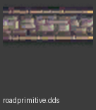

Extraction keeps the archive's folders, so an extracted model still finds its textures beside it; the Quarry render below came from those 21 extracted files. `art_preview.py` reads packed files directly without extracting them.

The already extracted mods in the local LLM working folder stay convenient for searching with grep, but they are no longer the only way to look inside a mod's art: any `.FPK` can now be listed, read or extracted on demand.

Checking the atlas numbering, with every file read straight from `Art0.FPK`: BtS's button atlas with cell 2,9 marked, that cell cut out, and BtS's standalone Quarry button.

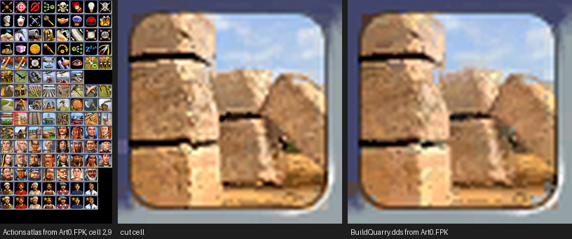

## .nif models

[NifSkope](https://github.com/niftools/nifskope) (2.0.dev7, BSD-licensed, kept by the user at `C:\Users\PC\Downloads\old\NifSkope_2_0_2018-02-22-x64 (4)\NifSkope_2_0_2018-02-22-x64\NifSkope.exe`) shows a model only in its window. [`nif_preview.py`](/LLM_Helpers/README.md#nif_previewpy) draws a still picture in the spirit of its view instead:

- PyFFI reads the model; skinned meshes, such as a unit's body, are posed by their bones;
- numpy fills every pixel from its texture, with a depth buffer, simple lighting and each shape's own transparency settings;
- a floor grid sits under the model, and `--yaw` and `--pitch` turn the camera.

```bash
python LLM_Helpers/nif_preview.py Assets/Art/AdvCiv_SAS/Units/Persia_Immortal/nif/persianimmortalarmoreddark.nif immortal.png --yaw 0 --pitch 15
```

Compared with NifSkope on the same Persian Immortal, from the user's screenshot:

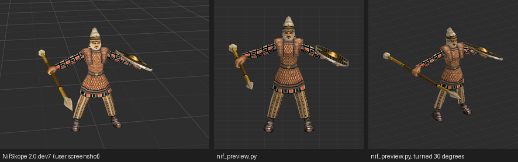

The current renderer also previews the Immortal’s idle and strike using the Heavy Spearman KFM referenced by its unit art XML. The Immortal is `DOMAIN_LAND`, so both examples use the Civilopedia grass scene. `--frame-shift-y` moves the framing down to fit the upright spear without moving the unit below the ground. Omit `--environment` and its placement options for the grid view.

The scene's ground is a finite mesh. The idle's camera first swung from -2° to 26°, and from about 17° the ground ended inside the frame, leaving a black band at the bottom. The same 14° swing centred on -2° stays on the ground; the strike's fixed 12° view does too.

Both clips are the Heavy Spearman's own: `idle` is `HeavySpearman_MD_Idle.kf` and `strikea` is `HeavySpearman_MD_StrikeA.kf`; listing the KFM without an output shows all of them.

A name picks the clip whose name ends with it. `idle` also ends `FortifyA_Idle` and `FortifyB_Idle`, so the clip whose whole name after `_MD_` matches wins.

The Immortal NIF has two sets of same-named bones. Binding each transform track to the first matching node keeps the extra set from distorting the pose.

```powershell
$btsAssets = Join-Path (Split-Path $civ4Assets) 'Beyond the Sword/Assets'
python LLM_Helpers/fpk_tool.py extract "$civ4Assets/Art0.FPK" immortal_assets "art/interface/screens/civilopedia/ancientbattlefield/*"
$immortal = 'Assets/Art/AdvCiv_SAS/Units/Persia_Immortal/nif/persianimmortalarmoreddark.nif'
$immortalKfm = "$btsAssets/Art/Units/Charlemagne_HeavySpearman/HeavySpearman.kfm"
$land = 'immortal_assets/art/interface/screens/civilopedia/ancientbattlefield/ancientbattlefield.nif'
python LLM_Helpers/nif_preview.py $immortalKfm immortal_idle.gif --clip idle --model $immortal --environment $land --model-scale 2.15 --yaw -2 --frame-shift-y 0.32 --sway 14 --cycles 2 --frames 48 --size 280
python LLM_Helpers/nif_preview.py $immortalKfm immortal_strike.gif --clip strikea --model $immortal --environment $land --model-scale 2.15 --yaw 12 --frame-shift-y 0.32 --frames 24 --size 280 --speed 0.65
```

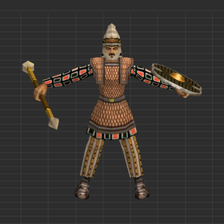
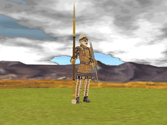
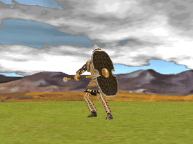

It took several steps, each found from a render that looked wrong:

1. The first version filled each triangle with one colour from its texture: shapes were clear, textures were not.
2. Per-pixel texturing with a depth buffer made the Immortal look like NifSkope's, but only after posing its skinned body by hand. PyFFI's own `get_skin_deformation` stopped with "cannot find a chain of NiAVObject blocks between BIP R Thigh and MD NonAccum", so each vertex is now moved by its bones' places in the scene, weighted.
3. The Peat bonus then showed its peat clumps but not the green ground around them: every texel under half alpha had been cut, while its decal blends and tests against a threshold of 1. Each shape's `NiAlphaProperty` is now followed, and `NiTriStrips` parts are drawn too.
4. Untextured shapes are skipped unless `--untextured` is given: they are usually hidden helpers, such as the Peat bonus's two grey "Sphere" shapes, which the first render showed as pyramids.

Limits: it shows a model in its stored pose, without the game's animations, effects, lighting or team colours.

PyFFI 2.2.3 needs two small fixes on current Python, both handled by the helper: setuptools for `distutils`, and `time.clock`, which the helper restores before importing it. For a model inside an `.FPK`, extract its folder first with `fpk_tool.py`, since a model finds its textures by name beside it.

## Scenes and movies

Agents cannot watch a video or hear sound; they see still images only. Civ4's "movies" come in two kinds, and both can still be turned into images.

**Religion-founding scenes are `.nif` files** with their own camera, lights, particle effects and keyframed animation, such as BtS's `Assets/Art/Movies/Religion/Taoism/Tao_Found.nif`. `nif_preview.py --scene-camera` looks through that camera, and `--frames N` draws N moments of the animation side by side:

```powershell
python LLM_Helpers/nif_preview.py "$civ4Assets/Art/Movies/Religion/Taoism/Tao_Found.nif" daoism.png --scene-camera --frames 4 --size 320
python LLM_Helpers/fpk_tool.py extract "$civ4Assets/Art0.FPK" candle_assets "art/shared/fx_fire*.dds"
python LLM_Helpers/nif_preview.py "$civ4Assets/Art/Movies/Religion/Taoism/Tao_Found.nif" daoism.gif --scene-camera --frames 36 --size 240 --particle-textures candle_assets/art/shared
python LLM_Helpers/nif_preview.py "$civ4Assets/Art/Movies/Religion/Christianity/Chr_Found.nif" christianity.gif --scene-camera --frames 36 --size 240 --particle-textures candle_assets/art/shared
```

- The Daoism and Christianity camera rigs move along a position track while aiming at a fixed target. The preview follows that move. Ordinary translation and Euler keys use linear interpolation, quaternion keys use normalized interpolation, and compressed transform tracks use a cubic spline.
- Such scenes bake their lighting into textures, so they are drawn without the preview's own shading.
- `--particle-textures` approximates the candle flame and glow using the scene's constant-rate box emitters and original additive sprites. Other particle behaviors and dynamic lighting still need the game renderer.

Compared with the user's in-game screenshot of the Daoism movie, then four moments of its 5-second camera move:

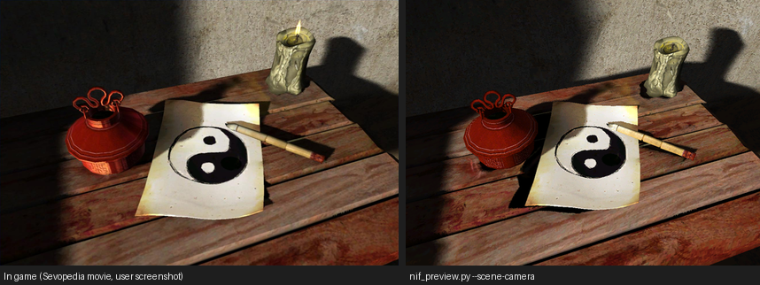
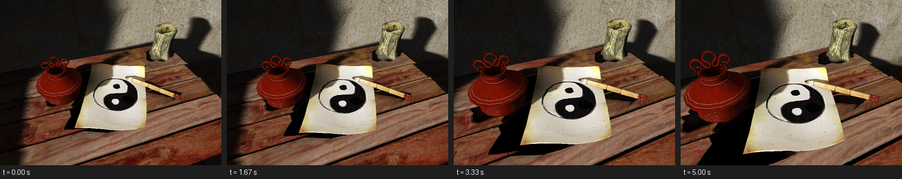

**Wonder movies are Bink videos (`.bik`)**, such as SAS's Natya Shastra movie. ffmpeg decodes them; it was already installed through winget (`winget install Gyan.FFmpeg`). [`movie_frames.py`](/LLM_Helpers/README.md#movie_framespy) takes evenly spaced frames into one sheet, and with `--audio` draws the sound as a waveform and prints its mean and peak loudness:

```bash
python LLM_Helpers/movie_frames.py Assets/Art/AdvCiv_SAS/Buildings/Natya_Shastra/movie/Meenakshi.bik natya.png --frames 6 --width 240 --audio natya_audio.png
python LLM_Helpers/movie_frames.py Assets/Art/AdvCiv_SAS/Buildings/Natya_Shastra/movie/Meenakshi.bik natya.gif --start 3 --duration 6 --fps 10 --width 240
```

For the Natya Shastra movie (31 seconds) it showed the Meenakshi temple's towers, carved deities and pillared hall, and music building from a quiet start to louder passages near the end (mean -19.5 dB, peak -0.9 dB). A waveform shows loudness over time, not what the sound is.

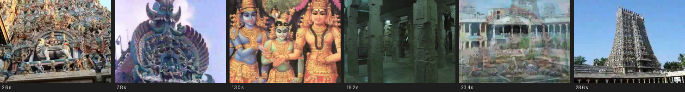
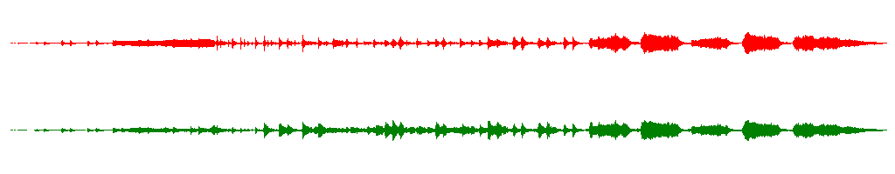

The same helper reads the original Civ IV Great Library wonder movie and Conquest victory movie. Their paths are listed in [CIV4ArtDefines_Movie.xml](/Assets/XML/Art/CIV4ArtDefines_Movie.xml). The commands use the absolute `$civ4Assets` directory set above.

```powershell
python LLM_Helpers/movie_frames.py "$civ4Assets/Art/Movies/Wonders/GreatLibrary.bik" great_library.png --frames 4 --width 200 --audio great_library_audio.png
python LLM_Helpers/movie_frames.py "$civ4Assets/Art/Movies/Victory/Conquest.bik" conquest.png --frames 4 --width 200 --audio conquest_audio.png
```

**Great Library (21.7 seconds).** The architectural drawing gives way to the library under construction and then the finished building.

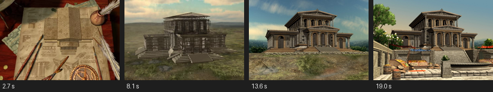

**Conquest victory (31.4 seconds).** The movie cuts between a chessboard and a city under attack, then returns to the board as the white king falls.

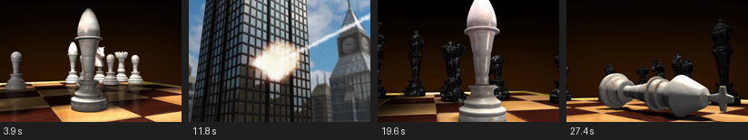

Use a `.gif` output to loop the whole movie or choose an excerpt with `--start` and `--duration` in seconds. Use `--fps` and `--width` to trade smoothness and detail against file size. GIFs are silent. `--audio` still makes a separate waveform of the full source.

```powershell
python LLM_Helpers/movie_frames.py "$civ4Assets/Art/Movies/Victory/Conquest.bik" conquest.gif --start 23 --duration 8.5 --fps 12 --width 320
```

**External model animations.** A `.kfm` lists the model and maps event codes to `.kf` clips. Pass the KFM without an output path to list its events, then add `--clip` to inspect one. You can also inspect a KF directly, or render it by passing its NIF with `--kf path/to/clip.kf`.

```bash
python LLM_Helpers/nif_preview.py Assets/Art/AdvCiv_SAS/Improvements/Peat_Works/nif/camp.kfm
python LLM_Helpers/nif_preview.py Assets/Art/AdvCiv_SAS/Improvements/Peat_Works/nif/camp.kfm --clip 2
python LLM_Helpers/nif_preview.py Assets/Art/AdvCiv_SAS/Improvements/Peat_Works/nif/camp.kfm --clip 3
python LLM_Helpers/nif_preview.py Assets/Art/AdvCiv_SAS/Units/Incan_Llama_Kamayuq/nif/llamaarcher.kfm llama_run.png --clip 1010 --size 200
python LLM_Helpers/nif_preview.py Assets/Art/AdvCiv_SAS/Units/Incan_Llama_Kamayuq/nif/llamaarcher.kfm llama_run.gif --clip 1010 --frames 16 --size 200 --speed 0.6
```

Peat Works' `not_worked` clip (event 2) hides `NodeFXCampfire` and its `worked` clip (event 3) shows it. The preview reports the switch. Fire and smoke particles are outside the renderer's scope. The Llama Kamayuq's run clip exercises bone transforms and gives four different moments of the stride, with the first pose repeating at the loop boundary.

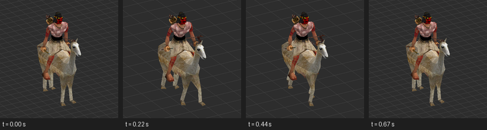

The renderer applies ordinary and compressed transform tracks and visibility tracks by node name. It reports unsupported tracks such as scalar and material animation.

Use `--model` to select an alternate NIF when the in-game art definition uses a variant such as `camp_fx.nif`. The preview samples individual clips. Game-driven transitions and effects need an in-game check.

**SAS Holy Roman Houfnice.** Its ranged-strike event is listed under the raw code `32113672`. The supported tracks show the crew's movement. The sheet is a partial preview because the renderer skips compressed transforms and material tracks.

```bash
python LLM_Helpers/nif_preview.py Assets/Art/AdvCiv_SAS/Units/Holy_Roman_Houfnice/nif/cannon.kfm houfnice.png --clip 32113672 --size 200
python LLM_Helpers/nif_preview.py Assets/Art/AdvCiv_SAS/Units/Holy_Roman_Houfnice/nif/cannon.kfm houfnice.gif --clip 32113672 --frames 24 --size 200 --speed 0.8
```

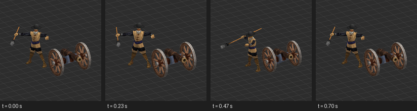

**Original Civ IV Catapult.** Extract the unit's folder from the original game's `Art0.FPK`. With the textured FX model selected, the ranged-strike preview shows the arm swing and the rock disappear from the sling.

```powershell
python LLM_Helpers/fpk_tool.py extract "$civ4Assets/Art0.FPK" catapult_assets "art/units/catapult/*"
python LLM_Helpers/nif_preview.py catapult_assets/art/units/catapult/catapult.kfm catapult.png --clip 1032 --model catapult_assets/art/units/catapult/catapult_fx.nif --size 200
python LLM_Helpers/nif_preview.py catapult_assets/art/units/catapult/catapult.kfm catapult.gif --clip 1032 --model catapult_assets/art/units/catapult/catapult_fx.nif --frames 24 --size 200 --speed 0.45
```

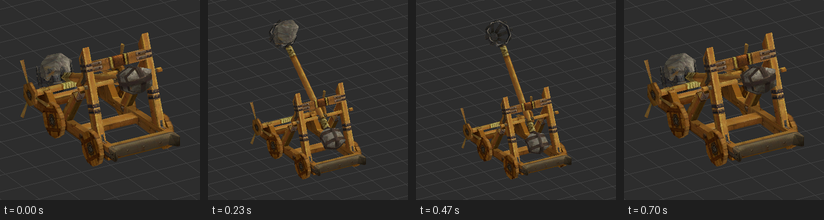

For NIF GIFs, `--speed` sets the playback multiplier. The Catapult example slows its 0.7-second clip to about 1.6 seconds. `--frames` still sets how many poses to sample.

**Leaderhead portraits.** Use the `NIF` and `BackgroundKFM` paths from the leader's entry in `CIV4ArtDefines_Leaderhead.xml`. The tool renders the backdrop through its own camera and reframes the leader's camera for a chest-up still.

```bash
python LLM_Helpers/nif_preview.py "Assets/Art/AdvCiv_SAS/LeaderHeads/Grace_O_Malley/nif/John II.nif" grace.png --leader-background Assets/Art/AdvCiv_SAS/LeaderHeads/Grace_O_Malley/nif/mansa_musa_bg.kfm
```

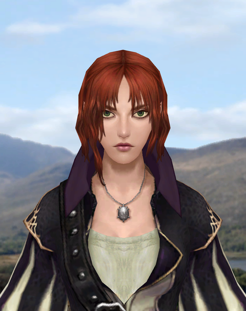

Grace's still uses the same lakeside backdrop and a similar chest-up crop as her Sevopedia portrait. Her head angle and eyes differ in the model's rest pose.

Pass `John II.kfm` without an output path to list the clips. With `--clip`, a `.png` output gives a frame sheet and a `.gif` output loops the sampled poses over the fixed backdrop. In the greeting she looks toward her raised hand, then turns to face the camera.

```bash
python LLM_Helpers/nif_preview.py "Assets/Art/AdvCiv_SAS/LeaderHeads/Grace_O_Malley/nif/John II.kfm" grace_greeting.gif --clip 6553600 --leader-background Assets/Art/AdvCiv_SAS/LeaderHeads/Grace_O_Malley/nif/mansa_musa_bg.kfm --frames 32 --size 230 --speed 1.8
python LLM_Helpers/nif_preview.py "Assets/Art/AdvCiv_SAS/LeaderHeads/Grace_O_Malley/nif/John II.kfm" grace_disagree.gif --clip disagree --leader-background Assets/Art/AdvCiv_SAS/LeaderHeads/Grace_O_Malley/nif/mansa_musa_bg.kfm --frames 30 --size 230 --speed 1.5
```

**Original Civ IV Gandhi.** Extract Gandhi's art from the original game's `Art0.FPK`. Here `NoShaderNIF` gives the software renderer more skin and clothing detail than the main NIF. The glasses follow the face in both the still and the animated poses.

```powershell
python LLM_Helpers/fpk_tool.py extract "$civ4Assets/Art0.FPK" gandhi_assets "art/leaderheads/gandhi/*"
python LLM_Helpers/nif_preview.py gandhi_assets/art/leaderheads/gandhi/gandhi_noshader.nif gandhi.png --leader-background gandhi_assets/art/leaderheads/gandhi/gandhi_bg.kfm
python LLM_Helpers/nif_preview.py gandhi_assets/art/leaderheads/gandhi/gandhi.kfm gandhi_greeting.gif --clip 0 --model gandhi_assets/art/leaderheads/gandhi/gandhi_noshader.nif --leader-background gandhi_assets/art/leaderheads/gandhi/gandhi_bg.kfm --frames 24 --size 200
python LLM_Helpers/nif_preview.py gandhi_assets/art/leaderheads/gandhi/gandhi.kfm gandhi_refusal.gif --clip 6 --model gandhi_assets/art/leaderheads/gandhi/gandhi_noshader.nif --leader-background gandhi_assets/art/leaderheads/gandhi/gandhi_bg.kfm --frames 24 --size 200
```

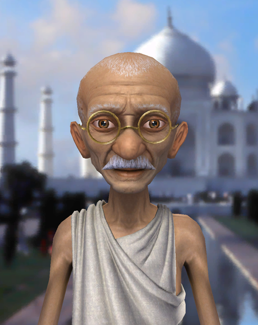

Gandhi bows with his palms together in the greeting and raises a finger in the refusal. The lighting and framing differ from Sevopedia.


**Original Civ IV Montezuma.** The greeting raises both hands. The Pleased idle is a separate event, `2`, and mostly changes his expression.

```powershell
python LLM_Helpers/fpk_tool.py extract "$civ4Assets/Art0.FPK" montezuma_assets "art/leaderheads/montezuma/*"
python LLM_Helpers/nif_preview.py montezuma_assets/art/leaderheads/montezuma/montezuma.kfm montezuma.gif --clip 0 --model montezuma_assets/art/leaderheads/montezuma/montezuma_noshader.nif --leader-background montezuma_assets/art/leaderheads/montezuma/montezuma_bg.kfm --frames 30 --size 200
python LLM_Helpers/nif_preview.py montezuma_assets/art/leaderheads/montezuma/montezuma.kfm montezuma_disagree.gif --clip disagree --model montezuma_assets/art/leaderheads/montezuma/montezuma_noshader.nif --leader-background montezuma_assets/art/leaderheads/montezuma/montezuma_bg.kfm --frames 30 --size 200
```

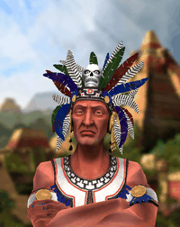

`--clip` also takes a clip name or a unique suffix such as `pleased` or `furious`. `greet`, `agree`, and `disagree` select the greeting, affirmative, and negative clips when the KFM contains them.

Use `--yaw` and `--pitch` to set the view. `--orbit` sets the total sweep across a GIF, while `--sway` swings to either side of `--yaw` and returns for a smooth loop. A leader's backdrop stays fixed as the camera turns around the leader.

```powershell
python LLM_Helpers/nif_preview.py montezuma_assets/art/leaderheads/montezuma/montezuma.kfm monte_refusal.gif --clip disagree --model montezuma_assets/art/leaderheads/montezuma/montezuma_noshader.nif --leader-background montezuma_assets/art/leaderheads/montezuma/montezuma_bg.kfm --yaw -12 --orbit 24 --frames 24 --size 160
```

**Standalone sound.** Use `--audio-only` on an MP3 or WAV to draw its waveform and report mean and peak volume in dBFS.

```bash
python LLM_Helpers/movie_frames.py Assets/Art/AdvCiv_SAS/Main_Menu/music/lofi-song-330550.mp3 menu_audio.png --audio-only
```

The menu track's two stereo channels taper at the beginning and end. FFmpeg reports a mean of −15.9 dBFS and a peak of 0.0 dBFS.

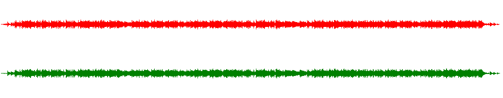

## Animated bonuses

The Fish and Pig entries in [CIV4ArtDefines_Bonus.xml](/Assets/XML/Art/CIV4ArtDefines_Bonus.xml) reference a model and a KFM. Event `1`, also selectable as `normal`, shows fish swimming and three pigs walking or lying down. `--orbit 360` turns the grid camera once while the clip plays.

```powershell
python LLM_Helpers/fpk_tool.py extract "$civ4Assets/Art0.FPK" bonus_assets "art/terrain/resources/fish/*"
python LLM_Helpers/fpk_tool.py extract "$civ4Assets/Art0.FPK" bonus_assets "art/terrain/resources/pig/*"
python LLM_Helpers/nif_preview.py bonus_assets/art/terrain/resources/pig/pig.nif pig.png --size 220
python LLM_Helpers/nif_preview.py bonus_assets/art/terrain/resources/pig/pig.kfm pig.gif --clip 1 --frames 48 --size 240 --pitch 16 --orbit 360 --speed 1.5
python LLM_Helpers/nif_preview.py bonus_assets/art/terrain/resources/fish/fish.kfm fish.gif --clip 1 --frames 48 --size 240 --pitch 16 --orbit 360 --speed 1.5
```

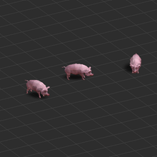

To put a bonus in its setting, pass the original Civilopedia environment NIF with `--environment`. The scene supplies the camera and background geometry. `--model-scale` and `--model-offset` set the bonus's placement in that scene. These values are fitted for the previews.

The water textures scroll using their embedded keys. `--water-opacity` controls the tint over submerged models independently of `--opacity-gain`, which boosts Fish ripples while preserving the clip's fades.

The Whale uses additive blending for its spray and ripples, though some of its effect tracks still go unused. The Pig preview plays at 1.25× for presentation.

Fish first swam along straight lines, while in the Sevopedia they leap in arcs.

- Each fish's path in `Fish_Normal` is about 15 quadratic (Bezier) position keys over 10 seconds, with TBC rotation keys for its turns, and the renderer joined the keys with straight segments.
- It now follows the curves: Hermite segments with the stored tangents for quadratic keys, and Kochanek-Bartels tangents for TBC keys, including rotations.
- PyFFI's names for the quadratic tangents read backwards: a key's `backward` value is the direction leaving it, as the fish's dives and leaps show.

With `--opacity-gain 1`, the ripples keep the strength their fades give them and are barely visible, as in the Sevopedia.

```powershell
python LLM_Helpers/fpk_tool.py extract "$civ4Assets/Art0.FPK" bonus_assets "art/interface/screens/civilopedia/ancientbattlefield/*"
python LLM_Helpers/fpk_tool.py extract "$civ4Assets/Art0.FPK" bonus_assets "art/interface/screens/civilopedia/waterenvironment/*"
python LLM_Helpers/fpk_tool.py extract "$civ4Assets/Art0.FPK" bonus_assets "art/terrain/resources/whale/*"
python LLM_Helpers/nif_preview.py bonus_assets/art/terrain/resources/pig/pig.kfm pig_habitat.gif --clip normal --environment bonus_assets/art/interface/screens/civilopedia/ancientbattlefield/ancientbattlefield.nif --model-scale 5 --model-offset 0 0 40 --sway 8 --frames 56 --size 280 --speed 1.25
python LLM_Helpers/nif_preview.py bonus_assets/art/terrain/resources/fish/fish.kfm fish_habitat.gif --clip normal --environment bonus_assets/art/interface/screens/civilopedia/waterenvironment/waterenvironment.nif --model-scale 1.6 --model-offset 0 -45 0 --water-opacity 0.55 --opacity-gain 2.7 --sway 8 --frames 56 --size 280
python LLM_Helpers/nif_preview.py bonus_assets/art/terrain/resources/whale/whale.kfm whale_habitat.gif --clip normal --environment bonus_assets/art/interface/screens/civilopedia/waterenvironment/waterenvironment.nif --model-scale 1.35 --model-offset 0 -28 0 --water-opacity 0.55 --frames 50 --size 280
python LLM_Helpers/nif_preview.py Assets/Art/AdvCiv_SAS/Units/Holy_Roman_Houfnice/nif/cannon.kfm houfnice_land.gif --clip 32113672 --environment bonus_assets/art/interface/screens/civilopedia/ancientbattlefield/ancientbattlefield.nif --model-scale 2.2 --pitch 8 --frames 24 --size 280 --speed 0.8
```

**Air units.** The Bomber uses the Civilopedia sky environment. The one-second idle clip animates its four propellers. `--cycles 36` repeats it during a single 36-second camera sway. The camera motion approximates the Sevopedia view.

```powershell
python LLM_Helpers/fpk_tool.py extract "$civ4Assets/Art0.FPK" air_assets "art/units/bomber/*"
python LLM_Helpers/fpk_tool.py extract "$civ4Assets/Art0.FPK" air_assets "art/interface/screens/civilopedia/skyenvironment/*"
python LLM_Helpers/nif_preview.py air_assets/art/units/bomber/bomber.kfm bomber.gif --clip idle --model air_assets/art/units/bomber/bomber_fx.nif --environment air_assets/art/interface/screens/civilopedia/skyenvironment/skyenvironment.nif --model-offset 55 -70 -490 --pitch 20 --sway 26 --cycles 36 --frames 157 --size 240
```

## Other mods' art

[`civ4_assets.py`](/LLM_Helpers/civ4_assets.py) finds a file the way the game does for a given mod: the mod's loose files, then its FPKs, then BtS's, Warlords' and the original game's, each loose before packed. Mods mix all of these, so one unit can take its model from the mod's FPK, its animations from the original game's `Art0.FPK` and a texture from a shared folder.

With `--mod`, [`nif_preview.py`](/LLM_Helpers/nif_preview.py) accepts an `ART_DEF_` type or an `Art/...` path and copies what it needs into one folder per mod under the system temporary folder.

- For an art define, it reads the files from the mod's art XML, including Caveman2Cosmos-style `Modules`.
- The model is a leaderhead's `NoShaderNIF`, else a unit's `SHADERNIF`, else its `NIF`: the BtS Warrior's plain NIF textures its body with `TeamColor.bmp` and drew only the club.
- A clip uses the define's KFM with that model, and a leaderhead gets its `BackgroundKFM`.
- Use `--mod bts` for the base game alone, which searches BtS, Warlords and the original game, as the game does without a mod.

A unit is placed in its domain's Sevopedia scene, read from the mod's unit XML and the game's interface art: land units on the battlefield, ships on the water and aircraft in the sky.

Its size follows its art define, as in the Sevopedia: `fScale` times `fInterfaceScale`, times a factor per scene taken from the hand-fitted Immortal, Galley and Bomber previews; a unit without an `fScale` is fitted to a common size instead. `--environment none` keeps the plain grid.

- Scaling every unit to one size first hid that: futuremod's Warbot uses the Assault Mech's model at `fScale` 0.10 and `fInterfaceScale` 0.5, against 0.35 and 0.6. Its Sevopedia shows it about four times smaller, close to the 4.2 of those products, so both scales are applied.

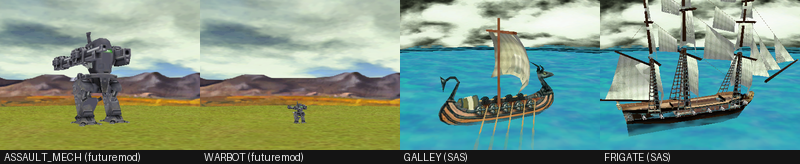

Units painted through `TeamColor.bmp` show the player colour as `--team-color`, by default a blue.

The cache keeps copies between previews. A copy is replaced when its source differs in size or is newer, so an edited texture or a newly added loose override shows at the next render, as Codex (GPT-6.1-Sol) pointed out was needed for iterative testing. `--refresh` replaces every copy, for an edit that kept the size and an older date, such as a file copied in with its original date.

```powershell
python LLM_Helpers/civ4_assets.py --mod "History Rewritten" defines "ART_DEF_LEADER_*"
python LLM_Helpers/civ4_assets.py --mod "Realism Invictus" locate "Art/Shared/musket.dds"
python LLM_Helpers/nif_preview.py ART_DEF_LEADER_ALEXANDER alexander.png --mod "History Rewritten" --size 230
python LLM_Helpers/nif_preview.py ART_DEF_LEADER_ALEXANDER alexander_greeting.gif --mod "History Rewritten" --clip greeting --frames 24 --size 200
python LLM_Helpers/nif_preview.py ART_DEF_UNIT_APACHE_RAIDERS apache.gif --mod "Realism Invictus" --clip idle --frames 24 --size 200 --orbit 360 --environment none
```

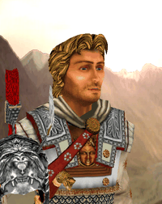
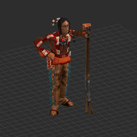

History Rewritten's Alexander greets from the mod's own loose art. Realism Invictus's Apache Raiders idle with a model and musket texture from two RI FPKs and animations from the original game's Musketman.

### Galleries

[`art_gallery.py`](/LLM_Helpers/art_gallery.py) renders every art define matching a pattern, leaders by default, in parallel. It keeps each picture as its own PNG, so a folder can be browsed with Windows thumbnails, and lays them out on numbered grid sheets of 20. `--domain`, `--combat` and `--era` keep units whose XML matches any listed word, the era coming from the unit's first prerequisite tech. `--labels` writes each name, and a unit's domain, era and unit combat, in a strip under its picture. `--clip` also renders a GIF per entry.

```powershell
python LLM_Helpers/art_gallery.py "$env:TEMP/civgold_leaders" --mod "CIV Gold" --labels
python LLM_Helpers/art_gallery.py "$env:TEMP/ri_knights" --mod "Realism Invictus" --pattern "ART_DEF_UNIT_*" --era medieval --combat mounted --labels
```

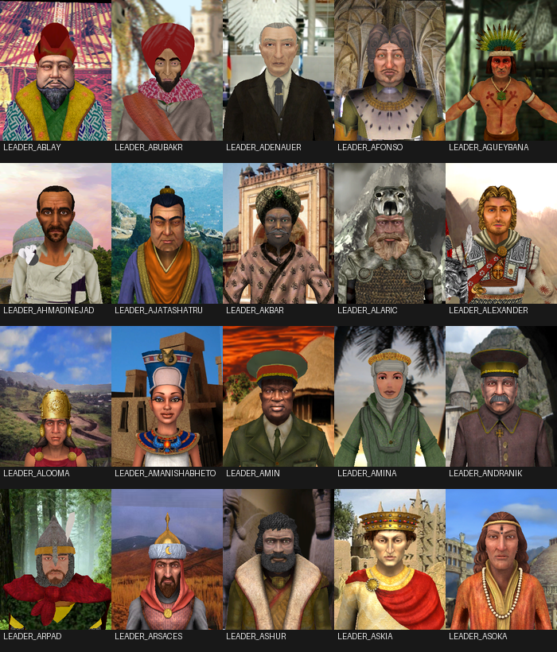

The first 20 of CIV Gold's 287 leaders rendered in about 9 seconds.

### What the tests showed

First tests (2026-11-08):

- Realism Invictus's 313 leaders use 47 leaderheads, all from BtS, Warlords and the original game. Its 4303 unit art defines draw mostly on its own FPKs, such as `RI_38_Units_Russia0.FPK`.
- History Rewritten draws 128 of its leaders from its own loose art, 177 leaderheads in all. Its Alexander shares Zara Yaqob's KFM, which names `Zara Yaqob.nif`, so the model is taken from the art XML, as the game does.
  - Two leaderheads and 20 unit models named by its XML exist in no layer, such as `Art/Leaderheads/Wu_Zetian/Wu.kfm` and `Anasazi AT Infantry/at_infantry.nif`.
- Realism Invictus's Apache Raiders take their model from `RI_38_Units_Minors0.FPK` and their animations from the original game's Musketman. Their musket texture is named without a folder and comes from `Art/Shared` in `RI_381_Shared4.FPK`.
- Some paths end a folder name with a space, such as `Art/Units/Cannon Ancient Chinese /`. Windows ignores trailing spaces and dots, so names are compared without them.

A survey of the 59 installed mods (2026-11-08) found more layouts, each now handled:

- futuremod names other mods' art from the Beyond the Sword folder, such as `Mods/FfH Age of Ice/Assets/Art/LeaderHeads/Charadon/brennus.kfm` for its Attila. Such paths are searched last; its misses left are in The Road to War, which is not installed.
- The Sword of Islam ships an empty `Pak1.FPK` beside its real `Pak0.FPK`, which stopped the lookup until empty archives were skipped.
- Chronicles of Mankind closes an XML comment with `-- >`, thecowwarrior's Variety Mod spells a Fallschirmjaeger NIF with a Latin-1 character in a file declared UTF-8, and a VIP module file has two top-level elements. A strict parser rejected these files, so they are read leniently: 985 Chronicles of Mankind units were found instead of 241.
- Sengoku's 201 and Master of Mana's 133 leaders are flat `.dds` portraits, shown as pictures.
- CIV Gold names `NoShaderNIF` files it does not ship, such as Abu Bakr's `frederick_the_great_noshader.nif` and Akbar's `Zara Yaqob.nif.nif`. The first model file that exists is used, as the game uses the NIF with shaders on.
- Backgrounds in the original game's older NIF format have no camera, even BtS's own `Louis_XIV_BG.nif`; the leader's NIF lends its camera.
- Realism Invictus lists a unit's techs as `<PrereqTechs><TechType>`, so its units' eras come from the first listed tech. It also replaces the Sevopedia battlefield scene in `RI_381_Shared3.FPK`, so its units stand in RI's own scene.

The game's order between two FPKs of the same folder holding the same file was not verified; they are searched in name order. `My Games/Beyond the Sword/CustomAssets` is not searched.

## Plots: terrain, features and plot types

With `--mod`, [`nif_preview.py`](/LLM_Helpers/nif_preview.py) can stand a subject on a map plot built by [`plot_scene.py`](/LLM_Helpers/plot_scene.py), or draw a plot alone.

The Sevopedia's terrain and feature pages show only their buttons, and the game draws a real plot only for a revealed map plot in a loaded game.

Adding the Marsh feature meant judging `bog.nif` and its fit on Grassland from in-game screenshots alone; a plot preview shows such art on any terrain without the game.

- A `TERRAIN_` or `FEATURE_` asset draws that plot. `BONUS_`, `IMPROVEMENT_` and unit or bonus `ART_DEF_` assets stand on one with `--on-plot`, a bonus or improvement type on its own.
- The plot starts from what the XML allows first: a bonus's first allowed feature on a terrain that feature allows, so the Deer gets a snowy Forest on Tundra; an improvement's first valid terrain or feature, or hills for the Mine; a feature's first terrain. `--terrain`, `--feature` (or `none`) and `--plot flat|hills|peak` force any other, even one the XML forbids, to see how it would look.
- Units and bonuses stand at their art define's `fScale`, and a unit, as the game draws a lone one, also at `SINGLE_UNIT_GFX_EXTRA_SCALE` (1.22 in SAS): the Llama Kamayuq is about 81 units tall on a 180-unit plot, the game's `PLOT_SIZE`, close to half a plot as in-game screenshots show. Zooming out enlarges units in game too, which a preview does not follow.
- They stand on the highest ground, hill or peak point near the plot's middle, so the Llama Kamayuq stands on a peak's summit; the feature is left out of that, or a forest would lift them onto the treetops.

```powershell
python LLM_Helpers/nif_preview.py FEATURE_MARSH marsh.png --mod AdvCiv-SAS
python LLM_Helpers/nif_preview.py BONUS_DEER deer.png --mod AdvCiv-SAS --feature none
python LLM_Helpers/nif_preview.py ART_DEF_UNIT_WARRIOR warrior.png --mod AdvCiv-SAS --terrain TERRAIN_PLAINS --plot hills
python LLM_Helpers/nif_preview.py TERRAIN_PLAINS river.png --mod AdvCiv-SAS --river
python LLM_Helpers/nif_preview.py FEATURE_FOREST forest.gif --mod "Realism Invictus" --orbit 360 --frames 24
python LLM_Helpers/nif_preview.py FEATURE_FALLOUT fallout.png --mod AdvCiv-SAS --glow 80
python LLM_Helpers/nif_preview.py FEATURE_FALLOUT fallout.gif --mod AdvCiv-SAS --frames 32
```

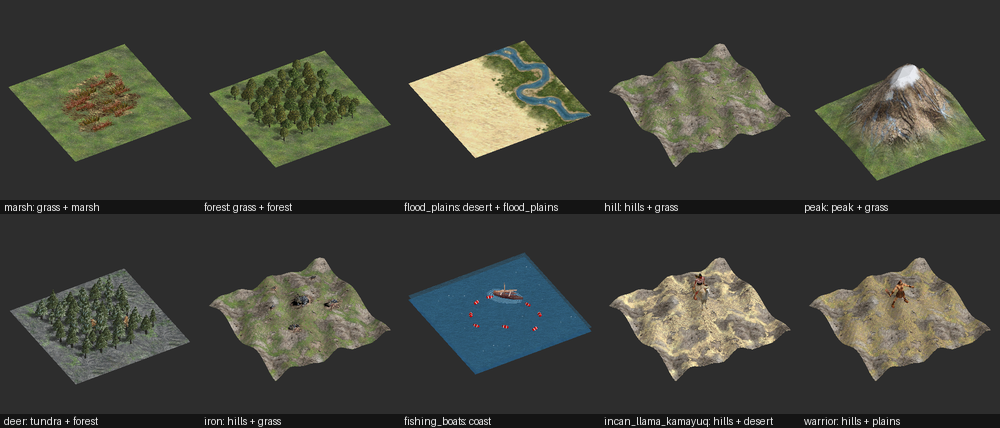

Every terrain the XML has, flat and, on land, as hills and peak, then every feature on each terrain it allows, and once on hills unless it requires flatlands. The sheet is read from the XML, so a new terrain or feature joins it on the next regeneration:

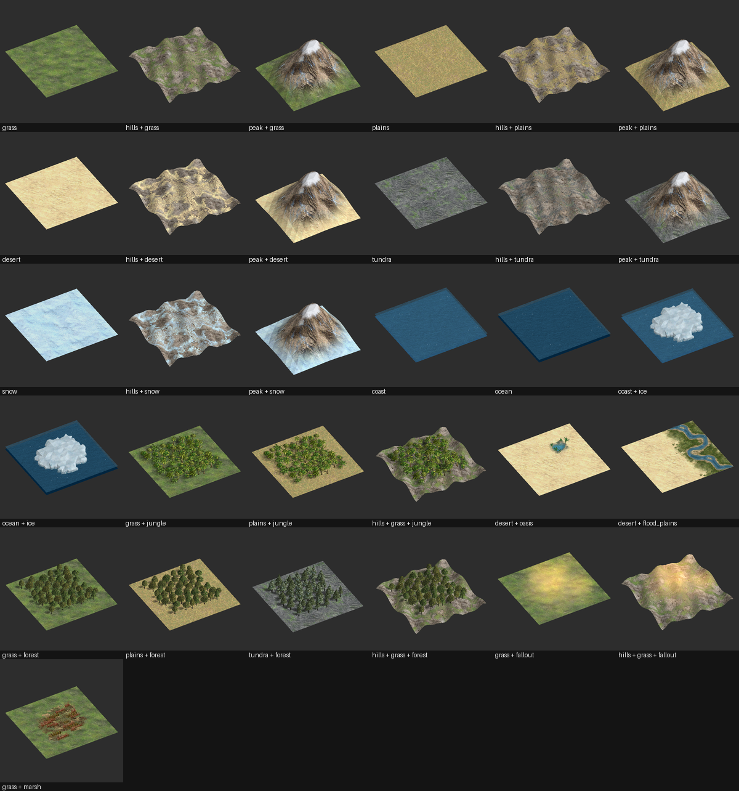

Fallout's light swells and fades, so that sheet shows it at 50%. `--glow` sets a still's light from 0 to 100% of its brightest moment, and a GIF of an animated feature plays the model's own loop, Fallout's 8 seconds or the Oasis water's 10:

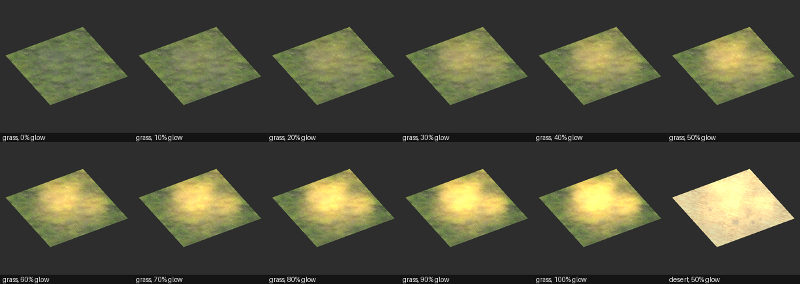

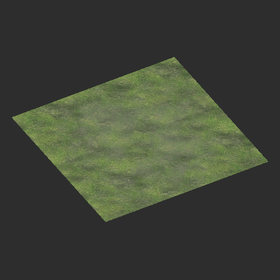 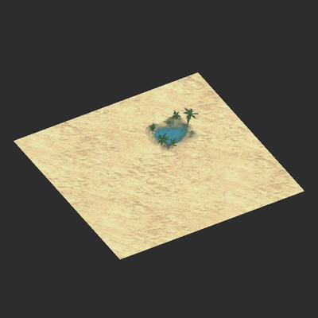

`plot_scene.py` draws the same sheet for any mod, its art found in loose files or FPKs as usual; `--match` keeps the plots whose label matches a regular expression, as many mods have dozens of terrains:

```powershell
python LLM_Helpers/plot_scene.py sengoku_terrains.png --mod Sengoku
python LLM_Helpers/plot_scene.py c2c_peaks.png --mod Caveman2Cosmos --match "^peak"
```

### Mods' own terrains and plot types

Art comes from the mod's XML wherever the game defines it there, so a mod's own art shows: each terrain's `Blend` and `Detail` textures, the Hill and Peak terrains' art for hills and peaks, features, the river pieces of `CIV4RiverModelInfos.xml`, and the river and flood plain textures named in `CIV4ArtDefines_Misc.xml`.

- Plot types are fixed in the game: peak, hills, flat land and water. The installed mods (2026-11-09) add none; they add terrains, which can be drawn under any plot type with `--terrain`.
  - The closest is Sengoku: its graphical-only `TERRAIN_SNOW_PEAK` has its own snow-covered sheet, which its scenarios put under peaks, and its Peak terrain has mossy green rock instead of the base game's brown.
- Caveman2Cosmos needed two changes, now general:
  - Its water terrains have `iDistanceToLand` but no `bWater`, so either marks water.
  - Its Modules hold partial entries for terrains its XML folder defines, such as a `TERRAIN_GRASSLAND` with only property changes. Read first, they hid the full entry and its art, so the XML folder is now read first and a module's entry adds to it.
- A preview falls back on Grassland and Coast, or on the mod's first land and water terrain when it has neither, as Caveman2Cosmos names Grassland `TERRAIN_GRASSLAND`.
- The peak's heightmaps are named in no XML: the engine loads `Art/Terrain/Features/Peak/PeakHeightA.tga` and its siblings by path, so a mod changes them only by replacing those files, which the preview then finds.
- Hills and peaks have no plot-type field to read either. `TERRAIN_HILL` and `TERRAIN_PEAK` are ordinary TerrainInfos whose art paints those plot types, and every installed mod keeps those two Type names.
  - `bGraphicalOnly` does not single them out: it also marks Sengoku's snow peak terrain, The Sword of Islam's salt lake and wasteland, and every terrain of Final Frontier Plus.
  - So those two Type names are the one fixed point, and everything else is read through them.

### How a plot is drawn

The engine draws terrain from texture sheets and heightmaps rather than models, so the plot is an approximation built from the game's pieces:

- **Ground**: one terrain's solid tile. A land terrain's `Blend` sheet holds alpha-masked edge pieces in its top half and solid terrain in its bottom half; Coast's and Ocean's are nearly all edge pieces, so their most opaque cell is used.
  - The engine multiplies the tile by its `Detail` texture at twice its value. The base game's average about 128, which keeps the tile's colour, while Caveman2Cosmos's Lush and Rocky tiles are plain grey and take their colour from their `Detail`; without it they came out blue-grey.
  - The game also lights terrain paler and bluer: in-game screenshots (2026-11-09) averaged desert 235 207 163, plains 158 151 118, grassland 113 131 73, tundra 98 102 82 and snow 186 213 236. A per-channel gain and offset fitted to those five gives pale cream desert and greener grassland, rather than brownish desert and plains and yellowish grassland.
    - A first fit to desert, plains and grassland alone added more blue and turned tundra blue-grey (110 120 114). No one gain and offset fits all five exactly; tundra stays a little bluer than in game (107 113 106).
- **Water**: water terrains get the ground lowered under a translucent surface, so the Fish swim and ships float. The surface has the ripples of `ART_WATER` in one colour and opacity fitted to in-game averages (2026-11-09): Coast comes out at 46 90 119 against the game's 45 88 116, and Ocean at 30 72 95 against 30 71 97.
  - The first surface, a flat blue at 0.6 opacity, gave 32 80 116 and 16 62 95, a deeper, more saturated blue than the game's.
- **Hills** are a plot type over a terrain, labelled so: "hills + plains". The Hill terrain's `Blend` sheet is an overlay the engine paints over the base terrain (its `LayerOrder` 79 sits above the land terrains'), grey rock streaks over rolling ground.
  - The first version put the grassy `Hills_GrassA.nif` mounds on one smooth bump, with the hill decal `hill_all_01.dds` blended toward the middle. In-game screenshots (2026-11-09) showed plains hills as sandy-brown rolling ground cut by grey rock streaks over the whole plot, desert hills likewise and tundra hills mostly grey rock, which the overlay gives.
- **Peaks** are the ground itself, raised by the game's 10 by 10 heightmap `PeakHeightA.tga` over a plot and a half: one summit whose slopes fall in ridges and do not reach zero at the edges, so a peak spills a little into its neighbours, as in-game screenshots show.
  - Its 10 by 10 points are joined by flat faces, as in-game peaks are faceted, with a sharp summit and a few broad ridges. Heights are raised to the power 1.4, so the slopes curve outward toward the foot, steep near the summit and flaring at the base, rather than running as a straight ramp.
  - The slopes take the Peak terrain's rock with its `Detail` texture, lit as the terrain is and with its contrast raised, covered at half opacity by `ART_PEAK_DECAL` from `CIV4ArtDefines_Misc.xml`, a peak seen from above. It is painted at 1024 pixels over a plot and a half, as at 512 the rock looked blurred when magnified.
    - The rock fades gradually into the base terrain over the lower slopes, and snow covers only the tip.
  - The first versions stood a model on the plot: `Peak_MountainA.nif`, untextured spires that came out as a low tan cluster, then `Peak_Single.nif`, a cone drawn 1.6 times larger. In-game screenshots (2026-11-09) showed the cone was too steep and narrow, like a tooth, while in game a peak is a wider pyramid.
  - The first heightmap peak, smoothed up bicubically to 40 by 40, was round, and smoothly coloured: it filled the Peak sheet's transparent texels with their average colour, while the sheet's colour is rock everywhere.
  - A second pass overcorrected: dozens of added sine ridges made it wavy, and `PeakDarkMap2.dds`, a dark blotch the engine also loads by path, laid around the summit made the slopes average 94 78 64 against the game's light tan-brown of about 124 113 99.
    - In game the dark streaks fall on gullies and shadowed faces, sometimes low on the peak and sometimes absent, so that map is left out; how the engine uses it is not known.
    - A hard-edged dark band under the snow remained; it was the decal's dark ring around its snowy middle at full opacity, which half opacity removes. Blurring the rock instead had only made the whole peak blurrier than the game's detailed rock.
    - Softening only the dark streaks was also tried: their darkening taken from a blurred copy of the rock, so their edges faded out, with a third of the crisp detail kept inside. It faded their hard edges, but the crisp rock was preferred as closer to the game overall, so it was left out.
- **Rivers** run along the plot's east edge with `--river`, or when the feature requires one through `bRequiresRiver`, as Flood Plains do. The piece is the straight one (`N S`) of `CIV4RiverModelInfos.xml`: a plane of one plot cut from the river sheet, `RIVER_BASE_TEXTURE`, whose meanders follow the river's own art.
  - Its white wisps are drawn at a third of their strength: in game they animate, so a still picture catches only part of them, sparse thin zigzags along the middle of the flow, while at full strength they drew dense white blobs over the whole river.
- **Flood Plains** follow their river: `RIVER_FLOOD_PLAIN_TEXTURE` has the river sheet's layout, a green band around each river piece, so the river piece's own texture coordinates lay it along the river. `RIVER_FLOOD_PLAIN_MASK_TEXTURE` thins it, which leaves the desert gaps in-game screenshots show between green patches.
  - The first version laid the flood plain sheet over the whole plot as crisp rows of grass, then one cell of it blurred, which came out as a round green patch beside a straight blue strip.
- **Features**: the art piece joining the most neighbours, such as the Forest's `NW NE SE SW`.
  - A model that dips below the ground is lifted by that much: the Oasis's pool sits in a bowl about 5 units deep, and our flat ground covered most of its water. The engine sinks the plot's ground there instead, which is not drawn. The Oasis sits in its plot's north-east quarter, as in game.
  - Ice is a half-tiling feature (`TILE_ART_TYPE_HALF_TILING`): its pieces sit on the plot's corners, each filling the quarters its `Connections` name among the four plots around that corner. A lone plot takes, on each corner, the piece joining only toward itself, which gives a floe with cliffs on every side. The piece joining the most, the inside of a large ice cap, had drawn a flat white square.
  - The game picks the variety from the plot's latitude, not its terrain, in `CvPlot::setFeatureType`: varieties × (latitude × 9 / 8) / 90, so the Forest is leafy below 27 degrees, evergreen to 53 and snowy beyond. `--latitude` follows that rule and `--variety` picks one directly; without either, the snowy variety goes on Tundra and Snow and the first elsewhere.
- **Fallout** is an effect rather than an object: `fx_cities_iradiated.nif` holds ten camera-facing `NiBillboardNode` cards of `fx_fire_glow.dds` that add light, and six of `fx_smokedrift00.dds` that lay a faint grey haze. All ignore the depth buffer, and a card's self-illumination colour follows its own 8-second keys, which is the swelling and fading seen in game.
  - The first preview drew these cards flat as the file stores them, at height 0 and black at time 0, so the ground hid the glow and only their corners poked through hills, as stray gold bars. It also ignored the smoke's vertex alpha, drawing a hard-edged grey polygon, which fading by that alpha turned into the soft border in-game screenshots show.
  - A burst of 56 in-game screenshots about 0.19 s apart, over 10.6 s (2026-11-09), confirmed the file's timing: the whole glow pattern repeats at 8.0 s (correlation 0.98), with weaker echoes near 2.7 and 5.5 s from the central cards' 2.67 s pulses, and each plot starts at its own moment.
  - Every card is dark at the loop's start, so each pixel's darkest moment in that burst is a clean baseline. Against it the game's light adds green 0.63 and blue 0.2 of red, and red saturates on bright ground while green keeps rising, which yellows the hot spots.
    - The texture times its key gives 0.6 and 0.1 at about 0.8 of the strength, so the preview applies a per-channel factor fitted to these, which brings six plots' centres to between 0.70 and 1.10 of the game's, averaging about 0.95. Why the game's light has more blue was not determined.
    - A first fit to a 5 s burst, against each pixel's tenth percentile rather than its darkest moment, gave a green of 0.72, a paler yellow than the game's orange halos.
  - The peak light over the loop forms the same four-lobed shape in game and here, with the hottest spot right of the plot's centre, so the cards' layout needed no change.
  - The cards reach past their plot, onto its neighbours in game. On a lone plot they are drawn only over the ground, as beyond it they made detached smudges on the backdrop.
- **The Oasis's water** is two copies of `oasis_water.dds` sliding in opposite directions over 10 seconds, the model's base and decal layers; a burst of 62 in-game screenshots (2026-11-09) repeats at 10 s (correlation 0.50, about 0 at the other lags). Fallout and the Oasis are SAS's only features with animated art.
  - Their stored alpha of 0.2 left the pool nearly still, with no crossing lines. An even mix lit as the terrain is, at 0.4 opacity, averages 72 131 145 in the pool against the game's 72 127 136; 0.5 unlit gave a duller pool and spread the water's outline over the dark rim. These two weights are fitted, and how the engine combines the layers was not determined.
  - The Oasis's size is right: measured against the plot's width in the same in-game view, its pool is 37.2 units wide in game and 39.8 here. It looks smaller in a preview because a preview shows the whole plot.
  - The model's land is lit as the terrain is and its soil lightened a quarter of the way toward the plot's ground colour, as its rim was too dark: its darkest tenth was 104 and is now 114, against the game's 128. Lightening only half-transparent texels barely moved it, as the rim is mostly painted opaque.
  - A faint straight edge of the water's mesh shows at the pool's lower right, which the game does not show. Letting the soil write depth at its alpha test, rather than at half opacity, did not hide it, so its cause was not found.
- **Effects in other mods** need no list of names, as no XML field marks a glowing feature: `bAnimated` is also set on the Oasis, whose water only scrolls, and `EffectType` is the feature's separate spawned effect.
  - So the preview looks inside the model: a `NiBillboardNode` makes it an effect, and an animated self-illumination (`NiMaterialColorController`) makes a card glow; only the colour factor above is fitted, to Fallout.
  - A scan of 59 installed mods' features (2026-11-09) found 77 distinct effect entries. Fallout's model is the one in 52 mods, and is reused for Caveman2Cosmos's Quasar and galaxies, The Eugenics Wars' Radiation and Better Tomorrow's Pollution. Others are Master of Mana's and Ashes of Erebus's Haunted Lands, and fog, storm, blizzard and sandstorm cards.
  - Volcanoes, in about a dozen mods, are a textured model with `NiParticleSystem` smoke, and no glowing cards: the model is drawn and the particles are not.
- Not drawn: blending into neighbouring terrains, river bends and deltas, the engine's farm fields and other ground painting, and the Cottage's and other improvements' surroundings. Realism Invictus's own terrain textures come from its `RealisticTerrain.FPK`.

### Known gaps

Compared with in-game screenshots (2026-11-08 and 2026-11-09):

- In game the water next to a shore is lighter, almost sky blue, and a lake, which is Coast surrounded by land, is mostly such shallows: one averaged 82 120 136. A lone water plot here has no shore, so it shows the open Coast colour.
- A Coast plot in game can show Ocean's deeper blue reaching into it, which is not drawn. Water plots show scattered white glints even without a bonus, about 0.04% of a Coast view's pixels, uneven in size, shape and spacing; a fixed few such are drawn here.
- Five in-game Coast views averaged about 47 91 119, which this Coast matches; a lake is not one colour: in one view its darker tenth was about 43 89 115 and its lighter tenth a whitish sky blue of 94 134 142, while the river beside it, about 77 123 147, is a deeper blue than those light shallows (2026-11-09).
- Buildings are not placed on plots or in Sevopedia scenes, including coastal ones in the Sevopedia's coastal backdrop (`CIVILOPEDIA_AMPHIB_ENVIRONMENT`).
- In game a plot's edges blend into its neighbours: a plains plot beside grassland, a peak and an oasis shows each of them reaching into it, and nearby jungle or forest trees climb a peak's foot. Snow beside the coast shows sandy, gnawed-looking edges. Here a plot stands alone.
- The `Detail` texture is laid once over a plot's tile; how often the engine repeats it was not measured.
- Fallout on several plots in game overlaps and starts each plot at its own moment, so large areas shift between patches; one plot here shows one plot's cards only.
- Particle systems on plots are not drawn, such as a volcano's smoke. Middle-earth's `FEATURE_MT_DOOM` comes out as a nearly empty plot; why was not examined.

Units and bonuses keep the game's sizes on plots: the Crab pair spans about a third of a coast plot's side in game (2026-11-09) and here. Leaderheads are not stretched either: the renderer keeps square pixels, and Gandhi's face is if anything slightly narrower here than in the Sevopedia panel.

Realism Invictus's SVN version (2026) also shows buildings' underwater parts: its DLL patches the EXE so the Sevopedia's coastal backdrop draws the building before the water, and the map draws city geometry in the underwater pass. Here water is always drawn after the models as a translucent layer, so underwater parts show through it.

## Searching mods

[`art_search.py`](/LLM_Helpers/art_search.py) finds a kind of terrain or feature across every installed mod and draws them side by side, each on a plot through its own mod's art and labelled with the mod. Designing the Marsh feature meant searching mods for marshes, swamps and wetlands by hand and comparing them from screenshots; this does that search in one command for any pattern.

- It matches Types against a regular expression in each mod's TerrainInfos and FeatureInfos, skipping entries a mod inherits unchanged from the base game, so the base game's own are listed once, under BtS. `--list` lists the matches without drawing them.
- A feature stands on the first terrain its XML allows; a terrain is drawn flat. A match that fails to draw is reported and left off the sheet, as some mods' XML or art does not load.
- Mods nested inside another mod's folder, such as Beyond the Game's own mods, are not searched.

```powershell
python LLM_Helpers/art_search.py "MARSH|SWAMP|WETLAND|BOG|MANGROVE|MUD" marshes.png
python LLM_Helpers/art_search.py "MARSH|SWAMP" marshes.png --kind feature --mods Caveman2Cosmos "Realism Invictus"
```

`--exclude` leaves named mods out of a search. On 2026-11-09 the first pattern found 35 marsh-like terrains and features in 20 mods: Caveman2Cosmos alone has a swamp, a mangrove and a peat bog as features and a marsh and muddy ground as terrains, and Sengoku and RFCEurope have a marsh feature and a wetland terrain.

The sheet below leaves out two installed mods by the maintainer's choice: RFC Dawn of Civilization, as under its [section of the license](/LICENSE.md#rfc-dawn-of-civilization-and-leoreth-controlled-project-restrictions), and Dawn of Civilization: America, whose bog and swamp models are byte-identical to RFC Dawn of Civilization's marsh models under other names.

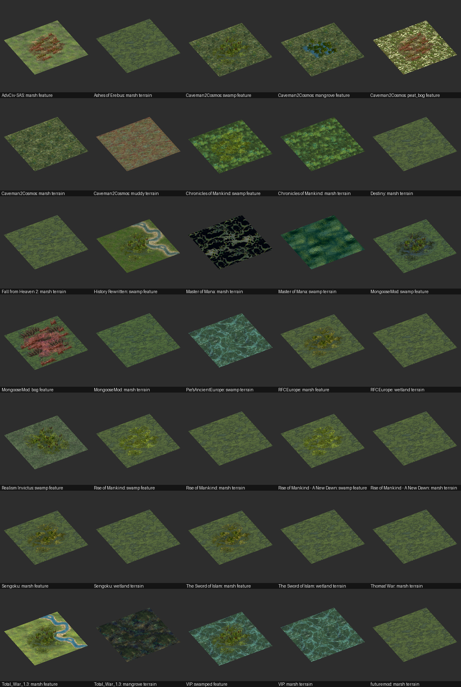

Other mods' animated features, with no list of names behind them: glowing cards, fog, storms, meteors and volcanoes.

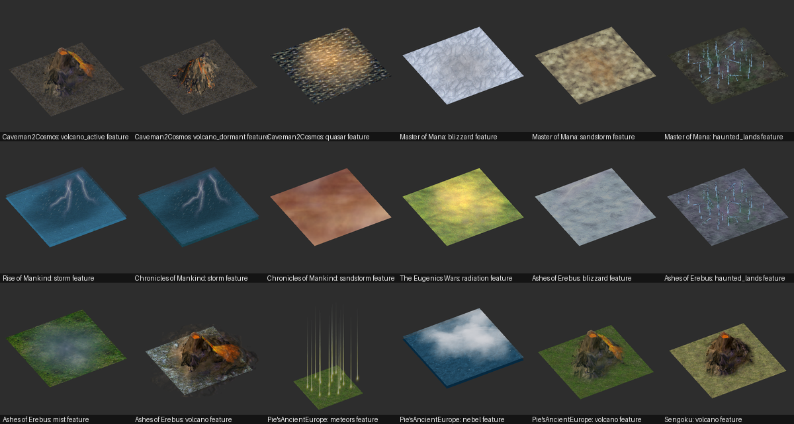

## Videos with sound

A GIF has no sound and `.bik` movies open only in players that decode Bink, so both helpers write `.mp4` video with sound, which VLC, browsers and Windows' own player open. Write them outside the repository, for example to `Downloads`: they copy Firaxis's movies in full.

- [`movie_frames.py`](/LLM_Helpers/movie_frames.py) converts a Bink movie with its sound; `--start` and `--duration` select an excerpt, in seconds or as a percentage of the movie, such as `--start 40% --duration 20%`.
- `nif_preview.py` writes an animated scene as `.mp4` at `--fps` (24 by default) with `--sound`, a file or a sound script. A `RELIGION_` asset takes its founding scene and `MovieSound` from the religion's XML: the Taoism scene animates for 5 seconds and its `Taoist.mp3` lasts 10.8, so the last frame holds until the sound ends.

```powershell
python LLM_Helpers/movie_frames.py "$civ4Assets/Art/Movies/Wonders/GreatLibrary.bik" "$HOME/Downloads/great_library.mp4"
python LLM_Helpers/nif_preview.py RELIGION_TAOISM "$HOME/Downloads/taoism.mp4" --mod AdvCiv-SAS --size 400
```

A 400-pixel religion scene took about 3 minutes for its 120 frames, with the candle sprites drawn at twice the size.

No video sample is committed, although the videos play well:

- They copy Firaxis's movies and music in full, sound included, while the GIF samples show a few seconds of motion without sound.
- GitHub's Markdown plays videos uploaded as attachments; as far as known here, an `.mp4` kept in the repository and linked from a README shows as a link to download rather than playing, so it would add little for readers. This was not tested on GitHub.

## Preview size and detail

The game draws a leaderhead again at each size it is shown, rather than stretching a small picture, so the larger views show more of its texture's detail: Cyrus, Gandhi and Grace look markedly sharper in a large full view than in the small Sevopedia panel, on the same 1080p screen.

`--size` does the same here: the picture is drawn at twice the size and shrunk, and textures are filtered between texels as the game does.

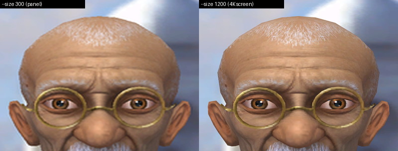

Gandhi's face at `--size 300`, about a Sevopedia panel, and at `--size 1200`, about a full view on a 4K screen, cropped and shown at the same size. The larger render shows the eyebrows, skin and the thin glasses rims more sharply, in about 11 seconds against 2. Nearest-texel sampling made magnified textures blocky in such large renders, so textures are now filtered between texels.

Going past `--size 1200` adds little: at 2400, Gandhi's face looks the same apart from slightly smoother glasses rims. His no-shader model has one 512 by 512 texture, all of whose texels already show at 1200. The game's sharper shader model adds a 1024 by 1024 normal map with specular and environment maps, which this renderer does not use.

## Regenerating the samples

The pictures in `_1_AdvCiv-SAS/Images/LLM` were rendered one at a time as the renderer improved, and some fell behind: Grace's still kept the wide eyes of a render made before the bone skinning was fixed, while her GIFs had them right.

[`regenerate_art_samples.py`](/LLM_Helpers/regenerate_art_samples.py) renders every sample made by `nif_preview.py` or `art_gallery.py` again with this guide's commands, finding base-game files through this mod rather than extracted folders; run it after changing the renderer and review the pictures before committing. `--list` shows each sample's command.

```powershell
python LLM_Helpers/regenerate_art_samples.py --list
python LLM_Helpers/regenerate_art_samples.py "*grace*"
```

A complete, successful run also records a fingerprint of the renderer's code in `LLM_Helpers/art_samples_fingerprint.json`. The [art sample freshness](/.github/workflows/README.md#builddocumentationart_samplespy) CI check fails when that code has changed since, comments aside, so a renderer fix cannot be committed with samples that predate it.

Movie and audio samples come from ffmpeg, which renderer changes do not affect, and comparison pictures such as NifSkope beside a render were assembled by hand, so neither is regenerated.

## Example: Peat Works' art

The new Peat Works first shipped with Quarry's button and model as placeholders. The guide said so, but the change was still called ready to test, and the user noticed it in the Sevopedia, where Peat Works and Quarry looked the same.

1. **Buttons.** With Pillow, the agent compared the peat art in the extracted Caveman2Cosmos files: its peat gatherer building's cut peat blocks, its peat dynamo, its Peat trade good, the stone-tools button its own Peat Cutter improvement uses, and SAS's Peat bonus.
   - The cut peat blocks were distinct from the Peat bonus and fit an improvement where peat is cut, so Peat Works and its build use them now.
   - The user, browsing C2C's own Sevopedia meanwhile, had picked the same one.
2. **Model textures.** C2C's Peat Cutter uses a camp model, `art/structures/improvements/rockgatherer/camp_fx.nif`. Before any model renderer existed, its textures were the only view of it: a wooden hut wall, hides, a ground decal, a fire and smoke.
3. **Model render.** Once `fpk_tool.py` and `nif_preview.py` existed, BtS's Quarry from `Art0.FPK`, the camp and the Peat bonus could be drawn side by side. The camp turned out to be a plank hut, a hide shelter on poles, a fire and scattered tools: no peat-specific model, but a rural camp rather than a quarry crane.

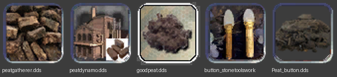
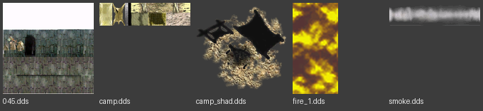
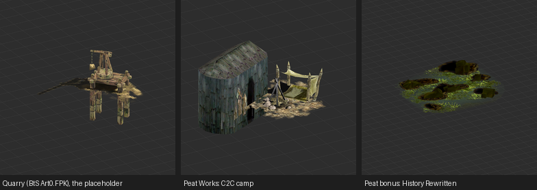

The same miss led to [`plot_asset_buttons.py`](/.github/workflows/README.md#buildxmlplot_asset_buttonspy), which fails when a feature, bonus, improvement, route or build borrows another one's button.

## Game font glyphs

### What the game font holds

[`GameFont.tga`](/Assets/Res/Fonts/GameFont.tga) and [`GameFont_75.tga`](/Assets/Res/Fonts/GameFont_75.tga) hold the small icons the game shows inside text: yields, commerce, religions, corporations, bonuses and other symbols. `GameFont_75.tga` is a smaller copy of the same layout, so both must change together.

A bonus's icon is the glyph at its `<FontButtonIndex>` in [`CIV4ArtDefines_Bonus.xml`](/Assets/XML/Art/CIV4ArtDefines_Bonus.xml), counted across the bonus rows, not its place in [`CIV4BonusInfos.xml`](/Assets/XML/Terrain/CIV4BonusInfos.xml). Moving a bonus glyph therefore means changing its `FontButtonIndex` in the same change, or two bonuses show each other's icons.

SAS still keeps all three in one order, which [`bonus_font_order.py`](/.github/workflows/README.md#buildxmlbonus_font_orderpy) checks.

Religions and corporations are different: the DLL gives them their icons in XML order, which is why [`xml_display_order.py`](/.github/workflows/README.md#buildxmlxml_display_orderpy) checks their order.

### Editing with Game Font Editor

The user edits the fonts with [Game Font Editor (v0.6) for Civ4](https://forums.civfanatics.com/resources/game-font-editor-v0-6-for-civ-4.17276/) by Asaf, listed in [README_References.md](/_1_AdvCiv-SAS/Docs/README_References.md). It shows the glyph grid, imports and exports single glyphs as images, and computes their alpha.

Its screenshots of both fonts are kept beside them, as `advciv-sas_gamefont_tga.PNG` and `advciv-sas_gamefont_75_tga.PNG`, with other mods' fonts as PNG previews in `Assets/Res/Fonts/other_mods/`.

### Editing as an agent

A screenshot of the whole font is too small to tell one glyph from another, and moving a glyph needs the grid. [`gamefont_tga.py`](/LLM_Helpers/README.md#gamefont_tgapy) does both with only Python's standard library: it reads the TGA pixels itself, writes a chosen region enlarged as a PNG, and copies glyph cells between slots.

It was written on 2026-11-07, before Pillow was installed, and confirmed Peat's glyph in the user's edit; on 2026-11-08 it moved three glyphs in both fonts.

Game Font Editor writes uncompressed 32-bit TGA (image type 2, no ID field or color map), with rows stored bottom-up and pixels as blue, green, red, alpha. The helper refuses any other kind, rather than guess. Magenta (255, 0, 255) draws the grid between glyphs and fills unused space.

### Glyph grid

Glyphs sit in rows of 25 cells between magenta grid lines. A bonus's `FontButtonIndex` counts from the first cell of the first bonus row: slot 32 is the 8th cell of the second bonus row.

As of 2026-11-08 the two SAS fonts measure as follows, with rows given as the grid line above each row, counted from the top:

| Font | Size | Bonus row tops | Row height | Column pitch |
| --- | --- | --- | --- | --- |
| `GameFont.tga` | 640 x 320 | 176, 197 | 21 | 22 |
| `GameFont_75.tga` | 512 x 256 | 140, 157 | 17 | 17 |

These can change when glyph rows are added, so measure them again with `grid` rather than trusting the table:

- `grid` without `--band` lists the horizontal lines; the gaps between them give the row tops and height.
- `grid --band` lists the complete vertical lines between two horizontal ones. Glyphs can cover parts of a line, so only empty cells show complete lines; the column pitch is the gap between them.
  - The first measurement, which expected every cell to show its lines, found only the empty ones, which is how this was noticed.
- Row height and column pitch are separate: they differ in `GameFont.tga` but are both 17 in `GameFont_75.tga`.
  - The first draft derived the pitch as row height + 1, which fit the full-size font but picked the wrong cells in the 75% one. Its enlarged preview showed this before any font was replaced, so always preview a `move` result first.

### Font commands

Run from the mod root:

```bash
python LLM_Helpers/gamefont_tga.py grid Assets/Res/Fonts/GameFont.tga
```

```bash
python LLM_Helpers/gamefont_tga.py grid Assets/Res/Fonts/GameFont.tga --band 197 218
```

```bash
python LLM_Helpers/gamefont_tga.py preview Assets/Res/Fonts/GameFont.tga bonus_rows.png --box 0 175 560 222 --zoom 3
```

`move` copies cells, reading every source before writing, so swaps work. `--set 33=32` puts slot 32's glyph into slot 33, and `--set 34=OTHER.tga:34` takes a glyph from another font of the same size. Write to a new file with `--out`, preview it, and only then replace the font.

### Example: Camel, Peat and Hit Movies in BonusInfo order

BtS ended its bonus list with three Hit bonuses. SAS replaced two of them with Camel and Peat, and one remains disabled, following the BonusInfo file's warning against removing bonuses. On 2026-11-08 the XML was put in that order: Camel, Peat, then Hit Movies.

The glyphs were still in the old order, Peat 32, Hit Singles 33 and Camel 34, so the fonts were changed to match, with the original Hit Movies glyph taken from base AdvCiv's font:

```bash
python LLM_Helpers/gamefont_tga.py move Assets/Res/Fonts/GameFont.tga --row-tops 176 197 --row-height 21 --col-pitch 22 --set 32=34 --set 33=32 --set "34=../AdvCiv/Assets/res/Fonts/GameFont.tga:34" --out GameFont_new.tga
```

```bash
python LLM_Helpers/gamefont_tga.py move Assets/Res/Fonts/GameFont_75.tga --row-tops 140 157 --row-height 17 --col-pitch 17 --set 32=34 --set 33=32 --set "34=../AdvCiv/Assets/res/Fonts/GameFont_75.tga:34" --out GameFont_75_new.tga
```

- After checking enlarged previews of both results, they replaced the fonts, and `FontButtonIndex` became 32 for Camel, 33 for Peat and 34 for Hit Movies.
- The user confirmed the result in Game Font Editor and refreshed its screenshots.
- Rerunning these commands on the user's previous fonts reproduces the installed files byte for byte.

Enlarged previews of the bonus rows, made with `preview` by Claude Code Opus 5.5: the full-size font before and after, then the 75% font after.


## Cautions

- Change both fonts, and the matching `FontButtonIndex` values, in one change.
- Keep a copy of a file before replacing it; a staged copy in Git's index also works.
- Check results in an enlarged preview, and in the game, which loads art and fonts at startup.
- A `.nif` render shows the model's stored pose only; judge a model in the game before keeping it.
