# Civ4 multiple instances and local LAN multiplayer test

This walkthrough reproduces a local test with two windowed AdvCiv-SAS clients on the same Windows computer. A LAN match gives the clients a shared game in which to check chat delivery and turn advancement, then compare their SASGameRecord logs.

The screenshots follow a Steam test from 2026-11-10. We named the two clients `First` and `Second` so we could tell them apart. You can choose any two distinct aliases. Click any thumbnail to open the full-size screenshot.

## Menu

- [Launch both clients](#launch-both-clients)
- [Identify and arrange the two windows](#identify-and-arrange-the-two-windows)
- [Host and join a LAN match](#host-and-join-a-lan-match)
- [Test multiplayer chat](#test-multiplayer-chat)
- [Check gameplay and turn advancement](#check-gameplay-and-turn-advancement)
- [Check the player records](#check-the-player-records)
- [Screenshot and exit observations](#screenshot-and-exit-observations)
- [Parallel autoplay](#parallel-autoplay)

## Launch both clients

Give each client its own settings file so you can give it a distinct player name. Both clients can load the same copy of the mod.

1. Close Civ4, then make two copies of `CivilizationIV.ini` beside `Civ4BeyondSword.exe`. Give them different filenames so you can pass one to each launch command. We used `SASChatTest-First.ini` and `SASChatTest-Second.ini`.
2. In both copies, set `Mod = Mods\AdvCiv-SAS` to load the mod and `FullScreen = 0` to run in a window. Give each client a distinct `Alias` so you can tell them apart in-game. We used `Alias = First` and `Alias = Second`. If you also want to compare the game records, enable `SAS_SGR_LOG` before launching.

Here is a full-path example from our Steam installation. Both INI copies go beside `Civ4BeyondSword.exe` in the inner `Beyond the Sword` folder. If Steam is installed elsewhere, find the folder that contains your executable and place both copies there.

```text
C:\Program Files (x86)\Steam\steamapps\common\Sid Meier's Civilization IV Beyond the Sword\Beyond the Sword\SASChatTest-First.ini
C:\Program Files (x86)\Steam\steamapps\common\Sid Meier's Civilization IV Beyond the Sword\Beyond the Sword\SASChatTest-Second.ini
```

Once both INI files are in place, paste this block into PowerShell. Each command starts Civ4 with one of the INI copies, and `multiple` lets both clients run at the same time. If your installation is elsewhere, change `$civ4Dir` to the folder containing `Civ4BeyondSword.exe`. If you chose different INI filenames, change the name after `ini=` on each launch line.

```powershell
$civ4Dir = "C:\Program Files (x86)\Steam\steamapps\common\Sid Meier's Civilization IV Beyond the Sword\Beyond the Sword"
$civ4Exe = Join-Path $civ4Dir 'Civ4BeyondSword.exe'
Start-Process -PassThru -FilePath $civ4Exe -WorkingDirectory $civ4Dir -ArgumentList 'ini=SASChatTest-First.ini', 'multiple'
Start-Process -PassThru -FilePath $civ4Exe -WorkingDirectory $civ4Dir -ArgumentList 'ini=SASChatTest-Second.ini', 'multiple'
```

The setup comes from the inherited AdvCiv manual’s multiplayer logging procedure, under `PER_PLAYER_MESSAGE_CONTROL_LOG`. It describes putting an INI copy beside the executable, setting `Mod` and `FullScreen`, and launching with `ini=... multiple` through a Windows shortcut.

This walkthrough uses PowerShell and the LAN lobby for the Steam setup tested here. [AdvCiv manual, multiplayer logging procedure](/_0_Legacy/Docs/AdvCiv/manual.txt#L2807)

## Identify and arrange the two windows

The two main menus look alike. Before opening multiplayer, check which alias belongs to each window so you can tell which client you’re controlling.

1. **Identify each window.** Either method works.

   - **In Civ4:** Open **Single Player → Custom Game** in each window and read the alias in the first player slot. Click **Go Back** once you know which window is which. The screenshot below shows this method.
   - **In Task Manager:** The `-PassThru` launch commands above print each process ID (PID) in order. In Task Manager’s **Processes** tab, expand the Civ4 group if needed, right-click a window entry, and choose **Go to details** to see its PID. Match it to the `First` or `Second` launch command.

   <a href="/_1_AdvCiv-SAS/Images/multiple_instances/1.297_m_00a_custom_single_first_second.JPG">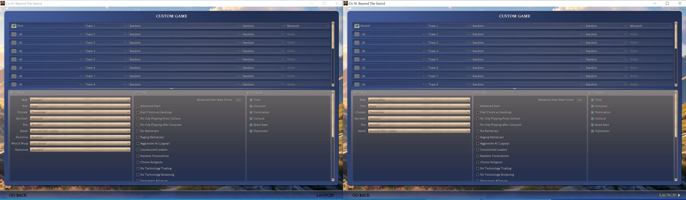</a>

2. **Put the windows side by side if you have room.** With both visible, you can see how a change in one window affects the other.

   <a href="/_1_AdvCiv-SAS/Images/multiple_instances/1.297_m_00b_left_right_windows.JPG">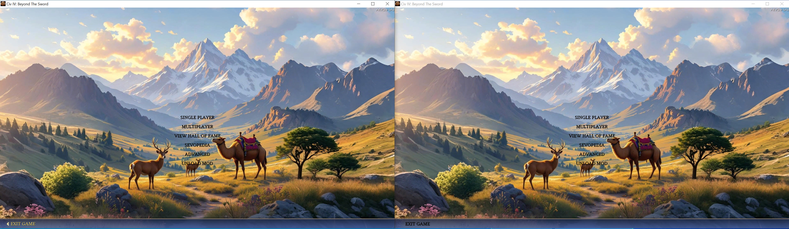</a>

## Host and join a LAN match

For this local test, create a LAN game in one window and join it from the other so both clients can observe the same match. We put **First** on the left and **Second** on the right so their names read in order. Either client can host. We chose **First** so the setup follows that same left-to-right order.

1. **Open the LAN lobby in First.** From the main menu, click **Multiplayer**, then **LAN Games**.

   <a href="/_1_AdvCiv-SAS/Images/multiple_instances/1.297_m_01_left_multiplayer.JPG">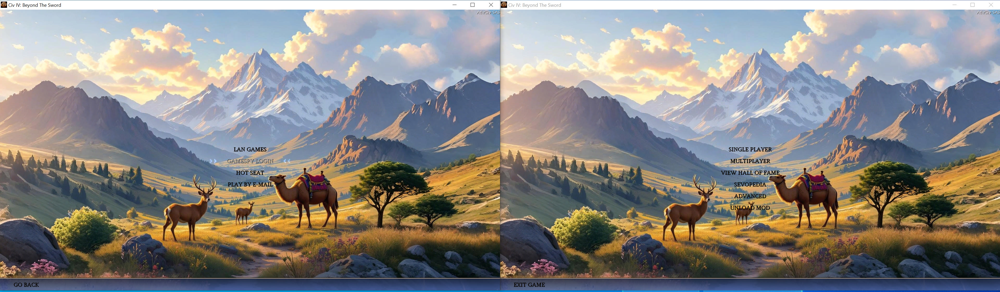</a>

2. **Click New Game** in the LAN lobby. This opens the **Staging Room**, where the host can set up the match.

   <a href="/_1_AdvCiv-SAS/Images/multiple_instances/1.297_m_02_left_lan_lobby.JPG">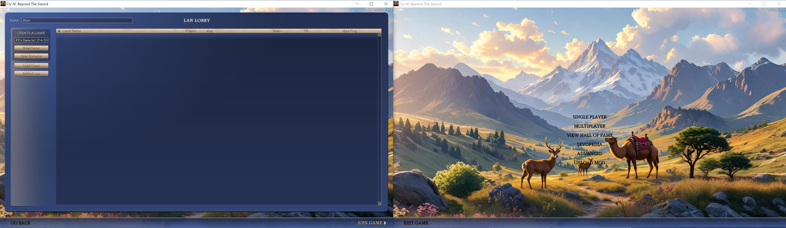</a>

3. **Keep the Staging Room open.** First’s game is now available for another client to join.

   <a href="/_1_AdvCiv-SAS/Images/multiple_instances/1.297_m_03_left_new_game.JPG">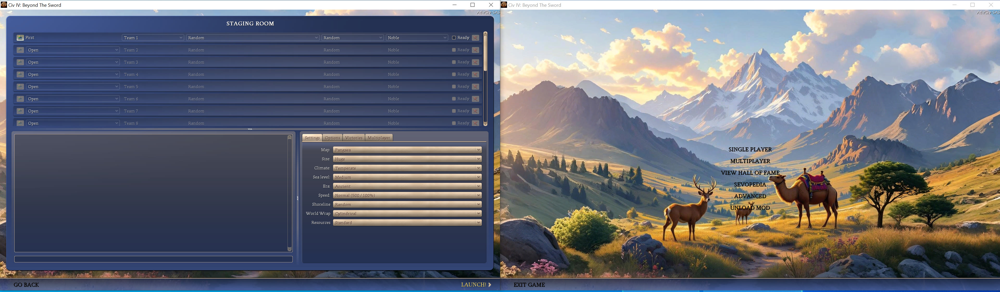</a>

4. **Switch to the right window.** In **Second**, click **Multiplayer**, then **LAN Games**. This time you’re looking for the game you just opened.

   <a href="/_1_AdvCiv-SAS/Images/multiple_instances/1.297_m_04_right_multiplayer.JPG">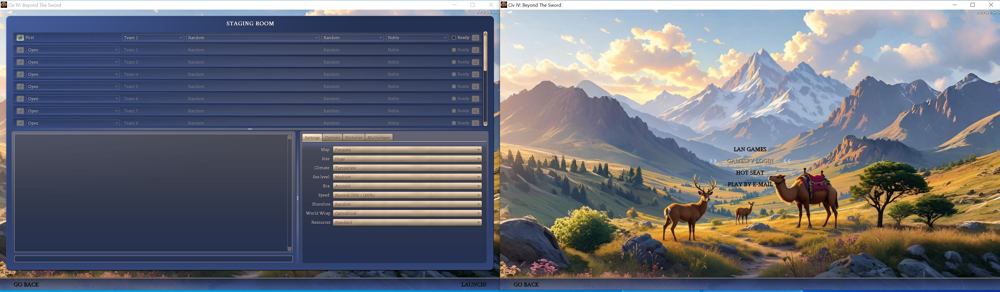</a>

5. **Find First’s game in the list.** Seeing it here confirms that Second can discover the host.

   <a href="/_1_AdvCiv-SAS/Images/multiple_instances/1.297_m_05_right_lan_lobby.JPG">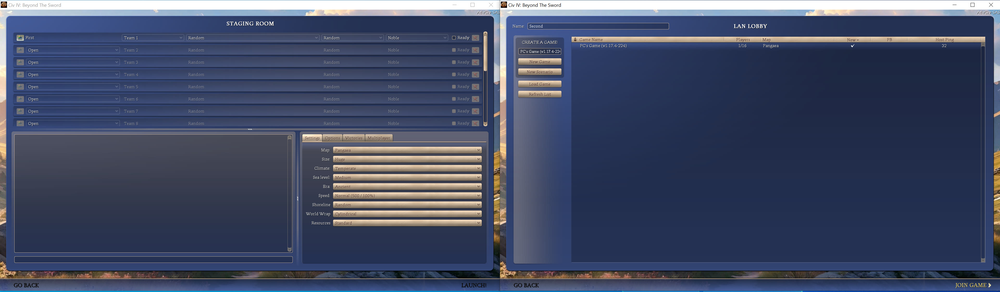</a>

6. **Change the map if you want.** The host controls the map settings, so switch back to **First** and choose a map in the Staging Room.

   <a href="/_1_AdvCiv-SAS/Images/multiple_instances/1.297_m_06_left_map_change.JPG">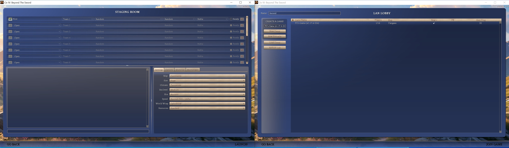</a>

7. **Refresh the list on Second.** If the lobby still shows the old map, click **Refresh List** to see the host’s current settings.

   <a href="/_1_AdvCiv-SAS/Images/multiple_instances/1.297_m_07_right_refresh.JPG">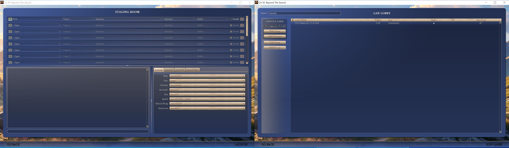</a>

8. **Join First’s game.** On **Second**, select the game in the list and click **Join Game**. Both windows should now show the same Staging Room.

   <a href="/_1_AdvCiv-SAS/Images/multiple_instances/1.297_m_08_right_join.JPG">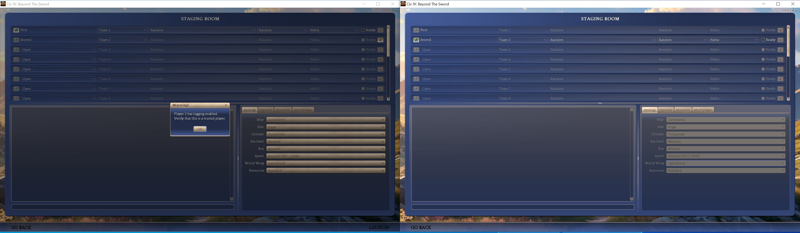</a>

9. **Get both players ready.** If you want to test team chat, set both players to the same team and leave **Shuffle Teams** off. Then check **Ready** in each window and click **Launch** on **First**.

   <a href="/_1_AdvCiv-SAS/Images/multiple_instances/1.297_m_09_right_ready_left_ready_multiplayer_tab.JPG">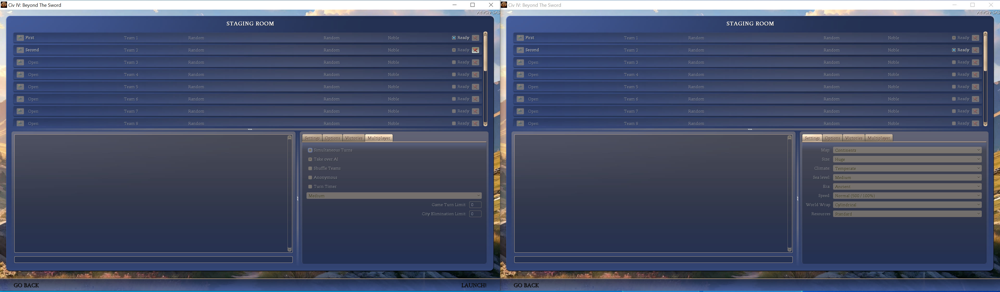</a>

10. **Enter the game.** When the Dawn of Man screen appears in both windows, click **Continue** in each one to reach the map.

   <a href="/_1_AdvCiv-SAS/Images/multiple_instances/1.297_m_10_both_dawn_of_man.JPG">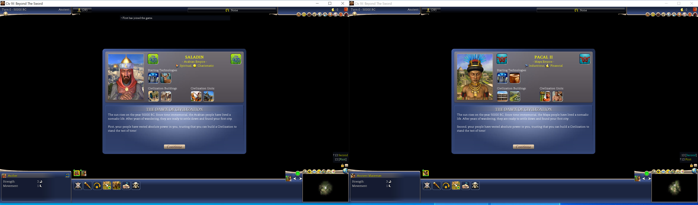</a>

**Note.** In our first run, the right window showed a **Save Error** at Dawn of Man saying it could not create the initial autosave. We dismissed the dialog and continued.

Later that day, we exited both clients to Windows, relaunched them, and repeated the setup. This time the error did not appear. The screenshot above is from that rerun. The error appeared again in a later test, so we recorded it separately with the observed conditions. [KI#996.2](/_1_AdvCiv-SAS/Docs/README_Known_Issues.md#ki-996.2)

## Test multiplayer chat

Once both clients are on the map, send a message from each one. Looking at the other window after you send it shows whether the message reached its recipient.

1. **Send a broadcast from First.** Open the Chat Log, choose **Say to All**, and send a short test message.

   <a href="/_1_AdvCiv-SAS/Images/multiple_instances/1.297_m_11_left_all_chat.JPG">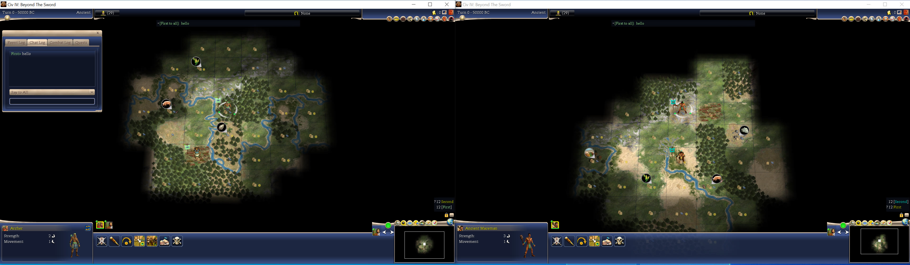</a>

2. **Reply from Second.** Open its Chat Log and check that First’s message arrived. Send a reply with **Say to All**, then check for it in First’s window.

   <a href="/_1_AdvCiv-SAS/Images/multiple_instances/1.297_m_12_right_all_chat_reply.JPG">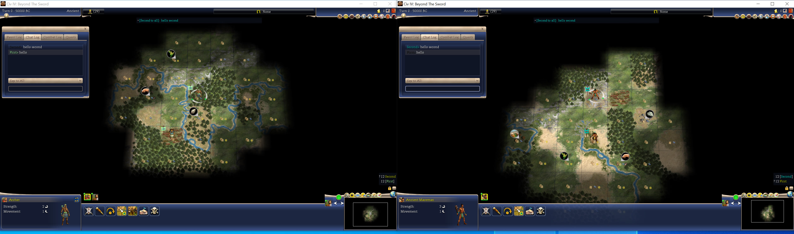</a>

3. **Try a direct message.** In each client’s recipient list, choose **Say to** followed by the other player’s name. Send a message from each window and check that the other player receives it.

   <a href="/_1_AdvCiv-SAS/Images/multiple_instances/1.297_m_13_both_chat_private.JPG"></a>

**Note.** Team chat is not shown here, but it was tested in a separate run with both players on one team, and worked in both directions.

We forgot to repeat it in the run shown here, where First and Second were on separate teams. It did not seem essential to this walkthrough: that test was for the SASGameRecord chat logging defines, and the rest of the walkthrough is otherwise complete without it.

## Check gameplay and turn advancement

Founding a city in each window gives both players a manual action you can look up in the records. Ending both turns then checks that the two windows advance together.

1. **Found a city as First.** Select the Settler and use **Found City**. First founded Mecca on turn 0 in the screenshot.

   <a href="/_1_AdvCiv-SAS/Images/multiple_instances/1.297_m_14_left_t0_finished.JPG">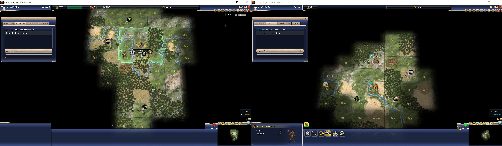</a>

2. **Switch to Second and found a city there too.** Second founded Mutal on turn 0.

   <a href="/_1_AdvCiv-SAS/Images/multiple_instances/1.297_m_15_right_t0_finished.JPG"></a>

3. **End the turn in one window.** We ended Second’s turn first. First could still play on turn 0.

   <a href="/_1_AdvCiv-SAS/Images/multiple_instances/1.297_m_16_right_t0_ended.JPG">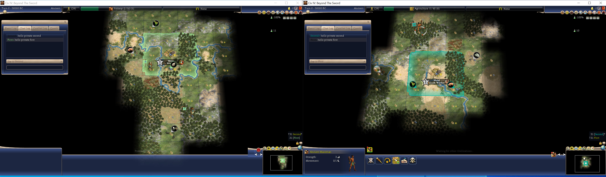</a>

4. **End the turn in the other window.** Once First also submitted, both windows advanced to turn 1. In the screenshot, First has already ended turn 1 and is waiting for Second.

   <a href="/_1_AdvCiv-SAS/Images/multiple_instances/1.297_m_17_t1_left_ended_right_still_playing.JPG">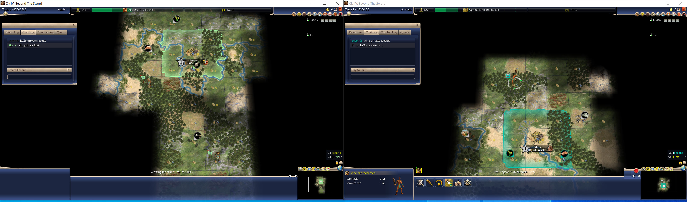</a>

## Check the player records

If you enabled SASGameRecord before launching, open the Civ4 profile’s `Logs` folder. The number before the timestamp identifies which player’s client wrote the file. The filenames and observations below come from the SGR198 test shown here. Use them as examples when checking your own run, since the filenames and recorded events can vary by session and SGR revision.

- `SASGameRecord0_20261110T141833Z_new1.log` for First (player 0 and LAN host)
- `SASGameRecord1_20261110T141833Z_new1.log` for Second (player 1 and LAN guest)

Both records show Mecca and Mutal being founded, the Worker and Quick Worker production choices, and Pottery and Agriculture being selected. Both contain the synchronized commands and `GAME_RECORD_TURN_COMPLETED` rows for turns 0 and 1. Each client's accepted `FORCE_END_TURN` request is recorded in its own file.

Both logs contain the all-chat and direct messages from the two players. The earlier same-team run also recorded team messages in both files and verified embedded-quote escaping. Testing whether direct messages are excluded from unrelated clients requires a third client.

## Screenshot and exit observations

In a later two-client test, every native screenshot captured while both clients were open showed **Second**’s view, even after we made Second the LAN host. Both Runtime screenshot observers reported the same files because they were watching the same `ScreenShots` folder. The observer entries identify the process being monitored, while the screenshot’s writer is reported as `NOT_OBSERVED`.

After **Second** exited to Windows, **First** stayed open and showed a dialog waiting for Second to reconnect. Print Screen then produced `Civ4ScreenShot3254.JPG` and `Civ4ScreenShot3255.JPG`, both showing First’s view. First’s observer recorded both files.

At that point `SASRuntimeStatus.json` still showed Second’s clean exit, so First’s screenshot rows reported `STATUS_IDENTITY_MISMATCH` for the shared status context. We did not establish why First’s view was absent from the earlier screenshots. [KI#7.2](/_1_AdvCiv-SAS/Docs/README_Known_Issues.md#ki-7.2)

## Parallel autoplay

Two Civ4 clients can also each run their own single-player autoplay at once. [`run_autoplay.py`](/LLM_Helpers/README.md#run_autoplaypy) does this with `--multiple`, launching each client with `multiple` and its own settings file; see [README_Game_Runs.md](/_1_AdvCiv-SAS/Docs/Modding_Resources/README_Game_Runs.md#two-clients-at-once). Tested on 2026-11-10 from the same Huge T0 save:

- Both clients completed 40 turns, and in later runs 100 turns, then exited with code 0.
- Each Runtime history file is named by its process start time and ID, so each runner read its own completion. Since Runtime18 each process also has its own `SASRuntimeStatus_<processStartUtc>_<pid>.json`, and `SASRuntimeStatus.json` shows the latest writer.
- Since SGR199 timestamped SGR, BBAI and assertion file names carry the client's process ID, replacing the seat number in network games, and each SGR and BBAI session header names its `processId` and `processStartUtc`, and each run also writes a `RunId` into its settings file; either identifies the run's own SGR file.
- Two clients without Debug Mode, and two clients with it, produced identical RNG and state checkpoints over 100 turns. A client with Debug Mode diverged from one without it at T84.
- Both clients write autosaves to the same `Saves/single/auto` folder, where same-turn names can overwrite each other. The autoplay stop saves did not collide: the second was saved with a `_2` suffix.
